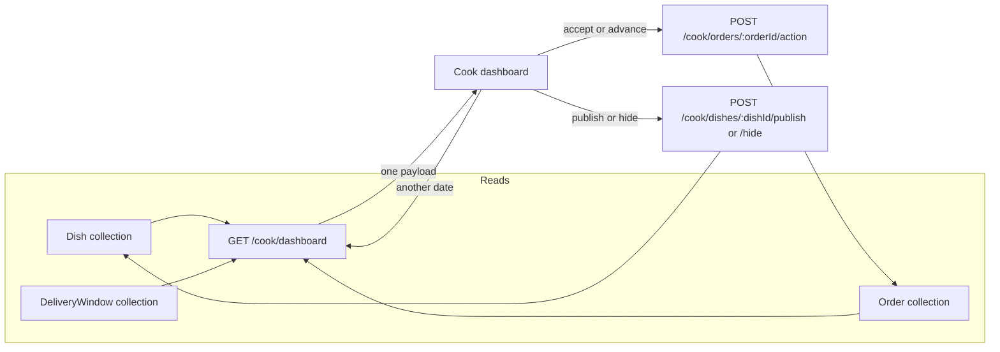

# The kitchen dashboard

It is 10:40 on a Tuesday. Umm Yousef has the oven on, a pot of rice resting, and her phone propped against a jar. She opens Sufra to answer three questions in this order: what is on my menu and is anything wrong with it, what am I cooking today and how much room is left, and is anyone waiting for an answer from me. If the screen answers them in a different order, or hides one behind a tab, she will scroll, tap, scroll again, and burn the ten minutes she has before the fryer needs her.

The dashboard is not a reporting page. It is the surface where a cook decides what to do in the next hour, on a small screen, with one hand free at best. This lesson builds one endpoint and one screen around those three questions, and it is deliberate about what each section may claim. A dashboard that shows a number it cannot justify is worse than one that says the number is not ready yet.

## One request, three sections

Load the screen with one request. `GET /api/v1/cook/dashboard?date=2026-11-03` resolves the kitchen from the session, reads the dishes, the day's windows and the orders that belong to that kitchen, and returns them together.

```txt
GET /api/v1/cook/dashboard?date=2026-11-03

200 {
  "kitchenId": "65f1c0a2a91b4c0012f0e111",
  "timeZone": "Asia/Gaza",
  "date": "2026-11-03",
  "serverNow": "2026-11-03T08:40:12.000Z",
  "dishes": { "active": [ { "dishId": "65f1c0a2a91b4c0012f0e331", "name": "Maqluba, chicken",
                            "prepMinutes": 90, "loadUnits": 3, "priceMinor": 1800,
                            "allergenCount": 2, "weekdays": "Sun to Thu",
                            "earlyCutoffLabel": "order by 11:10", "blockers": [] } ],
              "draft": [ { "dishId": "65f1c0a2a91b4c0012f0e332", "name": "Knafeh",
                           "blockers": ["NO_WEEKDAYS_TODAY"] } ],
              "paused": [] },
  "windowsToday": { "state": "not_generated", "windows": [] },
  "orders": { "state": "available", "byWindow": [] }
}
```

One request for the first paint is a data decision, and it is worth stating the trade. Three endpoints would let the dishes section refresh without re-reading the orders, and each could cache on its own. On a metered connection in Gaza, three round trips cost three times the latency and roughly three times the header bytes before a single useful row arrives. The dashboard is read as a whole and rarely needs one section refreshed alone, so one request is the better default here. Actions that change state keep their own routes, because those need their own preconditions.

The diagram shows the split that the one request does not remove. The screen reads three collections through one route, and each button on it writes through a different route with its own rules. Reading is combined, writing is separate, and the two directions never share a handler.



Notice that no arrow goes from the screen back into the window collection. A cook changes capacity in the schedule editor, not on the dashboard, because a capacity edit is a template decision with its own validation and its own report of affected dishes.

The `date` parameter is a convenience for looking at tomorrow. It is not an authority about the zone. The server converts the requested date into a start and end instant using `kitchen.timeZone` and returns the `date` it actually used, so a cook whose phone is set to Istanbul still sees the day her kitchen is living in.

## Dishes by status, with the reason

The first section lists dishes in three groups: active, draft and paused. Each row shows the four numbers a cook thinks in, the preparation minutes, the load units, the price and the weekday pattern. The fifth field is the one that earns the section: `blockers`, an array of machine codes that explain why a dish cannot be sold right now, computed on the server.

```js
/**
 * @typedef {Object} DishRow
 * @property {string} dishId
 * @property {string} name
 * @property {number} prepMinutes
 * @property {number} loadUnits
 * @property {number} priceMinor
 * @property {number} allergenCount
 * @property {string} weekdays          short label already formatted for the cook
 * @property {string|null} earlyCutoffLabel  "order by 11:10" when preparation is long
 * @property {('CANNOT_FIT'|'NO_WEEKDAYS_TODAY')[]} blockers
 */
```

`CANNOT_FIT` appears when the dish load exceeds the largest window, which the publish route already refuses. It still appears on the dashboard because a schedule edit can strand an already active dish, as lesson 11.3 showed. `NO_WEEKDAYS_TODAY` means the dish is active but its weekday pattern does not include the day being viewed, which is useful information and not an error. `earlyCutoffLabel` carries the warning that lesson 11.3 attaches to a slow dish, already formatted in the kitchen's zone, so the cook reads "order by 11:10" beside maqluba instead of discovering it when a diner cannot order.

The screen renders blockers as a sentence, not as a code: "This dish needs 12 units but your largest window holds 10." The server supplies the numbers in the row and the client supplies the sentence, so a language change does not require an API change. A dish with an empty blockers array shows nothing extra, because a healthy row should be quiet.

```jsx
// client/src/features/dashboard/DishSection.jsx (excerpt, the other two sections omitted)
const BLOCKER_COPY = {
  CANNOT_FIT: 'This dish needs more units than your largest window holds.',
  NO_WEEKDAYS_TODAY: 'Not cooked on this day.',
};

function DishRow({ dish }) {
  return (
    <li className="min-h-11 py-2">
      <span className="block">{dish.name}</span>
      <span className="block text-sm">{dish.prepMinutes} min / {dish.loadUnits} units</span>
      {dish.earlyCutoffLabel ? <span className="block text-sm">{dish.earlyCutoffLabel}</span> : null}
      {dish.blockers.map((code) => <p key={code} className="text-sm">{BLOCKER_COPY[code]}</p>)}
    </li>
  );
}
```

Three details in that excerpt carry the lesson. The row has a minimum height rather than a fixed one, so a long dish name wraps instead of clipping. The blocker copy is keyed by code, so an unknown code from a newer server renders nothing rather than a raw identifier. And the early cutoff label is a separate line, not a blocker, because a slow dish is still on the menu.

## Today's windows, and what empty means

The second section shows the day's delivery windows with `localLabel`, `cutoffAt`, `capacityUnits`, `remainingUnits` and how many orders are already in the window. This is the section most likely to lie, and it lies in two ways.

The first lie is treating a missing window as a full one. If the window generator has not created today's windows yet, the array is empty, and a client that maps zero windows to a "nothing available" message tells the cook her schedule is broken when it is simply not expanded yet. The response separates those cases with `windowsToday.state`. `not_generated` means the weekly template exists and no dated windows have been produced for this date. `generated` means the windows are real and the numbers below them are real.

The second lie is treating `remainingUnits` as a live counter before any claims exist. In the current build a window's remaining units equal its capacity until checkout starts claiming. The screen says "10 of 10 units, no claims recorded yet" rather than "10 units left", because the second phrasing implies someone has been counting. When the checkout module starts creating claims, the same field becomes the real number and the copy changes with a flag the server sends, not with a client guess.

```js
/**
 * @typedef {Object} WindowRow
 * @property {string} windowId
 * @property {string} localLabel       "Today, 13:00 to 14:00" in kitchen.timeZone
 * @property {string} startAt
 * @property {string} cutoffAt
 * @property {number} capacityUnits
 * @property {number} remainingUnits
 * @property {number} claimedUnits
 * @property {number} orderCount
 */
```

If your project has not built the window generator yet, the section renders the saved weekly template as a plan, labelled as a plan. Do not seed fake windows to make the dashboard look finished. A screenshot full of invented numbers is the kind of evidence that survives a demo and fails the first real Tuesday.

## Orders, and who decides the buttons

The third section lists orders grouped by delivery window, because a cook fills trays per window rather than per arrival time. Each order row carries its status, its lines, its deadline label and an `allowedActions` array.

The client does not decide those actions. The server computes them from the same transition table the order routes enforce, with the current instant and the stored deadline applied. A placed order before `acceptBy` allows accept and reject. An accepted order allows start cooking. A cooking order allows mark ready. A ready order allows out for delivery. A delivered or rejected order allows nothing.

| Status | Allowed actions | Why |
|---|---|---|
| `placed` | accept, reject | Cook has not answered yet |
| `placed` past `acceptBy` | none | Deadline worker owns the decision |
| `accepted` | start cooking | Cook committed, preparation begins |
| `cooking` | mark ready | Food is on the heat |
| `ready` | out for delivery | Handoff to the diner or a courier |
| `delivered`, `rejected`, `cancelled` | none | Terminal for this screen |

The rule that makes this safe is that the table lives in one place. If the dashboard builds its own list of buttons, the two lists drift, and the drift appears as a button that returns a conflict when the cook taps it in a hurry. Import the server function, do not re-implement it.

```js
// server/src/modules/orders/board.js (excerpt, shared with the order module)
export function boardActions({ status, acceptBy }, { now, actorType }) {
  const actions = ACTIONS_BY_STATUS[status] ?? [];
  if (actorType !== 'cook') return [];
  if (status === 'placed' && acceptBy !== null && Date.parse(acceptBy) <= now.getTime()) {
    return actions.filter((a) => a !== 'accept');
  }
  return actions;
}
```

The second condition is the one people forget. The table says accept is legal from `placed`; the deadline says it stopped being legal at 11:00. A dashboard that renders the button anyway has told the cook something false about the next ten seconds.

## Keep one broken section off the others

Each section is a separate part of the response and a separate piece of UI state. If the orders read times out, the dishes and windows still render, and the orders section shows one line: "Orders could not load. Pull to refresh." This is not defensive padding; it is the difference between a cook who can adjust Monday's capacity during a bad connection and a cook who sees a white screen.

```js
// client/test/dashboard/sections.spec.js (failing first)
it('keeps dishes visible when the orders section fails', async () => {
  server.use(dashboardHandler({ failOrders: true }));
  render(<Dashboard />);
  expect(await screen.findByText('Maqluba, chicken')).toBeInTheDocument();
  expect(screen.getByText(/orders could not load/i)).toBeInTheDocument();   // blank page today
});
```

Run it against the version that awaits one `Promise.all` and renders only on success, and watch it render an empty document. Then give each section its own status. The response arrives as one body, so the failure to model is not a partial response but a thrown parse or a single field that is unusable; keep the section boundaries anyway, because the next version of this screen will fetch the orders separately.

## Make the phone version the real version

Design the screen at 360 pixels first. Three stacked sections, each with a sticky header that names it and, for the windows section, the kitchen-local date. Rows are at least 44 pixels tall, text is at least 17 pixels, and there are no dish photographs, because a photo costs data and answers none of the three questions.

Refresh on focus, on a manual pull, and when the app returns from the background. A cook's phone spends most of the day in a pocket, and a dashboard loaded forty minutes ago is a liability. Compute any countdown from `serverNow` and the device offset, never from the phone's clock alone.

## Verify what the screen claims

Seed a kitchen in `Asia/Gaza` with one active dish, one draft dish whose weekday pattern skips today and one paused dish, plus a schedule whose largest window is 10 units. Read the dashboard at 360 pixels and check four things: the active dish shows 90 minutes, 3 units and the "order by 11:10" label, the draft dish appears under draft with its weekday blocker, the windows section says the day is not generated rather than empty, and the orders section renders its own failure message when the orders read is broken.

Then write one dated window for today into the database as a temporary test fixture, set its remaining units to 4, and reload. The section must switch to `generated` and show "4 of 10 units, 6 claimed" without any client change. That is the test that proves the screen reads the contract instead of a mock. Delete the fixture afterwards and say in the evidence note that it was a test row, not seed data, so nobody mistakes a hand written window for a working generator.

Save the two payloads and the two screenshots in `docs/EVIDENCE.md`. The gate next lesson asks a second cook to request the same screen with her own token and to prove she cannot see any of these identifiers.
