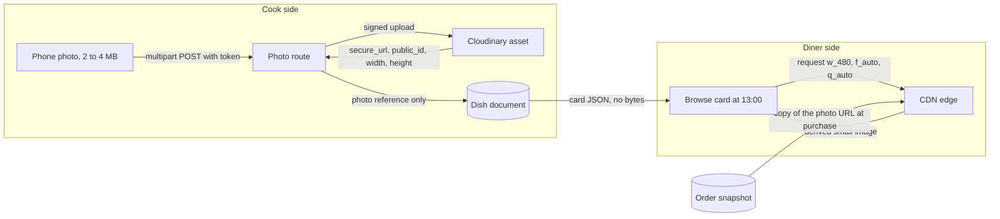

# A diner cannot smell the maqluba

It is 10:40 on a Tuesday. A diner opens Sufra on her phone, taps the 13:00 window, and stops on a card from Umm Yousef's Kitchen. She cannot smell the maqluba. She cannot lift the lid, hear the fryer, or ask whether the rice cooked in the same pot as the chicken. Everything she knows about that tray arrives through one small photograph, and that photograph does more selling than the price, the preparation time and the cutoff label put together.

Module 12 left the cook screen honest about time and silent about faces. A dish has ninety preparation minutes, three load units and an order-by label at 11:10, and none of those numbers convince a hungry person to buy. This module gives every dish up to four photographs of the food the cook actually makes, stored so that a diner on a metered connection can see them without paying for bytes she does not need.

## A borrowed photo is a promise the kitchen cannot keep

The cheap way out is to borrow an image. A search for maqluba returns a hundred glossy trays with almonds arranged in a perfect ring, and a tired cook could attach one in ten seconds and be finished. It looks better than her own photo. It is also a statement about food she has never cooked, and the diner who orders it receives a plain pot of rice at the door.

That is not a styling problem. It is a false statement inside the catalogue, and in a neighbourhood where diners talk to each other it ends with fewer orders and a complaint the cook cannot answer. The rule for this module is narrow and not negotiable: a dish photo shows the dish that cook makes, in her kitchen, from her ingredients. The photo does not have to be beautiful. A phone shot of a real tray under a kitchen light, lid off and steam still rising, sells more than a studio photograph of somebody else's lunch.

Sufra will not detect a borrowed photo with software, and this module does not pretend otherwise. Stating the rule and letting the cook stand behind her own listing is the same posture the hygiene declaration took in module 10. What the API can enforce, it will enforce: a photo belongs to a dish, the dish belongs to a kitchen, and only that kitchen's cook may change it.

## Four photographs, one question each

A diner looking at a dish card is asking four questions, and each one wants a different frame. The first is what is it, which needs the whole tray from above so the shape of the dish is recognisable. The second is how much, which needs the tray beside a hand or a plate, because "serves four" means nothing until there is a size in the picture. The third is what is inside, which needs the cut, so a diner sees rice, chicken and nuts layered rather than a lid of rice. The fourth is how it arrives, which needs the container and its cover, so nobody is surprised at the handoff.

Four is a cap, not a target. A cook with two honest photos uploads two, and the dashboard tells her that the first photo is the one diners see first. The cap exists for three reasons that all point the same way. Every photo is bytes that a diner pays for on a metered connection. A card holding twelve near-identical frames is slower and no more convincing. And a storage budget per kitchen stays predictable: forty dishes at four photos is a hundred and sixty assets, not two thousand.

The first photo carries the card, so it deserves its own decision rather than being whichever file arrived first. The data model keeps the order of the array, and the cook can promote any photo to the front. That small action is what makes a cap of four work in practice: the cook chooses the frame that answers the diner's first question, and the other three support it. A fifth photo would add a third or fourth version of the same answer, which is why the route refuses it instead of quietly dropping the oldest.

## Bytes go to object storage, the document keeps a reference

This is the decision the module exists to teach, and it is the decision every marketplace arrives at eventually. Photo bytes do not live in the MongoDB document. They go to Cloudinary, an object storage and delivery service, and the dish document keeps a URL and a public identifier that point at them.

The arithmetic explains why, and it is worth doing on paper once. A typical phone photo of a food tray is around 2.4 MB at the phone's default settings, so treat that as an illustrative figure and measure your own. Base64 encoding, which is what "just put the image in the document" means in practice, inflates the bytes by roughly a third, so one photo becomes a string of about 3.2 MB. A single MongoDB document can hold up to 16 MB, so one photo fits and four do not. Technical fit is not the real problem. The real problem is what a browse screen would cost: twelve cards carrying 3.2 MB each is close to 38 MB for one scroll, on the scroll where a diner decides whether Sufra is worth opening again.

There is a second cost that is easier to miss. Every query that returns a dish returns the fields stored on the dish. A dashboard listing names and prices, a cutoff label, an order snapshot, a search result: each one would carry the pixels unless every query projected them out, and the first query somebody forgets is the one that makes the phone warm in a pocket. With object storage the same field is around 120 characters per photo, and the JSON for a browse screen stays in kilobytes.

The diagram draws the two directions that matter. Bytes travel one way, from a phone through the route to Cloudinary. References travel the other way, into the dish document, and out to the pages that need them. Notice that the diner's browser never asks your API for a photo, and that an order snapshot keeps its own copy of the URL so a later photo change cannot rewrite a diner's receipt.



The takeaway is not "use Cloudinary". The takeaway is that a photograph has two lives: an asset with bytes that a CDN serves, and a reference in a document that a query returns. Confusing the two lives is what turns a catalogue into a slow database with pictures inside it. The dish record below shows the reference life on its own, with nothing that could grow.

```json
{
  "name": "Maqluba, chicken",
  "prepMinutes": 90,
  "loadUnits": 3,
  "photos": [
    {
      "photoId": "65f1c0a2a91b4c0012f0e401",
      "url": "https://res.cloudinary.com/sufra/image/upload/v1759/sufra/dishes/maqluba-tray.jpg",
      "publicId": "sufra/dishes/maqluba-tray",
      "width": 3024,
      "height": 4032,
      "bytes": 2411724,
      "uploadedAt": "2026-11-02T16:12:04.000Z"
    }
  ]
}
```

## One original, many delivered sizes

The next decision follows from the first. If the asset holds the original, at what size does the diner receive it? Not the original size. A browse card is about 360 CSS pixels wide on the phone most learners in this cohort carry, and a card does not need 3024 pixels of detail to look good.

Cloudinary lets the delivery URL itself carry the answer. A URL can ask for a format the browser prefers, a quality chosen for the content, and a fixed width, using `f_auto`, `q_auto` and `w_480` in the path. The service derives that version on the first request, caches it at the edge, and returns the same small bytes to the next diner. The dish page asks for `w_960` from the same original. The dashboard thumbnail asks for something smaller again. One asset, one public identifier to manage, and three sizes that exist only because somebody needed them.

The alternative is to resize at upload time and store three copies under three public identifiers. That is a legitimate design, and it costs a second and third delete path, a fixed list of widths that stops matching the layouts, and three times the assets to keep tidy. Choosing delivery-time transforms puts the size in the client's URL, where a layout change is a one-line edit instead of a migration. The price is a colder first request for a size nobody has asked for yet, and a dependency on the image service to derive what you asked for.

The trade-off has a name worth using in a viva. A large original is fidelity you keep once. A small delivered image is bandwidth you save on every request. The original is not for diners; it is the source that lets a future card, a future tablet and a future receipt each ask for their own width without asking the cook to upload again.

## Whose dish is it

Photographs live inside the Dish document, so the ownership rule from module 11 applies without a new table and without a new permission model. The route resolves the cook's kitchen from the session, never from the path or the body, then loads the dish with both identifiers in the query. Cook B, with a valid token and a real kitchen of her own, receives `403 NOT_KITCHEN_OWNER` and writes nothing.

The ordering of that check matters here more than it did for a price. If ownership runs after the file has been parsed, the server has already buffered a stranger's bytes in memory and possibly uploaded them before refusing. So the check runs first, which means a refused upload never costs upload quota and never leaves an orphan asset behind. Lesson 13.2 puts that order into the middleware chain and writes the test that proves it.

A photo is also the field where the damage is worst. A wrong price can be corrected in a minute and the diner sees the difference at checkout. A photograph of a dirty pan attached to another cook's falafel costs her orders for a week, and no audit log undoes what a diner remembers.

## The five ways this breaks

Five failures are worth naming before the build, because each has a different fix and each will happen to somebody in this cohort during their first week.

An unsupported file type arrives whenever a cook uses the phone the way phones work. An iPhone may hand over HEIC, a file passed through a chat application may arrive as something nobody expected, and a renamed file may claim `image/jpeg` while its bytes are a document. The route therefore checks two things: the declared type against an allowlist, and the first bytes of the file against what that type should look like. A mismatch returns `400 UNSUPPORTED_TYPE` and creates no asset.

An oversized file is the normal case, not the abuse case. A photo of the whole table shot in panorama mode is easily 12 MB. The limit is 5 MB per photo, stated in the form before the cook picks a file, and enforced again by the parser that reads the request. Rejecting a 12 MB upload after holding all of it in memory is wasteful, so the limit is applied while the parser reads rather than after it finishes.

An upload that fails after the dish was saved is the shape this module inherits from module 11, where a dish exists before it has any photo. The route uploads first and saves the reference second, so a failure in the middle leaves an orphan asset in Cloudinary rather than a reference in MongoDB pointing at nothing. An orphan costs a fraction of a cent and can be swept later. A broken reference shows a diner a hole where the food should be.

A broken URL appears whenever the reference and the asset drift apart: an asset deleted from the console, a cloud account switched, a public identifier edited by hand. The dish document still validates, the API still returns `200`, and the image simply fails to load. The client must render the dish name and a placeholder rather than a broken icon, and the cook's own dashboard must make the gap obvious instead of showing a grey box forever.

The fifth failure is the interesting one. When a cook replaces a photo, the temptation is to destroy the old asset in the same request. Module 19 copies a photo URL into every order item as part of the purchase snapshot, so destroying the old asset makes every receipt for a delivered maqluba show a hole, which is exactly the record a diner needs when she disputes an order. A delete is therefore conditional: the asset survives while any order snapshot references it, and is destroyed later once none does. Lesson 13.3 tests this with a real snapshot, because it is the failure a reviewer will ask about.

## How you will know it works

Three observations, in order of strength. A refused upload from cook B's token against cook A's dish returns `403` and leaves A's `photos` array empty, with no new asset in the storage folder. A successful upload from A's token leaves an asset in Cloudinary, a reference in the document that contains no image bytes, and a card that renders on a throttled connection. A replacement leaves the new photo on the dish while an older order snapshot still resolves to a working image.

There is one more judgement to make before the build, and it is a product decision rather than a technical one. A dish with no photo is still orderable in Sufra. Module 11's publish route never asked for a photo and this module does not change that, because a new cook with a good lunch and a cracked screen camera should not be locked out of selling. The missing photo shows as a placeholder with the dish name, and the dashboard nudges the cook to add one. That is honest, and it is more useful than a rule that turns a small phone problem into a closed kitchen.

The next lesson builds it: the route, the schema fields, the delete guard and the small delivery sizes. The gate after that asks you to show the three observations with the requests and the documents beside them.

## Next

Lesson 13.2 adds the upload route shape, the `photos` array on the Dish schema, the conditional destroy and the transformation widths, and it starts from a failing test rather than a working route.
