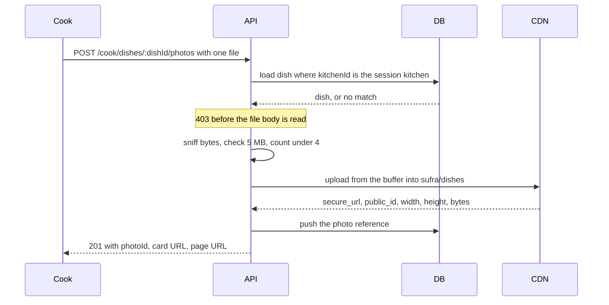

# Upload dish photos and serve small ones

The dish API from module 11 has five routes, one validation contract and one ownership filter. None of those routes reads bytes. This lesson adds three routes, a `photos` array to the Dish schema, one conditional destroy, and two delivery widths. It begins with a failing test, because the parts most likely to be wrong here are the order of the middleware and the condition on the destroy, and neither one fails loudly at runtime.

Work on a branch. You will install two dependencies, add an environment block that fails at boot when it is missing, and touch the same dish service the dashboard reads. If the photo work goes badly, the dish dashboard from module 12 should still run on the branch point.

## Where the project stands

Umm Yousef's Kitchen has maqluba with ninety preparation minutes and three load units, and falafel with twenty minutes and one unit. The dashboard lists both with their prices and cutoff labels and no pictures. `server/package.json` has no image dependency, and the Dish schema has no field that could hold a file.

That last point is the first decision. Do not add an `imageData` string to the Dish schema, and do not let a route accept a base64 body on the update path. Once that field exists, every query that returns a dish carries it, and removing it later means a migration over live documents. The only photo fields this module adds are references.

The route file you already have is `server/src/modules/dishes/dish.routes.js` with the five cook routes. Add the photo routes beside them rather than inside the existing update handler. A JSON patch and a multipart upload have different parsers, different size limits and different failure codes, and a single route that tries to accept both ends up refusing bodies it cannot explain.

## The route shape

Three routes cover the whole module: add a photo, remove a photo, and choose which photo leads the card.

```js
// server/src/modules/dishes/dish-photo.routes.js (shape only, handler bodies omitted)
router.post(
  '/:dishId/photos',
  requireAuth,
  requireRole('cook'),
  loadOwnedDish,      // resolves the kitchen from the session, then loads the dish
  uploadDishPhoto,    // one file in field "photo", 5 MB, image allowlist
  dishPhotoController.upload
);

router.delete(
  '/:dishId/photos/:photoId',
  requireAuth,
  requireRole('cook'),
  loadOwnedDish,
  dishPhotoController.remove
);

router.post(
  '/:dishId/photos/:photoId/cover',
  requireAuth,
  requireRole('cook'),
  loadOwnedDish,
  dishPhotoController.makeCover
);
```

Read the middleware order as the lesson. `loadOwnedDish` runs before the parser, so a request from the wrong cook is refused while its body is still in the socket. That is why the refusal costs no memory and creates no asset. The alternative order, parse then check, is the one most tutorials show, and it lets a stranger make your server hold five megabytes for every refused request.

The upload responds `201` with the dish's photo list, not with the whole dish. The list carries the new `photoId`, the original `url`, and the two derived URLs the client should actually use. Returning the full dish invites the client to read fields this route does not own.

| Condition | Status | Code |
|---|---|---|
| No token | 401 | `UNAUTHENTICATED` |
| Diner token | 403 | `ROLE_FORBIDDEN` |
| Dish not owned by the session kitchen | 403 | `NOT_KITCHEN_OWNER` |
| No file in the `photo` field | 400 | `PHOTO_MISSING` |
| Declared type not allowed, or bytes disagree | 400 | `UNSUPPORTED_TYPE` |
| File above 5 MB | 413 | `PHOTO_TOO_LARGE` |
| Dish already holds four photos | 409 | `PHOTO_LIMIT_REACHED` |
| Storage service refused or timed out | 502 | `PHOTO_UPLOAD_FAILED` |

The last row has a rule attached. When the upload fails, no reference is saved and the previous photos stay as they were. A dish that keeps three good photos is better than a dish whose array was cleared by a half-finished write, and the client can retry the fourth upload without repairing anything.

## The Dish schema fields

The photo is a subdocument with its own identifier, because the client needs to address one photo on a delete or a cover change. The array order is the display order, so the first element is the photo that leads the card.

```js
// server/src/modules/dishes/dish.schema.js (excerpt)
const DishPhoto = new Schema({
  url: { type: String, required: true },        // the original secure_url
  publicId: { type: String, required: true },   // used to destroy and to derive sizes
  width: { type: Number, required: true },
  height: { type: Number, required: true },
  bytes: { type: Number, required: true },
  uploadedAt: { type: Date, default: Date.now },
}, { _id: true });

const DishSchema = new Schema({
  kitchenId: { type: ObjectId, ref: 'Kitchen', required: true, index: true },
  name: { type: String, required: true },
  prepMinutes: Number,
  loadUnits: Number,
  photos: {
    type: [DishPhoto],
    default: [],
    validate: [(list) => list.length <= 4, 'PHOTO_LIMIT_REACHED'],
  },
}, { timestamps: true });
```

Six fields, and each one earns its place. `width` and `height` are stored so the client can reserve the right space before the image arrives, which is what stops a dish card from jumping while a diner is tapping it. `bytes` is stored so the cook screen can show what her photos cost and so you can answer the delivery question in the gate with evidence instead of a guess. `uploadedAt` is for support: when a cook says a photo changed on its own, the timestamps are the only record.

`publicId` is stored separately from `url` for a reason worth stating plainly. A Cloudinary URL contains a version segment and can contain transformation segments, so parsing a public identifier back out of a URL works until the day somebody changes a width. `destroy` takes the identifier, not the address, so the document keeps the identifier.

The array order defines the cover instead of a separate `coverPhotoId` field. One less field to keep in sync, and one less state where the cover identifier points at a photo that was deleted. The cost is that changing the cover rewrites the array, which is a single `$set` on a document that already has to be the owner of that array.

## Start with the failing test

Write this before the middleware order is settled, and run it against the version that parses the file first.

```js
// server/test/dishes/dish-photo.test.js (failing first)
it('refuses cook B before any bytes leave the request', async () => {
  const before = await countAssets('sufra/dishes');

  const res = await request(app)
    .post('/api/v1/cook/dishes/' + cookADish.id + '/photos')
    .set('authorization', 'Bearer ' + cookBToken)
    .attach('photo', fixture('maqluba-tray.jpg'));

  assert.equal(res.status, 403);
  assert.equal(res.body.code, 'NOT_KITCHEN_OWNER');
  assert.equal(await countAssets('sufra/dishes'), before);
  const after = await Dish.findById(cookADish.id).lean();
  assert.equal(after.photos.length, 0);
});
```

Against the parse-first version, the status is also `403` and the test still fails, on the asset count. That is the point of running it early: the two versions look identical from the outside and one of them has already paid for an upload, held five megabytes of a stranger's file and left an orphan that nobody will ever delete. The asset count comes from a small test helper that lists the folder, and it is the assertion that keeps the middleware order honest through later refactors.

Add three more tests beside it before you write the handler. A document renamed to `.jpg` must return `UNSUPPORTED_TYPE` and must not create an asset. A seven megabyte file must return `PHOTO_TOO_LARGE` without reading to the end of the body. A fifth upload on a dish that already holds four must return `PHOTO_LIMIT_REACHED` and must leave the existing four in place and in order.

## Validate the file, not the file name

The declared content type arrives from the client, so it is a claim rather than a fact. Check the first bytes as well, and refuse when the two disagree.

| Format | Allowed | How the bytes start |
|---|---|---|
| JPEG | yes | `FF D8 FF` |
| PNG | yes | `89 50 4E 47` |
| WebP | yes | `RIFF` at 0, `WEBP` at 8 |
| HEIC, GIF, SVG, PDF | no | any other signature |

```js
// server/src/modules/dishes/photo-file.js (shape only)
export const MAX_PHOTO_BYTES = 5 * 1024 * 1024;
export const MAX_PHOTOS_PER_DISH = 4;
export const ALLOWED_TYPES = ['image/jpeg', 'image/png', 'image/webp'];

export function sniffImageType(buffer) {
  // returns 'image/jpeg' | 'image/png' | 'image/webp' | null
}
```

HEIC is refused rather than converted, and the course says so out loud instead of hiding it. Converting needs a transcode step and a library the rest of the project does not use, and an honest refusal with a helpful message costs the cook ten seconds. The message names the three accepted formats and mentions that an iPhone camera can be set to a compatible format in its settings. That sentence is worth more than a partial implementation of a transcoder, and it is the kind of copy that belongs beside the file input rather than in a support reply.

The size limit is a constant used in three places: the form's own check before upload, the parser's limit, and the error message that names the number. Three places, one value, so the message cannot drift away from the enforcement.

## Delete, replace and the snapshot guard

Two operations remove a photo. The cook deletes one, or the cook replaces the leading photo and deletes the one it replaced. Both end in the same conditional destroy, and the condition is the module's most important line.

```diff
   const photo = dish.photos.id(req.params.photoId);
-  await cloudinary.uploader.destroy(photo.publicId);
+  const referencedByOrder = await Order.exists({ 'items.snapshot.photoPublicId': photo.publicId });
+  if (referencedByOrder) {
+    logger.info({ publicId: photo.publicId }, 'photo kept for an order snapshot');
+  } else {
+    await cloudinary.uploader.destroy(photo.publicId);
+  }
```

The dish update happens either way, so the cook sees the photo removed from her dish immediately. What changes is the asset's fate. When an order item copied the photo URL at purchase, that receipt is a record of what the diner bought, and a photo change made in November cannot be allowed to delete the picture a diner may need in December. The check reads the order collection, which belongs to module 19; if your project has no order collection yet, code the branch against a collection that does not exist and leave the query in place, then test it in the gate once a fixture order exists.

Two smaller rules belong in the same function. A failed destroy is logged with the public identifier and does not fail the request, because the diner's dish is already correct and a delete that reports failure would make the cook retry a change that already happened. An upload that succeeded while the document write failed is logged the same way, with the public identifier, so the orphan can be swept later. Module 21 gives you a queue, and a sweeper that compares stored identifiers against the storage folder is the right home for both logs. This module keeps the logs and says plainly that the sweeper does not exist yet.

## Serve small ones

The original is now stored. The card needs something much smaller, and the URL is where that decision lives.

```js
// server/src/modules/dishes/photo-url.js (shape only)
export const CARD_WIDTH = 480;
export const PAGE_WIDTH = 960;

export function deliveryUrl(publicId, width) {
  // builds upload path with f_auto, q_auto, w_<width>, c_fill and g_auto
}
```

Each parameter is a decision. `f_auto` lets the service pick a format the requesting browser decodes well, which is why the same dish card can arrive as a modern format on a current phone and as JPEG on an older one without a second upload. `q_auto` picks a quality for the content instead of a fixed number, which matters because a photo of rice and a photo of flatbread compress differently. `w_480` is a fixed width, not a percentage, because a percentage would make the derived image depend on the device and defeat the edge cache.

Why 480 for a card that is 360 CSS pixels wide. Phones in this cohort are commonly 2x or 3x density, so a card draws at 720 or 1080 device pixels. Asking for 480 is a deliberate compromise: slightly soft on a 3x screen in exchange for bytes a metered connection can afford, and sharp on the 2x screens that dominate. If a reviewer asks why not 1080, the answer is the measurement below, not a preference.

Now measure it. Save one maqluba photo twice, once the original and once at 480, and read the transferred bytes for each.

```bash
curl -s -o /dev/null -w 'card    %{size_download} bytes %{time_total}s\n' "$CARD_URL"
curl -s -o /dev/null -w 'original %{size_download} bytes %{time_total}s\n' "$ORIGINAL_URL"
```

Run both with the browser's network panel set to a slow profile and the cache disabled, and write the two numbers into `docs/EVIDENCE.md`. Illustratively, a phone original lands near 2.4 MB and the 480 wide version lands near 38 KB, which is roughly sixty times less data. Multiply by the number of cards a diner scrolls through. Twelve cards at the original size is about 28 MB; twelve at the card size is under half a megabyte, around 456 KB. That multiplication is the whole argument for this section, and it is also the argument for `loading="lazy"` on the list, because the cards below the fold should not download at all.

The trade-off has two sides. The large original is what makes every future size possible, and it is what an order snapshot can refer to without loss. The small delivered image is what a diner actually pays for. Keeping both is not duplication; it is the difference between a source and a delivery. What would change the decision is cost: if derived versions were billed in a way that dominated the bill, you would pre-generate two sizes at upload and store their identifiers, and accept the extra deletes. On the plan this course uses, the derived versions stay inside the free allowance, so check the current pricing page before you carry that assumption into a real kitchen.

## Wire the cook screen

The dish editor gets a file input, and the dish table from lesson 12.1 gets a thumbnail column. Both are small pieces of work, and both have a failure mode worth naming.

Client side, build a `FormData` object, append the file under the field name `photo`, and post it through the same authenticated client the rest of the app uses. Do not set the content type header yourself; the browser adds the multipart boundary, and a hand-set header creates a request the server cannot parse. Check the size and the type in the browser before sending, and treat that check as courtesy rather than security, because the server enforces both again.

```jsx
// client/src/features/dishes/PhotoPicker.jsx (excerpt)
const body = new FormData();
body.append('photo', file);
await api.post(`/cook/dishes/${dishId}/photos`, body);
```

In the table, render the first photo at a fixed box with `loading="lazy"`, explicit `width` and `height` attributes taken from the stored fields, and an `onError` handler that swaps in the placeholder. The placeholder is not decoration. It is what a diner sees when an asset has gone missing, and a table that shows a broken icon instead tells the cook nothing about which dish needs attention.

Keep the empty state honest. A dish with no photo shows a dashed box with the words "No photo yet" and the upload control beside it. Do not fill that space with a generic illustration of food. A generic picture is the borrowed-photo problem in a different form: it is a claim about a dish that nobody made.

## Verify the build

Four observations make the lesson complete. Upload a real maqluba photo from cook A's session and confirm the response carries a `photoId` and two derived URLs, the document holds a reference with no bytes in it, and the card does not jump while the image loads. Send cook B's token against A's dish and confirm `403` with an unchanged array and an unchanged asset count. Upload a document renamed to `.jpg` and confirm `400 UNSUPPORTED_TYPE` with no new asset. Delete a photo that an order snapshot references and confirm the dish loses the photo while the URL in the snapshot still loads.

The diagram puts the two paths side by side, because the upload path and the delivery path fail in different ways and are debugged in different places.



If the card is blurry, the width is wrong and the fix is in the URL builder, not in the upload. If the card is huge, the client is rendering the original `url` instead of the derived one, and the network panel will show a multi-megabyte image. If the asset count moves on a refused request, the middleware order is wrong. If the document grows by megabytes, a base64 field has crept into the schema and the reference design has been abandoned.

Save the four responses, the two byte measurements and the before and after document shape in `docs/EVIDENCE.md`. The gate asks you to run the same four observations against a fixture order and to explain what the delete guard protected.

## Next

Lesson 13.3 is the gate: two kitchens, one diner, one old receipt, and every failure path from lesson 13.1 walked with the request and the document beside it.
