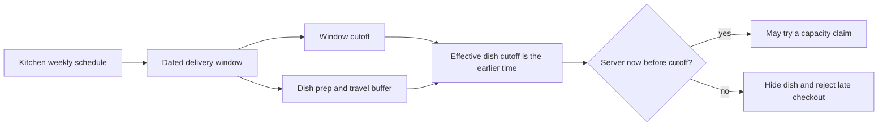

# The 11:31 lunch order

Sufra shows a delivery window from 13:00 to 14:00. A home cook has four capacity units left. At 11:31, a diner orders a dish that needs ninety minutes of preparation plus a delivery buffer. The kitchen has space, but it cannot finish the meal honestly in time. If the API checks only `remainingUnits`, it accepts an order the cook cannot deliver. Capacity and time are separate constraints, and both must pass at the moment the order is claimed.

A window is a promise about when a meal will reach a diner. A dish is a promise about how long it needs and how much of the kitchen's effort it consumes. The kitchen's weekly schedule says which windows are offered; a dated `DeliveryWindow` says when one particular window begins and ends. The order cutoff says when a diner must commit. A per-dish cutoff can be earlier than the window's general cutoff because a slow dish needs more preparation than a fast one.

## One window, two dishes

Consider a kitchen in `Asia/Gaza` with a 13:00 to 14:00 local delivery window. It publishes a 30-minute falafel dish and a 90-minute maqluba dish. The kitchen allows a 20-minute travel and packing buffer. The maqluba's latest safe order time is 11:10 for a 13:00 start. The falafel's latest safe order time is 12:10. If the kitchen also sets a general 12:00 cutoff for the window, the effective falafel cutoff is 12:00, while maqluba still closes at 11:10. A diner arriving at 11:31 can choose falafel but not maqluba, even if the kitchen has spare load units.

Those numbers are a teaching example. The actual formula belongs in one server function and uses UTC instants after interpreting the kitchen's dated local window. It does not use the diner's phone clock. In the UI, "order by 11:10" must be based on server data, and checkout checks it again. A phone may have a wrong clock or a page may have been open for several minutes.

The final decision has two gates. Passing the cutoff gate means the kitchen has enough time. It does not mean there are enough capacity units. The later checkout module will conditionally decrement remaining units and create a hold. This module prepares dated windows and the cutoff rule that checkout must use.

## Why Sufra cannot copy a stock counter

A dish does not sit on a shelf waiting to be packed. A cook can prepare several portions during a window, but the work has a limit. A large maqluba may use three load units while one falafel order uses one. The capacity belongs to the kitchen and the dated window, not to a dish record. A dish's `loadUnits` describes its cost against that shared capacity. The checkout flow multiplies it by quantity and checks the window's remaining units atomically. A later payment failure releases the held units; a paid order confirms them.

Time adds another changing input. `remainingUnits` can stay at four while the cutoff passes. An API response cached at 11:00 becomes unsafe at 11:31 even if no other diner has ordered. This is why availability for a dated window cannot be cached as a timeless yes/no field. The server checks the current instant when it responds and again when a state-changing claim is attempted. A client countdown can explain urgency, but it is not the authority.

## A short incident to investigate

A cook reports that Sufra accepted maqluba after the stated cutoff. Start with the kitchen's IANA zone, the dated window start in UTC, the dish's preparation minutes, the travel buffer and the server instant at claim time. Compute the effective cutoff and compare the claim instant. Do not start by reading a screenshot of the diner's countdown. A screenshot shows what the page displayed; it does not prove what the server accepted. If the server used the phone's clock or a stale page response, move the check into the claim path.

If the cutoff was computed correctly but the cook still could not deliver, inspect the assumptions: perhaps the prep estimate was too short, the travel buffer was unrealistic, or the kitchen accepted more load units than it could handle. The product should let the cook adjust future dish and window settings. It must not silently rewrite an already paid order's promise. The order snapshots its window and dish values at purchase so support can explain what was agreed.

## Two people see different parts of the promise

The cook needs to set working windows, preparation estimates and capacity in terms they can control. They should not enter UTC timestamps or calculate an offset. The kitchen schedule form shows local dates and hours in the kitchen's chosen IANA zone. It previews the next dated windows before they go public. If a special day changes the normal schedule, the cook adds a dated exception instead of rewriting the weekly rule. A cook who closes a day with paid orders needs a warning that those orders still require a decision.

The diner needs an orderable view. They choose a delivery window first, then see only kitchens and dishes that can fit that window. When maqluba is too late, the diner should see the next window where it can be prepared. A vague "unavailable" label leaves them wondering whether the dish is sold out, the kitchen is closed, or their address is outside the service area. Sufra can give a concise reason without exposing another diner's order or the cook's private schedule notes.

These screens do not make the final decision. The kitchen settings generate dated windows, and browse reads those windows to show an estimate. Cart rechecks the selected date and dish cutoff. Checkout performs the authoritative time check and capacity claim. This repeated validation is needed because both the clock and the remaining units can change between screens. A successful browse response is not a reservation.

## Compare two plausible but wrong rules

One wrong rule is "if units remain, accept the order." It ignores preparation and delivery time. Another is "close every dish at the kitchen's general cutoff." It hides a slow dish too late and may hide a quick dish unnecessarily if the general cutoff is loose. The effective cutoff takes the earlier of the general cutoff and the dish's calculated preparation deadline. It is still a model, not a guarantee that traffic or a power cut will never delay a meal. The cook owns realistic input estimates, and the platform enforces the published promise consistently.

An apparently safer third rule is to add a very large buffer to every dish. That can stop late orders but make the kitchen invisible for much of the day. The product should not repair missing time logic by guessing a universal buffer. Let a kitchen choose a validated travel buffer, make it visible in the dated window calculation, and inspect actual delivery evidence during the course demo. The goal is an explainable cutoff that a cook and diner can both understand.

## A diagnostic before you build

Write down the four values needed to answer "Can this diner order this dish for this window now?" They are the dated window start, the kitchen's general cutoff, the dish preparation plus travel duration, and the server's current instant. Now add the separate question "Can this kitchen accept the load?" That needs remaining capacity and the dish's load units times quantity. If your answer uses only one question, revisit the 11:31 example. A correct time decision can still fail a capacity claim, and an empty kitchen can still be too late to cook a slow dish.

## What you will build here

This module turns kitchen weekly schedules into seven days of dated delivery windows, with unique identity per kitchen and start instant. It computes a general window cutoff and an effective cutoff per dish. It handles schedule exceptions without mutating the weekly template. A fake clock lets tests prove the exact boundary: one second before cutoff passes, at cutoff fails, and one second after fails under our chosen strict rule. The module gate asks you to explain why a fast dish may remain orderable after a slow dish closes.

Write the 13:00 example in `docs/window-decisions.md`. Include the kitchen zone, window start and end, general cutoff, both dish prep times, the travel buffer, and the resulting cutoffs. State which dish is orderable at 11:31 and why. This note becomes the reference for API and checkout tests. If a later implementation disagrees, decide whether the formula or the code is wrong before changing either.

References: [Luxon named-zone documentation](https://moment.github.io/luxon/api-docs/), [MongoDB on atomic single-document updates](https://www.mongodb.com/docs/manual/core/write-operations-atomicity/).
