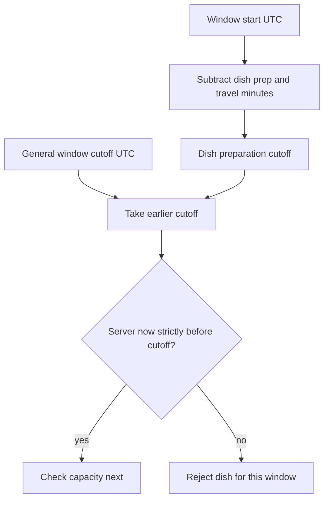

# Windows, cutoffs, and the server clock

A kitchen's weekly schedule is not an orderable delivery window. The schedule says, for example, "lunch from 13:00 to 14:00 on weekdays in Asia/Gaza." A diner cannot pay for a generic weekday. Sufra must expand the rule for a specific date, produce UTC start and end instants, and record capacity for that dated window. The window can then be closed, filled, or reserved without changing the recurring rule.

This distinction protects a cook who pauses tomorrow's lunch while keeping the rest of the week. It also prevents an order from drifting when the cook edits next month's schedule. A paid order points to the dated window it was sold against and snapshots the promised times. It does not recalculate its delivery interval from the current weekly template whenever the diner opens the tracking screen.

## Define the four values

`window.startAt` and `window.endAt` are UTC instants for one dated delivery interval. `window.capacityUnits` is the total effort the cook offers in that interval. `window.remainingUnits` is the unclaimed portion; checkout changes it with an atomic conditional update later. `window.cutoffAt` is the latest server instant at which the kitchen accepts any new order for the interval. The cook's local time zone is stored on the kitchen and snapped onto the dated window for explanation.

A dish adds `prepMinutes`, `loadUnits`, and `maxPerOrder`. `prepMinutes` affects whether there is enough time before the delivery window. `loadUnits` affects whether the kitchen has enough effort left. The two are not interchangeable. A dish could be quick but heavy, or slow but light. A diner may see one as unavailable for time and another as unavailable for capacity. The UI should say which without exposing other diners' private orders.

For a dish and a dated window, define `prepCutoffAt = window.startAt - prepMinutes - travelBufferMinutes`. Define `effectiveCutoffAt` as the earlier of `window.cutoffAt` and `prepCutoffAt`. Under this course's policy, an order is timely only when the server's `now` is strictly before `effectiveCutoffAt`. Exactly at cutoff is too late. The comparison uses UTC instants; the labels shown to a cook and diner can use their chosen zones.

<TraceRequest title="Maqluba and falafel at 11:31">
  <TraceStep actor="Kitchen" label="Lunch window begins 13:00" detail="Asia/Gaza on the dated window" />
  <TraceStep actor="Maqluba" label="90 minutes prep plus 20 travel" detail="Effective cutoff 11:10" />
  <TraceStep actor="Falafel" label="30 minutes prep plus 20 travel" detail="General 12:00 cutoff wins" />
  <TraceStep actor="Server" label="Read now at 11:31" detail="Maqluba closed; falafel may try capacity" />
</TraceRequest>

Walk through the trace with the general cutoff moved to 11:45. The falafel cutoff becomes 11:45, not 12:10. The slow dish still closes at 11:10. Now move the server time to exactly 11:45. Both dishes are closed under the strict boundary. This exercise changes one input at a time so you can tell which rule decided the result.

Before using the canvas, predict which of four orders will fail because of time and which will fail because the kitchen is full. Start with the shown 13:00 window, three capacity units, a slow maqluba and a fast falafel. Write your prediction first. Then change one arrival time or dish load and compare the result with your explanation. The canvas is a simplified model: it holds preparation and travel estimates fixed and does not simulate cook speed or traffic variation.

<InteractiveCanvas slug="sufra-window-fill-and-cutoff" />

After the simulation, answer a transfer question without moving the controls: if a kitchen has five units left at 11:31, can it accept maqluba for the same 13:00 window? Explain the dated cutoff and the capacity result separately. The correct reasoning is that spare units do not reopen a dish whose 11:10 preparation cutoff passed. Repeat with falafel after 12:00; its general cutoff closes the offer even if the kitchen is empty.

## Do not trust a countdown for the decision

The browser can display a countdown to `effectiveCutoffAt`, but it may be a minute old, have a skewed local clock, or lose network. Include the server's current time in an API response so the UI can estimate the offset between client and server for display. Still repeat the comparison on the server when a cart line is added and when checkout tries a capacity claim. The latter is the authoritative check because a time can cross the boundary while a diner is entering payment details.

The server's clock itself can be injected in tests. The production implementation uses a system clock; a test supplies a fixed instant. That makes the boundary deterministic. It does not make a distributed system immune to bad host clocks. Production operations should monitor clock synchronization and use UTC instants in logs. The API and worker must run with compatible time-zone data, because schedule expansion uses the kitchen's IANA rules. Correctness should not depend on the process's default `TZ` display setting.

## A worked calculation

Take the 13:00 Gaza lunch window from lesson 14.1. The cook's general cutoff is 12:00. A maqluba has 90 minutes of preparation and a 20-minute travel buffer. Subtract 110 minutes from the 13:00 start: 11:10. The earlier of 11:10 and 12:00 is 11:10. A falafel order has 30 minutes of preparation plus the same 20-minute buffer, giving a preparation cutoff of 12:10. The earlier of 12:10 and 12:00 is 12:00. At 11:31, only falafel is timely. At 12:00 exactly, neither is timely. The arithmetic is shown in local labels for human review; code operates on dated UTC instants.

Do not subtract minutes from a bare `13:00` string when a window can cross a clock change. Expand the dated kitchen-local window into UTC first, then subtract absolute minutes. Store the resulting UTC cutoff. If a cook changes the dish's prep time tomorrow, already paid orders keep their snapshots; new offers use the new value. If a kitchen closes tomorrow's lunch, mark that dated window unavailable and stop new claims without deleting the weekly rule.

## Distinguish timing from capacity

The browse API can say a dish is timely while `remainingUnits` is zero. It can say the kitchen has capacity while a slow dish is too late. Both conditions are needed for an offer. The checkout claim must evaluate both against current server state. A common bug reads the window and dish, computes a yes/no result, then updates `remainingUnits` without repeating the filter. Another checkout can take the last units between the read and update. The later capacity module uses `findOneAndUpdate` with a filter that requires enough units. The time condition also belongs in the state-changing path.

Do not hide all unavailable dishes under one generic "sold out" label. A cook may have space but insufficient preparation time; that is different feedback. The diner can move to a later window for the slow dish. A full window may have the right cutoff but no units; the diner needs the next window with capacity. This is not merely copy. It guides a safe next action rather than encouraging repeated failed checkouts.

## Trace the boundary through three APIs

At browse time, `GET /windows/:id/dishes` can return the dated `effectiveCutoffAt` and a current orderability hint. At cart time, `POST /cart/items` checks the same rule again and rejects a line whose cutoff passed. At checkout time, the claim service reads the server clock and validates the cutoff before changing capacity. These three calls may be seconds or minutes apart. Their answers can legitimately differ because time advances. A difference is not necessarily a bug; accepting a late order because an earlier page said yes is the bug.

Use distinct error codes for `DISH_CUTOFF_PASSED` and `WINDOW_FULL`. The first tells a diner to choose a later window or a faster dish. The second tells them to choose another kitchen or a window with units left. A single "not available" response hides which constraint failed and makes support harder. The backend can return only the safe public reason; it need not reveal another diner's cart or the exact number of held claims.

The same function should calculate the cutoff in all three places, but each call supplies a fresh clock and current persisted fields. Do not cache a boolean such as `isOrderable` in the dish document. It becomes false as time passes and can become true for a different dated window. Store stable inputs and dated instants, then calculate the decision when needed. This keeps the rule testable and prevents a nightly job from having to update every dish merely because the clock moved.

## Decision and evidence

Write the formula and strict boundary in `docs/window-decisions.md`. Add two cases where capacity and time disagree, and state the UI message for each. In the next lesson, you will make dated windows robust across local time changes. After that, you will implement idempotent generation, per-dish cutoffs, schedule exceptions and fake-clock verification. Keep the same example throughout so a mentor can trace one promise from weekly schedule to paid order.

References: [MongoDB atomicity and conditional filters](https://www.mongodb.com/docs/manual/core/write-operations-atomicity/), [Mongoose `findOneAndUpdate` behavior](https://mongoosejs.com/docs/tutorials/findoneandupdate), [Luxon API documentation](https://moment.github.io/luxon/api-docs/).
