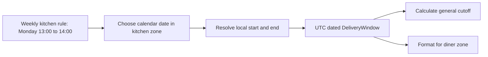

# A dated window has a time zone

A cook says lunch delivery is 13:00 to 14:00 on weekdays. That rule belongs to the kitchen's local calendar. A diner may live in another zone, and a server may run in UTC. If Sufra saves the cook's current numeric offset beside a recurring rule, future windows can shift when local time rules change. The weekly rule needs an IANA zone such as `Asia/Gaza`; each dated window needs resolved UTC start and end instants.

The conversion happens when Sufra generates a dated `DeliveryWindow`. The weekly rule is a plan. The dated row is something a diner can select and an order can snapshot. The row stores `startAt` and `endAt` in UTC, plus `kitchenZoneAtGeneration` so the original local promise can be explained. A diner may format the interval in their own zone, but the booking and cutoff arithmetic use the dated UTC values.

## Why an offset is too small

An offset such as `+02:00` says how far a clock is from UTC at one instant. It does not name the place's future rules. `Asia/Gaza` names a time zone whose offset can vary by date and whose rules can be updated. Do not hard-code a future Gaza change date in a lesson or in production. Ask the installed time-zone data for each dated window. Record the runtime version when testing so a later policy update can be investigated.

For a controlled historical exercise, use Berlin's March 2024 clock change. A Berlin kitchen with a Monday 13:00 window would have a different UTC start on 25 March and 1 April, while the cook sees 13:00 in both weeks. Adding seven 24-hour days to the first UTC start would be wrong for the second week's local rule. Sufra must expand each calendar date in the kitchen zone, then resolve that local boundary to an instant.

The branches after the dated row have different jobs. The cutoff is a server decision about whether an order can still be promised. The diner label is presentation. Changing the diner zone changes the label, not the row. Changing the kitchen's weekly schedule can change future unclaimed rows, but it must not rewrite a paid order's window snapshot.

<TraceRequest title="One lunch rule across a clock change">
  <TraceStep actor="Cook" label="Save Monday 13:00 to 14:00" detail="Europe/Berlin as a controlled example" />
  <TraceStep actor="Generator" label="Resolve 25 March 2024" detail="Use that date's IANA offset" />
  <TraceStep actor="Generator" label="Resolve 1 April 2024" detail="Ask again after the transition" />
  <TraceStep actor="Diner" label="View either window" detail="Format its stored UTC instants in the selected zone" />
</TraceRequest>

Predict before running code: the cook's local labels remain 13:00 to 14:00, while the UTC starts can differ by an hour. If a test reports identical UTC clock hours, check whether the code added seven days to the prior UTC row instead of resolving the new local date. That is a scheduling defect even if the UI still prints 13:00 using stale text from the weekly rule.

## Gaps and repeated hours

On a spring clock-change night, some local values do not exist. On an autumn change, a local value can occur twice. Most lunch windows will not sit at those hours, but a kitchen may offer an early breakfast or late evening window. The generator must have an explicit policy. In this course, an ambiguous or nonexistent start or end boundary makes that dated occurrence unavailable and creates a warning for the cook. It does not choose an offset silently. A later product can offer an explicit earlier/later choice, but then the UI and stored row must carry that choice.

Use Luxon to inspect a dated local boundary. Construct the local fields with the kitchen zone, compare the resulting fields to the requested fields to catch a normalized gap, and inspect `getPossibleOffsets()` to detect a repeated time. Accept only one matching instant. This mirrors the rule that a paid delivery promise cannot be based on a guessed hour. The helper belongs in `server/src/shared/time.js`, not copied into each route.

## A boundary belongs to a calendar date

Be careful with a delivery window that crosses local midnight. A rule from 23:30 to 00:30 does not have an end on the same local date as its start. The generator must advance the end's local date before resolving it to UTC. Comparing the bare strings `"00:30"` and `"23:30"` would call a valid overnight interval negative. For this course's core lunch example, start and end share a date, but the helper should not encode that accident as a universal assumption. Either validate that core kitchens use same-day windows or support an explicit `endsNextDay` flag and test it.

The same care applies to cutoffs. A breakfast window at 07:00 may have a preparation deadline on the prior local day. Subtracting absolute minutes from the dated UTC start gives the correct instant. Subtracting from a `"07:00"` string and wrapping the clock by hand can lose the date and the applicable time-zone rule. Store a UTC `cutoffAt` on the dated row. In the cook dashboard, format it back in the kitchen zone with its local date so the person can see when orders close.

## Review a changed zone rule safely

Suppose the runtime's time-zone data changes after a government announces a new clock policy. Tomorrow's unclaimed Sufra window might resolve to a different UTC instant while still reading 13:00 in the kitchen's zone. Do not insert a second row and leave both public. Match the planned occurrence by kitchen, local date and rule key; compare the old and new UTC starts. If there are no claims or paid orders, a reviewed regeneration can replace the projection. If there are paid orders, preserve their original UTC promise and show an operational alert. A zone-data update should lead to an explicit decision, not an invisible duplicate lunch.

The API and worker may be deployed separately. If one uses newer zone data, they can disagree about the next seven days. A deploy check should print the same sample kitchen schedule from both processes. Record the Node and library versions. The check does not replace tests, but it catches environment drift that a fixed historical unit case cannot. The public browse API should read persisted dated rows rather than independently recompute a different set for each request.

## Explain the result to a diner

A diner sees "13:00 to 14:00 in the kitchen's zone" and the equivalent in their chosen zone. If those labels differ, the checkout confirmation repeats both before payment. The backend sends UTC start and end and named zones, not only a rendered string. A client changing their display zone after paying changes the label but not the order's stored UTC interval. If a cook changes their kitchen zone setting, require confirmation for future weekly rules and leave paid orders fixed. This is the same rule, instant and display distinction that makes a booking system trustworthy, applied to a meal delivery promise.

## Store the right values

The kitchen profile holds `timeZone: 'Asia/Gaza'`. The weekly schedule holds weekday and local start and end strings. A dated window holds UTC instants and a snapshot of the kitchen zone. A paid order holds the selected window ID plus the promised UTC start and end at purchase. A cook changing tomorrow's schedule should not mutate yesterday's order or a paid order for tomorrow. A diner changing their display zone should never change either UTC field.

When the time-zone database changes, regenerate only future unclaimed windows from the current local rules. Compare them with any paid orders and held claims before changing or retiring a row. A paid promise is an instant range, not a projection that follows the newest rules automatically. If a zone policy changes and a future paid order's local label differs, notify the affected parties with both the original and current zone labels rather than silently moving the order.

## Practice and failure test

In `docs/window-decisions.md`, write a table with one weekly rule and two dated Berlin windows on the historical dates above. Record each date, kitchen local interval, resolved UTC interval, and a diner-local label. Use the library to fill the UTC values; do not guess an offset. Then try to generate a local boundary in New York's known 2024 spring gap. The helper should reject that dated occurrence with a specific code. A test that returns a normalized later time is failing Sufra's policy.

The next lesson makes generation idempotent. It will upsert each dated window by kitchen and UTC start, then preserve held or paid rows when the weekly template changes. Correct time conversion is necessary, but it is not the only safety property. Idempotency keeps a worker retry from creating two orderable copies of the same kitchen window.

References: [Luxon API documentation](https://moment.github.io/luxon/api-docs/), [MDN on gaps and repeated local times](https://developer.mozilla.org/en-US/docs/Web/JavaScript/Reference/Global_Objects/Temporal/ZonedDateTime), [MongoDB unique indexes](https://www.mongodb.com/docs/v8.0/core/index-unique/create-compound/).
