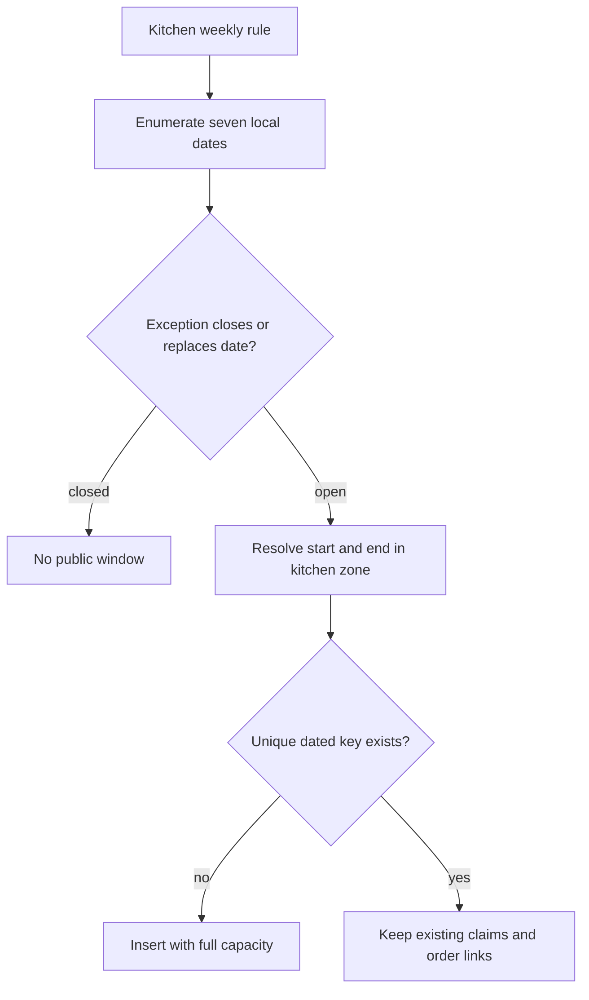

# Generate the next seven days once

A cook sets a weekly lunch schedule. Sufra needs dated windows for the next seven days so diners can choose an actual delivery interval. A worker may run twice after a restart, and an operator may rerun generation manually. If each run inserts another copy of Tuesday lunch, the kitchen appears to have twice its capacity. This chapter makes generation idempotent and keeps an already claimed or paid window intact.

The input is the kitchen's weekly template, kitchen IANA zone, schedule exceptions and the server's current date. The output is a set of dated `DeliveryWindow` documents. For each local date, ask whether the weekday is enabled and whether an exception closes or replaces it. Resolve the local start and end into UTC instants using the helper from the previous lesson. Reject an ambiguous boundary. Then insert only a window that does not already exist.

## Model one dated window

Add fields to the `DeliveryWindow` schema: `kitchenId`, `sourceRuleKey`, `localDate`, `kitchenZoneAtGeneration`, `startAt`, `endAt`, `cutoffAt`, `capacityUnits`, `remainingUnits`, and `status`. A row starts `open` with `remainingUnits` equal to `capacityUnits`. Later checkout will move units into held claims, and payment will confirm them. The date and rule key explain where the row came from; the UTC instants decide when it is offered.

Create a unique compound index on `{ kitchenId: 1, startAt: 1 }`, as the roadmap requires. Also consider a unique `{ kitchenId, localDate, sourceRuleKey }` index so a changed time-zone database or edited rule cannot create two windows for the same scheduled occurrence under different UTC starts. A duplicate-key error on concurrent generation is an idempotent "already exists" outcome only if the existing row represents the same intended occurrence. Read it and compare the local key. Do not swallow every duplicate-key error, because another collision may reveal a real schedule conflict.



The final branch is important. An upsert should not reset `remainingUnits` when it finds an existing row. A retry after three diners paid must leave those claims alone. If you set `remainingUnits` on every generation run, you can oversell a busy lunch window without any checkout race. Use `$setOnInsert` for initial capacity fields. Handle schedule edits and exceptions through a separate reconciliation flow that can inspect claims and paid orders.

## Implement a bounded generator

Place the generator in `server/src/modules/windows/generate.js`. The example assumes your `localToUtc` helper converts dated kitchen-local fields into a UTC ISO string and throws a named error for a gap or overlap. Adapt field names to your actual schema, but keep the operation order and the `$setOnInsert` behavior.

```js
export async function insertGeneratedWindow(Window, kitchen, rule, localDate, times) {
  const startAt = new Date(times.startUtc);
  const endAt = new Date(times.endUtc);
  if (!(endAt > startAt)) throw new Error('WINDOW_END_BEFORE_START');
  const row = {
    kitchenId: kitchen._id,
    sourceRuleKey: rule.key,
    localDate,
    kitchenZoneAtGeneration: kitchen.timeZone,
    startAt,
    endAt,
    cutoffAt: new Date(times.cutoffUtc),
    travelBufferMinutes: kitchen.travelBufferMinutes,
    capacityUnits: rule.capacityUnits,
    remainingUnits: rule.capacityUnits,
    status: 'open',
  };
  await Window.updateOne(
    { kitchenId: kitchen._id, startAt },
    { $setOnInsert: row },
    { upsert: true, runValidators: true },
  );
}
```

The helper deliberately does not calculate `times`. The prior lesson owns local-to-UTC conversion, and the cutoff lesson owns the cutoff formula. This separation lets you test a repeated worker run without also testing every time-zone boundary. The caller passes seven local dates in the kitchen zone. It should not enumerate seven UTC dates and assume they match seven kitchen dates around midnight.

## Rerun without erasing state

Seed one kitchen with lunch windows for seven dates. Run generation, record the seven window IDs and capacity values, then run it again. The count and IDs should be unchanged. Next simulate a held claim by lowering one window's `remainingUnits` and inserting a `CapacityClaim`. Run generation a third time. The lowered value must remain lowered. This is the key idempotency test; a mere document-count assertion could miss a reset that causes overselling.

Run two generator invocations concurrently against an empty date. The unique index, not a pre-read, prevents duplicate rows. One may see a duplicate-key error; the service should fetch the existing occurrence and confirm it matches the intended local key. If the two invocations used different rules that resolved to the same start, that is not a harmless retry. Reject the overlapping kitchen schedule and ask the cook to edit it.

## Why a pre-read is insufficient

It is tempting to call `findOne` before every insert and skip the insert if a row exists. Two workers can both read "nothing" and then both attempt to insert. The pre-read improves a log message but cannot enforce uniqueness under concurrency. The compound unique index is the final guard. The upsert expresses that a repeated attempt should not change an existing row. Tests should launch two invocations together, then assert one dated occurrence and unchanged capacity. This is a small version of the concurrency discipline needed later for capacity claims.

The index must be built before the generator is used with real kitchens. If existing data already contains duplicate kitchen/start pairs, the index build will fail. A migration script should find and resolve duplicates before enabling the unique index. In a new learner project with only seed data, create the index with the model before seeding. In a live service, never assume a schema declaration means an index has already finished building; check the database state during deployment.

## Make seven local dates, not seven UTC midnights

Use the kitchen's zone to find today's local date. Enumerate the next seven local calendar dates, including the current date only if its windows can still be ordered. For each date, look up the weekday and a possible exception. Do not start at UTC midnight and add 24 hours seven times. A kitchen near a zone boundary could see a different local date, and a clock-change day can be shorter or longer than 24 elapsed hours. Once a local date is chosen, resolve each start and end boundary independently to UTC.

If generation encounters an invalid local boundary, record the kitchen ID, rule key, local date and error code. Skip only that occurrence and alert the cook. Do not abort every kitchen's seven-day generation because one special window is ambiguous. Also do not catch every error and continue silently; a database outage or programming error should fail the job so operations can retry it. Distinguish invalid content from infrastructure failure in logs and tests.

## A record should explain its origin

Store `sourceRuleKey` and `localDate` on the dated row even though the public API mostly needs UTC instants. Those fields let a cook see which schedule entry produced a window and let a support engineer explain why a retry kept the row. They also support the second uniqueness check when time-zone data changes. A paid order snapshots the dated window; it does not rely on the weekly rule remaining unchanged. If a cook deletes a rule later, the historical row and order still explain what the diner bought.

## Handle edits and time-zone changes deliberately

A cook can change next week's capacity or close a day. Do not simply rerun the insert helper and expect the existing row to change. That would either do nothing or reset a row with claims. For an unclaimed future window, a separate edit path can replace its capacity and times after checking that no order refers to it. For a window with held or paid orders, preserve the promise and close it to new claims if the cook cannot serve more. Notify affected parties if a paid interval cannot be honored; do not delete their order history.

If a runtime time-zone update resolves the same local rule to a different UTC instant, the second unique local key helps detect the conflict. The generator should record it for review rather than insert a second public occurrence. This is an operational edge case, not a reason to hard-code the old offset. Future unclaimed windows may be regenerated after review. Paid orders keep their UTC snapshots.

## Evidence for the module gate

Commit `server/src/modules/windows/generate.js`, the unique indexes, and a test with first, second and third runs. Include a short log in `docs/window-decisions.md` showing seven intended local dates, seven row IDs after both runs, and an unchanged held window. The next lesson computes the cutoff for each dish against these dated rows. A generated window is necessary for browsing, but it is not permission to order after a dish's preparation cutoff.

References: [MongoDB compound unique indexes](https://www.mongodb.com/docs/v8.0/core/index-unique/create-compound/), [Mongoose `findOneAndUpdate` and atomicity](https://mongoosejs.com/docs/tutorials/findoneandupdate), [Luxon API documentation](https://moment.github.io/luxon/api-docs/).
