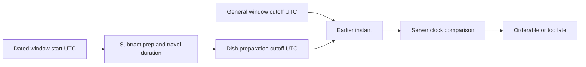

# A slow dish closes first

The dated lunch window now exists. It begins at one UTC instant, ends at another, and has a general kitchen cutoff. The kitchen lists dishes with different preparation times. If every dish closes only at the general cutoff, Sufra can promise a slow meal too late. If every dish closes according to preparation alone, a fast meal can remain orderable after the cook has stopped taking any lunch orders. The effective cutoff is the earlier of those two limits.

Keep this calculation in one pure function. Browse, cart and checkout can call it with the same inputs. Browse uses it to explain why a dish is hidden. Cart uses it when adding or changing a line. Checkout uses it again at the state-changing capacity claim. A result computed when the page first loaded is not enough; time moves while a diner chooses and pays.

## Put the formula in UTC

`prepCutoffAt = window.startAt - dish.prepMinutes - travelBufferMinutes`. `effectiveCutoffAt = min(prepCutoffAt, window.cutoffAt)`. A request is timely if `clock.now() < effectiveCutoffAt`. The strict inequality means exactly at the cutoff is too late. State this policy in the API contract and UI copy. The server returns the dated cutoff as a UTC ISO string so the client can display the correct kitchen-local or diner-local label.



The formula begins with the start of the delivery window because that is the earliest delivery promise. If the kitchen's route planning later requires a different arrival target, give that target its own explicit UTC field and review the formula. Do not hide a policy change in a magic buffer constant. For this course, the travel buffer is a validated kitchen setting snapped onto the dated window. A dish's preparation time is a validated positive integer snapped onto an order when the diner pays.

## Implement one decision function

Create `server/src/modules/windows/cutoff.js`. The function takes a dated window, dish, travel buffer and injected clock. It returns both the effective cutoff and a reason for closure. Validate inputs before arithmetic. Working with epoch milliseconds after the local window has been resolved avoids subtracting from a bare wall-clock string across a clock change.

```js
export function dishCutoff(window, dish, travelBufferMinutes) {
  const start = new Date(window.startAt).getTime();
  const general = new Date(window.cutoffAt).getTime();
  const prep = dish.prepMinutes;
  if (![start, general].every(Number.isFinite) ||
      !Number.isInteger(prep) || prep <= 0 ||
      !Number.isInteger(travelBufferMinutes) || travelBufferMinutes < 0) {
    throw new Error('INVALID_CUTOFF_INPUT');
  }
  const prepDeadline = start - (prep + travelBufferMinutes) * 60_000;
  return new Date(Math.min(prepDeadline, general));
}

export function isDishTimely(window, dish, travelBufferMinutes, clock) {
  const cutoff = dishCutoff(window, dish, travelBufferMinutes);
  return { cutoffAt: cutoff, timely: clock.now().getTime() < cutoff.getTime() };
}
```

The result includes the cutoff even when `timely` is false. The API can tell a diner when this dish closed and offer the next window. The function does not check capacity. That separate state can change under concurrency, so checkout will pair this pure time decision with a conditional database update. Do not return `true` from this function as if it promised the order will succeed.

## Run the lunch example

Use a dated window whose local start is 13:00 in the kitchen zone. Let the general cutoff display as 12:00, with a 20-minute travel buffer. A 90-minute maqluba has a prep cutoff of 11:10. The effective cutoff is 11:10. A 30-minute falafel dish has a prep cutoff of 12:10, so the general 12:00 cutoff wins. At 11:31, the maqluba result is false and the falafel result is true. At exactly 12:00, the falafel result is false under the strict boundary.

Write those as table-driven tests using a fake clock. The test inputs should be UTC `Date` values produced by a dated-window fixture, not strings such as `"13:00"` parsed in the test process's default zone. Run the suite with two different `TZ` settings and expect identical results. This catches a common regression where someone uses a local `Date` constructor and accidentally changes the cutoff when the server host moves.

## Propagate the reason without promising capacity

The browse API can return `orderableUntil` for each dish in a chosen window. It should not expose a stale `timely: true` as a guarantee. Cart addition checks the current server time and rejects a closed dish with a stable `DISH_CUTOFF_PASSED` code. Checkout repeats the check immediately before the capacity claim. If the cutoff has passed while the diner was on the payment page, release any temporary hold and offer a later window. Do not charge a client for a meal the kitchen cannot prepare on time.

The UI can show "Order by 11:10 kitchen time" and the equivalent in the diner's selected zone. Display both zone labels if they differ. A countdown is optional guidance; it can be wrong when a phone clock is skewed. Include the server's current instant in the response if you use a countdown, then adjust the display estimate. The server still decides the final status when the request arrives. A person should not have to interpret a `409` without a next action: suggest the next window where the dish remains timely.

## Test one unpleasant edge

A cook edits maqluba from 90 to 120 preparation minutes after a diner has already paid. New offers use the 120-minute value. The paid order keeps `prepMinutesAtPurchase: 90` and the promised delivery window snapshot. Do not recalculate a past order's deadline from the mutable dish record. The cook may need to communicate a problem through the order lifecycle, but the system must not rewrite what the diner bought. This is why checkout snapshots name, price, preparation time and window times.

## Two kitchens in one cart

A diner can choose one delivery window containing dishes from two kitchens. Each kitchen has its own time zone, general cutoff, travel buffer and preparation estimates. The cart groups lines by kitchen. Sufra computes each dish's effective cutoff against that kitchen's dated window and current server time. A quick dish from one kitchen cannot make a slow dish from another kitchen valid. Checkout must validate every line before accepting one payment for the cart. If one line becomes late, return the affected kitchen and dish with a suggested next window; do not silently drop it and charge a different total.

This scenario also shows why the response needs a dated cutoff instant. Two kitchens may both print "order by 12:00" in their own local zones while those deadlines are different UTC instants. The client can display each in their selected zone, but the server compares absolute instants. The payment amount is calculated from the validated cart after this check. The later split-order code snapshots each kitchen's share so one rejected kitchen can be refunded without guessing a price from today's menu.

## Constrain the input values

Validate that `prepMinutes` and `travelBufferMinutes` are integers within a sensible range chosen by the course, not arbitrary strings or negative values. A negative preparation time would push a cutoff after the delivery start. An implausibly large value could make a dish impossible to order in any window. The dish creation route can warn a cook when the dish cannot fit the kitchen's longest available window. The pure cutoff function still validates its inputs because it may be called from jobs or tests that bypass the form.

Check that `window.cutoffAt` does not lie after `window.startAt` unless the product has an explicit policy for accepting orders during delivery. This course does not. A malformed general cutoff should fail window creation, not merely make every dish appear orderable too late. The result returned to browse should contain the winning reason: general kitchen cutoff or preparation deadline. That reason drives the message a diner sees and helps a cook fix their settings.

## A debugging path

If a test says falafel closes at 12:10 instead of 12:00, print the preparation deadline, general cutoff and `Math.min` result as UTC ISO strings. If a test changes when run under a different `TZ`, check whether a fixture parsed a local string without an IANA zone. If an API accepts maqluba at 11:31, inspect whether the state-changing claim path called `isDishTimely` with a fresh server clock or trusted a stored browse boolean. Fix the boundary that made the decision, then add the failing dated example to the test suite.

## Evidence

Commit the pure function, a normal case, both disagreeing-capacity/time cases from lesson 14.2, and the exact-cutoff boundary test. In `docs/window-decisions.md`, add the formula and explain why it uses `Math.min` rather than `Math.max`. If a learner cannot explain that choice with the maqluba and falafel example, the implementation could be correct by accident. The next lesson adds date-specific exceptions without losing the weekly kitchen schedule.

References: [MDN `Date` instants](https://developer.mozilla.org/en-US/docs/Web/JavaScript/Reference/Global_Objects/Date), [MongoDB atomic conditional updates](https://www.mongodb.com/docs/manual/core/write-operations-atomicity/).
