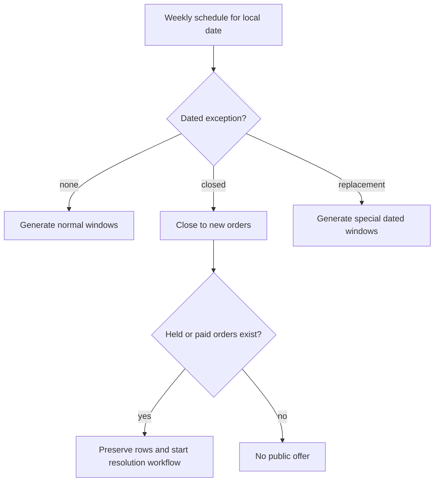

# Close or change one day safely

A cook offers lunch every weekday, then needs to close next Tuesday. Editing the weekly template to remove Tuesdays would close every future Tuesday. That is the wrong scope for one event. A dated exception says what happens on one local calendar date while leaving the normal schedule intact. Sufra uses the same mechanism when a cook opens a special evening window, for example a planned iftar meal, without claiming that every evening is now part of the kitchen's weekly hours.

An exception is an instruction to the window generator, not a silent edit to an existing paid order. If next Tuesday's lunch already has paid diners, the cook cannot make it disappear by pressing "close." The app may close the window to new orders and start a cancellation or support flow for existing ones. It must keep the paid order timeline and the original delivery promise for review.

## Name the scope of the exception

Store a kitchen-local `localDate`, the kitchen ID, an exception kind, and the affected rule key. A `closed` exception suppresses generation or closes one dated occurrence to new claims. A `replacement` exception supplies one or more special local start/end intervals and capacity values for that date. Validate that replacement intervals do not overlap each other or existing open windows for the same kitchen. Resolve them using the kitchen's named zone for that date, just like the weekly rule.

The decision at the bottom is the safety boundary. For a future unclaimed date, closing can hide or remove a generated row. For a row with a hold or paid order, deletion would erase the context needed to release capacity, refund, notify, or defend the promise. Keep the row, set it closed to new orders, and let explicit order transitions handle people who already bought.

## Build the exception API

Extend the `ScheduleException` model introduced in M9. Its unique index on kitchen, local date and rule key already protects a date-specific closure. M9 reserves `sourceRuleKey: '*'` for a whole-day pause; the generator must check that wildcard before any rule-specific exception. Add replacement-window fields and validation here. A cook can create or change only their own kitchen's exception. A diner has no write access. Validate the local date as a calendar date in the kitchen zone, not a UTC day guessed from the API process. For a replacement interval, validate the local start and end through the time helper; reject skipped or repeated boundaries. Check that capacity is a nonnegative integer and a special window has enough time before its cutoff to prepare at least one listed dish.

The endpoint can be `PUT /api/kitchens/me/schedule-exceptions/:localDate`, with a request body that explicitly says `closed` or `replacement`. Do not overload an empty `windows: []` array to mean both "closed on purpose" and "form omitted the field." A clear kind avoids accidental closures when a client sends a partial update. Return the affected dated windows and whether any held or paid order requires follow-up.

The service must check ownership before reading private order details. A cook may see counts and their own orders for the affected window. A different cook cannot inspect those orders by guessing a kitchen ID. The exception itself is not a payment action, but it can trigger a chain of notifications and refunds, so authorization and an audit trail matter.

## Reconcile the dated rows

On a new exception, inspect the existing `DeliveryWindow` rows for that kitchen and local date. If a row has no claims or paid orders, it can be marked closed and a replacement can be inserted. If it has active holds, stop new claims and let the hold-expiry or checkout-cancellation path release them. If it has paid orders, retain its original UTC interval and capacity snapshot, mark it closed to new orders, and open a task for the cook to contact affected diners or cancel through the order lifecycle. Do not silently move their orders into the replacement window. A diner chose and paid for a particular interval.

Run the generator again after adding the exception. It should not resurrect a closed occurrence because the exception is checked before upsert. It should not reset capacity on a paid occurrence. A retry should produce the same public window list and preserve the same order links. This is the idempotency property from the previous chapter applied to a schedule change.

## A concrete day

The kitchen normally offers a 13:00 to 14:00 lunch window in Gaza time. The cook plans a special evening delivery window from 18:30 to 19:30 on one local date and closes lunch that day. Enter one `closed` exception for the lunch rule and one replacement window with its own stable key. Run generation and inspect the public list: that date has the evening window, while the following weekday returns to normal lunch. The special window's cutoff is computed from its own dated start, preparation requirements and travel buffer. Do not copy the lunch cutoff just because both belong to the same kitchen.

Now add a paid lunch order before closing the date. Re-run the scenario. The lunch row must remain in the database and in the cook's order board; it is merely unavailable for new diners. The API should report that the cook needs to resolve one paid order. A subsequent cancellation must create a timeline event and a refund decision. This chapter does not implement refunds, but its data model must keep the information that later module needs.

## Verify failure behavior

Test a different cook attempting to close the kitchen and expect 403. Test an exception with a nonexistent local boundary on a clock-change date and expect a clear 422. Test two replacement windows whose UTC intervals overlap and expect a validation error before either becomes public. Test an unclaimed closure and a claimed closure separately. The first may hide the row; the second must preserve it and surface a follow-up action.

## Race a closure with checkout

A cook can press "close" while a diner is starting checkout. A pre-read of current claims is not enough to decide that the window is empty; a claim may arrive after that read. The closure and claim paths need one serialized state boundary. The simplest course design is to mark the dated window `closed` with a conditional write, and make the capacity claim filter require `status: 'open'`. The exact transaction or compensating-release choice is made in the checkout module, but this module must establish the condition now. A checkout that loses the race receives a clear window-closed conflict and no charge.

If the diner won a hold just before closure, the exception flow sees the held claim and preserves the row for resolution. It should not reset capacity or erase the hold. If the cook won the close first, the later claim filter must fail. Write both orders of events as tests. This is a different race from two diners taking the last capacity units, but both are protected by making the expected state part of the database update filter.

An exception also needs an audit trail. Record who created it and when, which local date and rule it affected, and whether paid orders existed. A cook might later ask why Tuesday disappeared from the public list. The trail should answer that question without exposing diner addresses in a schedule log. Keep full order details behind the kitchen ownership check and show only the count in a general settings response.

Keep a short reconciliation table in `docs/window-decisions.md`: prior window state, requested exception, public result, and what happens to existing claims or orders. The table makes it possible to review the behavior without reading every handler. The next lesson freezes time and tests the exact cutoff boundary for both a normal and a special window.

References: [MongoDB unique compound indexes](https://www.mongodb.com/docs/v8.0/core/index-unique/create-compound/), [Luxon named-zone API](https://moment.github.io/luxon/api-docs/).
