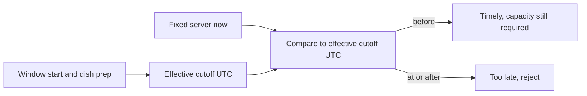

# Make the cutoff boundary fail on purpose

A test that calls the real clock and expects a cutoff "soon" is a test of the machine's timing as much as the product. Sufra needs evidence at the exact boundary. Freeze the server clock and ask the same cutoff function at one second before, exactly at, and one second after. The expected result follows the strict rule chosen in lesson 14.2: only a request before the cutoff is timely.

This test protects a real decision. At 11:10 exactly, a 90-minute dish for a 13:00 window with a 20-minute travel buffer is already too late under this policy. If the UI says "Order by 11:10," add copy that clarifies orders must arrive before that time. The server uses its own instant at the state-changing claim, not the time printed on the diner's phone. A fake clock makes the rule reproducible for a mentor and after a deployment.

## Write the boundary table first

Use a dated fixture for the 13:00 lunch window in `Asia/Gaza` on a historical date. Resolve its local start to UTC with the shared time helper. Give the window a general 12:00 local cutoff. Add maqluba with 90 prep minutes and falafel with 30, both with a 20-minute travel buffer. Convert the expected local cutoff labels to UTC using the same dated zone, then compare epoch milliseconds in the pure function. Do not construct a JavaScript `Date` from the string `"2024-01-15 11:10"` without a zone; the test would depend on the host setting.



The "timely" branch is not an order success. It only says the cook has enough preparation time according to the published settings. The later capacity claim can still fail with `WINDOW_FULL`, and another kitchen in a multi-kitchen cart may fail independently. Keep the test name precise so a passing cutoff test is not mistaken for a passing checkout test.

## Test the exact instants

Use the test runner configured in the learner project. This example uses Node's built-in runner and a fixed clock object so the decision is independent of wall time. Adapt the import names if your project already has a test runner; do not change the expected boundary.

```js
import test from 'node:test';
import assert from 'node:assert/strict';
import { dishCutoff, isDishTimely } from './cutoff.js';

const fixed = iso => ({ now: () => new Date(iso) });
const window = {
  startAt: new Date('2024-01-15T11:00:00.000Z'),
  cutoffAt: new Date('2024-01-15T10:00:00.000Z'),
};
const maqluba = { prepMinutes: 90 };

test('slow dish closes at its preparation cutoff', () => {
  assert.equal(dishCutoff(window, maqluba, 20).toISOString(),
    '2024-01-15T09:10:00.000Z');
  assert.equal(isDishTimely(window, maqluba, 20,
    fixed('2024-01-15T09:09:59.000Z')).timely, true);
  assert.equal(isDishTimely(window, maqluba, 20,
    fixed('2024-01-15T09:10:00.000Z')).timely, false);
  assert.equal(isDishTimely(window, maqluba, 20,
    fixed('2024-01-15T09:10:01.000Z')).timely, false);
});
```

The fixture's UTC values correspond to 13:00 and 12:00 in Gaza on this historical January date. The test keeps UTC explicit so a process `TZ` change cannot move the boundary. Add falafel with 30 prep minutes and assert its effective cutoff is the general 10:00 UTC value, not the later preparation deadline. That extra case proves the function chooses the earlier limit.

## Prove the test detects a bug

Temporarily change `clock.now().getTime() < cutoff.getTime()` to `<=`. The exact-at-cutoff assertion should fail. Restore the strict comparison. Then temporarily change `Math.min` to `Math.max` in `dishCutoff`; the falafel case should fail because it would remain open after the kitchen's general cutoff. A test suite is useful when it rejects these plausible wrong implementations. If both mutations pass, strengthen the fixtures before moving on.

Run the suite with `TZ=UTC` and `TZ=Asia/Qatar`. The UTC cutoff and timely booleans must match. If they differ, find an unzoned date string in the fixture or code. Tests should not compensate by setting a mandatory production `TZ` value. The kitchen IANA zone is an explicit input to date expansion, while a stored dated window already contains UTC instants.

## Verify a clock-change date

Create a weekly lunch rule for a controlled Berlin kitchen and generate dated windows on 25 March and 1 April 2024. Both should format to 13:00 local on their respective dates. Their UTC clock hours should differ because the zone offset changed. Then calculate each dish cutoff from that dated UTC start. A generator that adds seven 24-hour periods to the first UTC start will fail this check. Do not hard-code a future Gaza transition date to prove the algorithm; the historical Berlin case is stable evidence about the conversion path.

For the actual Sufra seed kitchen in `Asia/Gaza`, print the next seven dated local windows and their UTC instants during a deploy smoke check. Record the runtime and time-zone-data version as available. That check can reveal changed zone policy or environment data without turning a future political time decision into a brittle unit assertion. If the smoke output changes, review affected unclaimed windows and paid promises before regenerating.

## Verify idempotency and exceptions

Run window generation twice and compare IDs and remaining units. Add a held claim and run it again; the held window's units must not reset. Add a dated closure and rerun; the public list must omit the closed occurrence. If a paid order exists, its historical window row must remain and be closed only to new orders. These are not the same test as cutoff arithmetic, but together they prove the seven-day list cannot duplicate a lunch or erase a promise on a worker retry.

## Follow one request through the boundary

Add an integration test at the cart API after the pure tests pass. Freeze the server at 11:09:59 for the maqluba example and add the dish to the chosen dated window; the route accepts the line if the other validation passes. Move the clock to 11:10:00 and repeat with a fresh cart; the route returns `DISH_CUTOFF_PASSED`. The same route should not reveal another diner's cart. This test proves that the API uses the shared cutoff function and injected clock, rather than reimplementing a slightly different rule in a handler.

Then test checkout with a cart line added before cutoff but claimed after cutoff. The earlier cart success must not authorize the late claim. The checkout response identifies the stale line and suggests a later window. It must not create a paid order for that line. If a PaymentIntent was created before the failure, the payment module must handle cancellation or refund according to its state; this chapter records the required behavior without pretending payment is implemented here. The test can initially be marked pending until the checkout module exists, but the requirement belongs in the gate plan now.

This is also a place to test two kitchens. Give one a timely fast dish and the other an expired slow dish in the same chosen delivery window. Checkout should reject the whole proposed payment before creating split orders. It should not silently charge only the first kitchen or invent a different delivery window for the second. The cart UI can let the diner remove or move the expired line and review a new total.

## Check what the UI says

The browser may use the server's reported current instant to draw a countdown, but a countdown is an estimate. Test a phone clock set ten minutes ahead and one set ten minutes behind. The server's cutoff decision should be identical for both clients. The screen should recover from a conflict by fetching fresh window and dish data. Do not leave an expired green "Add" button active after the server rejects it; update the displayed state and give the diner an actionable next window.

Keep the time-zone label visible in the confirmation. A diner in Berlin may see a different local hour from a cook in Gaza. Both labels refer to the same UTC dated window. A test can assert that changing the diner profile zone changes the label but not `window.startAt`, `window.endAt`, or `cutoffAt`. This prevents a presentation setting from moving a meal promise.

## Read the test output critically

A green suite is only evidence if it ran the intended cases. Check the runner output for the exact boundary test, the Berlin transition case, the retry preserving held capacity, and the closure with a paid row. If a file pattern skips the new tests, `npm test` may exit zero while proving nothing. Save the command and result. If a case fails, print the dated UTC inputs and kitchen zone, not only a local label. That makes the defect reproducible on another machine.

Save the test commands and output in `docs/window-decisions.md`. Include the exact date, zone and cutoff values. A mentor should be able to rerun the test without guessing the machine's locale or waiting for a real lunch hour. The next gate asks you to explain why a dish can be too late while capacity remains and why a window can be full before its cutoff.

References: [MDN on zoned local time](https://developer.mozilla.org/en-US/docs/Web/JavaScript/Reference/Global_Objects/Temporal/ZonedDateTime), [MongoDB atomicity documentation](https://www.mongodb.com/docs/manual/core/write-operations-atomicity/).
