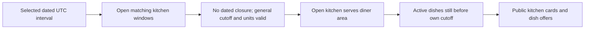

# Window first

Lina needs lunch around 13:00. Showing every dish in Sufra before asking for a delivery time would create a misleading catalogue. Maqluba may be on Umm Yousef's menu but already too late for the 13:00 window. A fast falafel meal may still fit. Beit Hanan may serve Lina's area but offer only an evening window. The diner needs an answer to "who can feed me then?" before comparing dishes.

This module builds the server answer. The client chooses a dated delivery interval from windows the platform actually offers. The browse API returns kitchen windows that match that interval and service area, remain open, have a general cutoff in the future and show remaining load units. It joins each kitchen's active dishes, then removes any dish whose own preparation deadline has passed. A result is a current invitation to try, not a reservation. Cart and checkout will check again.

## Begin with an actual interval

Use a canonical UTC `startAt` and `endAt` pair from Sufra's dated window list. Do not let the browser invent "today 13:00" in its local time and ask the server to guess what it means. A diner in a different zone may display the interval differently, but the selected pair names the same instants. Each participating kitchen has its own `DeliveryWindow` document for that pair, with its own capacity, cutoff, zone snapshot and status.

A kitchen can be public and still have no matching window. It may serve Lina's neighborhood but work dinner only. A window can exist and still be closed by a cook's date-specific exception. It can have units but be past its general cutoff. It can be open and timely for falafel but too late for maqluba. The browse API must filter at each of these boundaries instead of returning a kitchen card and hoping the client hides it correctly.

The diagram shows the filters in the order a reviewer can inspect. The result includes only kitchens with at least one orderable dish for the selected interval.

The last result is a view of changing data. Another diner may claim units immediately after it is sent. The server returns its current instant and each dish's dated orderable-until value so the client can show an honest label. It does not return another diner's claim IDs or address. A countdown can help Lina act, but it cannot authorize payment when the clock or capacity changes.

## Work the 11:31 lunch case

Umm Yousef has a 13:00 window with a 12:00 general cutoff and a 20-minute travel buffer. Maqluba needs 90 minutes, so its preparation deadline is 11:10. Falafel needs 30 minutes, so its preparation deadline is 12:10, but the general cutoff closes it at 12:00. At 11:31, browse should omit maqluba and include falafel if at least one load unit remains. It should not mark maqluba "sold out" merely because it is hidden. The reason is time, not necessarily capacity.

Now give the same kitchen zero remaining units. The entire window is omitted from orderable results, even though falafel is still timely. Give Beit Hanan a matching 13:00 window but a service area that does not include Lina's neighborhood. It is also omitted, for a different reason. Give Abu Sami a window that matches the interval and area but is `closed` by a whole-day exception. It must not reappear because its old window row still says it once had capacity. These cases become API tests, each with its own expected reason.

At 12:00 exactly, the general cutoff has passed under the strict rule. Even a fast dish is omitted. A request made one second before may have returned a card, but a cart request received at the cutoff must reject it. A stale browse response is normal; a late state-changing claim is the bug. The client can offer a later window without pretending the earlier one is still open.

## Keep the kitchen boundary intact

The API joins dishes by their actual `kitchenId`. A dish from Abu Sami must never appear under Umm Yousef's card because a cart line guessed a kitchen ID or because an aggregation joined by display name. The window also belongs to the same kitchen as the card. Tests should seed a dish with a different kitchen ID and prove it is excluded from the first card. A wrong-kitchen dish is more than a visual mix-up: it could make checkout calculate the wrong travel buffer, cutoff and capacity pool.

Public responses contain only fields the diner needs: kitchen ID and display name, chosen window ID and interval, safe area label, dish ID and name, price, preparation estimate, allergens, orderable-until instant and a coarse remaining-capacity hint. They do not contain claim arrays, owner email, private kitchen address or another diner's order. The backend needs those private fields for correctness, but the browse response is not an export of the database document.

## One query should not become one query per card

A simple implementation may load matching windows, then fetch each kitchen, then fetch dishes for each kitchen in a loop. With twenty kitchens, the number of database calls grows with the results. The delay is particularly costly on a phone connection. The roadmap asks for one aggregation that starts with selective dated windows and joins kitchens and dishes. The later lesson measures it with `explain()` and a query counter. One aggregation is not automatically fast, but it makes the data path reviewable and avoids an obvious N+1 pattern.

Filters and pagination must happen before returning a huge result. A dietary tag or kitchen filter should be applied in the query, not only after the server has loaded every dish. Stable cursor order prevents the same kitchen from appearing twice when the diner asks for the next page. Capacity and cutoff can change between pages, so each page uses a fresh server instant. The UI should be prepared for fewer results than a previous count suggested.

## Write the API promise

In `docs/browse-decisions.md`, write one request: selected UTC interval, normalized area code, optional dietary tag and page cursor. Write one response card from the 11:31 example with `serverNow` and falafel's `orderableUntil`. Then write four absent cases: maqluba past its own cutoff, a full window, a closed window and a kitchen outside the area. Give each a reason in the test notes even though absent cards do not expose private details to a diner.

Do not use this response as an order confirmation. It is a dated, bounded public view. The next lesson implements the first filter on matching windows and kitchens. Later lessons join dishes, apply their own deadlines and inspect the query plan before a cart uses the result.

Consider how a diner changes the selected interval. If Lina moves from 13:00 lunch to 18:00 dinner, the API must run the filters again for the new UTC pair. It cannot reuse the lunch cards and simply print "18:00" above them. A kitchen may offer dinner with different capacity, a different cutoff or different dishes. The cart also needs a new review if lines were already added. This is why the selected window identity travels with each dish offer and later cart line.

Consider how a cook edits a dish at 11:20. The new preparation minutes affect future offers, while an already paid order keeps its snapshot. A browse response at 11:19 and another at 11:21 can legitimately differ. The API should report one `serverNow` for the whole response and calculate all cutoffs from the same current data snapshot as closely as the database permits. It should not cache an `orderable: true` boolean on the dish record and expect a background job to flip it at every cutoff.

Finally, write a negative test for a wrong-kitchen reference. Create a valid 13:00 window for Umm Yousef and an active falafel dish that belongs to Abu Sami. The browse aggregation must not put that falafel under Umm Yousef just because both are active and timely. If the test fails, inspect the equality join on `kitchenId` before editing the interface. The card's kitchen ID, window ID and dish kitchen ID must describe one ownership chain.
