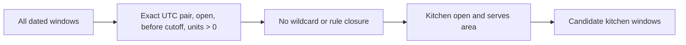

# The availability query

The first browse filter starts from `DeliveryWindow`, not `Dish`. Lina has chosen a dated 13:00 interval, so the database should consider only windows that match its UTC start and end. A candidate window must be open, still before its general cutoff, have at least one remaining load unit, and not be closed by a dated exception. Its kitchen must be open and serve Lina's normalized area. These checks reduce the candidate set before the more expensive dish join.

Capture one server instant for the request. A result at 11:59:59 may include a window that a request at 12:00:00 omits. Under this course's strict rule, `cutoffAt > now`. Use the current instant from the API's injected clock, not a browser timestamp. A response can include `serverNow` so the client formats a countdown, but that countdown remains guidance rather than checkout authority.

## Validate the selected interval

Create `server/src/modules/browse/browse-windows.js` and a `GET /api/browse/windows` route. Accept `startAt`, `endAt` and `area` query values. Parse exact ISO instants, reject invalid dates and require end after start. Bound the requested horizon to the next seven days for the core product, using the server clock. Normalize the area code with the same convention as the Kitchen API. Do not pass raw user strings into a MongoDB pipeline as operator names or regular expressions.

The route may receive a selected interval from the window-picker API, but it still validates inputs. A client can forge query parameters. If no kitchen has that exact UTC pair, return an empty list with a clear next-window suggestion rather than inventing a new `DeliveryWindow`. The pair identifies a public search target; the individual kitchen window IDs in the result are what cart lines will reference.

The diagram shows why the first `$match` belongs before joins. It narrows the database work to one interval and current public state.



The last box is not yet the final API response. A kitchen may pass these checks but have no active dish or only slow dishes past their own cutoffs. Lessons 15.3 and 15.4 add that requirement before the route is exposed to diners. Keep intermediate tests private to the module until the full filter is assembled.

## Match windows and closures

Use the field names established in M5, M9 and M14: `startAt`, `endAt`, `cutoffAt`, `remainingUnits`, `status`, `localDate`, `sourceRuleKey` and `kitchenId`. M9's `ScheduleException` uses `sourceRuleKey: '*'` for a whole-day pause. M14 also allows a rule-specific `closed` exception. The query needs to exclude either kind when it matches this window's local date and kitchen.

```js
export function windowCandidateStages({ startAt, endAt, area, now }) {
  return [
    { $match: {
      startAt, endAt, status: 'open',
      cutoffAt: { $gt: now }, remainingUnits: { $gt: 0 },
    } },
    { $lookup: {
      from: 'scheduleexceptions',
      let: { kitchen: '$kitchenId', day: '$localDate', rule: '$sourceRuleKey' },
      pipeline: [{ $match: { kind: 'closed', $expr: { $and: [
        { $eq: ['$kitchenId', '$$kitchen'] },
        { $eq: ['$localDate', '$$day'] },
        { $or: [
          { $eq: ['$sourceRuleKey', '*'] },
          { $eq: ['$sourceRuleKey', '$$rule'] },
        ] },
      ] } } }],
      as: 'closures',
    } },
    { $match: { closures: { $eq: [] } } },
    { $lookup: {
      from: 'kitchens', localField: 'kitchenId', foreignField: '_id',
      pipeline: [{ $match: { status: 'open', serviceAreaCodes: area } }],
      as: 'kitchen',
    } },
    { $unwind: '$kitchen' },
  ];
}
```

The expression tests the wildcard or exact rule key. Confirm the collection names in your Mongoose setup; the example assumes the default names shown here. The area value has already been normalized and is compared as an exact array member. The kitchen join uses its ObjectId relationship, not a display name. A paused or draft kitchen does not pass `status: open`, even if an old dated window still says `open`.

The broad status and cutoff checks are repeated in checkout later. Browse can return a window just before a different request claims the last units. The query only gives a useful current hint. Cart validates the chosen window and dish again; M19's conditional update is the final capacity decision. Do not expose `remainingUnits` as a guarantee of how many diners can still pay, because dishes consume different load units.

## Work four negative rows

Seed one valid 13:00 window for Umm Yousef. Add a second with `status: closed`, a third with `remainingUnits: 0`, and a fourth with `cutoffAt` exactly equal to the fake server instant. None of those three should pass. Add a valid open window whose kitchen does not serve Lina's area; it also fails. Add a wildcard closed exception for the first window's local date; it now fails even though its row remains open until reconciliation marks it closed. This test protects the pause race described in M9.

Then add another kitchen with the same interval and a different `kitchenId`. Its window should pass when it serves the area and has no exception. A closure on Umm Yousef's kitchen must not hide the second kitchen's window. If it does, the exception lookup omitted its kitchen equality. A rule-specific closure should hide only the matching source rule on one date, not every future lunch.

Test with `now` one second before, exactly at and one second after a general cutoff. Only the first is eligible. Keep the date values as explicit UTC instants in the fixture. Changing the test process `TZ` must not change the result. A query that compares local labels instead of dates may pass on one machine and fail on another.

## Decide what an empty answer means

An empty candidate list can have several causes. No kitchen may offer that interval in Lina's area. The interval may have existed but every general cutoff passed. A cook may have paused today. Every window may be full. The public response need not reveal a private kitchen's claim count, but it should give Lina a safe next action. Query the next published interval with at least one public candidate and offer a change-window link. Do not invent a window or quietly move her cart to it. A new interval can change kitchens, dishes and price, so she must review the choice.

Keep error and empty states separate. An invalid `startAt` string is a 400-style input error with field feedback. A valid interval with no candidates is a successful empty result. A database failure is a server error with a request ID, not an empty result that suggests every cook is closed. This distinction matters to a diner on a weak connection: a temporary service fault should not be presented as a product decision about today's lunch.

## Inspect the first index choice

The leading `$match` needs a supporting index on dated windows. Start with `{ startAt: 1, endAt: 1, status: 1 }` for exact interval and status, then inspect `explain()` with realistic seed volume. Additional range conditions on cutoff and remaining units may be filtered after the indexed equality prefix. Do not assume that putting every field into one compound index makes all conditions efficient. The exception lookup needs a unique or indexed combination of kitchen, local date and source rule key, already introduced in M9. The kitchen join uses `_id`, while the area filter should be checked against the returned kitchen.

Add the browse index to the `DeliveryWindow` model from M5 and apply it through the project's controlled index setup before measuring the plan. Keep the existing unique `{ kitchenId: 1, startAt: 1 }` index for generator idempotency; the browse index serves a different access pattern. Run a migration or explicit index build in production rather than assuming a schema edit instantly makes the index available. Verify the index list after deployment.

Measure how many windows reach each stage. If the initial match returns thousands for a single interval, the selected pair or index may be wrong. If most rows survive the first match but disappear only after kitchen lookup, consider whether the service-area design and join order need improvement. If the exception lookup dominates the plan, inspect its index and whether the wildcard predicate is using it. The gate later requires a saved plan; this chapter starts the measurement without claiming one index is universally best.

## Guard the returned window identity

When the next lesson joins dishes, carry the window `_id` and `kitchenId` through the pipeline. A cart line must reference the window ID that produced the offer. Do not return only the public interval and let the client choose a kitchen window ID later. Two kitchens may share the same UTC pair but have different cutoff and capacity. A guessed or mismatched ID can make the cart show one kitchen's dish against another kitchen's pool. The later cart route verifies all three relationships again: dish to kitchen, window to kitchen, and window interval to selected cart interval.

The response may include a coarse capacity message such as "limited space" from current remaining units, but it should not promise a number of meals. One tray may cost three units and one wrap one. If a diner sees a card at 11:09:59 and taps at 11:10:00, the cart may reject the slow dish. Keep `serverNow` and dated cutoff in the response so the UI can explain that change. Do not attempt to make browse a long-lived lock merely to avoid a possible conflict.

## Shape a safe intermediate result

Project only window ID, UTC interval, general cutoff, kitchen ID, display name and a coarse capacity hint for internal testing. Do not return `claims` or raw kitchen owner fields. The final response will add orderable dish snapshots and a per-dish `orderableUntil`. A client should not need access to claim subdocuments to draw a kitchen card.

Save the candidate count before and after each filter in `docs/browse-decisions.md`. If a kitchen outside the area appears, inspect the kitchen join and normalized code. If a closed date appears, inspect wildcard exception matching and status reconciliation. If a window at cutoff appears, check that the filter uses `$gt`. The next lesson adds the dish join without one extra query for every candidate kitchen.

References: [MongoDB `$match` placement](https://www.mongodb.com/docs/manual/reference/operator/aggregation/match/), [MongoDB `$lookup` pipelines](https://www.mongodb.com/docs/manual/reference/operator/aggregation/lookup/), [MongoDB `$expr`](https://www.mongodb.com/docs/manual/reference/operator/query/expr/).
