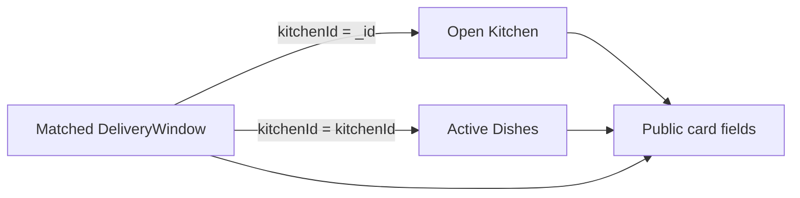

# Kitchens and dishes without N+1

The first pipeline returns dated kitchen windows that can still offer some capacity. Lina needs the dishes she can compare for that interval. A tempting handler loops over the windows and calls `Dish.find({ kitchenId })` for each one. With twenty windows, that makes twenty dish queries after the first window query. The number of database calls grows with the number of cards, and the delay appears just when a diner is waiting on a phone.

Join dishes inside the aggregation. Start with the selective window stages from lesson 15.2, which already join the matching kitchen. Then use `$lookup` to fetch only active dishes whose `kitchenId` equals the candidate window's `kitchenId`. Project only public dish fields. One application query returns kitchen cards with their dishes. This does not guarantee a fast plan by itself; the gate will inspect indexes and rows examined. It does remove the application-level N+1 pattern and keeps the ownership join visible in one place.

## Join by IDs, not names

Two cooks can name their kitchens similarly, and two dishes can both be called falafel. A display name is not a safe join key. The window has a `kitchenId`, the Kitchen document has `_id`, and the Dish has `kitchenId`. Require these IDs to agree. A wrong-kitchen dish must not appear on a card merely because it has the same title or a matching service area. This is also a checkout safety issue, since travel buffer, cutoff and capacity are kitchen-specific.

The diagram shows the join chain and the projection boundary. A diner sees public fields but never the embedded capacity claims or cook account details.



At this stage, active dishes are still candidates. A slow dish may already be past its own cutoff even though the general window cutoff is open. Lesson 15.4 adds that time filter. Keep the route internal or mark this as an intermediate query while building. Do not expose a card with a late dish and tell the client to hide it later; the server's response should be the reviewed public offer.

## Add a bounded dish lookup

Create `server/src/modules/browse/join-dishes.js`. Append the following stages after `windowCandidateStages`. The example assumes the Mongoose collection is named `dishes`; confirm the actual collection name in the learner project. The equality join can use an index on `{ kitchenId: 1, status: 1 }` from M5. The final `$project` explicitly excludes claim and private kitchen fields.

```js
export function joinActiveDishesStages() {
  return [
    { $lookup: {
      from: 'dishes',
      localField: 'kitchenId',
      foreignField: 'kitchenId',
      pipeline: [
        { $match: { status: 'active' } },
        { $project: {
          _id: 1, kitchenId: 1, name: 1, priceMinor: 1,
          currency: 1, prepMinutes: 1, loadUnits: 1,
          maxPerOrder: 1, allergens: 1, dietaryTags: 1,
          activeWeekdays: 1,
        } },
      ],
      as: 'dishes',
    } },
    { $match: { 'dishes.0': { $exists: true } } },
    { $project: {
      _id: 1, kitchenId: 1, startAt: 1, endAt: 1,
      cutoffAt: 1, localDate: 1, sourceRuleKey: 1,
      kitchenZoneAtGeneration: 1, travelBufferMinutes: 1,
      remainingUnits: 1, dishes: 1,
      'kitchen._id': 1, 'kitchen.name': 1,
      'kitchen.serviceAreaCodes': 1,
    } },
  ];
}
```

The projection keeps `kitchenId` on each dish for a testable ownership chain. It does not mean the browser may change that ID when adding to cart. The cart service reloads the dish and verifies it belongs to the selected kitchen window. Do not project the kitchen owner user ID, private address, claim array or another diner's order. The API can calculate a coarse capacity hint from `remainingUnits` before returning the card without publishing claim details.

The `$match` on `dishes.0` removes kitchens with no active dishes. It does not yet prove any dish is timely. After lesson 15.4 filters each dish by its effective cutoff, apply the nonempty check again. Otherwise a kitchen card may remain with an empty dish list after every slow item closes. That would invite a tap that cannot lead to a cart line.

## Test a wrong-kitchen fixture

Seed Window A for Umm Yousef and Window B for Abu Sami, both at 13:00. Give A one active soup and B one active falafel. Run the aggregation and assert A's card contains soup only, while B's contains falafel only. Add a paused dish under A; it must not appear. Add a dish with an invalid or missing kitchen reference; it must not appear under any card. This catches a join accidentally made on name, status alone or a client-provided kitchen ID.

Give A a matching area code and B a different area. Search A's area; B should not appear even if B's dish is active and its window open. Then close A's dated window; neither card should appear for that query. These tests connect the new dish join to the earlier window and kitchen filters. A local test of `joinActiveDishesStages` alone would not prove the full public API.

## Count calls and inspect returned fields

Instrument database calls in the integration test. One `aggregate` call should serve the page, rather than one dish `find` per kitchen. A `$lookup` may still read many documents internally; the application call count is only one part of performance evidence. Use `explain('executionStats')` later to see whether the dish join uses the kitchen-status index and how many documents it examines for a realistic seed.

Check the serialized JSON against an allowlist. Add a private field to a test Kitchen document and verify it does not appear. Add one embedded claim to a test window and verify its ID and attempt ID do not appear. The projection makes this test easier to pass, but run it because a later code change might return a raw document before projection.

## Keep the card tied to one window

A kitchen might offer two different intervals on the selected day. The pipeline begins with an exact UTC start and end, so one card should describe one dated window. If the API later supports a range search, a kitchen may produce several cards or a nested list of offers, but each dish's cutoff must be evaluated against the specific window that card names. Do not group all windows by kitchen before calculating cutoffs. The same maqluba can be late for lunch and timely for dinner.

The response can include both a kitchen ID and a window ID. The kitchen ID controls which dish records may join. The window ID controls which capacity pool and cutoff a later cart line requests. A diner cannot choose a different window ID by editing JSON and keep the card's earlier dish list as authority. The cart route verifies the chain again. If a test card has a dish from B under A's window, the safe response is to fix the join, not to rely on checkout to reject it every time.

## Compare query shapes with a fixture

Create ten kitchens, each with five dishes and one matching dated window. The loop version may make one window query, ten kitchen reads and ten dish reads. The aggregation makes one application call, then MongoDB performs indexed joins internally. Count actual calls in your route test. Next grow the fixture to twenty kitchens. The loop's call count rises with kitchens; the aggregation call count stays one, though its work inside MongoDB still rises. Record both call count and execution time so you do not claim one database call is always fast.

Add ten inactive dishes per kitchen. The lookup pipeline's `status: active` condition should keep them out of the returned array. If the database examines every dish for each window, inspect the `{ kitchenId: 1, status: 1 }` index and the explain plan. If the result payload grows large because one kitchen lists hundreds of active dishes, apply a reviewed product limit or separate detail route rather than sending every description and photo to a phone in the browse card. The course's card needs a small summary and can load detail after a deliberate tap.

The aggregation should not cache a yes/no availability flag on the Dish document. Time passes independently of dish edits. If you cache a public card response, give it a short policy and invalidate it for kitchen, dish, window and exception changes. Never use the cached card to authorize a capacity claim or payment. The next chapter computes per-dish deadlines on each browse request so a slow meal disappears at its actual cutoff without a job updating every dish row.

If a wrong-kitchen dish appears, check that the lookup uses `window.kitchenId` and `dish.kitchenId`. If latency grows linearly with cards, check for a hidden `find` loop in the route after aggregation. If a card has no dishes, check the nonempty filter and dish status. Record the query count and two-card fixture in `docs/browse-decisions.md`. The next lesson adds each dish's own dated cutoff, which can remove a slow dish while leaving a fast one in the same kitchen card.

References: [MongoDB `$lookup` aggregation](https://www.mongodb.com/docs/manual/reference/operator/aggregation/lookup/), [MongoDB `$match` stage](https://www.mongodb.com/docs/manual/reference/operator/aggregation/match/), [MongoDB aggregation explain](https://www.mongodb.com/docs/manual/reference/command/explain/).
