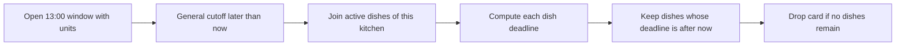

# Hide dishes past their own cutoff

The general 12:00 kitchen cutoff is still open at 11:31. That does not make every dish orderable. Maqluba needs 90 preparation minutes and a 20-minute travel buffer for the 13:00 window, so its own deadline was 11:10. Falafel needs only 30 minutes and is still timely until the general 12:00 cutoff. The browse card should keep falafel and omit maqluba. The kitchen may still have units; that fact does not reopen the slow dish.

Use the same formula taught in M14: `prepCutoffAt = window.startAt - prepMinutes - travelBufferMinutes`, then `effectiveCutoffAt = earlier of prepCutoffAt and window.cutoffAt`. An offer is timely only if the captured server instant is strictly before its effective cutoff. The route returns the cutoff instant for each retained dish so the client can display "order before" in the diner's zone. It does not return a static `isAvailable` field stored on Dish, because that field would go stale as the clock moves.

## Add a per-dish computation after the join

The preceding aggregation has one window, its kitchen and an array of active dishes. Map each dish into a public offer with `effectiveCutoffAt`, then filter the mapped array by `effectiveCutoffAt > now`. Finally remove kitchen cards whose array became empty. Keep the same `now` captured at the start of the request. If every dish uses a separate clock read, two offers near the same boundary can disagree merely because the loop ran at different milliseconds.

The diagram shows why a general window match comes before the dish-specific cutoff. The two reasons to hide an offer are independent of the capacity check that came earlier.



Use MongoDB's date arithmetic on stored UTC `startAt`. The travel buffer is snapped onto the dated window in M14. Do not read a changed kitchen setting for an already generated occurrence while computing one card; the window's buffer records the offer basis for that date. `prepMinutes` comes from the current active dish for a new offer. A paid order will later keep its own preparation snapshot.

```js
export function timelyDishStages(now) {
  return [
    { $set: {
      dishes: { $filter: {
        input: { $map: {
          input: '$dishes', as: 'dish',
          in: { $mergeObjects: ['$$dish', {
            effectiveCutoffAt: { $min: [
              '$cutoffAt',
              { $dateSubtract: {
                startDate: '$startAt', unit: 'minute',
                amount: { $add: [
                  '$$dish.prepMinutes', '$travelBufferMinutes',
                ] },
              } },
            ] },
          }] },
        } },
        as: 'offer',
        cond: { $gt: ['$$offer.effectiveCutoffAt', now] },
      } },
    } },
    { $match: { 'dishes.0': { $exists: true } } },
  ];
}
```

The code makes one dated cutoff per joined dish. Check the exact MongoDB version used by the learner project for `$dateSubtract` support, and test the pipeline against real MongoDB before claiming it works. The example is a source pattern, not evidence of an executed aggregation in this repository. If the project's version cannot use that operator, calculate the equivalent expression with supported date arithmetic and test exact boundary cases. Do not move the authoritative cutoff calculation to the browser.

## Prove the two cutoffs disagree

Seed a 13:00 window with a 12:00 general cutoff and 20-minute travel buffer. Add maqluba at 90 preparation minutes and falafel at 30. Freeze `now` at 11:09:59 and expect both dishes. At 11:10:00, expect only falafel. At 11:31, still expect falafel. At 12:00:00, the window's general cutoff filter removes the whole card. The strict greater-than comparison makes the exact cutoff late. A test at 11:10 without seconds is not enough; use explicit dated UTC instants.

Now reverse the cause. Give a quick dish a preparation deadline after the general cutoff. Its effective deadline must be the general cutoff, not the later preparation value. If the API returns 12:10 for falafel, it used only the dish calculation and ignored the cook's 12:00 stop time. M14's pure helper and this aggregation should agree for the same dated fixture. Add a cross-check test comparing their returned cutoff instants so a future formula edit cannot change one path without the other.

If every active dish becomes late while the general window is still open, remove that kitchen card. A card with no orderable items does not answer Lina's question. It can be shown in a separate informational kitchen page, but not as a lunch option with an Add button. The API can suggest a later dated window, where the same dish may be timely again. Do not mark the dish globally inactive because only this selected interval failed.

## Validate the inputs to date arithmetic

The aggregation assumes `prepMinutes` and `travelBufferMinutes` are finite positive or nonnegative integers within the limits enforced by M5 and M9. If old data violates those limits, `$dateSubtract` can produce a misleading cutoff or fail the pipeline. Run a migration audit before deploying the new browse route: count active dishes with missing or fractional preparation values and windows without a snapped buffer. Do not substitute zero silently for bad data. A bad dish can be marked unavailable with an operational alert until corrected, while valid kitchen offers continue.

An open window's general cutoff should be before its `startAt`, and its `endAt` should be after `startAt`. M14 validates these relationships at generation. The browse route can rely on validated records for normal operation but should log an impossible row and omit it rather than presenting it as an offer. A diner should never see a negative countdown or a dish marked orderable after the delivery interval began because one malformed window bypassed validation.

The current dish settings are used for new offers, but a cook edit can race with a browse request. The aggregation sees a consistent set of fields for each document it reads; it does not freeze the entire marketplace until checkout. A response can become stale immediately. Cart and M19 checkout reread and validate the dish and window. If a cook increases maqluba from 90 to 120 minutes after Lina sees it, the next state-changing step may reject the line and ask her to review a later window. It must not charge her based on the earlier, shorter estimate.

## Handle weekday and menu rules next

A dish may be active only on certain kitchen-local weekdays. The M5 dish model has `activeWeekdays`; an empty list means all days under the course policy. This chapter focuses on cutoff arithmetic. The next lesson adds weekday, dietary and kitchen filters before pagination. Keep the `window.localDate` and dish weekday list in the intermediate result so that filtering uses the kitchen's date, not the server host's or diner's date.

The response's `orderableUntil` should be the computed dated UTC instant. The client may format it for Lina and optionally show the kitchen zone. Say "Order before 11:10" for a strict boundary, not a phrase that implies 11:10:00 is accepted. If a user leaves the page open, the client can remove or dim an expired dish when its countdown reaches zero, but cart and checkout still repeat the backend check. A browser display is never the final acceptance rule.

Return the same `serverNow` for every card on one page. A card's cutoff can be 11:10 while another's is 12:00, but both are compared against one captured instant. When pagination requests a second page later, it captures a new instant and can legitimately return fewer dishes. Do not promise a fixed total count across pages as time advances. Use stable cursor order for rows that remain eligible, and let the UI handle a card disappearing because the cutoff or capacity changed.

If a kitchen is paused while the aggregation runs, the result can reflect either side of that concurrent change depending on timing. The important safety rule is that cart and checkout check the closure again, including M9's wildcard whole-day exception. A page may briefly show a card that becomes unavailable; it must not let a diner pay for a closed lunch. Document the expected conflict response and next-window suggestion so the stale-page case is a normal product flow, not a mysterious error.

## Debug the missing or extra dish

If maqluba appears at 11:31, print the window's UTC start, general cutoff, snapped buffer, dish preparation minutes, computed prep deadline and effective cutoff. A wrong `startAt` belongs to schedule generation. A wrong buffer belongs to the dated window snapshot. A wrong `Math.min` equivalent belongs to the aggregation. If falafel disappears early, check that the general cutoff and prep deadline were compared in the correct order and that the test fixture zone was resolved before subtraction.

Save the four dated results and the helper-versus-aggregation cross-check in `docs/browse-decisions.md`. The next lesson filters by diner needs and paginates after all eligibility rules, so a page never contains a wrong-kitchen, closed or late dish merely because pagination happened too soon.

References: [MongoDB `$dateSubtract`](https://www.mongodb.com/docs/manual/reference/operator/aggregation/dateSubtract/), [MongoDB `$filter`](https://www.mongodb.com/docs/manual/reference/operator/aggregation/filter/), [MongoDB `$map`](https://www.mongodb.com/docs/manual/reference/operator/aggregation/map/).
