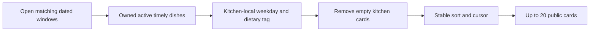

# Filters and pagination

Lina selects the 13:00 lunch window and her neighborhood. She then chooses a dietary tag and perhaps one kitchen she already knows. Those filters should narrow the server response before pagination. If the API first takes twenty windows and then removes late or mismatched dishes, a page may contain only two cards while valid kitchens sit on a later page. The result also needs stable order so a "Load more" tap does not repeat or skip a kitchen when the underlying collection is larger than one screen.

The kitchen filter is an ObjectId, not a display-name search. Validate it before building the pipeline and add it to the early window `$match` as `kitchenId` when present. The area filter still applies; choosing a kitchen by ID does not grant a diner access to a kitchen outside their service area or a closed window. A public filter can narrow eligibility but must never override it.

## Apply dish filters after time eligibility

M5 gives each Dish `activeWeekdays` and `dietaryTags`. An empty weekday list means the dish is offered on every kitchen-local weekday under this course policy. A nonempty list names weekdays numbered 0 for Sunday through 6 for Saturday. Use the `DeliveryWindow.localDate` to decide the weekday. Do not use the diner's local date, which may differ near midnight, or the API host's date. The selected window is a kitchen promise for its own local calendar date.

The dietary tag is a kitchen-provided label. Normalize it against a controlled set and describe it honestly. A tag such as `vegetarian` is not a medical guarantee and does not replace allergen information. If Lina filters by it, include only dishes explicitly carrying the tag. A kitchen with no remaining matching dish leaves the result. The client should not show a blank card with a message implying the kitchen has no food at all; it has no eligible dish for this filter and interval.

The diagram places eligibility before the page boundary. This ordering is what makes a page of twenty mean up to twenty actual offers, rather than twenty raw rows before many are removed.



Build `server/src/modules/browse/filter-and-page.js`. Derive a weekday from the date-only `localDate` as a calendar date; using UTC for this date-only parsing avoids changing the weekday based on the server host's zone. The window's `localDate` was generated in the kitchen zone, so it already names the correct local day. Then filter the already timely dish array and remove empty cards.

```js
export function menuFilterStages(dietaryTag) {
  const tests = [
    { $or: [
      { $eq: [{ $size: { $ifNull: ['$$dish.activeWeekdays', []] } }, 0] },
      { $in: ['$localWeekday', { $ifNull: ['$$dish.activeWeekdays', []] }] },
    ] },
  ];
  if (dietaryTag) {
    tests.push({ $in: [
      dietaryTag, { $ifNull: ['$$dish.dietaryTags', []] },
    ] });
  }
  return [
    { $set: { localWeekday: { $subtract: [
      { $dayOfWeek: { $dateFromString: {
        dateString: '$localDate', format: '%Y-%m-%d', timezone: 'UTC',
      } } }, 1,
    ] } } },
    { $set: { dishes: { $filter: {
      input: '$dishes', as: 'dish', cond: { $and: tests },
    } } } },
    { $match: { 'dishes.0': { $exists: true } } },
    { $unset: 'localWeekday' },
  ];
}
```

The array check handles an older dish whose weekday list is missing by treating it as all days. The schema and creation API should still write an explicit list. If missing means something different in your product, migrate old data and change the rule before publishing. The dietary tag branch adds a second condition only when a validated tag was requested. Do not place raw user text in a field path or operator position.

For a concrete weekday check, use a dated Monday lunch window whose `localDate` is Monday in the kitchen zone. Add a dish with `activeWeekdays: [2]` for Tuesday and another with an empty list. The Tuesday-only dish disappears; the all-days dish remains if its cutoff is open. Run the same fixture with the API process configured to a different host timezone. The result should not move to Sunday or Tuesday because the date-only value already names the kitchen's local calendar day. This catches an easy mistake where code calls `new Date().getDay()` on the server instead of using the window date.

For a dietary check, add two timely dishes from the same kitchen, one carrying the requested tag and one without it. The card should retain only the tagged dish. Now request a tag no dish has. The whole kitchen card should leave this browse page, but its public profile can still exist elsewhere. Do not make a tag filter override a known allergen warning. A diner with a serious allergy needs ingredient information and kitchen confirmation; the course tag is a browse aid, not a safety certification.

## Page after the final filter

Sort by immutable window `_id` for a stable course cursor. A name-based sort is pleasant but a cook can rename a kitchen between requests, making cards move across the boundary. The first page takes 21 rows when the requested page size is 20; the extra row tells the server whether another page exists. Return the first 20 and encode the last returned window ID as the next cursor. Bind the cursor to the selected interval, normalized area, dietary tag and optional kitchen ID, so reusing it after changing filters is rejected rather than skipping arbitrary cards.

Decode only a validated ObjectId from the cursor, then add `{ _id: { $gt: lastId } }` to the early window match. The sort remains `{ _id: 1 }`. Do not put a raw JSON cursor from the browser into a MongoDB query. A public cursor need not be secret, but it must be parsed, bounded and tied to the query it paginates. A short signed token or server-side filter fingerprint can do that. If the page is empty because time passed between requests, return an empty result and a clear window-refresh option.

Do not promise a fixed total count across pages. Capacity, cutoffs and kitchen pauses can change while Lina scrolls. A card can disappear from page two because its deadline passed. A new window might appear after a schedule update. Cursor ordering prevents duplicate stable IDs under a steady query; it does not freeze all marketplace state. The interface should handle an empty second page and let the diner refresh the chosen interval.

Use a small cursor payload rather than a whole kitchen document. It needs the last returned window ID and a fingerprint of the query inputs. The server can sign it so a client cannot substitute an arbitrary filter fingerprint, or it can validate and rebuild the fingerprint from an opaque server-side record. Either way, the database receives only a parsed ObjectId. Do not decode a base64 string and spread its JSON directly into `$match`. Query injection would be an avoidable cost of treating a pagination token as a trusted query.

If a window closes after page one, its ID may still be the cursor boundary even though the card is gone on refresh. That is fine: the cursor means continue after this stable ID, not continue after this kitchen's current name or capacity. If the selected interval itself has passed, return a refresh-required response rather than paging through historical lunches. This keeps the API's pagination contract aligned with a live, time-bound catalogue.

## Test filter order with a small fixture

Seed 25 matching windows. Make the first five by ID contain only late or wrong-tag dishes, and the next twenty contain timely matching dishes. The first page should return twenty real cards, not fifteen or zero because the raw first twenty were paginated too soon. Then request the next cursor and expect no repeated IDs. Change the dietary tag while reusing the cursor and expect a cursor-filter mismatch response. This test proves stage order as well as cursor validation.

Add a dish active only on Tuesday to a Monday kitchen-local window; it must be absent. Add a dish with an empty weekday list; it may appear if timely. Add a kitchen filter for a valid ID outside Lina's service area; the result is empty, not an ownership bypass. Add a wildcard close-today exception and verify pagination cannot bring the closed kitchen back on a later page.

If a valid kitchen is missing, print its window ID, `localDate`, computed `localWeekday`, dish weekday list and tag list. If a page is short despite many later eligible cards, inspect whether `$limit` or `$skip` ran before dish filtering. If cards repeat, inspect cursor ID comparison and sort. Save the fixture and query shape in `docs/browse-decisions.md`. The next gate uses `explain()` to check that the selective window match and dish join use indexes under a realistic seed.

References: [MongoDB `$filter`](https://www.mongodb.com/docs/manual/reference/operator/aggregation/filter/), [MongoDB `$dateFromString`](https://www.mongodb.com/docs/manual/reference/operator/aggregation/dateFromString/), [MongoDB aggregation pipeline optimization](https://www.mongodb.com/docs/manual/core/aggregation-pipeline-optimization/).
