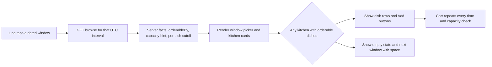

# Lunch on a phone, in a window

At 11:05 Lina is on a bus in Gaza City with two bars of signal and eight minutes before her class starts. She wants lunch at 13:00 and she has one free hand. She opens Sufra, taps a time, looks at three kitchens and decides. If that takes more than twenty seconds, or if the screen asks her to think about preparation minutes and travel buffers, she closes it and skips lunch. The browse screen is the product as far as she is concerned, and it is the part of Sufra she will judge everything else by.

Module 15 built the server answer: given one dated delivery interval and a neighbourhood, which kitchens can still cook at least one dish for it. This module builds the surface that uses that answer. The screen has three parts. A window picker with large targets for today and tomorrow. A list of kitchen cards, each showing the deadline that kitchen set for this window and a coarse hint about how much cooking space is left. A dish list inside each card, with preparation time, allergens and price, minus any dish whose own cutoff has already passed. When nothing fits, the screen says so and offers the next window that has space.

## The screen is a dated invitation, not a menu

Sufra's kitchens do not hold a shelf of food. Each one sells a share of its cooking time inside a delivery window, and that share shrinks as other diners order. A diner who opens a general catalogue of dishes sees maqluba from Umm Yousef and assumes it is available, even if her tray takes ninety minutes and the lunch cutoff for that dish was 11:10. The screen would then be advertising food that cannot arrive at the time she needs it.

So the browse screen always starts from a time. The diner picks a window first, and every card on screen describes what can be cooked and delivered inside that window. The same kitchen can appear for 18:00 and be missing for 13:00, and the same dish can be orderable at one o'clock in the afternoon and hidden at half past eleven. This order of decisions is the whole design, and it is worth protecting when the layout gets tight on a narrow phone.

The screen also has to stay honest about the fact that it is a snapshot. Between the moment the server builds the response and the moment Lina taps Add, another diner may claim the last units, the cook may pause the kitchen for today, or the clock may pass a cutoff. The screen cannot prevent any of that. What it can do is show values the server produced, label them as current, and let the cart and checkout repeat the checks with fresh data.

## Three kinds of facts, three different rules

Everything on this screen falls into one of three groups, and mixing them up is the most common way a browse screen starts lying.

The first group is durable facts about the offer: the kitchen's name, the dish's name, its allergen list, its preparation minutes and its price. These come from the kitchen and dish records. They can change when a cook edits a dish, but they will not change because a minute passed. The screen may render them freely and even keep them briefly while a refresh runs.

The second group is current state: the kitchen's deadline for this window, the remaining capacity hint, each dish's own cutoff instant and the server's own idea of the present moment. These change with the clock and with other diners. The screen may display them and must never compute them. A countdown is acceptable only when it is anchored to a server instant.

The third group is the diner's decision: which window she picked, which kitchen she opened and which dish she is considering. That belongs to the browser, and it must be sent to the server as an explicit selection rather than inferred from a formatted label such as "one o'clock".

The diagram is worth reading from the middle. The server facts arrive once per selected window, and the screen's only branching decision is whether there is anything to show at all. If your implementation has a branch that calculates whether a dish is orderable, that branch belongs on the other side of the network.

## A phone clock is not the server clock

Lina's phone is four minutes fast. She set the time by hand three weeks ago after a power cut, and she has not corrected it. If the browse screen hides dishes by comparing `orderableUntil` against `Date.now()`, it will hide a falafel that is still orderable and keep showing a maqluba that closed eight minutes ago. Both errors are invisible in a demo on a developer laptop with a correct clock.

The fix is small and it belongs in one place. Take the `serverNow` value from the response, subtract the phone's own time at the moment of receipt, and keep that offset for the life of the response. Every countdown and every local comparison uses `Date.now() + offset`. When the offset is larger than a minute or so, the screen can say that the phone's clock looks wrong instead of quietly calculating with it. Either way, the server still makes the final decision when Lina adds a dish to the cart.

It helps to say the deadline in words as well as a number. "Order by 11:30" with a small countdown underneath is easier to act on than a bare timer, and it survives a screen reader and a low-contrast screen. The countdown can stop at zero and the row can move into an expired state, but the text stays readable, because the diner may come back to the screen after the deadline and needs to understand what happened.

## Windows as large targets

The picker offers today and tomorrow, not the full seven days the generator creates. A person ordering lunch is choosing between "soon" and "later", and a scrolling list of fourteen windows makes that decision harder on a 360 pixel screen. The default selection is the first window in the list that still has kitchens with space, which for Lina at 11:05 is the 13:00 lunch window.

Each window is a full-width button with the time range on the first line and the order deadline on the second. The button is at least 48 CSS pixels tall, the text is at least 16 pixels, and the whole row is tappable, not just the time label. Two windows per row at this width would shrink each target to about 170 pixels and split the time range across lines, so the layout stacks them. A horizontal strip that scrolls sideways is the one pattern to avoid here, because the second window is then invisible and a diner may never learn that tomorrow exists.

Selected state must not depend on colour alone. The selected button carries a visible border, a checkmark label and `aria-pressed="true"`. A diner using a keyboard or a screen reader should be able to move between windows with Tab and Enter and hear which one is chosen. These details are not decoration. They are the difference between a screen that works on the fellows' phones and a screen that works on a laptop in a well-lit room.

## The kitchen card says two things

Lina reads a kitchen card to answer two questions: can I still order, and is there room for me? The card answers them with two server values: the kitchen's order deadline for this window and a coarse capacity hint. The deadline belongs to that kitchen's dated window, so two kitchens sharing the same 13:00 delivery interval can show different deadlines if one cook stops taking orders at 11:30 and another at 12:00.

The capacity hint is deliberately coarse. Sufra measures capacity in load units, not portions, because one tray of maqluba can use three units while a falafel wrap uses one. If the card said "two left", Lina would reasonably think two meals remain, then find that a single tray plus a drink no longer fits. A three-value hint (plenty, few, full) tells her what she needs to know without inviting arithmetic on a unit she cannot see. The server decides the threshold from the window's capacity, and the client prints the words.

Everything else on the card is context: the kitchen's neighbourhood, a preparation range taken from its orderable dishes, and dietary tags. Keep those secondary. The card's primary job is to move Lina to a dish list she can trust, and the fastest way to lose that trust is to print a deadline the server did not send.

## The dish row carries the safety details

Inside a card, each dish row shows the name, the preparation time in minutes, the allergen list and the price. Preparation time is a number the cook entered, not an adjective. "Takes about 90 minutes" is honest; "slow cooked" is marketing and hides the thing that decides whether Lina can eat at one o'clock.

Allergens get words, not just coloured dots. If maqluba contains nuts and the kitchen's knafeh contains gluten, the row says so in the diner's language, and the words are not truncated behind a "more" link. A diner with a sesame allergy is making a medical decision with this screen, and a tooltip that needs a hover is not available to her on a phone at all.

Prices are integer minor units from the server, formatted once at render. The row must never multiply a client-side price by a quantity that the cart will recalculate differently. That kind of mismatch produces a total that changes when the diner reaches the cart page, which reads as a scam even when the arithmetic is correct.

## When nothing fits

At 12:20 the 13:00 window is still open for a fast falafel, but suppose it is full. Every card for that window disappears, and the screen has two honest options: show nothing, or explain and redirect. Show the second. A short message says that the lunch window has no space left, and a button offers the next window with at least one orderable dish, with its time range and its own deadline.

The empty state must come from the same server response that emptied the list, so the suggestion is real. A hard-coded "try dinner" would be wrong on a day when the dinner windows are also full, and it would be wrong at 20:00 when tomorrow's lunch is the answer. If there is no later window with space in the search horizon, say that clearly and stop, because a button that leads to another empty screen is worse than no button.

One more rule: a dish past its own cutoff is hidden, not greyed out with a disabled Add button. A disabled row invites the question "why can I not press this", and the honest answer involves preparation minutes, a travel buffer and the clock, which is a paragraph, not a label. Hiding the dish and offering a later window answers the real question. The cart is where a diner sees a specific dish expire while her page is open, because there she has already chosen it and deserves an explanation.

## What you will build and what you will not

The next lesson builds the window picker, the kitchen card and the dish list against the browse response from Module 15, and makes the layout work at 360 pixels. The lesson after that is a gate: two dishes from one kitchen where only the fast one survives its cutoff, an empty window that suggests a later one, and a review of every place the client touches a time value. Nothing in this module claims capacity, writes to the database or takes payment. Every Add button leads to the cart, and the cart repeats the checks.

Before you start, create `docs/find-a-meal-decisions.md` and write down the three facts Lina needs at a glance: the delivery time, the kitchen's deadline and whether the kitchen still has room. Then write the one fact the screen must never invent: whether a dish is orderable right now. Everything you build in this module is a test of whether those four lines stay true under a thumb, a weak connection and a phone whose clock is wrong.
