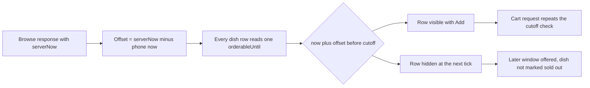

# Window picker, kitchen cards and dish lists

The browse aggregation is correct and it is still possible to build a screen that misleads Lina. Three failures account for most of them. The screen shows every dish the server sent, including one whose cutoff passed while the page sat open. It prints a capacity hint the client calculated from a remaining-units number it did not really understand. Or it lays out two windows side by side, and Lina's thumb lands on the wrong one. This lesson builds the three surfaces and closes those failures with one response, one clock offset and one layout rule.

Start with two reads. The window list gives the picker its targets for today and tomorrow. The browse read gives the cards for one chosen interval. Both take the diner's area code as a normalized value from her saved address, not a free-text string she typed this morning.

```txt
GET /api/v1/browse/windows?area=gaza-city
  -> 200 { serverNow, zone, windows: [
       { startAt, endAt, localLabel, orderableKitchens } ] }

GET /api/v1/browse?startAt=2026-03-03T11:00:00.000Z
                  &endAt=2026-03-03T12:00:00.000Z
                  &area=gaza-city
  -> 200 { serverNow, selected: { startAt, endAt },
           kitchens: [ { kitchenId, name, areaLabel,
                         orderableBy, capacityHint,
                         prepMinutesMin, prepMinutesMax,
                         dishes: [ { dishId, name, priceMinor, currency,
                                     prepMinutes, allergens,
                                     orderableUntil } ] } ],
           nextWindow: { startAt, endAt, localLabel } | null }
```

`orderableBy` is the kitchen's own cutoff for this dated window, already converted to a UTC instant. `capacityHint` is one of `plenty`, `few` or `full`, and the server computes it. `orderableUntil` is the dish's effective cutoff, the earlier of the kitchen cutoff and the dish's preparation deadline. `nextWindow` is only present when `kitchens` is empty, which keeps the empty state honest without a second request.

## Fetch the window list once, then let the server lead

The window list is small and changes slowly, so fetch it when the screen mounts and again when the tab becomes visible after a long pause. Choose the default target on the client from `serverNow`: the first window whose `startAt` is still in the future and whose `orderableKitchens` count is greater than zero. If every shown window is past its order deadline, select the first future one anyway and let the browse read return an empty list with a suggestion. Guessing a window the server will reject wastes a round trip Lina does not have.

Every later interaction sends the exact `startAt` and `endAt` strings from the list. Do not rebuild them from `localLabel`. A label such as "13:00 to 14:00" is a display string in the diner's zone; the pair of UTC instants is the identity the server uses. Two labels can look identical across a daylight saving change and mean different instants, which is the same trap Module 14 closed for kitchen windows.

Keep one `serverNow` response value per screen state and derive an offset from it. The offset is the server's instant minus the phone's instant at receipt. Every countdown, every "expires in" label and every client-side cutoff comparison uses `Date.now() + offset`, never a bare `Date.now()`. Store the offset in a single hook so no component invents its own. On a phone whose clock is eleven minutes fast, this is the difference between hiding a dish that is still orderable and showing one that closed before Lina sat down.



The diagram shows one offset feeding every row and the cart sitting downstream of the whole screen. The row's hidden state is a display decision that makes the page match the server, not a reservation and not the reason the cart will refuse a late line.

## Make the window targets big enough to hit

The picker is a vertical list of full-width buttons. Each button holds the time range on one line and the order deadline on a second, smaller line, and the whole button is at least 48 CSS pixels tall with 12 pixels between neighbours. On a 360 pixel viewport with 16 pixels of page padding, a button is 328 pixels wide, which is comfortable for a thumb and short enough for the two lines to fit without truncation.

Do not build a horizontal scroller for windows, and do not put two windows in a grid row at this width. Both patterns assume the diner knows that more options exist off screen. She does not, and a sideways swipe competes with the browser's own back gesture on Android. If a later design wants a week view, that is a separate screen reached from a link, not a strip on the browse page.

Selection is expressed in the markup as well as the styling. The chosen button carries `aria-pressed="true"`, a visible border and a short text label such as "Selected". Focus styles must be visible on the dark theme too, and the buttons must be real `button` elements so the Enter and Space keys work without extra handlers. Run the picker with the keyboard once before you call it finished, because a `div` with an `onClick` passes a mouse test and fails everything else.

## Render the kitchen card from three server values

A card shows the kitchen name, its neighbourhood, the deadline text and the capacity hint. The deadline text is formatted from `orderableBy` in the diner's zone, prefixed with the words "Order by". The hint text is a lookup from `capacityHint` to a short phrase: "plenty of space", "few spots left", "full". Nothing on the card reads `remainingUnits`, because that field is not in the response, and nothing computes a percentage.

Sort the cards by `orderableBy` ascending, then by name. The kitchen that closes first is the one Lina will lose, so it belongs at the top of the list where her thumb already is. This ordering also means the cards keep a stable place while she reads, as long as deadlines do not change, which they cannot inside one kitchen's window.

Keep the preparation range as a secondary line, for example "90 to 120 min". It comes from the dishes the server returned, so it describes what she can actually order rather than the kitchen's whole menu. If a cook hid every slow dish ten minutes ago, the range should shrink, and it does, because it is calculated from the same list that feeds the dish rows.

## Guard each dish row with the server instant

The server omits dishes past their cutoff, and the page can outlive that response. Lina leaves the tab open while she answers a message, comes back at 11:12, and the maqluba that was orderable at 11:09 is now closed. The row must disappear or convert to a clear expired state, and the check must use the server-anchored offset.

```js
// client/src/modules/browse/DishRow.jsx
export function DishRow({ dish, offsetMs, onAdd }) {
  const now = Date.now() + offsetMs;
  const closed = now >= Date.parse(dish.orderableUntil);
  // The server already filtered closed dishes; this guard covers a page
  // that stayed open while the clock moved past orderableUntil.
  if (closed) return null;
  return (
    <li className="dish-row">
      <span className="dish-name">{dish.name}</span>
      <span className="dish-meta">
        {dish.prepMinutes} min | {formatMinor(dish.priceMinor, dish.currency)}
      </span>
      <AllergenWords allergens={dish.allergens} />
      <button onClick={() => onAdd(dish)}>Add</button>
    </li>
  );
}
```

That is a sketch of one row, not the finished component. It omits formatting helpers, the expiry tick and styling, because those are mechanical. The part worth copying is the shape: one offset, one comparison, one early return.

Here is the failing test to write before that guard exists. It renders a stale response where the server still included maqluba, and it asserts what Lina should see at 11:31 in `Asia/Gaza`.

```js
// client/src/modules/browse/DishRow.test.jsx
it('hides maqluba when its own cutoff has passed', () => {
  const serverNow = '2026-03-03T09:31:00.000Z'; // 11:31 in Asia/Gaza
  const maqluba = { name: 'Maqluba', prepMinutes: 90, priceMinor: 4500,
    currency: 'ILS', allergens: ['nuts'],
    orderableUntil: '2026-03-03T09:10:00.000Z' }; // 11:10 in Asia/Gaza
  const falafel = { name: 'Falafel plate', prepMinutes: 30, priceMinor: 2000,
    currency: 'ILS', allergens: ['sesame', 'gluten'],
    orderableUntil: '2026-03-03T10:00:00.000Z' }; // 12:00 in Asia/Gaza

  render(<DishList dishes={[maqluba, falafel]} serverNow={serverNow} />);

  expect(screen.queryByText('Maqluba')).toBeNull();
  expect(screen.getByText('Falafel plate')).toBeInTheDocument();
});
```

Before the guard, this test fails on the first assertion. After it, both assertions pass, and the important one is the second: the fast dish must survive. A guard that hides everything after the earliest deadline passes both the naive version of the first assertion and a broken second one, so always assert both sides.

The offset in this test is zero because the fake clock and the fake server agree. Add a second test with a phone clock four minutes ahead and the same payload; if that test fails, some component is reading `Date.now()` directly instead of the injected offset.

## Empty state and next window

When `kitchens` is empty, the screen renders one message and one button. The message names the situation without blaming the diner: "No kitchen has space for 13:00 to 14:00." The button uses `nextWindow.localLabel` and, on tap, selects that interval and runs the browse read again. If `nextWindow` is null, the message says that nothing is open in the next two days and the button is absent. Never show a retry button that repeats the same request against the same interval, because the result will be identical and the diner will tap it three times.

The empty state must not reuse the last successful card list. Clear it when a new interval returns nothing, or a slow network will leave stale cards under a message that says there is nothing. That combination is the worst of both worlds: the screen contradicts itself and the diner cannot tell which half is true.

## Layout, weight and the network

At 360 pixels the page is a single column. The selected window sits in a sticky header that shows the time range and the order deadline, so a diner who scrolls to the fourth kitchen still knows which lunch she is looking at. Cards have no inner scrolling regions, no fixed-height dish lists and no horizontal tables. The price and preparation time share one line and wrap if they must. Allergen words wrap as whole chips so "contains sesame" never breaks inside a word.

Ask for menu images at a width that matches the row, using the Cloudinary transformations from Module 13, and give each image a fixed height so the list does not jump while it loads. The browse response for three kitchens and about twenty dishes should land near 8 KB before images; check it rather than guessing, because a response that quietly grew to 60 KB will feel slow at 3G and cost the learner real money on a prepaid plan.

Browse data is current state, so send it with `Cache-Control: no-store`. Module 24 caches kitchen menus on the server, where the cache can be busted when a cook saves a dish. A browser cache holding a fifteen-minute-old deadline is a bug that no server invalidation can fix.

If the request fails, keep the last rendered cards visible under a label that says when they were read, for example "Updated 4 minutes ago", and offer one retry. A blank screen with a spinner on a weak connection tells Lina nothing and leaves her no way to decide. The stale label is honest and the Add button still works, because the cart repeats every check anyway.

## Acceptance criteria

- The picker offers today and tomorrow, stacked, with 48 pixel minimum height and a text selection state.
- The selected interval is sent as the exact UTC pair from the window list, never as a formatted label.
- Every deadline and countdown uses one server offset, and a test proves a fast phone clock changes nothing.
- Cards show `orderableBy` and a capacity hint produced by the server, with no local arithmetic on remaining units.
- A dish whose `orderableUntil` passes while the page is open disappears at the next tick, and its fast neighbour stays.
- An empty interval shows the server's suggested next window, and a failed request shows stale cards with their read time.

Save the response shapes, the offset hook and the two dish-row tests in `docs/find-a-meal-decisions.md`. The gate in the next lesson asks you to demonstrate these on a 360 pixel viewport with the network throttled, so keep the fixtures that produce one slow dish and one fast dish from the same kitchen. You will need them twice.
