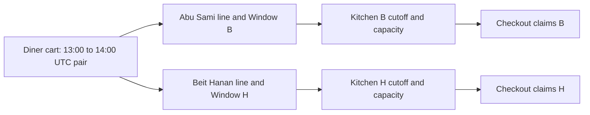

# One window per cart

Lina wants lunch between 13:00 and 14:00. She adds a falafel meal from Abu Sami and a sweet from Beit Hanan. Both kitchens have dated windows for that same UTC interval, so one cart can describe one delivery promise even though checkout will create separate kitchen orders. If the sweet is available only for an 18:00 interval, silently adding it would make the cart say "lunch" while one cook is preparing dinner. The API must reject the mismatch or ask Lina to change the cart's selected interval and review every line.

The cart belongs to one diner and one selected `startAt` and `endAt` pair. Its lines reference dishes, kitchens and kitchen-specific `DeliveryWindow` IDs. The window IDs differ across kitchens, but their intervals must match the cart's selected pair. A line is a request to buy a dish, not a claim on cooking capacity. Browse may have shown units a moment ago, but another diner can take them before checkout. The cart checks time and basic eligibility now; M19 claims capacity later.

## One interval makes the total understandable

A diner reviewing the cart should be able to answer when the meal is expected. One selected interval lets Sufra group kitchen orders under a single purchase and show one clear time. It also sets a consistent boundary when the diner changes their mind. If Lina moves to 18:00, the cart must revalidate every line. Abu Sami may not cook then, while Beit Hanan might. The API returns the affected lines and a new total for review. It must not keep a 13:00 kitchen order hidden inside an 18:00 cart.

The rule does not mean all kitchens share one capacity counter. Each has its own dated window, cutoff, travel buffer and remaining units. A slow dish from one kitchen can close while a fast dish from the other remains timely for the same selected interval. The cart can contain both only while each line passes its own cutoff. Checkout will claim each kitchen separately and compensate if one fails. The selected interval organizes the diner promise; it does not merge kitchen state.

The diagram shows one cart branching to two kitchen windows. Both rows agree on the UTC pair, while capacity and claims stay separate.

The diagram does not place a claim inside the cart. That is deliberate. A diner can leave a cart open while travelling or while the connection drops. Reserving kitchen effort for every cart line would block actual buyers for too long. A short hold starts only during checkout preparation, with a bounded expiry and server-owned attempt identity.

## The cart must recheck time

At 11:09, Lina adds maqluba for 13:00. Its effective cutoff is 11:10. The add-to-cart route checks the current server instant, the dated window's general cutoff, the dish's preparation minutes and its travel buffer. It can accept the line at 11:09 if other conditions pass. At 11:10 exactly, the same add request fails under the strict rule. If Lina added the line earlier but opens checkout at 11:31, M19 rejects it before a capacity claim. The earlier cart success does not freeze the clock.

The response should include a dated `orderableUntil` and the server's current instant. The client can display a countdown and a useful warning, but it cannot grant an exception by changing its phone time. The API must use the same M14 cutoff helper as browse and checkout. If a page says one deadline while cart uses another, a diner will see an unexplained error even though both sides claim to be following the schedule.

A kitchen may also pause today after Lina adds a line. M9's wildcard `ScheduleException` closes that kitchen's local date. The cart may retain the line temporarily so Lina can understand what changed, but any new add or quantity increase must fail while the date is closed. A change-window request and checkout revalidate the closure. The cart response should identify the line that needs attention and offer a later interval, not silently delete it and change the amount.

## Quantity affects two limits

A dish has `maxPerOrder`, which caps how many units of that dish one diner may request. It also has `loadUnits`, which says how much kitchen capacity each quantity would consume. Two falafel wraps at one load unit each require two units; two maqluba trays at three each require six. The cart can calculate a per-kitchen requested load for explanation, but it does not reserve it. M19 calculates the trusted group load again from current dish settings before claiming a dated window.

The client must not be able to send `loadUnits: 1` for a three-unit tray. The cart service reloads the dish and window, validates a positive safe-integer quantity, checks `maxPerOrder` and stores only the requested quantity and references. A displayed estimated price comes from server pricing and may change before checkout if the cook edits a future offer. The diner must review a changed total rather than being charged silently.

## Keep ownership on every route

Cart IDs can be guessed or copied. A signed-in diner must be able to read and edit only their own cart. The service matches both `cart._id` and `dinerUserId` from authentication. It does not trust a body field saying who owns the cart. A cook cannot read a diner's cart merely because one line names their kitchen; the cook sees an order only after verified payment and within their own kitchen scope.

The public browse API can list a kitchen's dishes without showing another diner's choices. The cart response may include dish names and price estimates but should not expose embedded capacity claim IDs from the window or private kitchen account details. At checkout, split orders carry only the fulfilment information each kitchen needs. These are different response boundaries for public discovery, private cart and paid order.

## Trace one invalid mix

Create a table in `docs/cart-decisions.md` with Lina's selected UTC start and end, each line's dish and kitchen IDs, its window ID, that window's UTC pair, current server instant and effective cutoff. Give Abu Sami a 13:00 window and Beit Hanan an 18:00 window. The API should reject the second add with `WINDOW_MISMATCH` and leave the original cart unchanged. Then give Beit Hanan a 13:00 window but a closed date; reject with a closure reason. Finally give both valid windows, and show that the cart accepts both while claiming zero units.

The next lesson implements those checks on add-to-cart. It will return an actionable conflict for a late, closed or mismatched line while keeping the diner’s reviewed interval clear.

Before writing that route, draw a second trace in `docs/cart-decisions.md` for a diner who adds at 11:09 and checks out after 11:10. Mark the add as accepted and the checkout as rejected. This is expected behaviour, not a defect in persistence. The product promise is that the cart remembers intent and explains changes, while the order is made only from a fresh, eligible request. If your test instead expects a successful checkout because the line exists, it has accidentally turned the cart into a reservation system. That would need a different expiry policy, a capacity claim, and a release process. Sufra puts those responsibilities in M19.

Also mark which facts are copied into the cart and which are loaded at decision time. The cart keeps IDs, quantity, the selected interval and a revision. Dish name, price, preparation minutes, kitchen status, window cutoff and remaining units come from current server records when a decision needs them. A UI may show a snapshot for quick rendering, but the server must not use that snapshot as authority. This division lets the cart remain small while allowing a cook to pause service or correct an offer before anyone pays. It also makes a rejected change explainable: the response can name the current fact that changed rather than pretending the old card is still valid.
