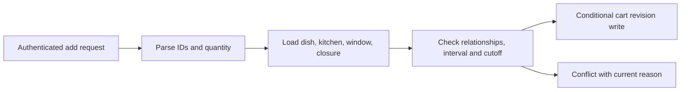

# Add to cart with time checks

Lina taps Add on a maqluba dish that browse displayed a few seconds ago. The cart route cannot assume the card is still current. Its kitchen might have paused, its window might have filled, or the dish's preparation cutoff might have passed. This lesson builds a route that loads current records and makes one decision from one server instant. It stores an intention only after every relationship is checked.

Use the M5 `Cart` shape: `dinerUserId`, `selectedStartsAt`, `selectedEndsAt`, `revision`, and `lines`. A line stores `dishId`, `kitchenId`, `windowId`, and `quantity`. It does not copy a client-provided price, load, cutoff, or kitchen name into authoritative fields. The client sends the IDs and desired quantity. Authentication provides the diner identity, and the server clock supplies `now`.

The request path below separates input validation, current-record checks and the cart write. Notice that a successful browse result is not a shortcut around the middle box.



The conditional write protects the cart from two tabs overwriting each other. It does not claim kitchen capacity. M19 handles claims when the diner starts checkout.

## Make the request contract small

Create `POST /api/cart/lines` with body `dishId`, `windowId`, `quantity` and `expectedRevision`. The selected interval is already on the cart. For a new cart, create it through a separate interval-selection route or accept a validated `selectedStartsAt` and `selectedEndsAt` only on first creation. Do not let a later add quietly replace the interval. That would require rechecking existing lines, which belongs to the change-window route in the next chapter.

Require `quantity` to be a positive safe integer. Reject zero, fractions, negative values, numeric strings and values above the dish's `maxPerOrder`. Check the resulting line quantity if the dish is already present. An add of two more units to a line of four cannot evade a maximum of five by validating only the increment. Return a field error for malformed input and a domain conflict for a well-formed quantity that exceeds the current offer limit.

The authenticated diner ID must come from the session or token verified by the server. Ignore or reject a `dinerUserId` in the body. A test should send another person's ID and prove that it has no effect. Also reject a request without a selected interval rather than guessing the first available window from a dish. The diner should choose a dated promise explicitly.

## Check current relationships

Load the dish, its kitchen and the named dated window. Require `dish.kitchenId === kitchen._id` and `window.kitchenId === kitchen._id`. A crafted request that combines Abu Sami's falafel with Beit Hanan's window is invalid even if both kitchens offer 13:00. Require `window.startAt` and `window.endAt` to equal the cart's selected UTC pair. Compare stored dates as instants, not as displayed local strings. The service area must include the diner's normalized delivery area, and the kitchen and dish must be publicly active.

M9 defines `ScheduleException` for a paused date. Reject when a `closed` exception matches the kitchen, the window's `localDate`, and either `sourceRuleKey: '*'` or this window's rule key. Also require the window's own status to be `open`. A stale open row after a pause must not permit an add. If the kitchen or window is closed, return a reason that the UI can explain without exposing private schedule notes.

The M14 cutoff helper receives `window.cutoffAt`, `window.startAt`, `window.travelBufferMinutes` and `dish.prepMinutes`. It computes the earlier of the general cutoff and dish-specific start-minus-buffer-minus-prep instant. The strict decision is `now < effectiveCutoff`. At equality the dish is already closed. Loading the helper in browse, cart and checkout avoids three slightly different definitions of "still orderable."

```js
export function effectiveDishCutoff(window, dish) {
  const preparationMs = (window.travelBufferMinutes + dish.prepMinutes) * 60_000;
  const dishDeadline = new Date(window.startAt.getTime() - preparationMs);
  return new Date(Math.min(window.cutoffAt.getTime(), dishDeadline.getTime()));
}

export function lineFailure({ cart, dish, kitchen, window, closed, now, quantity }) {
  if (dish.kitchenId.toString() !== kitchen.id || window.kitchenId.toString() !== kitchen.id) {
    return 'WRONG_KITCHEN';
  }
  if (+window.startAt !== +cart.selectedStartsAt || +window.endAt !== +cart.selectedEndsAt) {
    return 'WINDOW_MISMATCH';
  }
  if (closed || kitchen.status !== 'open' || window.status !== 'open' || dish.status !== 'active') {
    return 'NOT_SERVING';
  }
  if (!Number.isSafeInteger(quantity) || quantity < 1 || quantity > dish.maxPerOrder) {
    return 'QUANTITY_LIMIT';
  }
  if (+now >= +effectiveDishCutoff(window, dish)) return 'CUTOFF_PASSED';
  return null;
}
```

This compact helper shows the key relationships, but the route also checks service area, dish weekday and ID validity. Use the M14 shared helper in the real build instead of copying `effectiveDishCutoff` into a second module. Keep the example's comparison tests to make the intended rule visible. If your schema stores ObjectIds in different forms, normalize them before equality. Do not compare display names or rely on an ObjectId object's JavaScript identity.

## Handle the cart write without a lost update

Two taps from two tabs can read revision 4 and both propose revision 5. A read followed by an unconditional `save()` may let the later write erase the earlier line. Apply the intended line change to a candidate cart and use a conditional update on `_id`, authenticated `dinerUserId`, and `revision: 4`. Increment the revision in the same database write. If no cart matches, reload it and return `CART_CHANGED` with the new revision and line list. The client can show the current state and let Lina retry.

The conditional write cannot make the kitchen's schedule static. A cook can pause between your validation read and cart write. This is acceptable only because cart inclusion is not a promise of fulfilment. Checkout rechecks closures and time. For a better immediate message, reload status when the response is formed, but do not pretend this closes every race. The final capacity and cutoff decision stays in M19.

When a cart is new, enforce one active cart per diner with a unique index or an atomic upsert keyed by `dinerUserId`. A race between two first requests should result in one cart and a retry, not two carts with different selected intervals. Do not convert a duplicate-key error into a success unless you reload and verify the selected interval. The route's response includes the canonical cart revision, selected UTC pair, line references, estimated amount computed from current server prices, `serverNow` and a dated `orderableUntil` per line.

## Work the negative cases

Use a fake server clock at 11:09:59 for a 11:10 cutoff, then at exactly 11:10:00. The first request may pass; the second must return `CUTOFF_PASSED`. Give the kitchen a wildcard closed exception, and prove the same request fails even while the window row remains open. Pair a dish with a different kitchen's window and expect `WRONG_KITCHEN`. Pair a valid dish with an 18:00 window while the cart selects 13:00 and expect `WINDOW_MISMATCH` with no revision change.

Test `quantity: 1.5`, `quantity: 0` and an increment that would exceed `maxPerOrder`. Set `remainingUnits` below the requested load and decide how the cart responds. It may give an advisory shortage, but it must not write a claim or promise a slot. The definitive outcome is tested at checkout with the atomic M19 update. A test that expects add-to-cart to decrement `remainingUnits` has put the wrong responsibility in this module.

Finally, attempt two writes with the same `expectedRevision`. Exactly one may commit. The other returns a cart conflict that allows a safe refresh. If both succeed, your revision filter is missing or the update path bypasses it. If neither succeeds, inspect how the new cart revision is initialized. Save the request and response traces in `docs/cart-decisions.md`; the next chapter uses them when Lina changes the interval.

Include a request in which the dish was active when browse ran but became inactive before Add. The API should reject the new line and name that current condition. Then add a line successfully and make the dish inactive afterward. The cart may still show the saved selection with an action-needed flag, but a quantity increase and checkout must reject it. This distinction matters because deleting the line on read would erase the diner's intent and make a changed total look unexplained. A cart read can describe invalid state without authorizing the next purchase. It should also keep the original window ID visible in the response so the UI can offer a deliberate change-window action rather than substituting another kitchen's window.

References: [MongoDB atomicity and single-document writes](https://www.mongodb.com/docs/manual/core/write-operations-atomicity/), [Mongoose optimistic concurrency](https://mongoosejs.com/docs/guide.html#optimisticConcurrency).
