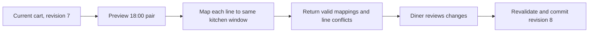

# Change the window

Lina selected 13:00 but now needs delivery at 18:00. Her cart contains falafel and maqluba from separate kitchens. A naive route can change `selectedStartsAt` and `selectedEndsAt`, leaving old window IDs on the lines. The cart would then claim one interval in its heading and another in its records. A second naive route can delete unavailable lines silently. Lina might pay a smaller total without knowing what disappeared. This chapter builds a review step that preserves her choice and reports every line that no longer fits.

The request starts with a target UTC start and end. These must identify a published delivery interval; the route must not accept an arbitrary local label such as "evening." For each existing line, find a dated window owned by the same kitchen with exactly the new pair. Then reload the dish and kitchen and run the same checks used by Add to cart: public status, service area, schedule closure, active weekday, max quantity and effective cutoff at one captured server instant. A line without a matching window is a conflict, not a reason to switch to another kitchen.

The diagram shows two distinct steps. Preview computes a proposal; commit updates the cart only when the diner has accepted the proposal and the cart revision still matches.



The second validation matters. A preview can become stale if a cook pauses service before Lina confirms. The commit route must not trust a client-sent list of "valid" lines.

## Build a preview result

Create `POST /api/cart/window-preview` with target `startAt`, `endAt`, and `expectedRevision`. Authenticate the diner and load only that diner's cart. Validate exact ISO instants, that end follows start, and the supported booking horizon. Capture `now` once so all lines in this preview are judged at the same instant. Return `serverNow`, proposed interval, current revision, a mapping for each line and a summary of changed price estimates. Do not modify the cart during preview.

Give every line an explicit result. `AVAILABLE` includes the new kitchen-specific `windowId`, effective cutoff, quantity and server-derived estimated price. `NO_KITCHEN_WINDOW` means the kitchen does not cook in that pair. `KITCHEN_PAUSED` means an exception or status closes it. `DISH_CUTOFF_PASSED` means the dish takes too long for the remaining time. `DISH_INACTIVE` or `QUANTITY_LIMIT` covers an offer change. Use stable codes for the client and plain copy for the diner. Avoid a single "invalid" label that hides whether waiting for a different window would help.

Do not merge windows just because their display text matches. A 13:00 to 14:00 label on two local dates represents different UTC intervals. The same local interval can map to different UTC offsets around a daylight saving change. Compare the stored UTC instants and use the kitchen window ID in the proposed mapping. Its `localDate` and `kitchenZoneAtGeneration` are for generation and explanation, not for guessing equality from a formatted string.

If a line has multiple candidate windows from one kitchen for the same pair, the M14 unique index on `kitchenId` and `startAt` should make that an integrity defect. Return a server error and investigate the generator or index instead of arbitrarily choosing one. If a kitchen has no candidate, a different kitchen's matching window is not a substitute. The diner chose the dish from a particular cook.

## Decide how to handle conflicts

There are two honest outcomes. If every line is available, the client can ask Lina to confirm the new interval and amounts. If some lines fail, the UI shows those lines and lets her keep the current cart, remove selected lines, or choose another interval. The API must not silently discard them. For this build, the commit route accepts an explicit `removeLineIds` array and requires that it match the lines still invalid on fresh validation. It rejects an attempt to retain an invalid line. A product could instead require the diner to remove lines through a separate route before committing; either approach must make removal visible.

The server should return the current estimated total and proposed estimated total. These are not final charges. A cook can change a price before checkout, and payment requires another review. However, a window change that alters dish availability or removes a line changes what Lina intends to buy now. Present the change in words: "Maqluba is not available for 18:00; your proposed cart has one fewer dish." This gives her a meaningful choice before persistence.

Never record the proposed window IDs as arbitrary client input. The commit route accepts the interval and diner-approved removals, then independently recomputes mappings. It writes selected start/end and the new `windowId` on every retained line in one conditional cart update. If the write fails on revision, return `CART_CHANGED` with the current cart. This keeps two browser tabs from swapping a line added after the preview into an interval it has never been checked against.

## Implement the candidate mapping

Start from existing line `kitchenId` values and query dated windows by `{ kitchenId: { $in: ids }, startAt, endAt }`. Build a map by normalized kitchen ID. Load dishes in one batch by their IDs; do not do one database round trip per line. Load kitchen statuses and matching schedule exceptions in batches too. Then evaluate each line with the shared validation function. Batch loading reduces latency, but do not conflate records from different kitchens when building the map.

```js
export function mapLineToInterval({ line, dish, kitchen, nextWindow, cart, now, closed }) {
  if (!nextWindow) return { lineId: line.id, code: 'NO_KITCHEN_WINDOW' };
  const proposed = {
    selectedStartsAt: nextWindow.startAt,
    selectedEndsAt: nextWindow.endAt,
  };
  const code = lineFailure({
    cart: proposed, dish, kitchen, window: nextWindow,
    closed, now, quantity: line.quantity,
  });
  return code
    ? { lineId: line.id, code }
    : { lineId: line.id, code: 'AVAILABLE', windowId: nextWindow.id };
}
```

This helper assumes the caller has already checked that `nextWindow.kitchenId` matches the line's kitchen and that the target pair is within the supported horizon. The production route should reuse the exact add-to-cart policy rather than maintain a second imperfect implementation. If `lineFailure` changes for a new rule, its tests should cover add, preview and commit. The example keeps the mapping shape visible for the learner.

## Test the transition, not only the answer

Seed a cart with two kitchens in 13:00 windows. Give the first kitchen an 18:00 window and leave the second without one. Preview must report one `AVAILABLE` mapping and one `NO_KITCHEN_WINDOW`, while the stored cart remains unchanged. Try to commit without approving removal; reject and keep revision. Approve removal, revalidate, then store only the first line under its 18:00 window and increment revision once. Prove the removed line appears in the response summary.

Next, pause the first kitchen between preview and commit. The commit must reject or return an updated conflict, leaving the cart in its original 13:00 state. Next, add a third line in another tab after preview. The old `expectedRevision` must fail rather than move that unreviewed line. Finally, test a target with a matching local display label on the wrong date. It must not pass the UTC pair check.

Use fake instants just before and exactly at a slow dish's cutoff. A line can move into an interval that looked available earlier but is now too late. The same strict `now < cutoff` rule applies. In your test record, show the cart before preview, the preview response, the diner decision, the commit request and the cart after commit. The transition is the evidence; a final response alone cannot prove the invalid line was never stored.

The next chapter computes the load requested from each kitchen group. That number helps the diner understand a capacity conflict, but changing windows still does not claim units. M19 rereads the current dishes and windows and makes the final capacity decision.

Record the rejection reason with the proposal, since a later successful move to another date should not erase why the first one failed. The log is for the learner's evidence and need not become a permanent consumer-facing audit trail.
