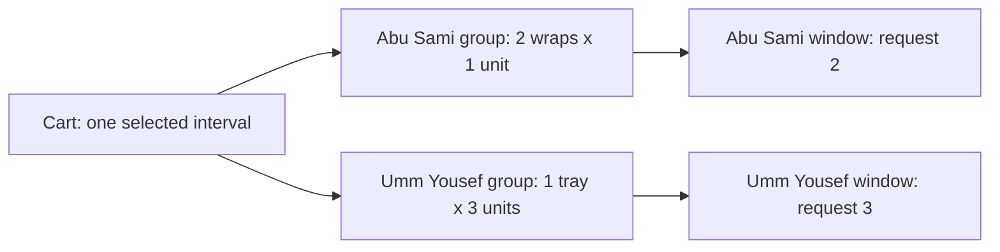

# Load per kitchen

Lina orders two falafel wraps from Abu Sami and one maqluba tray from Umm Yousef. The falafel uses one load unit per wrap; the tray uses three. The cart should report two units requested from Abu Sami and three from Umm Yousef. It must not report five units against one shared pool. Each kitchen has its own dated window and capacity counter, even when both windows match Lina's selected delivery interval.

The load summary has two jobs. It helps Lina understand why a large tray might no longer fit even when a kitchen card says "space left." It also gives the checkout chapter a clear grouping contract to test. It is still only a current estimate. Cart writes do not decrement `remainingUnits`, create a `CapacityClaim`, or reserve anything. M19 reloads dish settings and uses an atomic conditional claim for each kitchen.

The diagram shows the branch. The common delivery promise leads to distinct kitchen groups, and each group's requested load is compared only with its own dated window.



If a line references the wrong kitchen's window, there is no valid group to calculate. Reject the cart state as invalid rather than allocating units to whichever window ID the client supplied.

## Calculate from current records

Create a server function that receives an authenticated cart and current dish and window records. Index dishes by ID and windows by ID. For every line, verify that the dish and window both belong to the line's kitchen, that the window's UTC pair matches the cart pair, and that quantity is a positive safe integer within `maxPerOrder`. Then multiply `quantity * dish.loadUnits`. Both operands must be positive safe integers; the product and group sum must also remain safe integers. A malformed legacy row should fail loudly before checkout instead of silently becoming `NaN` or an overflowed capacity request.

Do not use `loadUnits` from the request body or a stale cart display snapshot. If a cook changes a dish from one to two load units, the current cart summary should change. That may cause checkout to fail against the remaining window capacity. The UI should show a refreshed estimate and ask Lina to review it. A cart is a saved selection, not a locked commercial quote or a slot reservation.

```js
export function loadByKitchen(cart, dishesById, windowsById) {
  const groups = new Map();
  for (const line of cart.lines) {
    const dish = dishesById.get(String(line.dishId));
    const window = windowsById.get(String(line.windowId));
    const kitchenId = String(line.kitchenId);
    if (!dish || !window) throw new Error('CART_REFERENCE_MISSING');
    if (String(dish.kitchenId) !== kitchenId || String(window.kitchenId) !== kitchenId) {
      throw new Error('CART_WRONG_KITCHEN');
    }
    if (+window.startAt !== +cart.selectedStartsAt || +window.endAt !== +cart.selectedEndsAt) {
      throw new Error('CART_WINDOW_MISMATCH');
    }
    if (!Number.isSafeInteger(line.quantity) || line.quantity < 1 ||
        line.quantity > dish.maxPerOrder ||
        !Number.isSafeInteger(dish.loadUnits) || dish.loadUnits < 1) {
      throw new Error('CART_INVALID_LOAD');
    }
    const lineLoad = line.quantity * dish.loadUnits;
    const current = groups.get(kitchenId) ?? { kitchenId, windowId: String(window.id), load: 0 };
    if (current.windowId !== String(window.id)) throw new Error('CART_WINDOW_MISMATCH');
    const next = current.load + lineLoad;
    if (!Number.isSafeInteger(lineLoad) || !Number.isSafeInteger(next)) {
      throw new Error('CART_LOAD_OVERFLOW');
    }
    current.load = next;
    groups.set(kitchenId, current);
  }
  return [...groups.values()];
}
```

The example groups by kitchen ID because the cart contract permits one dated window per kitchen for the selected pair. The M14 unique index on kitchen plus `startAt` supports that assumption. Keep the `windowId` check anyway, since an imported or corrupted cart can violate it. A successful summary returns kitchen ID, window ID and requested units. It may also return a display name loaded from the kitchen record, but never let the name become the grouping key.

## Explain current availability without promising it

The summary can compare requested load with the current `remainingUnits` on each window. Label the result as an estimate at `serverNow`. If Abu Sami has two units and Umm Yousef has only two, the second group is currently short by one. The response should say which kitchen group needs review. It should not pretend a smaller total across both kitchens solves the shortage. Abu Sami's spare units cannot be transferred to Umm Yousef.

Even a group with `requestedLoad <= remainingUnits` can lose the race. Another diner may check out before Lina. A group below remaining units may also fail because the dish cutoff or kitchen pause changes. The UI should say "Currently appears to fit" or give a conflict, not "Your spot is saved." M19's `findOneAndUpdate` filter and claim state are the only point where capacity moves from available to held.

For a full group response, include `requestedLoad`, `remainingUnitsAtRead`, `appearsToFit`, and `serverNow`. Do not expose other diners' claim IDs or individual orders. If a kitchen has zero current units, show an actionable later-window choice. The change-window route still has to revalidate all lines before moving them. It must not silently split one cart across two delivery intervals to make every kitchen appear available.

## Keep price and capacity separate

Price is measured in integer minor currency units; load is measured in kitchen capacity units. A tray may cost more and consume more load, but the two numbers are not interchangeable. Calculate a line's estimated amount as `quantity * current priceMinor`, with currency checks and safe-integer bounds. Group totals by kitchen for display, then check that all groups use the payment currency before presenting one payable total. If kitchens use different currencies, the product needs an explicit conversion or separate-payment policy. This course does not silently add them.

The checkout snapshot in M19 captures trusted price and load values at the order decision. It must never accept totals from the cart UI. A cook editing a price after Lina added a line should produce a visible review conflict before payment intent creation. A capacity change may produce a claim conflict. Treat each as a separate reason because the diner can respond differently: remove an expensive dish, choose a later window, or reduce a quantity.

## Test grouping and corruption

Write a table-driven test with two wraps at one unit and one tray at three. Assert two groups with loads two and three, their correct window IDs, and zero capacity claims added. Add another Abu Sami line in the same window and verify it increases only his group. Add a line referencing Umm Yousef's window but Abu Sami's dish and expect `CART_WRONG_KITCHEN`. Add a second Abu Sami window ID with the same interval and expect the mismatch guard. Add a quantity that would overflow safe integer arithmetic and expect an explicit error.

Change the tray's `loadUnits` in the seeded dish record after the cart is saved. Reload and confirm the summary reflects the new number while the stored cart line remains just IDs and quantity. This is the key distinction between user intent and current authority. Also set `remainingUnits` to exactly the requested load: it currently appears to fit, but two concurrent checkouts in M19 can still compete for that capacity. Do not write a test that treats the read-only comparison as a reservation.

Save the group table and test output in `docs/cart-decisions.md`. The next chapter proves that even a correctly calculated private cart cannot be read or changed by a different diner. That ownership boundary matters before a client can use the load response, because the grouped result reveals what Lina intends to buy and when she expects it.

There is one further edge to test: a cart can have two dishes from the same kitchen with different preparation times. The kitchen group load is the sum of both lines, but eligibility stays per dish. At 11:15, a fast wrap may still be timely while a slow tray has closed. Returning a group that "fits" capacity must not hide the closed tray. Make the summary include each line's effective cutoff and status beside the group total. If one line fails, the UI should identify that line and ask the diner to remove it or change the window. It should not automatically reduce the group load and present a new payable total without review.

Also consider a kitchen reducing `remainingUnits` after the cart summary was served. The cached response in a browser can remain visible, but the next cart read should show the new current estimate and checkout must run the conditional claim. Do not increase the displayed capacity by subtracting only this diner's cart; other diners' carts do not reserve units either. The source of current availability is the dated window's remaining counter after actual claims and releases. This gives every diner the same public capacity signal without treating a collection of unpaid carts as a queue.
