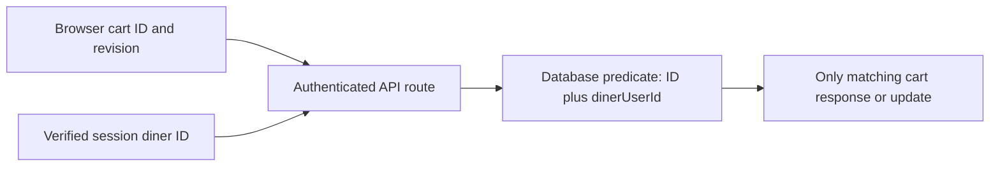

# User scoping test

Lina's cart contains a delivery interval, kitchen choices and estimated amount. Another diner must not see it merely by guessing the cart ID. A cook must not see it merely because their dish appears on a line. This chapter tests the boundary across every cart route, including the preview route that may seem read-only. A leak from preview is still a leak: it tells another account what Lina plans to order and when.

The server already authenticates a request, but authentication only answers who sent it. Authorization answers whether that account may act on this cart. Use the authenticated diner's server-side ID in the database predicate on every read and write. Do not load by `_id` and then compare owner after serializing or logging the document. A missing owner condition can expose the full cart before a later check has a chance to run.

The diagram marks the trust boundary. The browser may supply a cart ID and revision, but it cannot supply the owner used in the query.



If the predicate finds nothing, return the same public result whether the ID is unknown or belongs to someone else. A 404-style result avoids turning the route into an ownership oracle. Internal logs can distinguish cases for debugging, but must not include whole carts or payment data.

## Scope reads and writes consistently

For `GET /api/cart`, use the diner ID from the verified session to find the active cart. If the route accepts an explicit cart ID, match both `_id` and `dinerUserId`. For add, remove and quantity changes, match both fields and the expected revision in the conditional update. For window preview, load only the matching cart before calculating line results. For window commit, recalculate from a scoped cart and include the owner in the final update predicate. The same rule applies to cart reset and any future coupon route.

```js
export async function loadOwnedCart({ Cart, cartId, auth }) {
  if (!auth?.userId) throw new Error('AUTH_REQUIRED');
  return Cart.findOne({ _id: cartId, dinerUserId: auth.userId });
}

export async function writeOwnedRevision({ Cart, cartId, auth, revision, safeChanges }) {
  if (!auth?.userId) throw new Error('AUTH_REQUIRED');
  return Cart.findOneAndUpdate(
    { _id: cartId, dinerUserId: auth.userId, revision },
    { $set: safeChanges, $inc: { revision: 1 } },
    { new: true },
  );
}
```

This is an illustrative repository helper, not a request to let callers pass arbitrary `safeChanges`. A real service should construct a fixed allowlist from validated line changes. Accepting an untrusted object could allow modification of `dinerUserId` or other protected fields. The important feature in the example is the database filter: cart ID, authenticated owner and revision are checked in the same conditional operation.

If no row matches a write, reload by owner to distinguish a stale revision from a missing cart. Return `CART_CHANGED` only when the same authenticated diner owns the cart. Otherwise return not found. Do not reveal that a cart exists under another owner by returning a special "not yours" message. For an unauthenticated request, return the application's normal authentication error before looking up any cart.

## Create the paired-account fixture

Seed Diner A, Diner B and Cook C. Give A a cart with a 13:00 interval and Abu Sami's falafel; give B a different 18:00 cart. Sign in as A and confirm A can read, add, preview a window change and commit a valid one. Then sign in as B and send A's cart ID to each corresponding endpoint. Every request must fail without changing A's cart revision, selected interval or lines. Sign in as C and repeat the read and preview attempts. A cook may later see their own paid order, but never a diner's unpaid cart.

Make B send A's `dinerUserId` in the body and query string. The route must ignore or reject it; it must not let B claim A's identity. Make B send a valid dish ID and window ID with A's cart ID. The references are public enough to know from browse, but that does not grant access to A's cart. Also try a body that sets `revision` to A's current revision. A correct revision is a concurrency token, not an authorization token.

Compare B's response when the cart ID is random with B's response when the ID belongs to A. Both should have the same public status and shape. Do not include A's selected interval, line count, kitchen names or whether the ID exists. A timing difference can still reveal information in extreme cases, but this course's concrete gate focuses on response content and database effects.

## Check the write boundary after a race

Authorization must survive a concurrent edit. Seed A's cart at revision 5. A sends an add request while another A tab changes the window and increments to revision 6. The add must fail with `CART_CHANGED` and show only A the current cart. Then B sends the same ID and revision 6. B must receive not found, not A's updated cart. This order catches a common mistake: after a conditional write fails, an error handler reloads by `_id` alone to prepare a conflict response.

Inspect logs from these tests. They may record request ID, route, status and a safe reason code. They should not print the full cart or session token. Avoid logging raw addresses or detailed meal choices in an authorization failure. The goal is to diagnose a rejected request without turning logs into a second, less protected cart database.

Test the 404 response through the real API middleware rather than testing only a repository helper. Authentication, route parameter parsing and error translation can each create a leak. A repository test proves the filter but not that the route used it. A separate integration assertion should also read A's cart after B's failed mutation and verify exact lines and revision. A status code alone cannot prove no write occurred.

## Keep cook and diner views separate

At checkout, M19 creates kitchen orders from a verified, paid parent purchase. Those order records include fulfilment data for the assigned cook and hide other kitchens' private data. The cook's order authorization is therefore a different query boundary from the diner's cart boundary. Do not reuse a broad "user related to any line" rule for both. That would let a cook inspect a cart before payment and could let one cook see the other kitchen's line in a multi-kitchen purchase.

When the UI shows the cart, it can group lines by kitchen and show current capacity hints from lesson 17.4. Those hints must be calculated only after the cart is loaded for its owner. A public window endpoint can return published availability, but it must not return a private cart's per-kitchen requested load or line IDs. Keep a clear data contract for each route: public browse, private cart, and scoped paid order.

Save an authorization matrix in `docs/cart-decisions.md` with rows for A, B, C and anonymous access, and columns for read, add, preview, commit and reset. Record status, returned fields and whether the cart changed. The gate in the next lesson uses this matrix alongside time, interval and load evidence. A cart API is complete only when a diner can make a valid choice and another account cannot observe or alter it.

Repeat the matrix with a legitimate cook who owns one kitchen represented in A's cart. The cook's role does not relax the cart rule. The cook may update their own dish and schedule through the owner-scoped Kitchen API, which can cause A's saved line to become invalid. That is an indirect product effect, not authority to edit A's cart. This test prevents an overly broad access rule such as "cart contains a kitchen I own." It also clarifies the later order boundary: once payment is verified, a cook receives a kitchen-scoped order record, never the entire diner cart or another kitchen's order. Document the distinct route and predicate used for each view.
