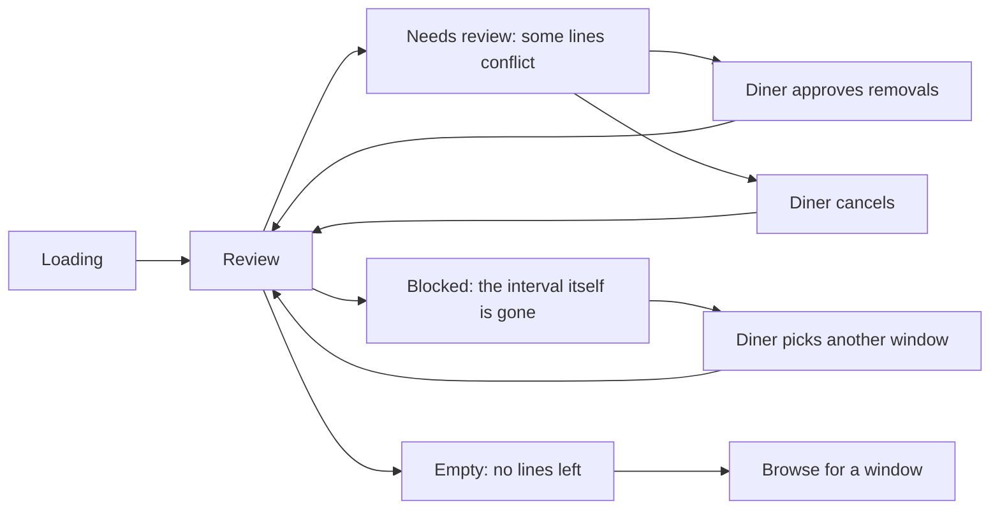

# One cart, one window, several kitchens

Lina has three lines in her cart: a falafel plate from Abu Sami, a maqluba tray from Umm Yousef and a knafeh from Beit Hanan. All three kitchens have a window for the same 13:00 to 14:00 lunch, so Sufra treats them as one delivery promise. Three cooks will work, three kitchens will hand over food, and Lina will pay once. The cart page is where those three separate commitments have to look like the single thing she agreed to.

If the page gets this wrong, the failure is not cosmetic. A cart that shows a 13:00 header above a line whose own window is 18:00 has already sold her dinner while telling her lunch. A cart that silently drops the maqluba when she changes to 18:00 takes money for a smaller order than she chose. A cart that pools the three kitchens into one capacity number invites her to believe that spare space at Beit Hanan can rescue a full window at Abu Sami. Module 17 built the API that prevents the data from reaching those states. This module builds a page that shows the data honestly and makes the recovery visible.

## A cart is a single delivery promise

The header of the cart page states the delivery window, and it is the first thing a diner should be able to confirm. It reads as a time range in her zone, for example "Today, 13:00 to 14:00", with the date named when the window is tomorrow. Under it, one line explains that all the food arrives together in that window and that each kitchen works towards the same delivery time. That sentence does real work, because a first-time diner looking at three kitchen names reasonably wonders whether she will receive three separate deliveries at three separate times.

The cart holds one selected UTC pair. Each line points to a dated window owned by its own kitchen, and those window documents are different records with different cutoffs, buffers and remaining capacity. They share the same `startAt` and `endAt`. That is the whole contract, and the page can lean on it: one time at the top, one kitchen heading per group, no per-line time labels competing with the header.

The cart also holds a revision number. Every accepted change increments it. The page reads the revision with the cart and sends it back on every write, which is how the server knows whether the diner is looking at the cart she thinks she is looking at. When two tabs are open, or when a phone has been asleep for an hour, this number is the only reliable way to detect that the page is out of date. Treat it as part of the cart's identity, not as a debug field.

## Three groups, one header, different window IDs

Grouping happens on the client, from lines the server already validated. The grouping key is the kitchen ID, and the group carries the kitchen's display name, its window ID and its lines. Do not group by kitchen name, because two kitchens in the same neighbourhood can share a name, and do not group by window ID, because the cart's contract is one window per kitchen and a second window for the same kitchen is a defect to report rather than a second group to render.

Each group shows the kitchen name, the number of lines, the kitchen's subtotal and the load that group would claim. The group is a section with a heading, not a card with a shadow, because on a narrow phone a heavy border around each kitchen eats the pixels that the dish names need. A thin separator and a bold heading are enough to show where one cook's food ends and the next begins.

Order the groups by the kitchen's deadline, earliest first, for the same reason the browse cards are ordered that way: the kitchen Lina is about to lose is the one she should see. If two deadlines are identical, order by kitchen name so the list does not reshuffle between renders. A cart that reorders itself on every refresh makes a diner hunt for the line she was about to remove.

## Load is per kitchen, never pooled

Sufra measures cooking capacity in load units. The falafel plate uses one unit, the maqluba tray uses three, and the knafeh uses one. The cart page shows "2 units at Abu Sami" and "3 units at Umm Yousef" as separate facts, because they are separate pools. A diner who sees a single total of six units learns something false about how the platform works, and she will be confused at checkout when one kitchen rejects a claim while the other accepts.

Show the number next to a short explanation rather than on its own. "Uses 3 of Abu Sami's cooking units for this window" is a sentence a person can act on. A bare badge with a number invites her to compare it with another kitchen's number, which is exactly the mistake the design is trying to prevent.

The number is also an estimate, not a hold. The cart does not create a `CapacityClaim`, and another diner can take the last units while Lina reads. The page should say so once, near the total, in plain words: capacity is confirmed at payment, and the cart is a review. If a group currently looks short, the page names that kitchen and offers to change the window or remove a line. It must not quietly reduce a quantity to make the arithmetic fit.

## Changing the window is a review, not a switch

Lina realises she cannot collect at 13:00 and taps "Change window". The page runs a preview against the interval she picks. The server maps every existing line to that kitchen's window for the new interval and returns a result per line. Some lines come back available, with a new window ID, a new cutoff and a possibly changed price. Others come back with a named reason: this kitchen does not cook then, this dish is too slow for the remaining time, this kitchen is paused today, this dish is no longer offered.

The page then does the one thing that matters. It shows the conflicts next to the lines they belong to and asks Lina to approve removing them. It does not switch the window and report afterwards. It does not remove the line and update the total in the same silent step. A diner who sees her total fall from 5,500 to 2,000 without an explanation will assume a bug, a discount or a theft, and all three reactions are reasonable.

The confirmation is explicit: a summary that says what will change, a list of lines that will be removed, and one button that commits. On commit the server revalidates from scratch and writes the new interval and the retained lines in one conditional update. If a cook paused the kitchen between the preview and the tap, the commit comes back with a fresh conflict and the cart stays where it was. That is the correct outcome, even though it costs Lina a second review.

## When the window changes under the diner

The page can also discover that the world moved without her touching anything. She leaves the cart open, a cutoff passes, another tab changes the window, or the kitchen fills. The next read or write returns a conflict, and the page has to translate it into one clear sentence and one next action.

There are five causes worth naming separately, because the diner's response differs. The cart's revision moved, which means another tab or another device wrote first; she needs to reload and look. The selected window's general cutoff passed, which means the whole interval is gone; she needs a later window. A dish's own cutoff passed, which means only that line is gone; she needs to remove it or move the window. The kitchen paused, which means that cook is out for the day; she needs to remove the group. The window filled, which means the units are gone; she needs another interval or a smaller order.

In every one of those cases the page must keep her lines on screen while it explains. Replacing the cart with an error page loses the work she did and tells her nothing about which dish caused the problem. The blocked banner sits above the groups, names the cause, and offers the specific fix. The lines stay visible underneath, uneditable until she acts.

## A page with five states

The cart page has five states, and the transitions between them are the design. Rendering all five from one boolean flag is the source of most cart bugs.

A loading state shows the header from the last known window if there is one, plus a skeleton for the groups. A review state is the normal case: header, groups, totals, a change-window action. A needs-review state appears after a preview with conflicts, or after a conflict response from the server: the banner, the affected lines marked, and the approve or cancel choice. A blocked state appears when the selected interval itself is no longer usable: the banner names the reason and the only offered action is choosing another window. An empty state appears when the last line was removed, and it offers the browse screen rather than a dead end.

What to notice in the diagram is that needs-review is not an error page. It is a working state with the cart still on screen, which is why it returns to review rather than to loading. Blocked is the only state where the diner cannot edit lines, and even there she keeps her content.

## What stays private

The cart belongs to one authenticated diner. The page fetches it with the session token and never with a cart ID from the address bar. A second diner who guesses a cart ID must get the same not-found response as a random ID, which is why the API matches on both cart and owner and does not distinguish "exists but not yours" from "does not exist".

A cook cannot read the cart either, even when it contains food from her kitchen. She sees an order only after verified payment, and then only her own kitchen's part. That separation matters on the cart page because the grouped view reveals what Lina intends to buy and when, which is private until she pays.

The page should also avoid logging the cart document in client error reports. Line names, quantities and the diner's neighbourhood are enough to identify a person's evening, and a crash reporter that captures state payloads will store it. Send the revision, the error code and the route, not the cart body.

## What this module builds

The next lesson builds the three surfaces: grouped rows with quantity and remove controls, load and money totals per group, and the change-window flow from preview to commit. It also wires the conflict responses into the banners described above, so a stale page is a normal state rather than a mystery. The gate asks you to show a cart at 360 pixels, a window change that removes one line with an explicit approval, and a clear error when the window moved under the diner.

The API you call is already built and tested in Module 17. If this page starts to calculate its own availability, its own cutoffs or its own capacity, stop and move that logic back to the server. The cart page's job is to show current facts from the API, keep the diner's intent intact across a change, and never let a total move without a sentence explaining why.
