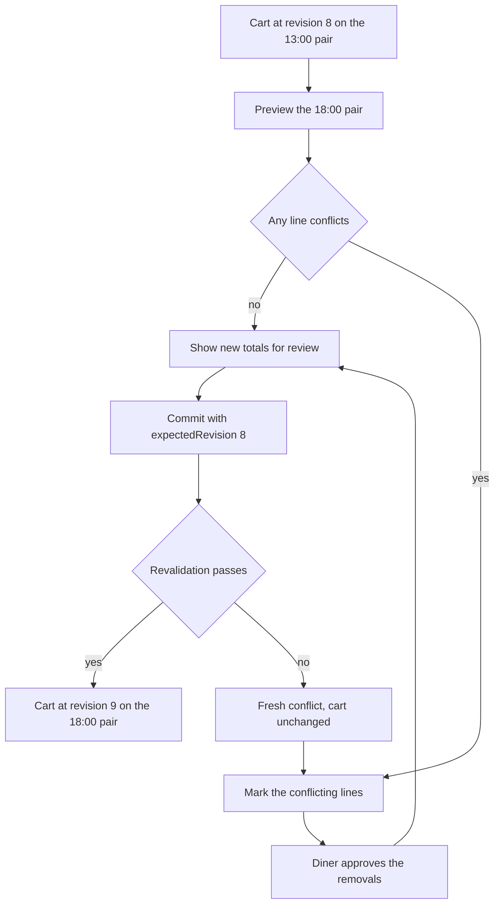

# Cart rows, load totals and window changes

The cart API from Module 17 can already answer every question this page asks. The page's difficulty is sequencing. A diner can change a quantity, remove a line, open the change-window sheet, approve two removals and press Continue, all within forty seconds on a slow connection, and any of those actions can lose a race against her own second tab or against a cook pausing the kitchen. This lesson builds the page so that every one of those sequences ends with a cart she recognises and a sentence explaining what changed.

Start from the routes. They are already implemented and tested; the page must call them in the right order with the right identity.

```txt
GET    /api/v1/cart
PATCH  /api/v1/cart/lines/:lineId        { quantity, expectedRevision }
DELETE /api/v1/cart/lines/:lineId?expectedRevision=8
POST   /api/v1/cart/window-preview       { startAt, endAt, expectedRevision }
POST   /api/v1/cart/window               { startAt, endAt, expectedRevision,
                                           removeLineIds }
```

A cart read returns groups rather than a flat line list, because grouping is a server-side decision here. The client renders what it receives and does not re-derive groups from window IDs.

```txt
200 {
  revision: 8,
  selected: { startAt, endAt, localLabel },
  serverNow: "2026-03-03T09:04:00.000Z",
  groups: [
    { kitchenId, kitchenName, windowId, orderableBy,
      requestedLoad, remainingUnitsAtRead, appearsToFit,
      subtotalMinor,
      lines: [ { lineId, dishId, windowId, name, quantity, unitPriceMinor,
                 maxPerOrder, effectiveCutoffAt, status } ] }
  ],
  totals: { subtotalMinor, currency }
}
```

`status` is a short code per line, for example `OK`, `DISH_CUTOFF_PASSED` or `QUANTITY_LIMIT`, and it tells the row whether to render normally, show a warning, or block the Continue button. The page must not compute that status from `effectiveCutoffAt` and the phone clock. The server's `serverNow` is there for countdowns and labels, not for deciding eligibility.

## Render groups without trusting their shape

Three invalid shapes can reach a client: two groups for the same kitchen, a line whose `windowId` differs from its group's window, and groups that do not share a currency. The API rejects all three, and the page should still fail loudly rather than render a mixed total, because a silent render hides a server bug behind a plausible screen.

```js
// client/src/modules/cart/groupCart.js
export function groupCart(response) {
  const seen = new Map();
  for (const group of response.groups) {
    const key = String(group.kitchenId);
    if (seen.has(key)) throw new Error('CART_DUPLICATE_KITCHEN_GROUP');
    for (const line of group.lines) {
      if (String(line.windowId) !== String(group.windowId)) {
        throw new Error('CART_WINDOW_MISMATCH');
      }
    }
    seen.set(key, group);
  }
  // Rows are grouped by kitchen, so the kitchen that closes first comes first.
  return [...seen.values()].sort(
    (a, b) => Date.parse(a.orderableBy) - Date.parse(b.orderableBy)
  );
}
```

That helper is deliberately small. It does not sum money, because the server already returns `subtotalMinor` per group and a `totals` object for the whole cart. Adding formatted currency strings on the client is how a page ends up showing 5,500 in one place and 55.00 in another. Format once, from integer minor units, at the point of render.

If `totals` is missing, the groups do not share a currency and the API has refused to invent a conversion. The page then enters its blocked state with one message: these kitchens price in different currencies, so this cart cannot be paid in one step. Do not add the numbers anyway.

## Quantity and remove with a revision

Every write sends the revision the page last read. The stepper disables itself while its write is in flight, and the remove button does the same, because a double tap that produces two increments is indistinguishable from a diner who wanted three plates. On success the response body is the new cart, and the page replaces its state with it rather than patching numbers locally.

A `409` with code `CART_CHANGED` is the normal outcome of a lost race. Use the cart in the response body to repaint, then show a short banner: "This cart changed in another window, so we reloaded it. Check the quantities before you continue." Repainting silently is worse than the error, because the diner will notice a total that moved on its own.

Here is the test to write before the route is trusted. It fails on any implementation that checks the revision after writing, or that returns a conflict without the current cart.

```js
// server/src/modules/cart/cart.routes.test.js
it('rejects a stale quantity write and leaves the cart unchanged', async () => {
  const { cartId } = await seedCart({ revision: 7, quantity: 1 });
  const first = await patchLine(cartId, { quantity: 2, expectedRevision: 7 });
  expect(first.status).toBe(200);
  expect(first.body.cart.revision).toBe(8);

  const stale = await patchLine(cartId, { quantity: 3, expectedRevision: 7 });

  expect(stale.status).toBe(409);
  expect(stale.body.code).toBe('CART_CHANGED');
  expect(stale.body.cart.revision).toBe(8);      // the client can repaint
  const after = await readCart(cartId);
  expect(after.lines[0].quantity).toBe(2);        // nothing was half-written
});
```

Run it against a route that loads, validates, then writes unconditionally and watch the last assertion fail with quantity 3. That failure is the lesson: validating a revision you read in the same request is not a lock. The write itself must match on `_id`, `dinerUserId` and `revision`, and report a matched count of zero as a conflict.

## The change-window flow in four steps

Changing the window is the part of this page that most often ships broken, because the happy path looks like a single button. Build it as four explicit steps and keep each step's result visible to the diner.

Step one: the diner opens a sheet listing today and tomorrow's windows from the browse window list, each with its time range. The current interval is marked and disabled. Step two: tapping a window calls the preview route with the exact UTC pair and the current revision. Nothing is written. The sheet shows a spinner in place of the list while the preview runs.

Step three: the preview returns a result per line. Available lines show the new cutoff and any price change. Conflicting lines show a code and a short sentence, for example "Maqluba needs 90 minutes, so its deadline for this window has passed." The sheet turns into a summary: what moves, what is removed, and what the new total would be. Step four: the diner presses the confirm button, which sends the interval and the IDs of the lines she approved removing. The commit route revalidates, and on success returns the new cart with a higher revision.

The client never sends a list of "valid" lines. It sends the removals and lets the server decide again, which is why a kitchen that paused during the review produces a fresh conflict instead of a wrong write.

```txt
POST /api/v1/cart/window-preview  -> 200 {
  serverNow, revision,
  proposed: { startAt, endAt, localLabel },
  lines: [
    { lineId, code: "AVAILABLE", windowId, effectiveCutoffAt, unitPriceMinor },
    { lineId, code: "DISH_CUTOFF_PASSED", dishName }
  ],
  removedCount: 1,
  proposedTotals: { subtotalMinor, currency }
}
```

If the preview itself returns `CART_CHANGED`, close the sheet, repaint from the returned cart and tell the diner the cart moved. Do not run the preview again automatically. She may have added a line in the other tab that she wants to keep, and an automatic retry would evaluate a cart she has not seen.



The flow contains one loop, and the loop is the point. A conflict found at commit sends the diner back to the review step with her cart untouched, rather than completing a half-applied change. Notice also that the preview and the commit both ask the server, and neither trusts the earlier answer. That repetition is what makes the change safe on a weak connection where the two taps can be a minute apart.

## Name the cause in the banner

Every conflict the page can receive maps to one sentence and one action. Keep that mapping in one module so two screens cannot describe the same code differently, and so a reviewer can read the whole vocabulary in one place.

| Code | What the diner reads | Action offered |
|---|---|---|
| `CART_CHANGED` | The cart changed in another window | Reload and review quantities |
| `WINDOW_CUTOFF_PASSED` | Orders for this window have closed | Choose a later window |
| `DISH_CUTOFF_PASSED` | This dish is too slow for this window | Remove the line or change window |
| `KITCHEN_PAUSED` | This kitchen is closed today | Remove the group |
| `WINDOW_FULL` | This window has no space left | Try another window |

The table is short because the API is disciplined about codes. If your client starts printing raw server messages, the vocabulary will drift, and a diner will one day read a sentence written for a developer. Keep the mapping in `cartMessages.js`, keep the fallback generic but honest, and log the unknown code with the revision so you can add it later.

A banner sits above the groups, never in a toast that disappears. A message that vanishes after four seconds is gone before a diner on a slow connection has read it, and the blocked state would then look like a cart that simply refuses to work.

## Make it work at 360 pixels

Each line is a block with three rows. The first row holds the dish name and the price, with the name allowed to wrap to two lines and the price pinned to the right. The second row holds preparation time and allergen words, which wrap as whole phrases. The third row holds the quantity stepper and the remove action. Nothing sits in columns narrow enough to truncate a dish name, and no row depends on a hover state.

The stepper buttons are at least 44 pixels square with the quantity between them, and the remove action is a text button that opens a one-line confirmation. A swipe gesture to delete is tempting and wrong here: it conflicts with horizontal scrolling on some Android browsers, it is invisible, and it cannot be used with a keyboard.

The total and the Continue button live in a sticky footer that stays reachable while the groups scroll. The footer shows the total once, from `totals.subtotalMinor`, and the Continue button is disabled with a short reason when any line's status blocks checkout. It never hides the reason in a tooltip. Test the page at 360 by 740 with the keyboard open if you can, because the on-screen keyboard is what pushes a sticky footer over the content it is meant to help.

## Acceptance criteria

- Lines render inside their kitchen group, with the group heading, subtotal and requested load, and no merged capacity number.
- A quantity change and a removal each send the last read revision and repaint from the response body.
- A stale write returns `409 CART_CHANGED`, repaints the cart and shows the banner instead of a silent reset.
- A window change runs preview, marks conflicting lines, requires explicit approval and commits only approved removals.
- The five conflict codes each map to a fixed sentence and a next action, defined in one module.
- The page passes the 360 pixel check with no horizontal scroll, no truncated dish names and a reachable sticky footer.

Save the grouping helper, the conflict mapping and the stale-write test output in `docs/cart-ui-decisions.md`. The gate next asks you to demonstrate a window change that removes exactly one line after approval, and a cart that reports a clear error when the window changed while the page was idle. Keep the fixture with one slow dish and one fast dish; it produces both cases without new seed data.
