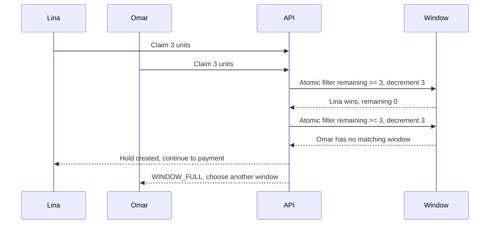

# Two diners, one last spot

Umm Yousef has three cooking units left for the 13:00 lunch window. Maqluba needs all three. Lina and Omar open the same page at 11:05. Both screens show the dish as available. Both press checkout. Sufra cannot accept both orders, even if their phones send requests within the same millisecond. One diner must receive a clear full-window result before payment begins.

This is the point where a browse answer becomes a promise. Browse can say what was true when the page loaded. A capacity claim changes the database so another checkout cannot spend the same units. The claim must also respect the dish cutoff. At 11:10, the maqluba deadline passes even if all three units remain. Time and capacity are separate conditions, and checkout must satisfy both with a fresh server decision.

## Follow the two requests

Imagine both requests read `remainingUnits: 3`. A naive handler checks that three units remain and then writes `remainingUnits: 0`. Both handlers can pass their check before either write lands. Each may create an order and a PaymentIntent. The stored counter ends at zero, which looks harmless, but the kitchen has promised six units of work. The counter alone does not reveal the double promise.

The diagram shows the unsafe read, then the state-changing decision we need. It uses one window because that is where the capacity counter lives.

The exact winner is not important. The important facts are that only one request changes the window, remaining units never go below zero, and the losing request never gets a payable order. In a real run the requests may arrive in either order. A test must assert the invariant rather than assume Lina always wins.

## The unit is kitchen effort

Capacity is not the count of dishes. One falafel wrap may cost one load unit while a large tray of maqluba costs three. A cart with two wraps and one tray needs five units from that kitchen. Compute the total from validated quantities and current dish settings on the server. The browser may show an estimate, but it cannot send a trusted `units: 1` field and make a large tray cheap to cook.

The same cart may include a second kitchen. Beit Hanan could have its own 13:00 window, counter, cutoff and travel buffer. Sufra creates one payment for the cart and one draft order per kitchen. It cannot tell Lina that her checkout succeeded if one kitchen was claimed and the other failed. The first claim must be released, or both must be committed together through a database transaction. The approved core path uses compensating release, with durable retry state, because the two kitchen windows are separate documents.

A compensation is not an afterthought in a `catch` block. The API process can stop after the first kitchen claim. A durable checkout attempt records which claim IDs belong to this request. A recovery worker can find an unfinished attempt and release or resume it. Every release must be idempotent so a retry cannot add units twice. Later lessons build that state machine.

## Decide when money may move

The client should see a payment form only after Sufra has checked the cart, claimed every kitchen's units and created draft orders with a fixed server total. The hold expires at a bounded time. A PaymentIntent is created for that one checkout attempt in the payment module, using the server total and a stable idempotency key. Its existence does not mean payment succeeded. The trusted payment webhook later confirms the held claims or starts a refund path if the hold can no longer be honored.

Do not use a browser redirect or a successful button click as proof of payment. The payment provider may need extra steps, the network may drop, and events may arrive later. Sufra's order states must distinguish `awaiting_payment`, `paid`, `cancelled` and `refund_required`. This module prepares the capacity and order side. The next module integrates Stripe test mode and webhook confirmation. We keep that boundary visible in every example so a learner does not accidentally mark an order paid while building capacity code.

The hold should not outlive its useful window. If the maqluba cutoff is 11:10 and a client starts at 11:09, a 15-minute hold would promise preparation time that no longer exists. M19 sets the first rule: `expiresAt` is the earlier of a short checkout deadline and the earliest effective dish cutoff in that kitchen's order. M26 will stress this rule under delayed payment and a busy lunch rush. An expired hold needs an explicit release worker; a database TTL index can remove old records later but does not restore capacity for you.

## Make the loser useful to the diner

Omar should receive a stable code such as `WINDOW_FULL`, the affected kitchen and window, and a suggestion to select another dated window. If maqluba closed by time rather than capacity, the response is `DISH_CUTOFF_PASSED` with the dated cutoff instant. These errors need different copy. "Sold out" is inaccurate when there are spare units but no preparation time. "Try again" is poor advice when repeating the same request cannot change a closed window.

The response must not reveal Lina's cart, payment details or order. It can reveal only public availability information. A conflict response should include the current server time and a fresh public window summary so Omar can choose again. The client must review a new total before creating a new payment attempt. Sufra never silently drops a kitchen from the cart and charges less than the diner expected.

## Trace the money and the promise

Write a short trace in `docs/checkout-decisions.md`. Start with two requests against a 10-unit window that has only three units remaining. Show each request's attempted units, the atomic filter result, the new counter, the claim state, the order state and whether payment is allowed to start. Then trace a two-kitchen cart where the first claim succeeds and the second fails. The first release should restore exactly its own units. A second release call should do nothing.

Use a concrete date and zone in that trace. A kitchen-local `11:10` label is useful to a cook, but the server compares UTC instants. Write both values. Note whether the claim happened before the cutoff and when its hold expires. A reader should be able to check the decision without relying on the writer's phone time zone.

Now try a cart that asks for four units when only three remain. The handler must reject it before changing the counter. It must not decrement to minus one and later repair the number. A negative counter is evidence that the claim filter was too weak, even if a release worker eventually puts the units back. Conversely, a window with four units should accept a four-unit request and end at zero. These two nearby cases make the boundary visible.

Also ask what happens when the same request is sent twice because the phone lost its response. The second request should recover the same checkout attempt and its existing claims. It must not reserve another set of units or create a second payment path. A stable attempt key must be scoped to the diner and checked against the same cart snapshot. Reusing the key with a different cart is an error, not permission to change the first purchase. These retry rules are just as important as the parallel winner rule because weak mobile connections make retries normal.

If the trace cannot explain a crash after the first claim, the design is unfinished. The next chapter shows the one-document atomic update that prevents the two diners from sharing the last spot. Later chapters connect that update to an idempotent multi-kitchen attempt and a payment boundary.

References: [MongoDB single-document atomicity](https://www.mongodb.com/docs/manual/core/write-operations-atomicity/), [Stripe PaymentIntent lifecycle](https://docs.stripe.com/api/payment_intents).
