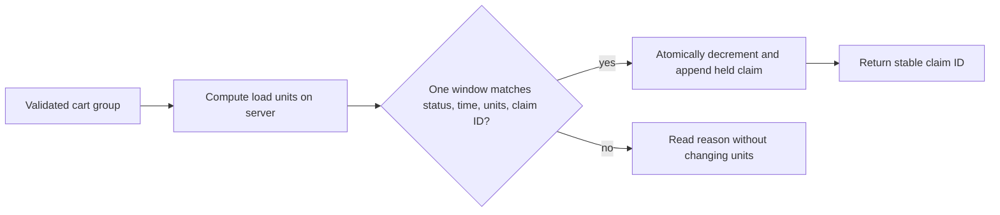

# Claim capacity in one window update

The two diners in the last lesson both saw three units. The safe claim does not ask what an earlier read returned. It tells MongoDB to change one dated window only if that window still has at least three units, remains open, and has not already recorded this request. The match and change happen as one document update. If another request wins first, the second update does not match.

There is another failure between a counter decrement and a separate claim insert. The process can stop after decreasing `remainingUnits` but before inserting `CapacityClaim`. A retry would not know which units to release. For the small Sufra course build, put a compact claim subdocument on the `DeliveryWindow` and change it in the same atomic update as the counter. This embedded `CapacityClaim` is the authority for the window's capacity. Orders will point at its stable ID. The bounded window capacity and short lifetime keep the claim list small; a larger product would review document growth and perhaps use a transaction-backed separate collection.

The diagram shows the one-document boundary. It matters because MongoDB's single-document atomicity covers the counter and the embedded claim together, but it does not cover a second kitchen or an external payment call.



## Calculate units before the update

The cart groups lines by kitchen and dated window. For each line, multiply the validated positive integer quantity by the dish's positive integer `loadUnits`. Sum with safe integer checks. A cart with two one-unit falafel wraps and one three-unit tray needs five units. Do not accept `loadUnits` or a claimed subtotal from the browser. Read current dish settings, verify ownership and active status, then snapshot the values that will become part of the order. Set a course limit on quantity and total units so a malicious request cannot create an enormous claim array or overflow arithmetic.

The same group has a cutoff. Call the shared `dishCutoff` function from M14 for every line using the dated window and kitchen travel buffer. The earliest effective cutoff becomes the group's last safe claim time. Capture an injected server instant as close as possible to the write. Reject if any line is already late. M19.6 will test the difficult boundary where time advances during checkout and will add a post-write guard before payment is exposed.

## Keep claim and counter together

Create `server/src/modules/checkout/claim-window.js`. This example uses a Mongoose `DeliveryWindow` model. The window has `claims` as small subdocuments with `id`, `attemptId`, `units`, `state`, `expiresAt` and `createdAt`. Validate the values before this function. Use a stable claim ID derived from the checkout attempt and kitchen window, not a new random value on every retry.

```js
export async function claimWindow({ Window, windowId, claimId, attemptId,
  units, expiresAt, now }) {
  if (!Number.isSafeInteger(units) || units < 1) {
    throw new Error('INVALID_UNITS');
  }
  if (expiresAt.getTime() <= now.getTime()) {
    throw new Error('HOLD_ALREADY_EXPIRED');
  }
  const changed = await Window.findOneAndUpdate(
    {
      _id: windowId,
      status: 'open',
      cutoffAt: { $gt: now },
      remainingUnits: { $gte: units },
      'claims.id': { $ne: claimId },
    },
    {
      $inc: { remainingUnits: -units },
      $push: { claims: { id: claimId, attemptId, units,
        state: 'held', expiresAt, createdAt: now } },
    },
    { new: true },
  ).lean();
  if (changed) return { status: 'held', claimId };
  const existing = await Window.findOne(
    { _id: windowId, 'claims.id': claimId },
    { 'claims.$': 1 },
  ).lean();
  if (existing) return { status: existing.claims[0].state, claimId };
  return { status: 'unavailable' };
}
```

The update has no `upsert`. Checkout must never create a window when a requested ID does not exist. The `$inc` and `$push` affect the same window document. A concurrent update rechecks the filter against the current window before it changes that document. `remainingUnits: { $gte: units }` prevents a negative counter. The claim-ID condition prevents a retry from subtracting the same units again. A failed match could mean full, closed, late, missing or already claimed; read safe current state to choose the response rather than calling every failure `WINDOW_FULL`.

The returned document is not needed to decide payment yet. It proves only that this kitchen's hold exists. The API must still claim every other kitchen and create draft orders. It should not return a PaymentIntent client secret or a success status here. A lost response after the update is normal; the same claim ID lets a retry find the existing hold.

Work the three-unit example as a request trace. The first update changes the window from three units to zero and stores Lina's claim ID. The second update sees zero and matches no document. A repeat of Lina's request also matches no document because the claim ID is present, but its follow-up read returns her existing held claim. These two failed matches mean different things to the diner, so preserve the reason after the atomic decision.

<TraceRequest title="One win, one conflict, one retry">
  <TraceStep actor="Lina" label="Claim three units" detail="Window changes from three remaining to zero; claim L is held" />
  <TraceStep actor="Omar" label="Claim three units" detail="Capacity filter finds no match; no claim O exists" />
  <TraceStep actor="Lina retry" label="Use the same claim ID" detail="Duplicate filter finds no match; claim L is returned unchanged" />
</TraceRequest>

Try to explain why a plain `findOne` followed by `save` cannot produce the same guarantee. Both readers can see three units before either save. An optimistic version check could also solve that race, but every caller would need to retry the compare-and-swap correctly. The conditional update expresses the actual resource rule in one database command. It is easier to review because the necessary conditions sit beside the decrement.

## Check the invariant, including releases

For each dated window, `remainingUnits + sum(units for held and confirmed claims) = capacityUnits`. Released claims do not consume units. This equation is easy to test and inspect. Start at ten. Claim three: remaining seven, active claims three. Claim four: remaining three, active claims seven. Release the first claim once: remaining six, active claims four. Releasing it again must leave remaining six. A claimed three-unit group cannot be split into three separate one-unit releases just because the cart displayed three portions.

When a hold expires, do not delete its subdocument and hope the counter recovers. Change the claim from `held` to `released` and increment the counter in one conditional update on the same window. A filter that matches the specific claim ID and its `held` state makes release idempotent. A confirmed claim must not be released by the expiry worker. A later module will attach a job and reconciliation process, but the state transition belongs to this model now.

Consider a duplicate request after a release. The same claim ID is already present with `released` state. The function returns that state rather than reclaiming units. To start a genuinely new checkout after the diner reviews a changed cart, create a new attempt ID and new claim ID. The API must reject reuse of the old attempt key with changed cart contents. This avoids using a retry as an unreviewed second purchase.

The claim ID is not a secret or a substitute for authorization. The checkout route still checks the signed-in diner, their cart ownership and the attempt's owner before returning its status. A guessed claim ID must not reveal another person's meal or payment. Store a server-generated attempt ID or a cryptographically random idempotency key with a unique index per diner. If a client supplies a key, bind it to a hash of the validated cart snapshot. This makes network retries predictable without trusting the client to choose units or prices.

## Prove the read-then-write bug

Write an integration test that starts 20 promises at once against a window with ten units. Each request needs three units and a unique claim ID. Exactly three should become `held`; seven should receive a conflict. The counter should end at one. Repeat the test with one-unit claims and expect ten winners. Do not assert which promise wins because scheduling differs by machine. Then send the same winning ID twice and assert the counter does not change on the retry.

If the test passes only when requests run one at a time, it has not tested the race. If it reports a negative counter, check that the capacity condition is in the `findOneAndUpdate` filter rather than in a prior `findOne`. If the counter falls twice for one ID, check that the claim ID is stable and the `$ne` condition is present. If it never restores units, inspect the release transition rather than forcing the generator to reset `remainingUnits`.

This one-window claim is the foundation, not the whole checkout. The next lesson compares a database transaction with the approved compensating path for two kitchens. It will make recovery durable so a crash between two individually safe claims cannot leave a hidden hold forever.

References: [MongoDB atomicity and conditional updates](https://www.mongodb.com/docs/manual/core/write-operations-atomicity/), [Mongoose `findOneAndUpdate`](https://mongoosejs.com/docs/tutorials/findoneandupdate.html).
