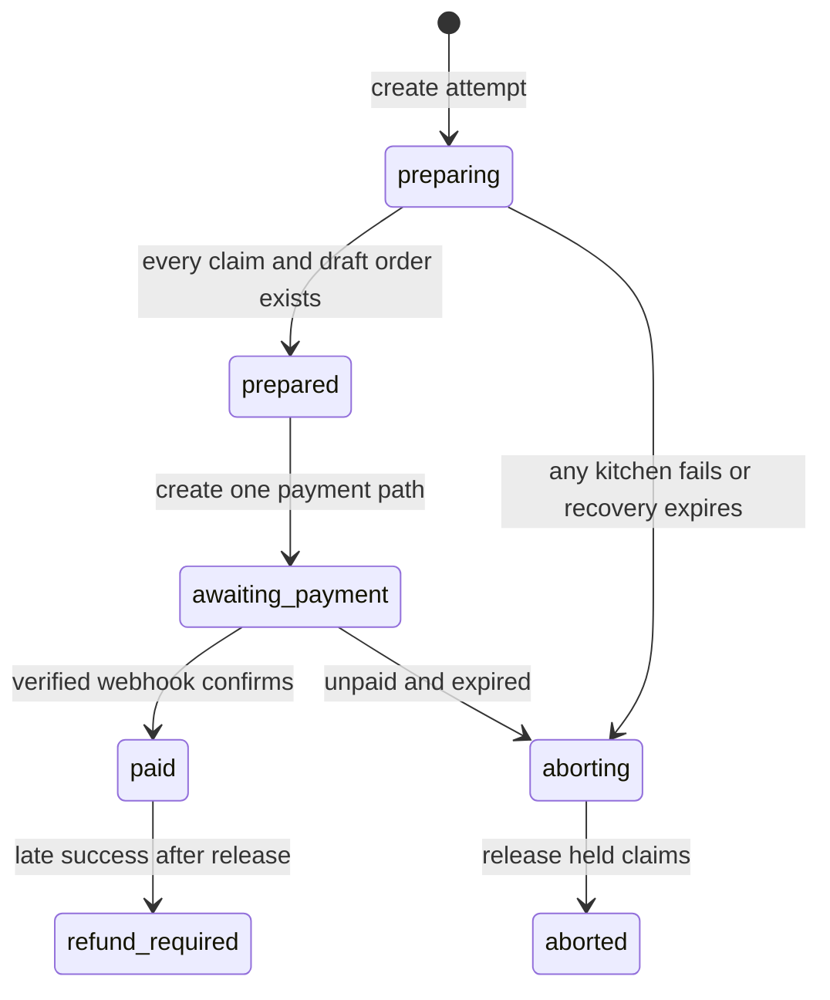

# All or nothing across kitchens

Omar's cart has maqluba from Umm Yousef and sweets from Beit Hanan. Each kitchen has its own dated 13:00 window. Both need a capacity claim before Sufra offers one payment for the cart. The first kitchen may have space while the second is full. One atomic update on Umm Yousef's window cannot promise anything about Beit Hanan's window. We need a rule for the gap between those two documents.

One option is a MongoDB transaction. It can update both window documents and create related records as one commit on a replica set or sharded cluster. Another option is to claim the windows in a fixed order and release any earlier claim if a later one fails. The approved Sufra roadmap selects the second option for the core build and asks learners to discuss transactions. That choice keeps the local setup simpler, but it creates explicit recovery work. A compensation can be delayed by a process crash, so it must be driven by a durable attempt record and idempotent release operation.

## State what all or nothing means

To the diner, all or nothing means Sufra does not charge for only one kitchen when the cart requested two. It does not mean two independent MongoDB documents change at the same instant. During preparation, one kitchen can be temporarily held while the other has not yet been claimed. No PaymentIntent client secret is returned in that state. If preparation fails, a worker releases every held claim for the attempt and marks draft orders cancelled. Only an attempt with all required claims and draft orders can proceed to payment.

This distinction matters during an outage. Suppose the process claims three units from Umm Yousef, then stops before contacting Beit Hanan. The first claim still consumes capacity until recovery runs. That temporary loss is a cost of compensation. It is safer than exposing a partial payable order. A short hold deadline and a recovery worker bound how long the units remain unavailable. The release transition must work even if the original API process never returns.

The state diagram separates internal preparation from the customer-visible payment boundary.

The arrow from `paid` to `refund_required` is an exception path, not a normal checkout outcome. The payment module must reconcile late events instead of assuming the browser's timing is exact. A paid order cannot be silently deleted because a worker noticed an expired hold. It requires a recorded refund and a clear message to the diner.

## Make the attempt durable first

Create `CheckoutAttempt` before claiming any window. Give it a unique key scoped to the diner, a hash of the validated cart snapshot, an ordered list of kitchen window IDs, deterministic claim IDs, an `expiresAt`, a status and a lease owner with a short lease deadline. The client can retry with the same key after a lost response. The server returns the same attempt if the cart hash matches. If the cart changed, return `IDEMPOTENCY_KEY_REUSED` and ask the client to start a new reviewed checkout.

Sort kitchen-window groups by stable ID before claiming. A fixed order makes logs and tests reproducible and reduces conflicting claim patterns. Record each successful claim ID in the attempt, or derive all claim IDs from the attempt ID and group ID so recovery can discover them even if the process stopped before updating the attempt document. The embedded claim on each window is authoritative for capacity. The attempt document is the recovery map. Neither alone tells the full business story.

Use a compare-and-swap update to acquire the attempt lease. Only the lease holder prepares or aborts the attempt. If the process dies, another worker may acquire the lease after its deadline. That worker reads every deterministic claim ID from the listed windows and decides whether to resume or release. For this module, choose release if an attempt is still `preparing` after its deadline. A retry before that deadline returns `CHECKOUT_PREPARING` rather than launching a second concurrent claim loop. This makes the recovery policy simple enough to test.

## Release only what this attempt owns

The release operation matches a window and an embedded claim whose ID belongs to the attempt and whose state is `held`. In the same window update it sets that claim to `released` and increments `remainingUnits` by its stored units. Do not increment from a number supplied by the browser or from today's dish settings. The stored claim units are the exact debit being reversed. If the claim is already released, a second release is a no-op. If it is confirmed after a verified payment, an expiry release must not match it.

An attempt with two kitchens can fail after the first claim. The abort worker tries release for both deterministic IDs. The second may never have been created; that is okay. It then marks the attempt `aborted` only after it has accounted for each group. If a database error interrupts release, keep `aborting` and retry. Do not mark `aborted` while a held claim is still present. A reconciliation job in M26 will also compare the window counter with active claims and report drift.

<TraceRequest title="A failed two-kitchen attempt">
  <TraceStep actor="Attempt" label="Prepare A17" detail="Cart hash and both kitchen windows saved" />
  <TraceStep actor="Umm Yousef" label="Hold C17-A" detail="Three units held on her dated window" />
  <TraceStep actor="Beit Hanan" label="No matching capacity" detail="Second kitchen is full; payment stays hidden" />
  <TraceStep actor="Recovery" label="Release C17-A once" detail="First window regains three units; attempt becomes aborted" />
</TraceRequest>

The trace is also a debugging tool. A support log should show attempt ID, kitchen window IDs, claim IDs, state transitions and error codes. It should not log the full card details or a PaymentIntent client secret. If a trace shows `aborted` with a held claim, the state machine was advanced too early. If it shows `prepared` with only one claim for a two-kitchen cart, the preparation completeness check was weak.

## Compare the transaction alternative honestly

A transaction would make the multi-document claim and draft-order creation atomic. It would avoid a temporary partial hold. It also requires a supported MongoDB deployment, correct session handling and retry logic for transient transaction errors. It cannot make Stripe part of the database transaction. Even with a MongoDB transaction, payment confirmation remains an external event that needs idempotency and reconciliation. Transactions are a strong choice for a larger implementation, but they do not remove the payment state machine.

Write a two-column decision note in `docs/checkout-decisions.md`: transaction on one side, compensating release on the other. Compare local setup, temporary partial holds, crash recovery, payment boundary and test evidence. State the approved course choice. Do not claim compensation gives database-level atomicity. Its promise is narrower: the diner never gets a payable partial cart, and an unfinished hold is eventually released through a durable, testable path.

## Practice the crash windows

List four places a process might stop: before any claim, after the first claim, after all claims but before marking prepared, and after marking prepared but before returning a response. For each place, state what a retry sees and what the recovery worker can discover. The deterministic claim IDs are crucial in the third case because the attempt document may not yet record the final successful write. The prepared attempt is safe to resume only while its claims are still held and unexpired.

Finally, test the worker twice against the same aborted attempt. Capacity should restore once, not twice. Make one release fail temporarily, then retry and verify that the attempt remains `aborting` until both groups are accounted for. These tests are the price of the approved compensation path. The next lesson gives a hold its exact state and deadline, so this recovery policy has a bounded interval rather than an indefinite promise.

References: [MongoDB single-document atomicity and transactions](https://www.mongodb.com/docs/manual/core/write-operations-atomicity/), [MongoDB transaction considerations](https://www.mongodb.com/docs/manual/core/transactions-production-consideration/), [MongoDB TTL timing](https://www.mongodb.com/docs/manual/core/index-ttl/).
