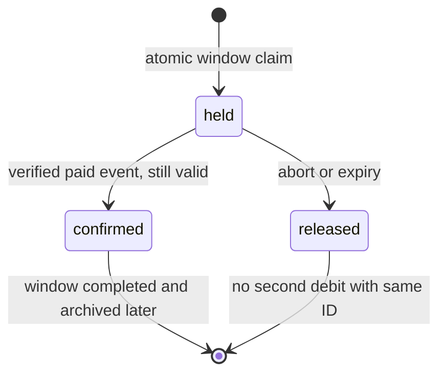

# Capacity claims as holds

A capacity claim is a temporary promise, not a paid order. Sufra sets aside cooking units while the diner completes payment. The claim starts as `held`, changes to `confirmed` only after trusted payment evidence, or changes to `released` when checkout fails or the hold expires. This chapter implements the held and released states. The payment module will add the confirmed transition through a verified webhook.

The deadline must reflect food preparation, not only a generic payment timer. A 13:00 maqluba window has an 11:10 cutoff. A claim made at 11:09 cannot remain useful until 11:24 simply because a common checkout timer is fifteen minutes. Use the earliest of the attempt's short payment deadline, each line's effective dish cutoff, and any earlier window close rule. Under the strict policy, `expiresAt` is a UTC instant and is not extended by a phone reconnect. The diner sees an honest deadline and can choose a later window if it passes.

## Model the state on the window

Add a compact `claims` array to the `DeliveryWindow` schema. Each entry has a stable `id`, `attemptId`, `units`, `state`, `createdAt`, `expiresAt` and optional `orderId`. Keep `units` immutable after creation. The window already has `capacityUnits` and `remainingUnits`. Set a reasonable maximum capacity for this course so the bounded claim list remains small. Document the eventual archive policy for old dated windows; do not delete a paid window merely to shrink its document.

The state path is narrow. A held claim can confirm if a verified payment success is applied before release. It can release after expiry or failure. A confirmed claim cannot return to held. A released claim cannot reclaim units under the same ID. A refund after a paid order is a separate financial and order action; it does not pretend that an expired lunch slot is newly usable.



The diagram has no direct `released` to `confirmed` arrow. If a late payment succeeds after release, Sufra records `refund_required` on the checkout attempt and starts a refund. It must not decrement capacity again without a fresh checkout because another diner may have claimed the restored units. This is a case where money and capacity cannot be made atomic by a local function.

## Set the deadline once

Create `server/src/modules/checkout/hold-deadline.js`. The function accepts a server instant, a configured checkout duration and the calculated effective cutoffs for every line. It returns the earliest allowed expiry. Reject an attempt if the expiry is at or before `now`. Do not accept a client-provided expiry. A shorter cutoff for one dish must shorten the whole kitchen group hold because the order is sold as one group.

```js
export function holdDeadline({ now, checkoutMinutes, cutoffs }) {
  if (!Number.isSafeInteger(checkoutMinutes) || checkoutMinutes < 1 ||
      !Array.isArray(cutoffs) || cutoffs.length === 0) {
    throw new Error('INVALID_HOLD_INPUT');
  }
  const times = cutoffs.map(value => new Date(value).getTime());
  if (times.some(value => !Number.isFinite(value))) {
    throw new Error('INVALID_CUTOFF');
  }
  const deadline = Math.min(
    now.getTime() + checkoutMinutes * 60_000,
    ...times,
  );
  if (deadline <= now.getTime()) throw new Error('DISH_CUTOFF_PASSED');
  return new Date(deadline);
}
```

Test with the maqluba cutoff at 11:10. At 11:09:00, a fifteen-minute checkout setting still gives 11:10. At 11:10:00 the function rejects. For a falafel-only group with a 12:00 cutoff, the same 11:09 request ends at 11:24. If the cart combines both dishes from one kitchen, the group ends at 11:10. Show the deadline in the response as a dated UTC instant, then format it for the diner. A countdown may be useful, but server state decides expiry.

## Release once, even after a retry

Create `server/src/modules/checkout/release-claim.js`. Read the embedded claim by ID to obtain its stored units. Then update only if that exact claim is still held and still has those units. The read and update are not one transaction, but the conditional update makes a competing confirmation or release win only once. If the update does not match, reread the state and return it without incrementing capacity.

```js
export async function releaseClaim({ Window, windowId, claimId }) {
  const row = await Window.findOne(
    { _id: windowId, 'claims.id': claimId },
    { 'claims.$': 1 },
  ).lean();
  const claim = row?.claims?.[0];
  if (!claim) return { status: 'missing' };
  if (claim.state !== 'held') return { status: claim.state };
  const changed = await Window.findOneAndUpdate(
    { _id: windowId,
      claims: { $elemMatch: { id: claimId, state: 'held', units: claim.units } } },
    { $set: { 'claims.$.state': 'released' },
      $inc: { remainingUnits: claim.units } },
    { new: true },
  ).lean();
  return { status: changed ? 'released' : 'race_lost' };
}
```

The array match prevents release from touching a different claim. The condition on `state: held` means two workers cannot both restore units. The stored units prevent a client or later dish edit from changing the release amount. A `race_lost` result is not necessarily an error: a webhook could have confirmed the claim first, or another worker could have released it. Reread and log the final state during reconciliation.

## Make expiry explicit

Create a delayed worker job keyed by claim ID for the planned expiry. Also run a periodic sweep for held claims whose `expiresAt` is at or before the server clock, because delayed jobs can be lost or a worker can restart. A unique job key makes rescheduling idempotent, but the database state transition is the real guard. The worker checks the attempt and payment state before release, then applies the conditional release. If payment confirmation and expiry race, only one `held` transition can win on the window document.

Do not use a MongoDB TTL index as the mechanism that frees capacity. TTL deletion is a background cleanup with no exact timing guarantee, and deleting the claim would remove the evidence needed to restore or explain units. Sufra keeps the state and runs explicit release work. A separate later retention policy may archive old attempts after accounting is complete.

## Check the accounting equation after each transition

Add an assertion in the test helper: `remainingUnits + heldUnits + confirmedUnits === capacityUnits`. Count only claims on that dated window. A released claim remains in the array for history but contributes zero to the used total. This equation catches two different defects. If a release changes the state but forgets the increment, the sum is too small. If a release increments twice, the sum is too large. It also catches a generator retry that resets remaining units without touching existing claims.

The equation does not prove the diner paid. A held claim consumes capacity while payment is pending. A confirmed claim consumes capacity after payment. Those states have the same arithmetic but different business meaning. Keep both the claim state and the checkout attempt state in the evidence. If a mentor sees ten units accounted for but a paid order still marked `awaiting_payment`, the webhook path needs review. If the attempt says `aborted` while a held claim remains, the recovery worker needs review. One numerical invariant cannot replace state-machine checks.

When a kitchen closes a dated window after a diner has paid, do not release the confirmed claim just to make the counter look available. The paid promise remains attached to the historical window while the cook and diner resolve it. The window status stops new claims. A future refund can change the order and financial records, but it should not make a past lunch interval available again. This distinction prevents a tidy counter from hiding a broken promise.

## Verify the state and the user's view

In a test, create a ten-unit window and hold three units. Expect seven remaining. Release once and expect ten. Release again and still expect ten. Create another hold, confirm it through a test-only state transition, then run the expiry worker; it must not restore confirmed units. Freeze time exactly at `expiresAt` and assert the hold is expired under the strict boundary. A worker that runs a minute late should still release it; the product may temporarily show fewer units, but it must never overbook.

Simulate a lost response after the initial claim. Retry with the same attempt and claim ID. The server should return the same hold and deadline, not create another one or extend its time. Simulate a phone whose clock is ten minutes behind. The client may display an old countdown until it refreshes, but the API rejects payment continuation after the server deadline and offers a later window. Give the diner a specific message rather than a generic server error.

Record the commands and rows in `docs/checkout-decisions.md`: claim ID, window ID, before and after remaining units, expiry, final state and worker retry result. This evidence makes a capacity leak visible. The next lesson uses these held claims to create draft orders that preserve each kitchen's price, dish and delivery promise before the payment provider is called.

References: [MongoDB single-document atomicity](https://www.mongodb.com/docs/manual/core/write-operations-atomicity/), [MongoDB TTL timing](https://www.mongodb.com/docs/manual/core/index-ttl/).
