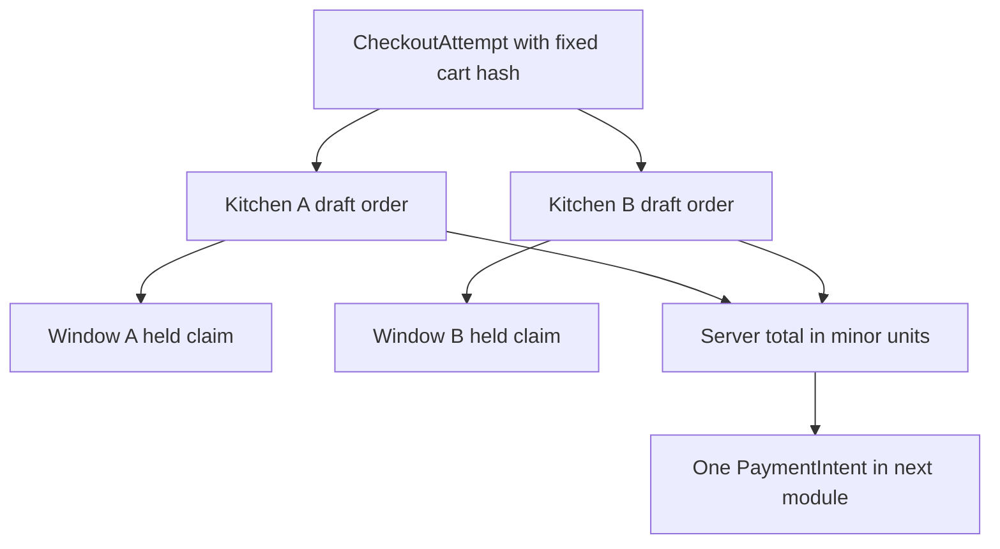

# Split and snapshot orders

Both kitchen windows now have held capacity. Sufra still has one diner checkout and one future payment, but each cook needs an order they can accept or reject separately. Create one draft order per kitchen. Every order points to the common checkout attempt and to that kitchen's dated window. The diner sees the whole purchase; a cook sees only their own order and the details needed to prepare it.

A draft order must preserve the promise as it stood at checkout. The dish name, unit price, preparation minutes, load units, kitchen name, delivery start and end, kitchen time zone, travel buffer and effective cutoff are snapshots. A cook can later rename a dish or change next week's schedule without rewriting a paid order. The order still points to the live dish and kitchen IDs for current navigation, but the snapshot is what support uses to explain this purchase.

## Build from one validated cart version

Create `server/src/modules/checkout/build-order-drafts.js`. Accept a server-validated cart snapshot, the held claim IDs, the checkout attempt ID and a pricing result from the existing server pricing module. Do not accept a browser subtotal or line price. Require positive integer quantities and prices in the smallest currency unit. Use one currency per attempt and reject mixed currencies before claiming capacity. Define all fee and discount rules in the existing pricing boundary; this module only records their already validated allocation to kitchen orders.

Group by kitchen ID and dated window ID. Sufra's cart is bound to one selected delivery interval, but each kitchen has its own window record and zone. A group must have exactly one held claim matching its computed load units. If one group lacks a claim, do not create a payable attempt. If two groups share the same kitchen but point to different window IDs, the cart is invalid under the one-window rule. Return an actionable conflict and let the diner review a new cart.

The diagram shows the relationship the learner will implement. The single payment amount is the sum of the kitchen order totals, not a third independent price source.



For example, Lina orders a maqluba tray for 1800 minor units and a falafel meal for 700 from two kitchens. If the pricing module says no fees or discounts, the attempt total is 2500. The first kitchen order totals 1800 and the second totals 700. If a kitchen-specific discount exists, allocate it to that kitchen before summing. If a shared fee exists, record its allocation rule explicitly so a later partial refund has a defensible amount. Do not divide a fee by two without a written rule or let the browser decide the allocation.

## Use stable order identity

Give each draft a deterministic ID or a unique index on `{ attemptId, kitchenId }`. Use `upsert` with `$setOnInsert` for the immutable snapshot. If the API stops after creating the first draft, a recovery run can create the missing second draft without duplicating the first. A retry with the same attempt ID must compare the stored cart hash and totals before returning existing drafts. If they differ, stop and investigate rather than silently changing a draft that a payment may reference.

The order begins in `awaiting_payment`. It is not visible as a kitchen job yet. The cook should not prepare a meal because a diner opened a payment page. Only the verified payment webhook in M20 can make the order actionable. If checkout compensation aborts before payment, mark draft orders `cancelled` and retain their IDs for audit. Do not delete one draft and leave a gap that a retry might fill after the attempt is aborted.

Write a pure snapshot function first. It should make the fields explicit and reject missing values. The code below shows the shape; adapt names to the project's schema and existing pricing service.

```js
export function orderLineSnapshot({ dish, quantity, priceMinor, cutoffAt }) {
  if (!Number.isSafeInteger(quantity) || quantity < 1 ||
      !Number.isSafeInteger(priceMinor) || priceMinor < 0 ||
      !Number.isSafeInteger(dish.prepMinutes) || dish.prepMinutes < 1 ||
      !Number.isSafeInteger(dish.loadUnits) || dish.loadUnits < 1) {
    throw new Error('INVALID_ORDER_LINE');
  }
  return {
    dishId: dish.id,
    nameAtPurchase: dish.name,
    quantity,
    priceAtPurchaseMinor: priceMinor,
    prepMinutesAtPurchase: dish.prepMinutes,
    loadUnitsAtPurchase: dish.loadUnits,
    effectiveCutoffAtPurchase: new Date(cutoffAt),
  };
}
```

The helper does not calculate total money, verify ownership or claim capacity. Those are separate trusted steps. Its job is to freeze a validated line. Test that changing `dish.name` and `dish.prepMinutes` after calling it leaves the snapshot unchanged. If the copied fields change with the source object, the function retained a nested reference instead of making a value snapshot. Keep the snapshot small but sufficient to explain the order and any later refund.

## Connect a claim to exactly one draft

Each kitchen order stores its `claimId`, `windowId`, `attemptId`, `kitchenId`, diner ID, status and order-level snapshots. The held claim stores the same order ID once the draft exists. If writing the order ID back to the window fails, recovery can derive the order ID from the attempt and kitchen and retry. Do not mark the attempt prepared until every draft and claim link is verified. A claim without a draft holds capacity but cannot be charged; a draft without a claim is not payable.

Add a unique index so one attempt cannot create two orders for the same kitchen. Check that a cook querying orders is scoped by their kitchen ownership, not by an attempt ID supplied in a URL. The diner can view their own combined receipt and each split order. A different diner must not be able to retrieve either by guessing an order ID. Avoid putting a private address or phone number in a public window record; the window claim needs only IDs, units and timing.

## Reconcile the total before payment

Sum line amounts as integer minor units, then apply the already validated fee and discount allocations. Assert that the sum of kitchen order totals equals the checkout attempt total. Persist both the total and its currency. The M20 PaymentIntent must use exactly that persisted total and currency. A front-end total can help the diner review, but it is not an input to Stripe creation. If a price changed while the cart was open, return a review-required response before holding or charging; do not replace the amount behind a payment button.

Test two kitchens, one kitchen with two dishes, and a retry after only the first draft was written. The retry must complete the missing draft and preserve the first order ID. Then alter a dish after draft creation and verify the order's name, price and preparation snapshot remain the same. Finally, make one claim missing and assert that no PaymentIntent path is exposed. Save the order IDs, claim IDs and arithmetic in `docs/checkout-decisions.md`.

Test a price edit that occurs between browse and checkout. The checkout service reads the current trusted price before it creates the attempt. If the reviewed cart carried an older display price, return a changed-total response and ask the diner to confirm. Do not charge the new amount under an old button label. Once the attempt is prepared, its order snapshots and payment amount are fixed. A later price edit cannot change a draft tied to that attempt; it belongs to future carts.

Check rounding at the boundary rather than after writing orders. Store amounts as integers in the currency's smallest unit. If the pricing module allocates one shared minor unit among two kitchens, its documented rule must choose exactly one recipient. The sum cannot gain or lose that unit through floating-point division. This matters when a cook rejects one order and M20 calculates a partial refund: the refund comes from the paid kitchen share, not a fresh calculation against today's menu.

If one order insert times out, do not guess whether it succeeded. Read by the deterministic attempt-and-kitchen key, compare its snapshot hash, and retry only the missing insert. The database may have committed the write even though the API lost its response. This pattern is the same reason the window claim uses a stable ID. It turns an uncertain network outcome into a queryable state instead of a second promise.

The next chapter moves the server clock to the exact claim boundary. It checks that a draft built from a formerly valid cart cannot bypass a cutoff that passes before the state-changing window update.

References: [Stripe PaymentIntent amount and currency](https://docs.stripe.com/api/payment_intents/create), [MongoDB unique indexes](https://www.mongodb.com/docs/manual/core/index-unique/).
