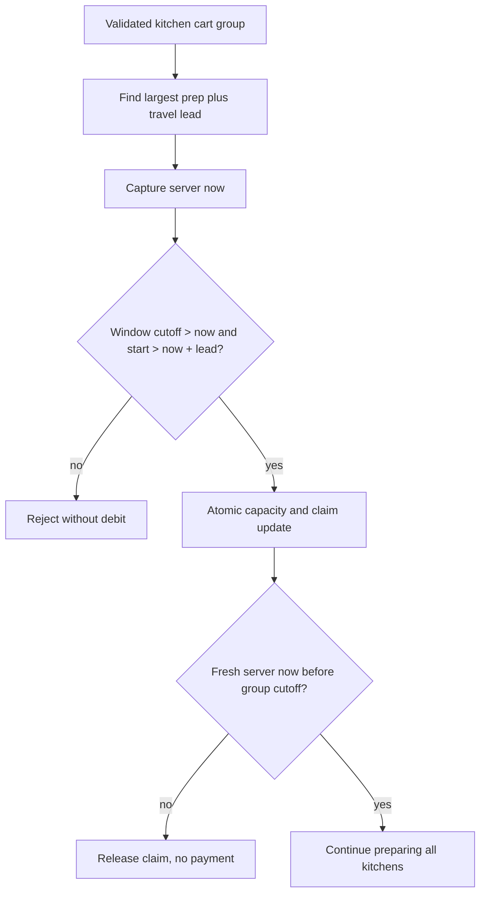

# Recheck the cutoff at claim time

Lina added maqluba to her cart at 11:09. She reads the order and starts checkout at 11:10. The cart line was valid when it was added, but the dish is late now. The capacity counter might still show three units. Sufra must reject this checkout without creating a payable order. A cart's earlier success is not permission to ignore the current server clock.

This chapter connects the M14 cutoff rule to the M19 atomic claim. The server checks every line's dated effective cutoff immediately before the write. It also puts the general window cutoff and the longest required preparation lead into the `findOneAndUpdate` filter. After the write, it checks the clock again before exposing payment. That final guard handles a process paused at the boundary. If it finds a crossed cutoff, it releases the new hold and returns a dated conflict.

## Convert the group to one strict deadline

For each dish, `prepDeadline = window.startAt - prepMinutes - travelBufferMinutes`. The group's preparation deadline is the earliest of its line deadlines, which is the same as subtracting the largest required lead from the window start. The group's effective cutoff is the earlier of that preparation deadline and `window.cutoffAt`. A cart with maqluba and falafel closes at maqluba's 11:10 cutoff, not the later falafel cutoff. If the diner wants only falafel after 11:10, they must review a changed cart and a new total.

Use the same `dishCutoff` function from M14 to show the reason to the diner. In the write filter, express the equivalent conditions directly against persisted UTC fields: `window.cutoffAt > now` and `window.startAt > now + largestLead`. A strict `$gt` matches the policy that exactly at the cutoff is late. This is a useful equivalence to test. It prevents a handler from computing `Math.min` correctly for display but forgetting one of its two limits when it changes capacity.



The second clock check does not turn MongoDB into a time machine. It gives Sufra an explicit externally visible rule: if checkout processing crosses the deadline before the attempt is prepared, the diner is not offered payment for that attempt. A claim may briefly exist before release. The release is idempotent and recovery can finish it if the process stops. This is safer than telling the diner the meal is valid based on an instant captured several seconds earlier.

## Strengthen the update filter

Extend `claimWindow` from lesson 19.2 with a validated `requiredLeadMinutes`. The server calculates the maximum of `dish.prepMinutes + window.travelBufferMinutes` across the kitchen group. Reject a negative, fractional or implausibly large lead before constructing the query. Capture `now` from the injected clock immediately before the update. The relevant filter fields are shown here; keep the existing status, units and claim-ID conditions too.

```js
const now = clock.now();
const requiredLeadMinutes = Math.max(...lines.map(
  line => line.dish.prepMinutes + window.travelBufferMinutes,
));
const earliestStartAllowed = new Date(
  now.getTime() + requiredLeadMinutes * 60_000,
);
const filter = {
  _id: window.id,
  status: 'open',
  cutoffAt: { $gt: now },
  startAt: { $gt: earliestStartAllowed },
  remainingUnits: { $gte: requiredUnits },
  'claims.id': { $ne: claimId },
};
```

`startAt` and `cutoffAt` are dated UTC fields produced in M14. No local time string appears in the filter. The line values come from the server's validated dish records and the kitchen window snapshot, not from a browser countdown. Compare `Math.max(...leads)` with a direct `Math.min(...dishCutoffs)` in a unit test. They must select the same preparation boundary. This test protects the algebra if someone changes the dish cutoff helper later.

Do not treat a no-match as proof of a time failure. The window could be full, closed, missing or already claimed under this attempt ID. Read the current public fields and the specific claim ID after the update. Choose `DISH_CUTOFF_PASSED`, `WINDOW_CLOSED`, `WINDOW_FULL` or an idempotent existing-attempt response. If both time and capacity fail, choose a documented priority and keep it consistent. For the diner, a passed cutoff is more useful than a stale capacity number because a later time is required either way.

## Guard the paused request

After the update succeeds, read `clock.now()` again. Recompute the group's effective cutoff from the dated window and validated lines. If the fresh instant is at or after that cutoff, call the idempotent release operation and mark the attempt `aborting`. Do not create a PaymentIntent or show its client secret. If release fails temporarily, keep the attempt in `aborting` for the worker and still return a conflict. A diner can start a new attempt for a later window after reviewing the cart.

This guard also needs to run after the last kitchen claim, before marking the whole attempt `prepared`. The first kitchen's deadline may pass while the service is claiming the second. If any group is late at preparation completion, release all held groups. Only an all-current attempt can progress. The later payment flow has its own difficult case: a payment can succeed after a hold expires. M20 and M26 handle that through webhook reconciliation and refund, not by pretending the clock stopped while the card form was open.

Recheck M9 and M14's dated `ScheduleException` at this same boundary. A cook may pause today while a diner prepares checkout. A wildcard `sourceRuleKey: '*'` closes all normal rules for the kitchen-local date; a rule-specific closure closes one occurrence. If a matching closure appears after a window claim, release the new hold and withhold payment. A paid order created before the closure remains for the cook's resolution workflow. A cutoff check alone does not make a closed kitchen orderable.

## Test exact instants and slow processing

Freeze the server at 11:09:59 for the 13:00 maqluba window. The claim filter should match if units remain. At 11:10:00 it should not match. At 11:10:01 it should not match. Repeat with falafel-only and expect success until just before 12:00. Then use a fake clock that returns 11:09:59 before the database update and 11:10:00 immediately afterward. The post-write guard must release the claim, restore units once and leave no payable order.

For two kitchens, make the first cutoff 11:10 and the second 11:30. Pause after claiming the first until 11:10. Even if the second window still has space and time, the attempt aborts both groups. Do not silently remove the first kitchen and charge only for the second. The test should inspect both embedded claim states, both counters, attempt status and absence of a payment path.

## Handle a lost response at the boundary

A database write can succeed while its response fails to reach the API. If the handler simply retries with a new claim ID, it may reserve a second set of units after the cutoff. Keep the deterministic ID from the attempt and query the window for that claim before deciding what happened. If it exists and the group is now late, release that same claim. If it does not exist, return the cutoff conflict without writing. If it exists and the time is still valid, continue the same attempt. This is a recovery decision, not a reason to trust the old cart check.

Use one server-owned clock abstraction in the claim service and the recovery worker. Tests should be able to advance that clock while a promise waits. Do not pass `Date.now()` from a route handler into one function and call `new Date()` from another. Mixed clocks can make the write filter use 11:09 while the response uses 11:10 and produce an unexplained success. Passing the clock dependency makes the two readings intentional and lets the test show exactly when the boundary was crossed.

Consider a slow database response that arrives after the cutoff but whose write matched just before it. The post-write check releases the hold. The diner sees `DISH_CUTOFF_PASSED` and can choose a later window. The database briefly counted the units as held, so another simultaneous request may have received `WINDOW_FULL`. That temporary conflict is an acceptable cost of the compensation design; it is not a paid overbooking. The test should record this limitation rather than expect the system to serve every possible diner at the last millisecond.

If the exact-at-cutoff test passes unexpectedly, check whether any condition uses `$gte` or `<=` in place of strict comparison. If a claim succeeds after a process pause, check whether the post-write guard used a fresh clock reading. If capacity remains lower after rejection, inspect the release state and worker queue. Log the UTC instants and kitchen zone; do not debug this by changing a phone's time setting.

Save the boundary table and the paused-request trace in `docs/checkout-decisions.md`. The next lesson creates parallel pressure against the same window and checks the numeric invariant under real concurrent database requests.

References: [MongoDB conditional update atomicity](https://www.mongodb.com/docs/manual/core/write-operations-atomicity/), [MongoDB `findOneAndUpdate`](https://www.mongodb.com/docs/manual/reference/method/db.collection.findOneAndUpdate/).
