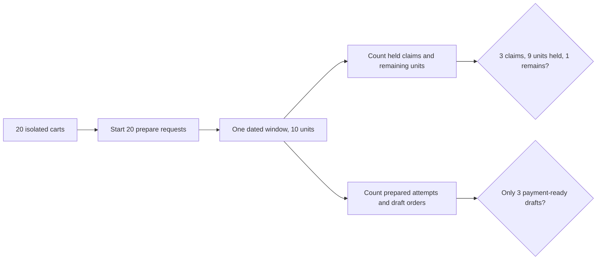

# Twenty parallel checkouts

A sequential test can prove that one claim subtracts units. It cannot prove that two diners cannot spend the same units at once. Create a dated Sufra window with ten capacity units. Start twenty checkout preparations at nearly the same moment, each asking for a three-unit dish. At most three can hold capacity. The remaining counter must be one, and no losing attempt may receive a payment path. Repeat the test several times because request scheduling differs between runs.

This is not a speed contest. A good result is an invariant that remains true under pressure, not a particular winner or millisecond number. The test should inspect database state and API responses. A zero counter could still hide a double promise if two orders were created from one three-unit debit. Count active claims and draft orders as well as the remaining units. Each prepared attempt must have exactly one held claim for this one-kitchen case.

## Set up a dated fixture

Seed one kitchen, one dish and one 13:00 dated window whose cutoff is well after the fixed test clock. Give the dish `loadUnits: 3`, a valid preparation time and a price in minor currency units. Create twenty different diners or isolated carts owned by test users. Each request gets a distinct checkout attempt key. Do not share one cart document across all requests unless you intend to test cart ownership races instead of window capacity. Keep the fixture's UTC start and cutoff explicit so a test machine's local time zone cannot move the offer.

Use a test database that you can reset. Clear the window, attempts and orders before each run, then assert that the reset generator did not overwrite existing holds during a run. The test should call the real prepare route or service with the same MongoDB collection used by the app. A pure in-memory counter will not test MongoDB's conditional update. It is fine to run the test without Stripe because this module stops at prepared draft orders and a payment boundary stub.

The diagram shows the evidence path. The test must check the persisted result, not only the HTTP status codes.



## Launch together and record every result

Put an integration script at `server/tests/integration/sufra-checkout-race.test.js`. Use your project's test runner and request helper. The outline below shows the important shape. Prepare authenticated clients and carts in a setup function; the test does not need to expose credentials or payment secrets in logs.

```js
const attempts = await Promise.all(
  diners.map((diner, index) =>
    prepareCheckout({
      auth: diner.auth,
      cartId: diner.cartId,
      attemptKey: `race-three-units-${index}`,
    }).then(value => ({ ok: true, value }),
            error => ({ ok: false, error })),
  ),
);
const prepared = attempts.filter(result => result.ok);
assert.equal(prepared.length, 3);
const saved = await loadWindowAndAttempts(windowId);
assert.equal(saved.window.remainingUnits, 1);
assert.equal(saved.activeClaimUnits, 9);
assert.equal(saved.preparedAttempts.length, 3);
assert.equal(saved.payableDraftOrders.length, 3);
```

`Promise.all` starts the requests without awaiting each one in a loop. The actual winner count comes from the capacity math: floor of ten divided by three is three. One unit remains, which cannot fit another three-unit dish. Assert that each rejected response has a stable conflict code and no PaymentIntent client secret. Check that all twenty results settled; a hung request is a failure, not a missing data point to ignore.

Run a second fixture with `loadUnits: 1`. Ten of twenty attempts should prepare, ten should conflict, and remaining units should be zero. Run a third fixture with one ten-unit claim and expect exactly one prepared attempt. These variations guard against an implementation that accidentally hard-codes the winner count or subtracts one unit for every dish regardless of load.

## Test the same attempt twice

Pick a winning attempt key and send the same request twice after the initial result. Both responses should refer to one attempt ID, one claim ID and one set of draft order IDs. The counter should not change. Then reuse that key with a different cart quantity. Expect `IDEMPOTENCY_KEY_REUSED` and no second claim. A lost response on a mobile connection must not become a second meal promise.

Now call the release worker twice for one held claim. After the first release, remaining units rise by the claim's stored units. The second call leaves the counter unchanged. If the claim has been confirmed through a test-only transition, neither call should restore units. This case is essential because retries happen in workers too, not only in browsers.

## Force a two-kitchen failure

Make kitchen A's window have three units and kitchen B's window have zero. A cart requests one three-unit item from A and one item from B. Preparation may hold A before it discovers B is full. The attempt must move to `aborting`; recovery releases A. After recovery, A has three units again, B has zero, and there is no payable attempt. Its draft orders, if any were written, are cancelled. Run the recovery worker a second time and verify no extra units appear.

Inject a process stop after A's claim but before recording the claim in the attempt. The deterministic claim ID lets the worker find A's hold from the attempt's planned group list. This is a stronger test than an exception thrown inside the same API process, because a local `catch` block will not run after a real stop. You can simulate the stop with a controlled hook in the test service. Remove the hook after verifying recovery.

## Test time and capacity together

Freeze the clock one second before maqluba's effective cutoff and let a valid claim proceed. At the exact cutoff, another request with free capacity must fail with `DISH_CUTOFF_PASSED`, not `WINDOW_FULL`. Advance the clock between the atomic update and the post-write guard. The new hold must release and no payment path may appear. Then move the client device clock ten minutes backward; the server result stays late. These tests prove the authoritative time belongs to the backend.

If a race test fails, log the fixed UTC now, window ID, claim IDs, active claim units, remaining units, attempt states and response codes. Do not print card details or secrets. Compute `remaining + held + confirmed` and compare with capacity. If the sum is wrong, inspect claim and release transitions. If the sum is right but too many drafts are payable, inspect the attempt preparation gate. A counter test alone cannot catch that business error.

Save three repeated runs and the injected-failure result in `docs/EVIDENCE.md`, including the command and database version. The gate in the next lesson asks you to defend the choice of compensating release and show that capacity never falls below zero. This local evidence is not the deployed load evidence required by M26, but it makes the later production test interpretable.

## Review a failed run before changing code

Suppose four three-unit attempts report success against the ten-unit window. First count unique active claim IDs. If four claims consume twelve units while remaining is negative, the conditional filter is missing or the update and check are separate. If there are only three active claims but four successful responses, one handler returned success after its update failed. If there are three claims and four draft orders, the order creation step did not require a matching claim. These are different defects, and increasing test timeouts will not fix any of them.

Suppose a two-kitchen failure leaves A's counter at zero after the attempt is aborted. Look for its claim ID in A's window. A held claim means the worker marked the attempt aborted too early. A released claim with zero remaining suggests release changed state without incrementing, or a generator later reset the counter. A missing claim with zero remaining suggests the original debit and claim identity were written separately. Use the state and arithmetic to localize the bug before adding a repair job.

Run the test against an actual MongoDB service configured like the learner project. An in-memory mock may execute `findOneAndUpdate` serially and conceal the race. Record whether the test used a local standalone MongoDB or a replica set; the approved compensation path works without a multi-document transaction, but the query and update still need the real database's atomic behavior. If the test fixture uses a future kitchen-local time, pin its UTC instant and zone so a policy change does not cause an unrelated failure.

References: [MongoDB atomicity under concurrent updates](https://www.mongodb.com/docs/manual/core/write-operations-atomicity/), [MongoDB transactions for multi-document alternatives](https://www.mongodb.com/docs/manual/core/transactions/).
