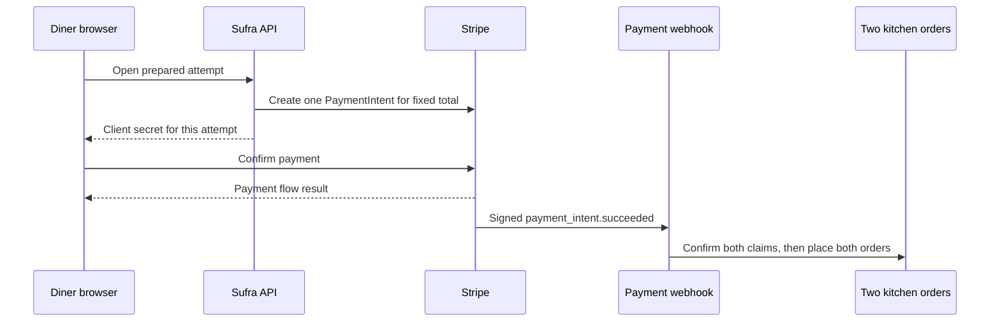

# One payment, two kitchens

Lina checks out a maqluba tray from Umm Yousef and sweets from Beit Hanan. M19 has prepared one `CheckoutAttempt`, held capacity in two dated kitchen windows, and created two draft orders. The orders share one fixed total and currency. Lina expects one payment, while each cook will later receive only their own order. This module connects those facts to Stripe without turning a browser callback into a kitchen job.

The payment boundary is narrow. The server creates one PaymentIntent for the prepared attempt using its persisted amount and currency. The browser confirms that intent through Stripe's payment UI. Stripe later sends an event to the server. Only a verified, reconciled success event can confirm both held claims and make both kitchen orders actionable. A page returning from a card flow may display progress, but it cannot mark a kitchen order paid by itself. Lina could close the page before the callback, or a hostile client could call the success route directly.

The diagram shows the two clocks. The browser can finish its visible interaction before the backend has processed the event. The kitchen orders wait on the server side of that gap.

The event may arrive twice or out of order with another event. The server must make repeated processing safe. It may also arrive after an unpaid hold expired and capacity was released. In that case, Sufra cannot silently revive the old promise. It records a late paid state, withholds both kitchen jobs and starts a traceable refund.

## Keep one amount source

M19's order snapshots sum to the attempt's total in integer minor currency units. The amount is fixed before the PaymentIntent is created. A browser sends only the attempt identity and a safe retry key, never a price. The server loads the authenticated diner's prepared attempt, verifies every expected claim and draft order still belongs to it, and creates a PaymentIntent for the persisted total and currency. If a cook edits a price after preparation, that edit belongs to future checkouts. It cannot change this attempt's intent amount or order snapshots.

For a simple example, the maqluba share is 1800 minor units and the sweets share is 700. With no fees or discounts, the attempt total is 2500. One PaymentIntent is created for 2500. A later refund of the sweets share uses the stored 700 share, not a fresh menu price. If the product adds a shared delivery fee, M19's pricing allocation must record where that fee belongs before payment. Otherwise a partial refund cannot be explained from the order snapshot.

Do not create one PaymentIntent per kitchen while presenting one checkout. Two independent charges could leave Lina charged for one kitchen after the other payment failed. The approved path uses one payment across both held groups and separate kitchen order records. This simplifies the diner charge, but it makes internal claim reconciliation essential. The webhook must not expose one kitchen job while the other claim is still held, missing or released.

## Separate payment and fulfilment states

An attempt can be `prepared` before Stripe knows it. After intent creation it is `awaiting_payment`. A verified success event can move it to `paid` only when all claim and order preconditions still hold. A kitchen order begins `awaiting_payment`; after both claims are confirmed it becomes `placed`. The cook's acceptance lifecycle in M22 starts from that placed state. Payment processing does not mean the cook has accepted or begun cooking.

A failed card attempt does not automatically mean the PaymentIntent is permanently unusable. Stripe's PaymentIntent has its own state machine, and a diner may be able to provide another payment method while the hold remains valid. However, Sufra's held capacity has a deadline. If it expires before confirmed payment, release the claims and prevent a later success from placing an order. The payment module must compare the current attempt and claim states, not infer fulfilment from a single Stripe event type.

If a customer pays after the hold was released, the amount is real money but the kitchens no longer have reserved cooking space. Re-claiming capacity might fail, and doing it invisibly would break the promise to other diners. Sufra chooses refund and support visibility for the core path. Record the Stripe intent ID, attempt ID, event ID, refund state and reason. Show Lina that the order was not placed and that a refund is being processed. Do not show a paid receipt as if the cooks have work.

## Learn the three retry identities

The attempt ID identifies Lina's fixed cart and snapshots in Sufra. The PaymentIntent ID identifies one Stripe payment state machine. The webhook event ID identifies a delivery of a Stripe event. These are not interchangeable. Retrying the same attempt should return the same intent, even if the API lost Stripe's first response. Replaying the same event should not confirm claims or send cook notifications twice. A different event for the same intent must still be reconciled against the current attempt state.

Use a stable Stripe idempotency key for intent creation, derived from a server-owned attempt identity and operation version. Store the returned intent ID with a unique index. Stripe's idempotency facility helps with network retries, but Sufra must also persist its own mapping and reject a changed amount under the same attempt. An idempotency key is not authorization. The route still checks the authenticated diner and the attempt owner before returning a client secret.

For webhook delivery, verify Stripe's signature from the raw request body before trusting the event. Store processed event IDs or an equivalent durable event inbox. A successful HTTP response means the event has been durably accepted for processing or fully handled; it must not mean the handler discarded an event before a slow database write. The exact queue design arrives in M21, but this module can start with a durable inbox and a replay-safe reconciler.

## Walk the failure window

Write a timeline in `docs/payment-decisions.md`. At 11:08, M19 holds both kitchens. At 11:09, Sufra creates a PaymentIntent. Lina completes authentication, then closes her browser. At 11:09:30, Stripe sends success. The webhook confirms both claims and places both orders even though the browser never calls back. Now repeat with the success event arriving after the hold deadline and release. This time the webhook records `refund_required` and creates no kitchen job. The difference is the current Sufra claim state, not whether Lina saw a success screen.

Add a third timeline where Stripe sends the same event twice. The first delivery may update the attempt; the second must become a no-op. Add a fourth where the server stops after recording the event but before confirming the second claim. On restart, the reconciler must resume from durable state. These timelines will become the tests in lesson 20.8. They force a precise answer for what happens between a successful card charge and a visible kitchen task.

The next lesson creates the PaymentIntent only for a complete prepared attempt. It will use the server total and a stable identity, then expose only the client secret needed by Lina's browser. That path begins payment; it does not place either kitchen order.

Before moving on, write down the customer-visible promise for each state. `awaiting_payment` means the cart is held briefly, not ordered. `processing` means Stripe has not delivered a final success signal. `placed` means both kitchen records are ready for cooks to see, not that either cook has accepted. `refund_required` means payment succeeded but the prepared meal cannot be promised. These labels should prevent a support agent from telling Lina to expect lunch because a card form returned successfully while the server is still resolving the kitchen holds.

References: [Stripe PaymentIntents](https://docs.stripe.com/api/payment_intents), [Stripe webhooks](https://docs.stripe.com/webhooks), [Stripe idempotent requests](https://docs.stripe.com/api/idempotent_requests).
