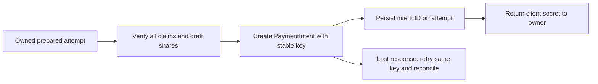

# One PaymentIntent for a prepared attempt

M19 has already checked Lina's cart, held capacity in both kitchens and written two immutable draft orders. The payment route's first duty is to refuse any attempt that did not reach that prepared state. A partial claim, a missing draft or a changed total must never reach Stripe. Its second duty is to create or recover one PaymentIntent for the exact stored amount and currency. A page refresh should not create another charge path.

Create `POST /api/checkout/attempts/:attemptId/payment-intent`. The authenticated diner owns the attempt. The route accepts an expected attempt version, but no price, currency, kitchen share or claim units from the browser. It loads the attempt by `_id` and `dinerUserId`, then checks state, hold deadline, claim IDs, draft IDs and totals. The server computes the sum of the stored kitchen shares and compares it with `attempt.totalMinor`. Reject if arithmetic or currency disagrees. Do this before making a network call to Stripe.

The route crosses two systems that cannot share a transaction. The diagram places a persisted attempt on one side and Stripe's intent on the other. A retry must query both states when a response is lost.



The client secret authorizes the browser to complete this specific payment flow. Treat it as sensitive response data: return it only after owner and state checks, keep it out of logs, and do not put it in a URL or analytics event. The server's secret key and webhook signing secret stay on the server in environment configuration.

## Define the stable creation request

Use the attempt ID to construct a stable idempotency key such as `payment-intent:create:<attemptId>:v1`. The version suffix belongs to the operation design, not to each HTTP retry. Reusing a key with changed amount or currency must be an error, not a way to update the existing intent. If the attempt's fixed total changes after preparation, that is an integrity defect requiring a new attempt and fresh capacity decisions.

Create the PaymentIntent with integer `amount`, lowercase `currency`, metadata containing the attempt ID, and an automatic payment method policy appropriate for the supported test flow. Do not put diner email, address, dish names or private kitchen notes into Stripe metadata. Metadata helps correlation but is not trusted authorization. The local attempt ID and persisted Stripe ID form the authoritative mapping.

```js
export async function createAttemptIntent({ stripe, attempt }) {
  if (attempt.state !== 'prepared' && attempt.state !== 'awaiting_payment') {
    throw new Error('ATTEMPT_NOT_PAYABLE');
  }
  if (!Number.isSafeInteger(attempt.totalMinor) || attempt.totalMinor < 1) {
    throw new Error('INVALID_TOTAL');
  }
  return stripe.paymentIntents.create({
    amount: attempt.totalMinor,
    currency: attempt.currency,
    metadata: { attemptId: String(attempt.id) },
    automatic_payment_methods: { enabled: true },
  }, { idempotencyKey: `payment-intent:create:${attempt.id}:v1` });
}
```

This function deliberately does not accept an amount parameter from the route body. The caller must still verify all claims and drafts and persist the result. Keep Stripe's published API version pinned in the actual project configuration, then inspect the supported payment methods for the market and hold duration. A payment method that can remain processing beyond the kitchen hold may need a different product policy. For the core Sufra path, test a card flow and treat `processing` as unpaid until a later verified success event. Do not dispatch cooking from a `processing` event.

## Make the local mapping durable

Persist `paymentIntentId` and `state: awaiting_payment` on the attempt with a conditional update that matches `state: prepared` and no existing intent ID. Add a unique index on `paymentIntentId`. If another request already stored an ID, reload and return that existing intent only when its Stripe amount, currency and metadata still match the attempt. Do not create a second intent because two browser tabs both opened payment. If the local write fails after Stripe created the intent, retry with the same Stripe idempotency key and reconcile the returned ID before exposing a client secret.

There is a subtle timing issue. A webhook may arrive quickly, possibly before the local attempt has stored `paymentIntentId`. The webhook can use the signed event's intent ID and attempt metadata to find a candidate, but it must confirm the mapping, amount and currency before changing orders. A durable event inbox can hold the event until the creation route or reconciler completes the mapping. Do not mark an unknown event as processed and discard it. Also do not trust metadata alone to select a different attempt with the same number; the persisted mapping and unique constraints must agree.

If intent creation times out, do not tell Lina that no intent exists. The Stripe call may have succeeded. Retry the same key and read Stripe's response. If Stripe returns an error for parameter mismatch, stop and investigate the immutable attempt. If the hold deadline has passed during recovery, withhold the client secret, cancel the payable path where allowed, release remaining holds through M19's state transition, and reconcile any late payment separately. Never reuse an expired attempt for a new window.

## Keep the browser result modest

Return `attemptId`, `paymentIntentId`, `clientSecret`, amount, currency, hold deadline and `serverNow` to the authenticated diner. The browser can render the amount and payment element. It should show an explicit time limit based on server time, but a countdown cannot stop a Stripe event already in flight. After browser confirmation, poll the attempt status or wait for a server event. The browser may say "Confirming payment" while the webhook finishes. It should not display "Kitchen accepted" because that belongs to M22.

If Stripe confirmation reports a card failure, let the diner retry within the valid hold using the same PaymentIntent according to Stripe's state. Do not create a fresh attempt on every failed card entry while old holds remain. If the hold expires, show a new checkout action that reevaluates the cart and may create new claims and a new intent. Treat the old intent as a separate object that still needs reconciliation or cancellation. The server decides whether a given attempt may be paid; the browser cannot extend `expiresAt` by keeping a tab open.

## Verify before moving on

Seed a prepared two-kitchen attempt with shares 1800 and 700 and total 2500. Assert the Stripe test double receives one `paymentIntents.create` call for 2500, one currency, and no card data. Send the route twice from Lina with the same attempt and verify the same intent ID. Send it from Omar and require the same public not-found response as an unknown attempt. Corrupt one draft share or release one claim before the call; Stripe must receive zero creation requests.

Simulate a Stripe success followed by a lost HTTP response. The retry uses the same idempotency key and finds the same intent. Simulate a local mapping write failure after Stripe success; the recovery path must persist the returned ID once and never expose two client secrets. Record attempt row, draft totals, claim states, Stripe request parameters and route responses in `docs/payment-decisions.md`. The next lesson verifies the signed webhook before any order state can change.

Keep an explicit test for a hold that expires between the initial database read and returning the client secret. Read the server clock again after the Stripe call and local mapping write. If the attempt's payable deadline has passed, withhold the secret and move the attempt into reconciliation. A PaymentIntent may now exist, so the service must retain its ID, attempt mapping and any cancellation or late-success work. Deleting the local row because the response was not sent would make a later webhook impossible to explain. The payment route cannot guarantee the browser will finish before expiry, but it can avoid knowingly opening a payment UI after the current deadline.

The attempt lookup should also constrain which account may request a client secret after a refresh. A logged-in cook, an anonymous visitor and another diner all receive the application's ordinary not-found or authentication result. The fact that a PaymentIntent exists is private. Even if the client secret alone does not expose card details, it is the capability for a specific payment flow and must be treated as such. Include this authorization test alongside the amount test rather than relying on a generic route middleware check.

References: [Stripe PaymentIntent creation](https://docs.stripe.com/api/payment_intents/create), [Stripe idempotent requests](https://docs.stripe.com/api/idempotent_requests), [Stripe PaymentIntents](https://docs.stripe.com/api/payment_intents).
