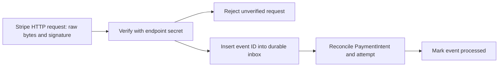

# Verify and record webhooks

The browser has submitted payment, but it is not the authority for an order. Stripe sends a signed `payment_intent.succeeded` event to Sufra's webhook endpoint. The endpoint must verify the signature before reading business fields, then record an event identity so retries are safe. A forged success request must never turn Lina's two draft orders into cooking jobs.

Choose one Stripe event format for this build and register it deliberately. The code here uses snapshot `payment_intent.*` events with the Stripe Node SDK's `constructEvent` verification. Do not mix a thin-event parser with a snapshot payload. Store the webhook signing secret separately from the Stripe API secret. The Stripe CLI's local signing secret differs from the deployed endpoint's secret, so test and production configuration must each use the right value.

The diagram shows the security boundary and the durable handoff. Parsing JSON for convenience before signature verification changes the bytes that Stripe signed and can make verification fail.



The inbox is a small durable record keyed by Stripe event ID, with event type, PaymentIntent ID, received time, processing state and last error. It need not store full card data or a large raw payload forever. A repeated event ID finds the same row. A second event ID for the same PaymentIntent still goes through reconciliation because it may represent a different state transition.

## Preserve the raw body

Register the webhook route before generic JSON parsing middleware or configure a route-specific raw body parser. The exact framework integration may vary, but `stripe.webhooks.constructEvent(rawBody, stripeSignature, endpointSecret)` must receive the unchanged body and header. Treat a missing header or failed verification as an unauthenticated request. Return a 400-style response and do not write an inbox row or inspect an attempt.

```js
export function verifyStripeSnapshotEvent({ stripe, rawBody, signature, endpointSecret }) {
  if (!Buffer.isBuffer(rawBody) || !signature || !endpointSecret) {
    throw new Error('INVALID_WEBHOOK_INPUT');
  }
  return stripe.webhooks.constructEvent(rawBody, signature, endpointSecret);
}
```

This helper is intentionally small. The route must also limit body size, use HTTPS in deployment and select only event types it handles. A signature verifies origin and payload integrity, not business correctness. A valid Stripe event can still refer to another merchant operation, an old attempt or an amount that does not match the stored Sufra total. Reconciliation in later lessons checks those facts before placing orders.

## Make duplicate delivery harmless

Insert an inbox row with a unique index on `eventId`. If the insert conflicts, read the existing row. When its state is `processed`, return success without running the order transition again. When it is `pending` or `failed_retryable`, ensure one worker claims it for processing, or let the route retry under an explicit lease. Avoid the sequence "check if ID exists, then insert" without a unique index; two concurrent deliveries can both pass the check and run business effects.

Stripe may retry deliveries after network errors, and event delivery order is not a reliable substitute for the PaymentIntent's current state. A `payment_intent.payment_failed` event can be followed by a successful retry of the same intent. A late failure event must not reverse an already paid attempt. Reconcile using allowed state transitions and, when needed, retrieve the current PaymentIntent from Stripe to resolve an ambiguous old snapshot. Store the event ID for traceability, but do not treat it as the order ID.

The endpoint should acknowledge promptly after it durably accepts the event. A durable queue or inbox worker can perform the slower cross-document claim and order reconciliation. If no worker is present yet, the route may process synchronously for local learning, but it must return an error when a required durable write fails so Stripe retries. Do not return success after only placing work in process memory. M21 moves the reconciler behind a queue and tests worker shutdown.

## Guard the event-to-attempt mapping

For a success event, read `event.data.object.id` as the PaymentIntent ID. Find the attempt by persisted `paymentIntentId`, or, during an early creation race, use metadata only to locate a candidate that must then be verified and linked. Compare the signed object's amount and currency with the attempt's fixed total and currency. Confirm the expected Stripe account and mode for your environment. A mismatch is a reconciliation error and must not produce kitchen jobs.

Do not trust a browser-supplied `eventId`, a URL parameter or a metadata field to mark payment. The signed event is the entry point; the database mapping is the local authority for which cart was prepared. If an event references an unknown intent, keep it in an investigation state with a request ID. Dropping it could hide a real charge. Do not attach it to the newest attempt that happens to have the same amount.

Only handle the event types this module understands. `payment_intent.succeeded` begins paid reconciliation. `payment_intent.processing` records a pending signal but does not place orders. `payment_intent.payment_failed` records a failure signal and may allow a retry while the hold is valid. Other event types can be acknowledged after a safe log or routed to separate handlers. A generic `event.type.includes('succeeded')` check is too broad for money-moving state changes.

## Test the endpoint boundary

Send a valid signed snapshot event using Stripe's local test tooling or the SDK's test signature helper. Assert one inbox row is created and the payment reconciler receives the intent ID. Change one byte of the raw body while keeping the signature; assert signature failure, no inbox row and no order update. Parse and reserialize the body before verification in a deliberately failing test to show why raw bytes matter. Send the same valid event twice concurrently; the unique event ID permits one processing path and both HTTP deliveries can be acknowledged safely after durable acceptance.

Send a valid signed event for a different intent with the same amount as Lina's attempt. The webhook must not map it by amount. Send an event for Lina's intent with a mismatched currency and ensure neither claim is confirmed. Then send `processing` and prove no kitchen order becomes `placed`. These tests separate a valid signature from a valid business transition.

Save the raw-body route setup, inbox index and redacted test output in `docs/payment-decisions.md`. Do not copy a real signing secret into course evidence. The next lesson checks payment decisions before the reconciler moves both claims and orders through a replay-safe state machine.

There are two distinct duplicate cases to record. Stripe can deliver the same Event ID more than once, which the inbox's unique index handles. Stripe can also create separate Event objects about the same underlying PaymentIntent state, or an operator can manually resend while automatic retry remains active. In that case, the Event IDs differ, so the attempt and claim transitions must themselves be idempotent. The inbox prevents repeated work for one delivery identity; it does not replace the conditional state machine in lesson 20.5. Test both cases and name which layer stopped each duplicate effect.

An inbox row that remains `processing` forever is another loss mode. Give it a lease expiration and retry count, or let M21's worker reclaim it when its worker lease dies. Persist the last safe step and error code. Do not mark the event processed merely because a worker fetched it. After a restart, the reconciler re-reads the PaymentIntent mapping and current claim states, then resumes. This design lets the webhook acknowledge quickly while keeping a path from every verified paid event to a final order or refund decision.

Review that lease with a fake worker stop and record how many attempts occurred before the event reached a final state. A retry limit should page an operator while preserving the paid event for recovery.

Before confirming either kitchen claim, use the next decision check to test the boundaries established here. The payment route may expose one PaymentIntent only for a complete prepared attempt. A valid signed success signal still does not prove that cooking capacity remains held. Trace the `CheckoutAttempt`, both window claims, draft orders, intent and verified event for each scenario. Decide whether the diner may pay, whether a cook may see a job and whether a refund is needed. The browser message alone cannot answer those questions.

References: [Stripe webhook setup and raw body requirement](https://docs.stripe.com/webhooks), [Stripe signature troubleshooting](https://docs.stripe.com/events/manage-webhook-endpoints), [Stripe event types](https://docs.stripe.com/api/events/types).
