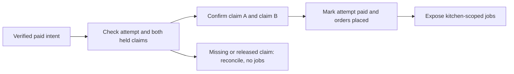

# Confirm both kitchens after payment

The decision check asked you to separate a valid payment from a fulfilment promise. For a replay after only Kitchen A's claim was confirmed, record one sentence in `docs/payment-decisions.md`: the reconciler leaves A unchanged, confirms B and publishes both orders once. It never debits capacity again. Use the quiz's missed scenarios to guide the negative tests in this chapter.

Stripe has sent a verified `payment_intent.succeeded` event for Lina's prepared attempt. M19's two kitchen claims are still `held`, and the two draft orders are `awaiting_payment`. This chapter moves them into paid, actionable state. The work spans an attempt, two window documents and two order documents. Sufra's approved compensation design does not make that one atomic database transaction. The reconciler therefore needs durable progress, safe retries and a clear visibility boundary.

Start by loading the attempt through its persisted `paymentIntentId`. Check the Stripe intent amount and currency against `totalMinor` and `currency`, the attempt owner, two expected claim IDs, two draft order IDs and a fixed snapshot hash. Do not use a success event to construct missing drafts. If a draft is absent, keep the event pending for investigation or recovery and withhold both kitchen jobs. The paid charge is real, but the product cannot promise fulfilment from a partial prepared state.

The diagram distinguishes internal steps from the public placement decision. A claim can be confirmed before the second claim is updated, but neither cook should see a job until the attempt's complete paid transition is recorded.

The cooking capacity was already subtracted when claims became `held`. Confirmation changes claim state; it must not subtract units again. The paid order snapshot and kitchen window identity stay fixed. A second delivery of the success event must find confirmed claims and placed orders and produce no extra capacity movement or second notification.

## Use conditional claim transitions

For each expected kitchen window, match the embedded claim ID, attempt ID and `state: held`, then set that claim to `confirmed`. The update does not change `remainingUnits`. If the update matches nothing, read the claim by ID. `confirmed` is an idempotent success when all IDs and units match. `released` is a serious conflict: the hold expired or was compensated and cannot be revived by changing a field. A missing claim is also a conflict. Do not create a new claim during webhook handling; that would compete with new diners after Lina's checkout deadline.

The window update must use the exact claim ID recorded on the corresponding draft order, not a fuzzy match by diner and interval. Two attempts from the same diner may target a similar date. Stable IDs make recovery precise. Also compare stored claim units to the draft's purchased load. If they differ, do not place the order even if the Stripe amount matches. Money and cooking capacity are separate quantities, and both must agree with the prepared attempt.

If confirming the first claim succeeds but the second database call times out, keep the attempt in a durable `confirming_payment` state. A retry can read the first as confirmed and finish the second. Do not report completion or enqueue cook notifications yet. If the second is released, enter `refund_required` and route the whole charge to late-success resolution. The first confirmed claim then needs a safe release or cancellation policy because no kitchen should cook a partial cart. Preserve the charge and claim identities for audit.

## Make placement one controlled publication step

After all claims are confirmed, update the attempt to `paid` with a conditional transition from `confirming_payment` or `awaiting_payment` and record `paidAt` and Stripe intent ID. Then move the two draft orders to `placed` by deterministic order ID. Because those writes are separate, kitchen-facing queries should require both `order.status: placed` and the parent attempt's `state: paid`, or read a placement publication marker set only after all orders are ready. The goal is to keep a temporary half-written reconciliation invisible to cooks.

Use a durable outbox row keyed by `attemptId` and `kitchenId` for each cook notification. Insert it only after the complete placement condition is met. M21's worker will send messages and retry them with deterministic job IDs. A webhook handler that sends email or push directly between the two order updates can notify one cook while the other order is still uncertain. Notifications are side effects, so make their source a persisted placement state.

The diner can see a combined paid receipt once the attempt is paid and both orders are placed. The receipt should show each kitchen's snapshot, delivery interval and next action. A cook sees only their kitchen order. Payment does not mean cook acceptance; M22 adds an acceptance deadline and later lifecycle transitions. Keep `paidAt`, `placedAt` and `acceptedAt` as distinct concepts rather than one overloaded timestamp.

## Recover after every stop point

Write a test that stops after claim A is confirmed, then reruns the same event. The second pass should observe A as already confirmed, confirm B, mark the attempt paid, place both orders and create one notification outbox row per kitchen. Replaying again changes nothing. Stop after both claims but before the attempt update; retry and finish. Stop after the attempt update but before order B placement; the kitchen query must still hide both jobs until placement completes.

The exact publication strategy is a design choice that must be implemented and tested, not only described. A parent attempt state of `paid` alone may be too early if orders are not all placed yet. A separate `placementCompleteAt` marker written last can make the visibility condition explicit. Require every expected order to be `placed` before setting that marker. Kitchen queries filter on it, and a recovery worker can finish any remaining order write. This is an application-level publication barrier; it does not claim database transaction semantics.

Test a released claim before success delivery. The webhook must not set it to confirmed, must not decrement capacity again, and must not expose either order. It records `refund_required`, which lesson 20.6 handles. Test one missing draft and one mismatched amount. Both stop before any public job. Test a `processing` event: it can update an observed payment state but cannot confirm claims. These negative rows are as important as the happy path because they describe what the server does with real paid money when the local state is incomplete.

## Record a checkable trail

For one successful two-kitchen attempt, save a redacted table containing attempt ID, Stripe intent ID, event ID, both kitchen order IDs, both window IDs, claim IDs, claim states before and after, order states before and after, `remainingUnits` before and after, and outbox row count. The remaining counter must be unchanged during confirmation. Compare it with M19's original debit to prove the same units were not claimed twice.

For one forced crash, save the state at the stop point and after replay. A reviewer should be able to see the durable progress, not just a green assertion. The next lesson handles the hardest conflict: Stripe success after the attempt's holds were released or expired. The reconciler cannot place orders in that state, and it cannot pretend the payment did not happen.

Check the ordering of the attempt's paid marker and the placement publication marker in the implementation. A receipt may truthfully say payment was received while placement is still being reconciled, but a kitchen board must wait for `placementCompleteAt`. If order B write fails, the worker can retry from the paid attempt without asking Stripe to charge again. Show a distinct diner status such as "Payment received, confirming kitchens" during that interval. It gives support an accurate state and avoids a false claim that both cooks have already seen the work.

References: [Stripe PaymentIntent success event guidance](https://docs.stripe.com/payments/payment-element/migration), [Stripe webhook retries and replay](https://docs.stripe.com/events/manage-webhook-endpoints), [MongoDB single-document atomicity](https://www.mongodb.com/docs/manual/core/write-operations-atomicity/).
