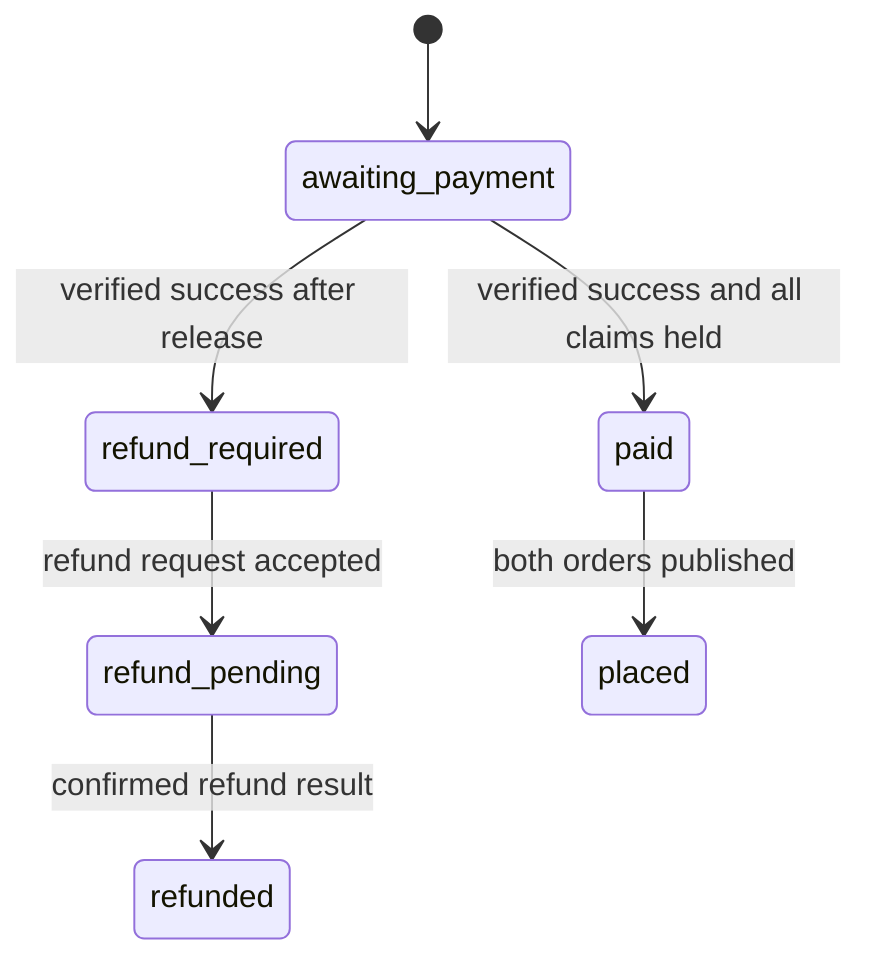

# Reconcile a late payment success

Lina completed a card challenge just as her kitchen holds expired. M21's expiry worker released them, and another diner may now claim the cooking units. Stripe still reports a successful charge. Sufra has two true facts: Lina paid, and Sufra no longer has the capacity it promised during preparation. It cannot erase either fact. This chapter records the conflict and starts a full refund without showing either cook a job.

The webhook is the first place this conflict may become visible. Its verified event has the correct PaymentIntent ID, amount and currency. Those checks prove which attempt was paid, but they do not prove the attempt may be fulfilled. Load every expected claim and examine its state and expiry. If any claim is `released`, missing or tied to an aborted attempt, the all-kitchen purchase cannot move to placed. Keep the draft orders non-actionable and mark the attempt `refund_required` with a stable reason such as `HOLD_EXPIRED_BEFORE_PAYMENT`.

The state diagram makes the branch explicit. A payment success does not always lead to a placed order; it can lead to a refund when the capacity boundary has already closed.

The diagram compresses the two-kitchen confirmation work from 20.5 into the `paid` branch. It does not mean a single update confirms both windows. The `refund_required` branch is durable before any network call to Stripe, so a worker restart can continue it.

## Handle a race with the expiry worker

The expiry worker releases only a claim still in `held` state and only when its deadline passes. The payment reconciler confirms only a claim still in `held` state. Those conditional transitions compete on the same window document. Exactly one wins for each claim. If confirmation wins, the worker must not release the confirmed claim or add units back. If release wins, the webhook must not revive it. Read the result rather than assuming which request started first.

A two-kitchen attempt can briefly have one confirmed claim and one released claim if payment and expiry race across separate windows. The product still cannot place half the cart. Mark the attempt `refund_required`, withhold both orders, and compensate the confirmed group's capacity under a documented paid-conflict cancellation transition. Do not simply change `confirmed` to `released` with a generic unpaid expiry helper; record that a successful charge required a refund and why the paid claim was cancelled. The counter should increase only once for each released group.

Do not try to claim again after late payment. A new claim could fail, and it could take units from a diner who checked out after the original hold expired. Even if it succeeds in a test fixture, it would silently replace Lina's original time-limited promise with a new capacity decision she did not review. The core policy is a full refund. A future product could offer an explicit new order, but it must be a separate purchase decision.

## Request a full refund once

Create a durable `RefundRequest` record with a unique key on `attemptId` and reason category. Store intended amount equal to the fixed attempt total, currency, PaymentIntent ID, state and Stripe refund ID when returned. Use a stable Stripe idempotency key such as `refund:late:<attemptId>:v1`. Stripe accepts a refund request against a PaymentIntent and a positive amount in the smallest currency unit. A timeout after creation does not prove failure; retry the same key and reconcile the returned refund ID.

The call can be delayed or fail. Keep the attempt in `refund_required` or `refund_pending`, expose a truthful message to Lina and alert support when retry limits are exceeded. Do not mark it `refunded` merely because an HTTP request was sent. Read the Refund object's state and handle a later refund event or polling reconciliation. A full refund can take time to appear on Lina's payment method; the app should distinguish "refund started" from "refund completed."

If Stripe has already refunded part of this PaymentIntent for another reason, a request for the full original amount may exceed the unrefunded balance. That situation should be an investigation state, not an automatic second refund of every kitchen share. This late-success case should normally happen before a kitchen order was placed, so previous partial refunds are unexpected. Keep a ledger of all refunds by attempt and kitchen, and compare Stripe's remaining refundable amount before recovery if the local history is uncertain.

## Test each race outcome

Use an injected clock and two kitchen windows. At the hold deadline, run expiry and a verified success reconciler concurrently. Repeat enough times to observe both possible winners, then assert a valid final state in each case. If both claims confirm, both orders may become placed and no expiry release runs. If any claim releases first, neither order becomes visible, the attempt enters `refund_required`, and every retained capacity debit is compensated exactly once. No final state may show one placed order and one refund-required sibling.

Deliver the same success event again after `refund_required`. It must not create a second refund request. Run the refund worker twice with the same idempotency key; assert one Stripe refund identity. Simulate a Stripe refund success with a lost response; the retry must find the same refund. Simulate a declined or failed refund request and confirm the attempt remains visible for retry or support, not falsely closed.

Check the diner and cook views. Lina should see that payment was received but the order could not be placed, with a refund status and support reference. Neither cook sees a kitchen job. The public kitchen capacity view reflects released units only after the conditional transition succeeded. Do not show available units from a guessed release; a failed database write must be retried from the durable conflict record.

## Keep the audit trail joined

Save a timeline with the original claim IDs, expiry instants, release writes, Stripe intent ID, signed success event ID, refund request ID, Stripe refund ID and final state. This lets support answer whether Lina's money was taken, whether a cook was asked to work, and whether capacity became available again. Avoid storing card details or a client secret in the timeline. A request ID and safe object IDs are enough to connect server logs with Stripe's dashboard.

This failure path is the reason payment confirmation and fulfilment publication are distinct. A browser success screen sees only the Stripe side. The server has to reconcile Stripe against current Sufra state before making a meal promise. The next lesson uses the same one-PaymentIntent design for a different case: both orders were placed, then one cook rejected their kitchen share.

Run one more case with a slow database connection. The success event is verified and stored before the deadline, but the claim transition reaches the database after expiry has released one hold. The event receipt time alone cannot grant fulfilment. The conditional claim states decide. If the payment reconciler wins confirmation on both windows, placement proceeds; if the expiry worker wins on either, the refund path proceeds. Document the actual write order in the trace, not merely the wall-clock time printed by the webhook. This prevents a test from passing because it guessed which asynchronous action should have won.

Keep a support-facing reason separate from a diner-facing explanation. The internal record can say `HOLD_EXPIRED_BEFORE_PAYMENT` with claim IDs and timestamps. Lina should see plain language that the kitchen slot could not be secured and her payment is being returned. A generic "payment failed" message would be false. The refund's final state and date should be visible later from the same attempt, so she does not need to start a new purchase just to check what happened to the old one.

References: [Stripe refund creation](https://docs.stripe.com/api/refunds/create), [Stripe idempotent requests](https://docs.stripe.com/api/idempotent_requests), [MongoDB atomicity](https://www.mongodb.com/docs/manual/core/write-operations-atomicity/).
