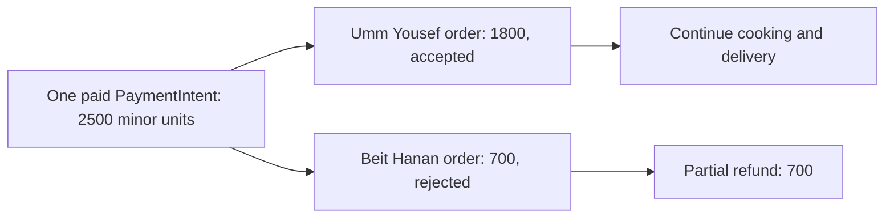

# Refund one kitchen share

Lina has paid for maqluba and sweets in one PaymentIntent. Both kitchen orders were placed, but Beit Hanan rejects the sweets order because its cook cannot fulfil it. Umm Yousef has accepted the maqluba and continues cooking. Sufra owes Lina only Beit Hanan's allocated share. It must not refund the entire charge or cancel Umm Yousef's order. It must also not calculate the sweets amount from today's menu, which may have changed since Lina paid.

M19 stored an immutable total and allocation for each kitchen order. Use the rejected order's paid share in integer minor currency units. It includes exactly the line amounts and any fee or discount allocation that the pricing policy assigned to that kitchen at checkout. The sum of all kitchen shares equals the attempt total. If a shared fee was not allocated then, stop and define the policy before automating refunds. Guessing half a fee at rejection time can overpay or underpay Lina.

The diagram shows a single charge splitting into two fulfilment outcomes. The refund follows one order's stored share; the other order remains paid and active.



This is not a second PaymentIntent and not a transfer between kitchens. Stripe refunds a positive amount against the original PaymentIntent. If the product later pays kitchens through a separate transfer system, transfer reversal needs its own accounting policy. The current course scope is the diner charge and kitchen order state.

## Build a refund request from a state transition

M22 owns the cook rejection route. It verifies kitchen ownership and permits a transition from `placed` to `rejected` only within the acceptance policy. That transition writes a timeline event and a durable refund request in a coordinated application flow. M20 defines the refund worker that consumes the request. Do not let the cook's browser call Stripe directly or send an amount. The cook chooses a valid order action; the server derives `amountMinor` from the immutable paid share.

Give each kitchen order at most one automatic rejection refund request, enforced by a unique index on `{ orderId, refundKind: 'cook_rejection' }`. Store attempt ID, PaymentIntent ID, order ID, kitchen ID, amount, currency, state, Stripe refund ID and stable operation key. A retry of the rejection action should find the same order state and refund request, not create another refund. If the order has already been partially refunded for a separate adjustment, compare all prior refund ledger entries before asking Stripe for more money.

```js
export function rejectionRefundDraft({ attempt, order }) {
  if (attempt.state !== 'paid' || order.status !== 'rejected' ||
      String(order.attemptId) !== String(attempt.id)) {
    throw new Error('REFUND_PRECONDITION_FAILED');
  }
  const amount = order.paidShareMinor;
  if (!Number.isSafeInteger(amount) || amount < 1 || amount > attempt.totalMinor) {
    throw new Error('INVALID_REFUND_SHARE');
  }
  return {
    attemptId: attempt.id,
    orderId: order.id,
    paymentIntentId: attempt.paymentIntentId,
    amountMinor: amount,
    currency: attempt.currency,
    key: `refund:cook-rejection:${order.id}:v1`,
  };
}
```

The helper assumes the order's paid share was validated and frozen during M19 preparation. It does not itself call Stripe. The refund worker uses the stored key as Stripe's idempotency key and persists the returned Refund ID. Keep the request and Stripe call separate so a process stop does not lose the reason or amount. The worker may retry after a timeout; it must not make a new request with a new key just because the first response was lost.

## Constrain the amount across orders

Stripe allows multiple partial refunds up to the remaining unrefunded amount of the charge. Sufra needs its own ledger so two kitchen rejections do not accidentally request more than was paid. Before creating a new refund request, sum succeeded and pending refund amounts for the attempt, including any full late-success refund. Enforce `newAmount + committedOrPending <= attempt.totalMinor`. The database should serialize refund-request creation per attempt or use a conditional balance update; a read-only sum followed by two concurrent inserts can race.

If both kitchens reject, the two shares should sum to the full original total and produce two traceable partial refunds or one deliberate consolidated refund policy. Do not issue one full refund after the first partial request without accounting for it. If a refund fails at Stripe, keep the ledger entry in a retryable or investigation state and do not count it as complete in the diner UI. However, reserve its planned amount while retrying so another worker does not over-request.

Refund timing differs from order status. A rejected order can be non-actionable immediately while the refund is pending. Show Lina "Beit Hanan declined; refund in progress" and continue to show Umm Yousef's active timeline. Do not display a full-purchase cancellation. If the remaining order later fails, it gets its own rejection and refund entry. The combined receipt should show the original amount, each refunded share and the remaining paid amount without changing the original charge record.

## Test duplicate and mixed outcomes

Seed the 1800 and 700 shares and one paid PaymentIntent for 2500. Reject Beit Hanan's order and run the refund worker. Assert Stripe receives `payment_intent` for the original intent and `amount: 700` with one stable idempotency key. Assert Umm Yousef's order stays accepted and its claim stays confirmed. Re-run the rejection route and worker; no second refund request or Stripe refund identity should appear.

Change the sweets dish's current price to 900 after purchase and repeat. The refund remains 700 because the order snapshot is authority. Simulate a lost Stripe response and retry; the same key recovers the same refund. Then reject Umm Yousef's 1800 order. The ledger should permit a total of 2500 across the two shares and refuse any extra automatic refund. Also test a full late-success refund already pending: a cook rejection should be impossible because no kitchen order was placed. If such a request appears, flag an integrity defect rather than sending another refund.

Save the order status, frozen paid share, refund request, Stripe refund ID and resulting paid balance in `docs/payment-decisions.md`. These are the facts a diner or support agent needs. The next lesson tests event replay, creation retries and partial failure across the whole payment module, not only the refund worker.

The refund policy also needs a clear answer for delivery fees. Suppose Lina paid a 100-minor-unit shared fee on top of 1800 and 700 in dish amounts. If M19 allocated the entire fee to Umm Yousef's order, rejecting Beit Hanan refunds 700; if it allocated 50 to each kitchen, rejecting Beit Hanan refunds 750. Either result can be explained if the policy was stated and stored before payment. Recomputing a fee after rejection from today's delivery route can produce a third answer that Lina never accepted. Add a fixture with an odd one-unit fee and prove your allocation rule preserves the exact total without a lost minor unit.

Consider a cook who rejects just after another support worker starts a full-purchase refund. The rejection route should not independently issue a partial refund while the full refund is pending. The refund ledger must serialize these decisions on the attempt. Mark one path as the owner of each refundable unit, then let retries use the existing request IDs. If the full refund request is already accepted by Stripe, later kitchen rejection changes the order lifecycle but adds no new money movement. If the partial request committed first, a later full-purchase cancellation requests only the remaining balance under an explicit policy. A local state transition should make that amount visible before calling Stripe.

Refund success is also an asynchronous state. A worker may receive a Refund object with a pending status, or a request may need manual resolution. Keep the rejected kitchen's order marked non-actionable, but show the refund as pending until Stripe's result is reconciled. Do not send another refund because a diner refreshes the page. The page reads the durable refund request and its status. A support retry uses the same operation key. Test that the original paid total never changes in the receipt: the receipt gains refund entries and a remaining balance, preserving the history of what Lina paid and what was returned.

References: [Stripe partial refund API](https://docs.stripe.com/api/refunds/create), [Stripe idempotent requests](https://docs.stripe.com/api/idempotent_requests).
