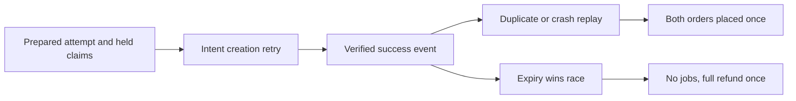

# Replay and race tests

The happy path has one prepared attempt, one PaymentIntent, one success event, two confirmed claims and two placed orders. A local demo can show that path while hiding serious defects. Payment systems retry, users double-submit, and workers stop between writes. This chapter turns those conditions into repeatable tests with exact database assertions. A passing response status is insufficient if capacity or money moved twice.

Keep two kinds of tests. Pure tests use fake Stripe calls and an injected clock to explore state transitions quickly. Integration tests use a local database and Stripe test mode or signed webhook fixtures to prove indexes, raw-body handling and real route wiring. Do not claim Stripe or MongoDB integration from a mock-only run. The gate will ask for both when a complete Sufra reference build exists.

The matrix below is a route through state, not a list of screenshots. Each row starts from a known attempt and asserts the resulting attempt, claims, orders and refund ledger.

The diagram makes the fork visible: a replay of valid success can finish placement, while a success after release cannot. The same Stripe event type does not force the same fulfilment outcome in different local states.

## Test intent creation identity

Start with a complete M19 attempt with two held claims and two draft orders. Send the payment-intent route twice concurrently from the owner. Both responses must identify one Stripe PaymentIntent and one local mapping. If the route uses a Stripe test double, assert one unique idempotency key and equal parameters. Then force Stripe to accept creation but drop the API response. The server retries with the same key and persists the same ID. A third call returns the existing intent without creating a new one.

Change the attempt amount in the test database after the first Stripe call, then retry. The route must stop on parameter mismatch or immutable snapshot mismatch. It must not use a new idempotency key to hide the error. Send the route from a second diner and from an anonymous caller; neither may receive a client secret. Remove one held claim before the call and assert Stripe was never called. These assertions protect both money amount and private access.

## Test the signed event boundary

Use a signed snapshot event for the stored PaymentIntent. Send its exact raw bytes and signature; assert the inbox records its event ID. Change one byte but keep the signature; the route rejects before a database transition. Send a valid signed event whose intent ID is unknown; it goes to investigation, not to the attempt with a matching amount. Send `payment_intent.processing`; neither order becomes placed. Send `payment_intent.payment_failed` followed by a later success for the same intent while holds remain valid; the success path must still work.

Deliver one success event twice concurrently. The inbox unique index and conditional state changes prevent two placement publications. Assert two confirmed claims, not four; one attempt paid; two kitchen orders placed; and one notification outbox row per kitchen. Check `remainingUnits`: it changed once in M19 when held and did not change when confirmed. A test that only counts orders could miss a second capacity subtraction.

## Stop after each durable write

Inject a process stop after the first claim becomes confirmed. Restart the reconciler with the same event and prove it finishes the second claim and both orders. Stop after both claims but before the attempt state update. Stop after the attempt state update but before the second order placement. At each stop, kitchen-facing queries must hide a partial purchase until the placement publication marker is complete. The retry must use existing IDs and state, not create new draft orders or another PaymentIntent.

Test the event inbox itself. If a handler crashes after storing `pending` but before reconciliation, a worker or later retry must claim it. If it crashes after reconciliation but before marking `processed`, replay must be a no-op for already confirmed claims and placed orders. If it marks `processed` before durable business work, the test should fail: that ordering can lose a real payment event permanently. Record how the inbox lease or retry policy handles a worker that dies while holding work.

## Race payment against expiry

Use an injected clock at the hold deadline. Run M21's expiry release and the success reconciler against the same two windows. The conditional claim transitions decide each window's winner. Assert one of two acceptable final outcomes. Either both claims confirm and the two orders are published once, or any release causes no order publication and a full refund request. If one confirms and one releases, compensate the confirmed group and enter `refund_required`. No outcome may leave an active kitchen job paired with an active full refund.

Replay the late success event and run the full-refund worker twice. Assert one refund request ID and one Stripe refund identity for the full attempt total. Simulate a lost Stripe refund response. Reuse the key and recover the same object. A test double can prove key reuse; a Stripe test mode run can verify the API parameters and object state. Keep the distinction in the evidence log.

## Test one kitchen rejection

After a normal paid placement, reject only the 700-minor-unit sweets order. The refund worker must request 700 against the original PaymentIntent, while the 1800 maqluba order remains active and its claim remains confirmed. Repeat the rejection action, the worker and the refund event. There should still be one refund request and one final refund amount. Edit today's sweets price before the retry and assert it has no effect on the stored share.

Then reject the second order. The refund ledger total reaches 2500 and cannot exceed the charge. A concurrent two-rejection test should verify the ledger's conditional balance or serialization, not rely on timing in one test run. If your implementation can create two refund requests based on the same stale unrefunded balance, strengthen the local atomic guard. Stripe's maximum refundable amount may reject an excess request, but a local ledger is still needed for clear diner status and safe retry decisions.

## Record measured outcomes

Save a table in `docs/payment-decisions.md` for each scenario: initial attempt state, event or route, injected failure point, expected final attempt, claim states, order states, capacity delta, Stripe intent count, refund count and outbox count. Include actual test command and result. Mark any scenario that was only modelled with a fake Stripe client as such. The test suite is a teaching artifact: it shows why the browser success callback, a read-only capacity check and a single "processed" flag cannot cover payment truth.

The final gate asks you to present a coherent paid two-kitchen purchase and one recovery path. If the complete reference build is not present, these cases remain a specification and the track cannot be marked ready. A green syntax parser does not stand in for a working webhook, database race or Stripe test-mode trace.

When an integration assertion fails, keep the failed database snapshot before resetting fixtures. It may reveal a more specific defect than the failed response: a duplicate inbox row suggests a missing unique index, a negative remaining counter suggests the claim path changed twice, and a paid attempt with one hidden order suggests the publication barrier was written too early. Use the snapshot to identify the exact transition that violated the contract. Then rerun only that scenario after the fix, followed by the payment gate suite. Do not turn the test into a longer delay to make a race pass; coordinate the competing writes with a barrier so the failure remains reproducible.

References: [Stripe webhook retries and duplicate handling](https://docs.stripe.com/events/manage-webhook-endpoints), [Stripe idempotent requests](https://docs.stripe.com/api/idempotent_requests), [Stripe testing guidance](https://docs.stripe.com/testing).
