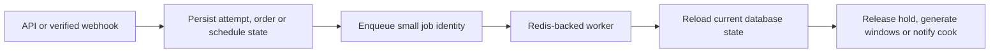

# The checkout request that waited too long

Lina pays for lunch from two kitchens. Stripe sends a verified success event, and Sufra places both kitchen orders. The API then tries to send two cook notifications before answering the webhook. One notification provider is slow. The webhook request times out, Stripe retries, and one cook receives the message twice while the other receives none. The order records are correct, but the side effect is unreliable because it lived inside one short request.

Another path has the opposite problem. Omar starts checkout and holds three cooking units but closes the browser before paying. The API has no future request from Omar that can release the hold. A timeout must trigger work later, even if the API process restarts. Finally, every night Sufra needs to generate dated windows from cooks' weekly templates. The generator cannot depend on a visitor opening a page at the right time. These three jobs share one property: they must survive the request that caused or scheduled them.

The diagram separates the fast decision from the slower work. The API writes durable state, then workers act from that state. A queue message is a prompt to inspect the database, not a second source of order truth.

The worker may run more than once. BullMQ retries failed jobs and can reprocess work after a stalled worker. Therefore each action must be safe to repeat. M19's conditional release checks that a claim is still `held` before returning units. M14's window generator upserts a kitchen and dated start pair without changing a claimed window. M20's placed-order outbox gives notification a durable identity. Those rules make a queue useful; the queue itself cannot supply exactly-once business effects.

## Decide what must finish now

The API still performs the decisions that a diner needs before proceeding. A checkout request must validate the cart, claim each kitchen's capacity, store draft orders and return a clear payable or conflict result. It cannot queue the capacity claim and immediately show a payment form, because the worker might later discover that a kitchen is full. The verified payment reconciler must durably record the event and settle paid versus refund-required state before presenting a final order truth. Async jobs support these decisions, but do not replace their authority.

By contrast, sending a cook notification may happen after the placement state is committed. The cook can open their board and see the order even if a push message is delayed. Generating tomorrow's windows can run on a schedule with idempotent upserts. Expiring an unpaid hold must run at or after its deadline, but a few seconds of worker delay is recoverable if the payment path checks the claim's actual state and deadline. Keep deadlines in MongoDB records; a delayed job timestamp is a wake-up hint, not the only definition of expiry.

The distinction gives the diner honest messages. A queue acceptance response is not a paid order. The browser should see "confirming" while a verified event is still being processed, and "placed" only after both kitchen orders pass M20's publication barrier. A cook notification is a convenience on top of that state. Do not display "cook notified" merely because a Redis job was added. The worker may retry or the provider may be down.

## Trace a crash at each boundary

Imagine the API commits an order and crashes before adding a notification job. If the only copy of the task was in process memory, the cook receives no alert. A durable outbox row committed with or immediately after placement gives a recovery scanner something to enqueue later. The job includes `attemptId`, `kitchenId` and a deterministic notification type, not the full diner address. The worker reloads the placed order and checks the current state before sending. If the order was cancelled before the worker ran, it must not send a misleading "new order" alert.

Now imagine the worker sends the alert but crashes before acknowledging the job. BullMQ may retry it. A deterministic `jobId` prevents duplicate queue entries while that ID is retained, but job removal or replay can still make the processor run again. Keep a delivery record keyed by order and notification type, and use a provider idempotency key where supported. If the provider offers no such key, record that an uncertain send can create a duplicate and choose a message whose content is safe to receive twice. The kitchen board remains the source of truth.

For an unpaid hold, a worker can stop after releasing Kitchen A but before releasing Kitchen B. M19's attempt state and deterministic claim IDs let another run find and release B. The release of A is a no-op on retry. The worker should not mark the attempt fully aborted until all expected held claims have been dealt with. A job success flag alone cannot prove that the two kitchen windows are reconciled.

## Work with two stores carefully

Sufra's orders and windows live in MongoDB, while BullMQ uses Redis. A database write and a queue add are not one transaction. A crash can happen between them. Use a MongoDB outbox or a repeatable reconciliation scan for critical enqueue points. The outbox records the task identity and state in the same durable domain as the order. A separate publisher safely adds it to Redis, and the worker reloads domain state before changing anything. This is more work than `queue.add()` inside a route, but it closes the missing-message gap for paid orders and hold expiry.

For the course build, keep the outbox narrow. It needs type, aggregate ID, due time, attempts, state and last error. It does not need to duplicate the whole order. The expired-hold scan can also find `held` claims whose `expiresAt <= now` even if a delayed Redis job was lost. Nightly generation can scan kitchens and date horizon from current templates, so a missed scheduled tick is recoverable by the next run. The queue improves latency and workload separation; MongoDB records allow repair.

## Define the learner evidence

In `docs/jobs-decisions.md`, draw three timelines: an unpaid hold whose API process restarts before expiry, a paid two-kitchen purchase whose notification worker stops after the first send, and a nightly generator run repeated twice for the same local date. For each timeline, write the durable MongoDB state, Redis job identity, worker decision and final database state. Then mark where a retry can happen. If your answer depends on a process staying alive or on a callback being delivered once, the design is incomplete.

The next lesson compares synchronous and queued work, including a counterexample where queueing would be wrong. Then the build lessons add a separate worker, a scheduler, delayed expiry and notifications. The module gate requires a checkout response before worker logs, but also requires that a worker restart can still finish the important work.

Before proceeding, put a timestamp next to each event in your three timelines and distinguish due time from execution time. A hold might be due for release at 11:10 yet actually processed at 11:10:08 because the worker restarted. That delay should affect availability but not the definition of expiry. The claim record says what should happen; the worker catches up. A notification may be queued at 11:09 and sent at 11:12 after provider recovery. That delay affects communication but not whether the order was placed. A window generator may wake late and still fill the same rolling local-date horizon. Keeping these three meanings separate is the reason the jobs reload domain state instead of obeying only their Redis timestamps.

References: [BullMQ idempotent jobs](https://docs.bullmq.io/patterns/idempotent-jobs), [BullMQ Job Schedulers](https://docs.bullmq.io/guide/job-schedulers/).
