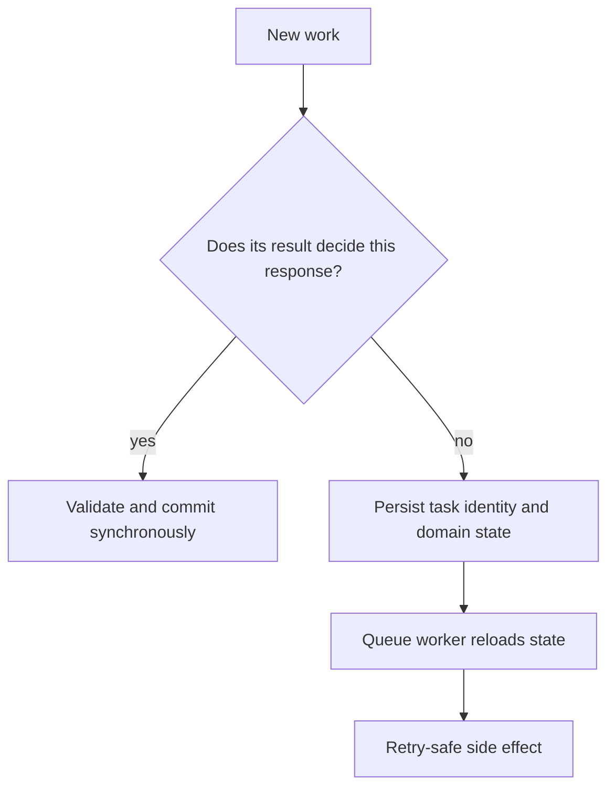

# When to queue

Queuing is useful when work can happen after a durable decision. It is dangerous when the result of that work decides whether the user may proceed. In Sufra, a cook notification can wait until both paid kitchen orders are placed. A capacity claim cannot wait while the API hands Lina a PaymentIntent client secret. The two actions may both involve an order, but they sit on opposite sides of the payment boundary.

Write a decision table for four Sufra actions before adding BullMQ. For each action, ask what state must be true before the route returns, whether work has a deadline, whether a retry changes money or capacity, and where the authoritative state lives. A queue entry alone should never be the sole record that a diner paid, that a kitchen accepted, or that capacity was released.

The diagram maps those decisions to a request boundary. The left branch finishes before a response; the right branch begins from saved state and can be retried later.



This is a starting rule, not a claim that every synchronous operation is quick. A slow payment provider can still force an API to return a pending state and reconcile later. The important point is the response's meaning. If the server cannot yet know whether the purchase is paid, it should say "pending," not "placed."

## Keep capacity decisions in the checkout path

M19's conditional `findOneAndUpdate` decides whether each kitchen window has enough units and is still before its cutoff. The diner must know that result before payment is offered. Queueing the claim and returning a client secret would create a gap where Stripe can charge Lina while the worker later finds a full window. Sufra's prepared attempt exists only after every kitchen claim and draft order is complete. This remains a synchronous preparation step, with durable compensation for partial failure.

The later release of an unpaid hold is a different decision. When its `expiresAt` passes, no diner is waiting on the original checkout request. A delayed job may wake a worker to release it. The worker matches the claim ID and `state: held`, then increments `remainingUnits` by the units stored on that claim. If the webhook confirmed it first, the release is a no-op. If another worker released it first, the retry is a no-op. The deadline is stored on the claim, so the worker checks it again rather than assuming a Redis timer is exact.

## Queue effects that follow paid placement

M20's webhook reconciler may use a worker after a verified event has been durably accepted. The public attempt remains "confirming" until both claims and both orders reach the publication barrier. The enqueue step can be async because the request does not falsely report the final order before reconciliation. Once the attempt is fully placed, a cook notification can be queued. It is useful but not authoritative: the cook board reads placed orders from MongoDB even if the provider is down.

Trace one paid purchase across the boundary. Notice that the notification worker reads a finished order; it does not make the purchase valid.

<TraceRequest title="One paid purchase and a delayed cook alert">
  <TraceStep actor="API" label="Prepare both kitchen claims" detail="Return a payment path only after both groups are held" />
  <TraceStep actor="Webhook" label="Verify payment and publish both orders" detail="Durable paid and placement records define the purchase" />
  <TraceStep actor="Outbox" label="Queue one alert per kitchen" detail="Each job carries a stable order identity" />
  <TraceStep actor="Worker" label="Reload and notify the cook" detail="A retry does not create a second order" />
</TraceRequest>

If the worker stops after the outbox step, the diner still has a paid purchase and the cook board still has the placed orders. The missing alert is an operational task to retry, not a reason to charge again or modify capacity. This trace makes the decision table's response column concrete.

The order lifecycle in M22 will also enqueue an acceptance-deadline job. At `acceptBy`, the worker checks the order is still `placed` and unaccepted, then transitions it to `rejected` and creates a refund request. An early or duplicate job must not reject an accepted order. The database state and clock decide; the queue only prompts a check. This is a general pattern for delayed business work. Put a due time in the domain record, then use a delayed job plus a reconciliation scan to act on overdue records.

## Schedule generation without making old promises move

Every kitchen has a weekly template and IANA time zone from M9. M14 turns these into dated windows for a rolling horizon. That work is suitable for a recurring job because no diner needs it within one current request. But the generator must be idempotent. Running twice for the same kitchen and date should not duplicate windows or reset `remainingUnits` on a window that already has held or confirmed claims. The unique kitchen/start index and `$setOnInsert` strategy give the generator a stable result.

Schedule the generator in UTC at a predictable time and let it calculate each kitchen's local dates from its named zone. Do not run one scheduler per kitchen with a fixed numeric offset; daylight saving rules can shift the local relationship to UTC. A missed nightly tick can be repaired by scanning the desired horizon on the next run or through an operator command. The scheduler is not the only copy of future windows, and its exact firing time must not alter existing paid promises.

## Compare failure costs

For each action, write what happens if the API process stops after the domain write but before `queue.add()`. A critical notification needs an outbox row or publisher scan. An unpaid hold can be found by a due-claim scanner even if its delayed job was never added. A nightly generator can rerun its horizon. If a task has no recovery path, calling it "queued" has only moved the failure to a quieter place.

Now write what happens if a worker stops after changing MongoDB but before acknowledging BullMQ. The job may run again. The release transition uses `state: held`; the generator uses a unique upsert; the notification uses an outbox or delivery key. These domain guards are more important than a queue-level `jobId`. A retained `jobId` helps avoid duplicate entries, but once a completed job is removed, the same ID may be added again. Do not rely on Redis retention to protect money or capacity.

If Redis is temporarily unavailable, the checkout API can still make a capacity decision if MongoDB is healthy, but it should ensure the outbox or due scan will enqueue expiry and notification later. If the design instead writes a hold and then requires `queue.add()` to succeed before it can respond, a Redis outage may leave a hold with a failed request. That is recoverable only if the attempt state records the outcome and a worker scans it. Document whether the route reports prepared, pending or conflict in that case; do not let a transport error create an unexplained second checkout attempt.

## Fill the decision table

Use `docs/jobs-decisions.md` with columns: action, must finish before response, durable source, queue trigger, retry guard, deadline and recovery scan. Include claim creation, hold expiry, window generation, cook notification, verified payment reconciliation and acceptance deadline. For claim creation, mark synchronous and name M19's conditional update. For notification, mark queued after complete paid placement and name the order outbox. For expiry, mark delayed plus scan and name the claim-state predicate. For generation, mark recurring plus horizon scan and name the unique window index.

Make one row deliberately wrong and explain why. For example, "queue checkout claim and return payment intent now" fails because the diner can pay before capacity is known. "Send cook notification before placement" fails because a cook may start a meal while the second kitchen claim is being reconciled. The exercise is useful only if the table changes a design choice, not if it assigns every action to a queue by default.

The next lesson creates the Redis-backed queue and a separate worker process. It will demonstrate a fast API response followed by worker activity while preserving the decision table's rule that domain state, not job completion, defines whether a purchase is real.

Use this short decision to check the boundary before building a worker. Your explanation should name the current database record that the worker will reload.

```quiz
type: mcq
id: sufra-queue-boundary-q1
question: The payment webhook placed both kitchen orders, but the notification provider is down. What should Sufra do next?
options:
  - Keep orders placed and retry the durable alerts
  - Undo payment until both alerts have been sent
  - Hide the kitchen board until Redis recovers
  - Create new claims when the worker restarts
correct: 0
explanations:
  - Paid placement is the domain truth; alerts may be retried from saved identities.
  - A notification failure does not reverse a verified charge and placed order.
  - The board reads placed orders from MongoDB, not Redis messages.
  - Existing confirmed claims must never be charged or claimed again.
```

References: [BullMQ idempotent jobs](https://docs.bullmq.io/patterns/idempotent-jobs), [BullMQ delayed jobs](https://docs.bullmq.io/guide/jobs/delayed), [BullMQ Job Schedulers](https://docs.bullmq.io/guide/job-schedulers/).
