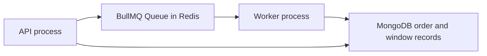

# Run a separate BullMQ worker

Sufra's API should answer a placed-order status without waiting for a notification provider. This chapter adds a Redis-backed BullMQ queue and a separate Node worker process. The API and worker share job identities through Redis, but they do not share memory. The worker must reload the current order or window from MongoDB before acting. That is the first practical boundary between an HTTP request and later work.

Install BullMQ and the Redis connection package compatible with the project's Node version. Add a `worker` script to the learner server package so `npm run worker` starts one long-lived process. Keep `REDIS_URL` in server environment configuration, not in client code or course screenshots. A local run uses two terminals: one for the API and one for the worker. In production, they become separately supervised processes with the same release and environment configuration.

The diagram shows two processes, one Redis queue and the authoritative database. A job carries an ID; the worker reads the domain record rather than trusting a copied order payload.



If Redis is unavailable, the API can still report a completed MongoDB decision only if an outbox or scan can enqueue missing work later. Do not claim that `queue.add()` and the MongoDB write are one atomic operation.

## Define names and connection ownership

Create `server/src/jobs/names.js` with job names `windows.generate`, `claims.expire`, and `orders.notifyPlaced`. A job should include only `kitchenId`, `attemptId`, `orderId`, claim ID or due time as needed. It should not include full address, phone, dish list or Stripe client secret. The worker fetches the current record with appropriate service access and checks state. Small payloads reduce stale facts and accidental exposure in Redis.

Use one queue for the course build, `sufra-operations`, and branch by `job.name` in the worker. A larger system may separate expensive generation from urgent expiry with distinct queues and concurrency limits. For now, set low concurrency and measure whether nightly generation delays hold expiry. If it does, split queues or worker pools before production. Naming the jobs now makes that later change easier than embedding one generic "do work" task with opaque payloads.

```js
import { Queue, Worker } from 'bullmq';

export const queueName = 'sufra-operations';
export function makeQueue(connection) {
  return new Queue(queueName, { connection });
}
export function makeWorker(connection, handlers) {
  return new Worker(queueName, async (job) => {
    const handler = handlers[job.name];
    if (!handler) throw new Error(`UNKNOWN_JOB:${job.name}`);
    return handler(job.data);
  }, { connection, concurrency: 2 });
}
```

The functions separate construction from startup so tests can pass a local Redis connection and fake handlers. The worker entry point imports actual handlers and registers `error`, `failed`, `completed` and `stalled` logging with safe job IDs and reason codes. It should close gracefully on a stop signal after current work reaches a safe point. A hard kill still can happen, so each handler remains idempotent.

## Make retry policy explicit

For each job, choose attempts and backoff. A transient Redis or database connection error should retry. A malformed job name or missing required identity should be sent to an error queue or investigated, not retried forever. Hold expiry is safe to rerun because the database transition matches `held`; notifications need their own delivery record. A queue retry policy is not a business-state policy. It only controls when the worker tries again.

Do not put an arbitrary five-minute delay on a claim expiry job and assume it releases at the right time. Store `expiresAt` on the claim and schedule a delayed job for that instant. On execution, compare the server clock and database state. If it runs early, reschedule for the remaining time or leave it for a due-claim scan. If it runs late, release if still held. Redis scheduling is useful but not the source of the deadline.

A BullMQ `jobId` can avoid duplicate queue entries while the job remains retained. Use a stable ID such as `claim-expire:<claimId>` or `notify-placed:<orderId>`. Do not rely on that alone for exactly-once effects. Completed jobs can be removed, workers can retry after a crash, and an outbox publisher may enqueue again. The domain handler must check a durable state transition or delivery key.

## Add a narrow outbox

Define an `OutboxEvent` collection with unique `eventKey`, type, aggregate ID, due time, state and last error. M20's placement code writes one `orders.notifyPlaced` event per kitchen order after its publication barrier. M19's hold creation can write a `claims.expire` event with the stored deadline. If the process stops before queueing, a small publisher loop scans due unqueued rows and adds BullMQ jobs. After `queue.add()` succeeds, mark the row queued. If the mark fails, the loop may add it again; the stable job ID and handler state guard make that safe.

Do not copy all business fields into the outbox. The worker reads the current order or claim. A cook may reject an order before its notification job runs. The worker should then decide whether to skip or send a different status message, not deliver an outdated "new order" from the job payload. Keep a retention policy for processed outbox rows that preserves enough IDs for support and idempotency.

## Run a small local trace

Start Redis, MongoDB, the API and `npm run worker`. Add a harmless test job named `orders.notifyPlaced` pointing to a seeded placed order. Observe the API return before the worker log appears. Stop the worker, add another job, and verify the API still returns a queued status while the job remains waiting. Restart the worker and observe it process the saved identity. Then add the same `jobId` again and show that the business notification remains one recorded delivery even if the worker handler is called twice.

Use a fake notification provider at first. Its call log is enough to prove the order state check and idempotency. Do not send real cook messages during a learner test. Inspect Redis using BullMQ's queue APIs, not a broad key deletion command. Save job IDs, outbox rows, worker logs and order state in `docs/jobs-decisions.md`. After the decision check, a Job Scheduler will generate tomorrow's dated windows without duplicating existing ones.

Before that build, complete the queue decision check. A queue delivers work; it does not decide whether a cart has capacity, a payment succeeded or a cook accepted an order. Trace the durable claim, attempt and order records for each scenario. Name the record that lets a stopped worker resume. For a cook notification, write one sentence in `docs/jobs-decisions.md` distinguishing the queued alert from the placed order: the kitchen board reads the completed order state, while the alert may arrive later or be retried.

Check the actual process boundary by giving the API and worker different process IDs in the trace. A module import that starts a Worker inside the API process will appear to work locally, but an API restart would also stop all jobs and a slow processor could interfere with request latency. The worker entry point should register handlers only in the worker process. The API may construct a `Queue` producer without constructing a `Worker`. Close each connection on shutdown so tests do not hang, but never treat graceful shutdown as the only recovery mechanism.

Also test a malformed job payload. A `claims.expire` job without a claim ID should fail with a safe reason code and move to a visible failed state; it must not query all claims for an attempt or release the first match. A `windows.generate` job with an excessive horizon should be bounded by server configuration. The queue is an internal surface, but stale deploys or manual operations can still produce bad payloads. Validate IDs and job names before calling domain services, then let those services verify ownership and state again. This keeps a bad queue entry from becoming a broad MongoDB update.

Finally, decide how to observe a worker that has stopped entirely. Individual failed-job metrics will not move if nothing consumes jobs. Record oldest waiting and delayed job ages, outbox rows not yet queued, and overdue held claims. An alert on those domain facts catches the condition that matters to a diner: a kitchen looks full because an unpaid hold was not released. The gate should include one stopped-worker interval and the recovery result, not only a console line saying the worker started.

References: [BullMQ Queue](https://docs.bullmq.io/guide/queues), [BullMQ Worker](https://docs.bullmq.io/guide/workers), [BullMQ idempotent jobs](https://docs.bullmq.io/patterns/idempotent-jobs), [BullMQ job IDs](https://docs.bullmq.io/guide/jobs/job-ids).
