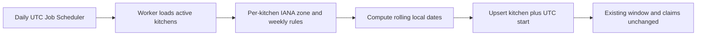

# Generate the rolling window horizon

The decision check should have separated generator retries from capacity changes. This chapter applies that distinction to a recurring job: a retry may fill missing dated rows, but it cannot reset a window that already holds or confirms kitchen work.

Umm Yousef sets a weekly lunch rule in her kitchen's IANA time zone. M14 turns that rule into dated `DeliveryWindow` records for a rolling horizon. Until now, a learner may have run the generator manually. A real diner should find tomorrow's windows without waiting for a developer command. This chapter schedules generation and adds a recovery scan, while preserving every existing paid or held promise.

Use BullMQ's current Job Scheduler API to upsert one recurring scheduler for the system, not one scheduler per kitchen. Let it run at a documented UTC time and call the M14 generator for the next seven local dates of each active kitchen. The generator uses the kitchen's named zone to map local windows to UTC `startAt` and `endAt`. A fixed numeric offset is insufficient because zone rules can change across daylight saving transitions. The scheduler clock chooses when to scan; the kitchen zone chooses which dated windows to create.

The diagram separates schedule wake-up, kitchen-local calculations and insert-only database writes. A repeated job must converge on the same dated rows.



The last box is the crucial condition. `$setOnInsert` can initialize status, cutoff, capacity and local labels on a new row. A repeat run must not `$set` `remainingUnits` on an existing row, because held and confirmed claims already consumed that counter.

## Upsert one scheduler identity

Create a setup function that calls `queue.upsertJobScheduler` with a stable ID such as `sufra-windows-daily`, a UTC cron pattern and a job template named `windows.generate`. Call it during deployment setup or worker startup in a controlled way. The upsert avoids adding duplicate recurring definitions when a process restarts. Avoid the older repeatable-job API from legacy lessons; current BullMQ documentation uses Job Schedulers.

```js
export async function registerWindowScheduler(queue) {
  return queue.upsertJobScheduler(
    'sufra-windows-daily',
    { pattern: '0 5 2 * * *', tz: 'UTC' },
    { name: 'windows.generate', data: { horizonDays: 7 },
      opts: { attempts: 3, backoff: { type: 'exponential', delay: 5_000 } } },
  );
}
```

Confirm the cron fields against the BullMQ version installed in the learner build and record the chosen UTC time. BullMQ can produce a job later than its nominal time if workers are busy. Therefore a job should calculate the desired horizon from the actual server instant when it runs, not from an assumed midnight carried in payload data. A manual recovery command can call the same generator without creating a second algorithm.

## Preserve generator idempotency

M14's unique index on `{ kitchenId: 1, startAt: 1 }` prevents duplicate dated windows for a kitchen and UTC start. M14 also defines a stable `sourceRuleKey`, `localDate`, `kitchenZoneAtGeneration`, `travelBufferMinutes`, cutoff and capacity for the inserted occurrence. The worker should call that existing service; it should not write a shorter second generator that forgets pause exceptions or cutoff calculations. If the kitchen rule was edited, the policy for existing future windows needs review. Do not overwrite a window with claims merely because a weekly template changed today.

When a rule is paused by M9's `ScheduleException`, the generator skips that local date or marks an unclaimed occurrence closed according to M14's policy. It cannot erase a paid order. When a cook changes the IANA zone, future unclaimed windows may need controlled regeneration, but already promised intervals keep their original UTC instants and `kitchenZoneAtGeneration` snapshot. The recurring job should surface such conflicts for review rather than reset counters or retime orders.

If the worker sees a duplicate-key error, it should reload the existing window and compare immutable identity fields. A duplicate row with the same kitchen and UTC start is an expected convergence case if two generator runs raced. A row with mismatched `endAt` or source rule signals a schedule conflict that needs an explicit policy. Do not hide that as a successful upsert. The goal is repeatability, not silent replacement of promises.

## Recover missed runs

Stop the worker before the daily schedule time, then restart after it. A scheduler may not create every missed daily job. Sufra should not rely on a backlog of missed ticks. On startup or through a periodic sweep, compute whether each active kitchen has its desired seven-day horizon and call the same idempotent generator for gaps. This scan is safe to repeat because the generator preserves existing rows and uses the unique key.

The scan should be bounded. It asks for the next seven local dates for each kitchen, not every historical date since the service launched. It should page through kitchens and record progress so a large marketplace does not monopolize the worker. A failed kitchen should not prevent the next kitchen from generating its windows. Log kitchen ID, local date, count inserted, count already present and conflict count, without printing private owner data.

No diner should be shown a window that has not been generated. The browse API in M15 reads dated windows, not weekly templates, and returns a clear empty state if none are available. That makes a missed generator run visible to monitoring. Alert when active kitchens unexpectedly have no future windows despite an active weekly rule, and run the recovery scan. Do not let browse invent a window on demand, because it would bypass the approved generator, exception and unique-index rules.

## Test the repeated run

Seed two active kitchens in different named zones, one paused local date and one existing future window with a held claim. Run the generator twice for the same horizon. Assert one row per kitchen and UTC start, unchanged `remainingUnits` and claim array on the existing row, and no row on the paused date. Change the test process's `TZ` and rerun; output UTC instants should stay the same because kitchen zones, not host-local time, drive conversion.

Stop the worker before a scheduled tick, restart later, and run the recovery scan. It should fill missing future dates without touching the held row. Record the scheduler identity, produced job IDs, generated window IDs and before-and-after claim states in `docs/jobs-decisions.md`. The next lesson applies a delayed job to unpaid claims, where an inaccurate or duplicate action would return cooking units to the public pool at the wrong time.

Test a rule edit that lands between two generator runs. The first run creates a 13:00 window with no claims; the cook then moves future lunch to 14:00. The second run can insert a new 14:00 row, but it must decide what to do with the old unclaimed 13:00 row through M14's controlled reconciliation. If the old row has a paid or held claim, it cannot be deleted or retimed. Record the conflict and preserve that promise. A blind upsert that only adds 14:00 would leave an unwanted 13:00 offer; a blind replacement could erase a purchase. The lesson's generator service must make this transition explicit.

Now test a zone rule change across the horizon. Use one kitchen with a named zone whose UTC offset differs between two local Mondays. Both windows can still show 13:00 to the cook, but their stored UTC starts differ. The recurring job must calculate each date from the zone rather than add exactly seven times 24 hours to a prior UTC instant. A host `TZ` change must not alter either result. Keep the old `kitchenZoneAtGeneration` on rows already published so support can explain why a past receipt showed that local label.

Save both dated examples for review.

References: [BullMQ Job Schedulers](https://docs.bullmq.io/guide/job-schedulers/), [BullMQ scheduler time zone options](https://docs.bullmq.io/guide/job-schedulers/repeat-options), [MongoDB unique indexes](https://www.mongodb.com/docs/manual/core/index-unique/).
