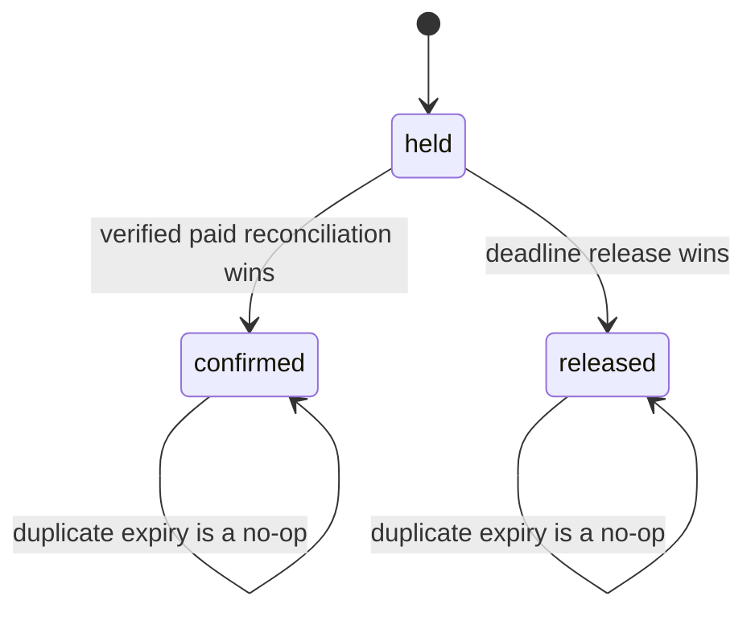

# Expire unpaid holds

Omar starts checkout for two kitchens and receives a PaymentIntent, then closes his browser without paying. The M19 claims still hold cooking units. They have a stored `expiresAt`; when that instant passes, Sufra needs to return units to the dated windows. A delayed BullMQ job can wake the worker, but the claim state and deadline in MongoDB decide whether release is allowed. A worker may run late, twice, or after Stripe's success event has already confirmed payment.

Schedule one job per claim with a stable identity such as `claim-expire:<claimId>`. Include `attemptId`, `windowId` and `claimId` in the small payload. Calculate the delay from the stored deadline and current server time; clamp negative delays to zero so an already overdue claim is checked promptly. Do not store the number of units in the job. The worker reads the embedded claim and uses its saved units if it transitions from `held` to `released`.

The state diagram shows the race. At the deadline, payment confirmation and expiry may compete, but a claim cannot be both confirmed and released.



The diagram describes one window claim. A two-kitchen attempt still needs M19/M20 reconciliation: if one group released while the other confirmed, do not expose a partial purchase. The payment path enters `refund_required` and compensates the retained group.

## Schedule from a durable deadline

When M19 creates a claim, write its `expiresAt` into the window and attempt. Persist an outbox entry for the delayed expiry job, ideally in the same controlled domain flow. An outbox publisher adds the BullMQ job. If Redis is down or the process stops before enqueue, a due-claim scan will still find the held claim later. The queue improves promptness; it is not the only reminder that capacity must return.

```js
export async function enqueueClaimExpiry(queue, claim, now) {
  const delay = Math.max(0, claim.expiresAt.getTime() - now.getTime());
  return queue.add('claims.expire', {
    attemptId: String(claim.attemptId),
    windowId: String(claim.windowId),
    claimId: String(claim.id),
  }, { delay, jobId: `claim-expire:${claim.id}`, attempts: 5,
    backoff: { type: 'exponential', delay: 2_000 } });
}
```

The code is a producer only. The worker must not assume a job fires at the exact millisecond; BullMQ delayed jobs can run later under load. If the job runs before `expiresAt` because of clock skew or a reschedule, it should leave the claim held and enqueue a new check for the remaining delay or rely on the scanner. Do not release early because the job arrived.

## Reuse the M19 release transition

The worker loads the attempt and expected window claim. It checks `state: held`, `expiresAt <= now` and that the attempt has not completed a paid publication. Then it calls M19's conditional release. The release update matches the exact claim ID and `held` state, sets it to `released`, and adds the claim's stored units to `remainingUnits` in the same window document update. If no row matches, reload. A confirmed claim or already released claim is a no-op. A missing or corrupt claim is an investigation error, not a reason to add guessed units.

```js
export async function expireClaim({ loadClaim, releaseHeldClaim, job, now }) {
  const claim = await loadClaim(job.windowId, job.claimId);
  if (!claim) throw new Error('CLAIM_NOT_FOUND');
  if (claim.state !== 'held') return { state: claim.state, changed: false };
  if (claim.expiresAt > now) return { state: 'held', changed: false };
  return releaseHeldClaim({ windowId: job.windowId, claimId: job.claimId });
}
```

This helper delegates the atomic update to M19 instead of implementing a second capacity formula. It also needs an attempt-state check in the service before release, but the final guard lives on the claim state in the conditional window update. A verified payment may race between the read and write. If confirmation changes the claim first, the release update matches nothing. If release wins, M20's success reconciliation cannot revive the claim and starts a refund path.

## Reconcile all groups for an attempt

Expiring one claim is not the whole attempt. An unpaid two-kitchen attempt may have two held claims with slightly different deadlines. Once a claim expires, move the attempt toward `aborting` or `expired` and release all remaining held groups according to the M19 compensation policy. Do not leave Kitchen B's units held for its later timer if the purchase is already impossible because Kitchen A released. The attempt state records whether compensation is complete and whether an intent still needs cancellation or late-success monitoring.

The worker must not mark the attempt fully expired merely because one release job returned success. It should verify all expected claim IDs are released or otherwise reconciled. If Kitchen B's database write fails, keep the attempt in `aborting`, retry from durable state and hide payment. If Stripe success has already been recorded, follow M20's paid or refund-required path instead. The job cannot infer payment truth from the absence of a browser callback.

Keep the claim state transitions small and conditional. A window's `remainingUnits` should never exceed its `capacityUnits`. If a release would do that, stop and investigate rather than silently cap the number; capping could hide a duplicate release bug. M26's reconciliation under load will compare capacity with held and confirmed claims. This module's tests should already assert the invariant for a single and two-kitchen expiry.

## Add a due-claim scan

A delayed job can be lost if it was never enqueued, and a worker can be down beyond its retry window. Add a bounded scanner that finds attempts with held claims past `expiresAt` and enqueues or directly calls the same idempotent expiry service. Use an index on relevant state and deadline fields, page through due attempts, and cap each scan's work. Do not rely on MongoDB TTL deletion: deleting the claim document would not add units back to its window, and TTL cleanup is not guaranteed to happen at the exact expiry instant.

Run the scan after worker startup and on a periodic schedule. If Redis is down, the scan may call the release service directly when MongoDB is available, provided it keeps the same state guards. Emit metrics for oldest overdue held claim and count of overdue attempts. An overdue hold is an operational defect even if no diner has complained; it can make a kitchen look full while nobody has paid.

## Prove the race and restart path

Seed a window with ten units, a three-unit held claim and seven remaining. Run expiry twice after its deadline. The first run returns to ten and marks `released`; the second changes nothing. Confirm the claim before the expiry job and run it; remaining stays seven and claim stays `confirmed`. Run expiry and confirmation concurrently at the boundary; accept only one of the two coherent outcomes, with M20 refund handling if release won after Stripe success.

For two kitchens, stop the worker after releasing A and restart. It must finish B and mark the attempt compensated without adding A's units twice. Stop the worker before the delayed job was ever added, then run the due scan and show the same final state. Save the claim IDs, deadlines, window counters, attempt state and job IDs in `docs/jobs-decisions.md`. The next lesson uses the queue for cook notifications, where a duplicate does not change capacity but can still confuse a person preparing lunch.

Add a test where the delayed job is waiting while an operator closes the kitchen for that date. Releasing an unpaid hold should still return its units to the window counter once; the window remains closed and does not reappear in browse. Capacity arithmetic and public availability are separate. A release helper that sets `status: open` as a convenience would undo the cook's pause. Likewise, if a window has reached its general cutoff, a release can restore the counter for reconciliation without making a late dish orderable. The browse API checks status and time again.

Record why MongoDB TTL is the wrong primary mechanism for this transition. TTL deletes documents later, without applying the paired increment to a different field in the dated window. The claim is also evidence for payment reconciliation, so deleting it too soon would make a late Stripe event harder to explain. Retain released and confirmed claim IDs under a bounded history policy and archive them when safe; do not let embedded arrays grow forever. M26 will measure that bound under load.

References: [BullMQ delayed jobs](https://docs.bullmq.io/guide/jobs/delayed), [BullMQ idempotent jobs](https://docs.bullmq.io/patterns/idempotent-jobs), [MongoDB TTL behavior](https://www.mongodb.com/docs/manual/core/index-ttl/).
