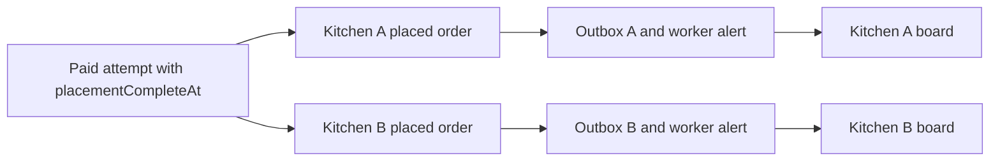

# Notify the cook after placement

Lina's verified payment has confirmed both kitchen claims and published both kitchen orders. Umm Yousef and Beit Hanan each need to learn about their own order quickly. Their notifications are separate because each cook has a different job and later acceptance deadline. Yet the alert must not lead either cook to a partial or unpaid purchase. M20's `placementCompleteAt` barrier is the trigger, and the kitchen board reads the paid order record as authority.

Create one durable outbox event per kitchen order with a key such as `notify-placed:<orderId>`. The event stores order ID, kitchen ID, attempt ID and type. An outbox publisher adds a BullMQ `orders.notifyPlaced` job with the same deterministic ID. The worker reloads the order and parent attempt, requires complete paid placement, verifies the order belongs to the named kitchen, and sends a small alert. It does not trust a copied dish list or phone number in Redis payload.

The diagram shows that the notification branches only after publication. There is one outbox row for each kitchen, but both depend on the shared attempt barrier.



The board is not populated from the alert. It queries its kitchen-scoped placed orders. If a message is delayed, the board still has the work. If an alert is delivered twice, the order is still one job with one identity.

## Check before sending

The worker receives `orderId` and `kitchenId`. It loads the order by both fields and loads the attempt by `attemptId`. Require `attempt.state: paid`, `placementCompleteAt` set, and `order.status: placed` or a later active status such as accepted. If the order was rejected or cancelled before the worker runs, skip the new-order alert. If the attempt entered refund-required due to a late-success conflict, there should never have been a placement event; the extra guard prevents a bad legacy row from notifying a cook.

The notification may say "New order for your 13:00 window" with a link to the kitchen board. Do not embed Lina's full address, another kitchen's items or Stripe details in an email or push payload. The cook sees details only after authenticated navigation to their own order. A public push service token or inbox preview may be visible on a locked device, so keep its copy minimal.

```js
export async function notifyPlaced({ loadOrder, loadAttempt, send, orderId, kitchenId }) {
  const order = await loadOrder({ orderId, kitchenId });
  if (!order) return { skipped: 'ORDER_NOT_FOUND' };
  const attempt = await loadAttempt(order.attemptId);
  if (!attempt || attempt.state !== 'paid' || !attempt.placementCompleteAt) {
    return { skipped: 'NOT_PUBLISHED' };
  }
  if (!['placed', 'accepted'].includes(order.status)) {
    return { skipped: 'NOT_ACTIVE' };
  }
  await send({ kitchenId, orderId, key: `notify-placed:${orderId}` });
  return { sent: true };
}
```

The example shows the state checks and stable provider key, but a real sender also needs a durable delivery record. A worker can crash after `send()` succeeds and before BullMQ marks the job complete. On retry, the same call may be made. If the provider supports idempotency keys, pass the stable key. If it does not, record send attempt and result and accept that an uncertain network outcome may cause a duplicate alert. Keep copy safe to receive twice and link to the one order. Do not say the product offers exactly-once messaging without provider support.

## Keep one cook's view scoped

The two kitchen orders share an attempt, but a cook may see only their kitchen's order. A worker running with service permissions must apply kitchen ID and order ID together when creating the alert. It must not send the combined cart receipt to both cooks. The diner can view the whole purchase; each cook sees only their own items, kitchen window, fulfilment details and relevant acceptance deadline. This is the same authorization split introduced in M19.

Add a test where an outbox row names Kitchen A but its order ID belongs to Kitchen B. The worker must skip and report an integrity error, not send Kitchen B's order to A. Add a test where the attempt is paid but `placementCompleteAt` is absent because the second order write is still pending. No alert is sent. A test that checks only `attempt.state: paid` would miss that half-published gap.

The outbox publisher should not mark an event delivered when it merely added a Redis job. Use separate states such as pending, queued and delivered. The notification worker records delivery result by `eventKey`; a provider error keeps the event retryable. Alert operations when placed orders have no successful notification after a service target, but do not roll back paid orders because of an alert outage. The kitchen board should display pending orders and support a manual refresh or polling fallback.

## Test shutdown and replay

Place two kitchen orders and record two outbox rows. Stop the worker; the API and webhook reconciliation still finish, and neither cook alert is sent yet. Restart the worker and show one alert for each kitchen. Replay the same job IDs and assert no additional delivery record or new order appears. If the fake provider returns an error for Kitchen B, Kitchen A's alert remains delivered while B retries. Neither retry changes claim state, order total or attempt state.

Stop a worker immediately after the fake provider records a send but before it acknowledges BullMQ. On restart, inspect whether the provider idempotency key collapses the retry or, if the fake provider lacks that feature, whether the course marks duplicate delivery as a known possibility. The one kitchen order remains the source of truth. A second alert must never create a second acceptance deadline or a second refund path.

Save the outbox keys, BullMQ job IDs, delivery records, order IDs and attempt publication marker in `docs/jobs-decisions.md`. The gate will ask you to demonstrate that checkout and the verified payment path return before worker logs, while a stopped worker can recover alerts and overdue holds from durable records.

There is a useful timing case when a cook already has the kitchen board open. The new placed order appears through the board's ordinary refresh or M23's later live stream, perhaps before its alert arrives. The notification should point to the same order ID and should not be the source that inserts a card into a separate client-side list. Otherwise the cook could see one order from polling and a second apparent order from push. Use the order ID as the stable UI identity and treat every alert as a prompt to refresh that record. The board can show `placedAt` and `acceptBy` from the order, not from the alert delivery time.

Add a failure case where the notification provider accepts a request but returns an ambiguous timeout. If it supports a stable idempotency key, retry with `notify-placed:<orderId>` and check that one provider message is recorded. If it does not, the worker may send twice. Do not suppress all retries merely to avoid a duplicate, because that would leave many cooks uninformed when the first send actually failed. Use calm copy that remains true on replay: "A new order is on your board" and a link to the specific order. Avoid "You have exactly one new order" if several were placed during the outage.

Record channel preferences on the kitchen account or notification settings, not in the BullMQ job payload. The worker loads the current approved channel and destination at send time. A cook can change a device token after placement; an old copied token may be invalid. If there is no valid channel, mark the delivery as skipped with a reason and keep the board order available. An invalid token should not roll back the paid purchase. A later product may support email, SMS and push, but the course gate can use a fake provider and one channel while preserving this separation of order truth from message transport.

The outbox's delivery state needs a clear transition as well. `pending` means MongoDB recorded the task; `queued` means Redis accepted it; `delivered` means the provider reported success or the fake provider logged the call; `failed_retryable` means it needs another attempt. Avoid a single `done` flag that cannot tell whether a message was merely queued or actually sent. Test a process stop at each boundary and show that the scanner or worker resumes from the last durable state. Retain enough result metadata to diagnose a missed alert without storing the entire diner order in the outbox.

References: [BullMQ job IDs](https://docs.bullmq.io/guide/jobs/job-ids), [BullMQ idempotent jobs](https://docs.bullmq.io/patterns/idempotent-jobs), [BullMQ worker guide](https://docs.bullmq.io/guide/workers).
