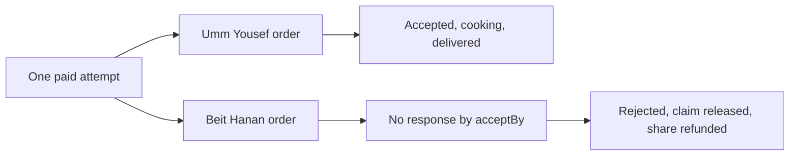

# The cook who never answered

Lina has paid for lunch from Umm Yousef and Beit Hanan. M20 placed two kitchen orders only after the full payment and both capacity claims were confirmed. Umm Yousef opens the kitchen board and accepts her order. Beit Hanan's cook is away and never answers. If Sufra shows both orders as "placed" until delivery time, Lina does not know that half her meal will not arrive. A paid order needs a clear acceptance deadline and a policy for silence.

Each kitchen order can progress independently after the shared payment. Umm Yousef may accept, cook and deliver while Beit Hanan's order is rejected and partially refunded. The parent attempt still records one original charge and both kitchen outcomes. This is why M19 created separate draft orders from one cart. The kitchen lifecycle acts on one scoped order; it does not rewrite the sibling order or charge the diner again.

The diagram shows the split after payment. One branch advances toward delivery while the other reaches a deadline and refund. The shared PaymentIntent remains one historical charge.

The silent branch is not a payment failure. Stripe collected the combined amount successfully. The later kitchen failure starts a partial refund for Beit Hanan's stored share. Lina's receipt must show both facts: the original payment and the return of one kitchen's allocation.

## Define a response window

When an order becomes `placed`, store `acceptBy` from a server policy tied to the order's dated delivery window. The policy should give the cook a bounded period to respond while leaving enough preparation time for the dish. A fixed thirty minutes after payment may be too late for a slow meal whose cutoff was already close. Calculate the deadline from `placedAt`, the earliest preparation need and the kitchen's delivery start, then choose the earlier safe bound. Record the policy version and resulting instant on the order so support can explain it later.

The kitchen works in Asia/Gaza local time, but the order must not store a local wall clock as its deadline. Convert the computed instant to UTC and keep that value as `acceptBy`. The board can render the same instant as Gaza time, while the deadline worker compares it against the server clock without guessing an offset. Palestine announces daylight saving dates each year, so a stored offset such as plus three hours would be wrong for part of the season. A worker that reads a UTC instant carries no such ambiguity, and the cook sees a time that matches the clock on the kitchen wall.

The per-dish cutoff and `acceptBy` answer different questions. A cutoff is the last moment a diner may order that dish for a given DeliveryWindow. `acceptBy` is the last moment the cook may answer an order that already exists. When Lina orders a hot dish five minutes before its cutoff, the kitchen has very little room left, so a flat thirty-minute window would already be too generous. Compute `acceptBy` from the delivery window start, subtract that dish's preparation time and a small buffer, then clamp the result so it never falls before `placedAt`. When the clamp activates, the board should mark the job as urgent instead of pretending a normal window exists.

M21 schedules a delayed acceptance job for that stored instant. The job reloads the order. If the cook already accepted, it does nothing. If the order remains `placed` at or after `acceptBy`, it transitions to `rejected` with reason `NO_RESPONSE`, releases the confirmed capacity claim under a controlled paid-cancellation transition, and creates M20's kitchen-share refund request. A worker can run late, but it must not change the deadline. The board and diner screen should show the stored `acceptBy` even if the background job is delayed.

The deadline is not a promise that the diner will always receive a meal. A cook may accept and later encounter a problem. The lifecycle still needs a controlled rejection or cancellation policy for that case, but it should record a distinct reason and whether cooking has begun. The core gate tests rejection before preparation. A later cancellation after cooking may have different compensation rules and needs explicit human review rather than silently using the same button.

## Give actions to the right actor

A cook may accept, begin cooking and mark ready only for a kitchen they own. A delivery worker or approved integration may mark out for delivery and delivered, depending on the product's delivery model. A diner can view the timeline and request support, but cannot set `delivered` by changing an API body. The system worker may reject an unanswered order at `acceptBy`. Each transition has an actor, from-state, to-state and timestamp. This prevents a generic status PATCH route from allowing arbitrary jumps.

Actor identity has to be proven, not declared. The cook sends an authenticated session token, and the server resolves that token to a user and then to the Kitchen that user belongs to. The order row already stores its kitchen ID, so the transition predicate compares the two values. If the token resolves to a different kitchen, the transition fails even when the request names the correct order ID. Write the actor type and actor ID onto the timeline event at the moment of the transition, because reconstructing them later from application logs is unreliable once tokens rotate or staff leave.

Use a monotonically increasing sequence number on the order timeline. When Umm Yousef moves from `placed` to `accepted`, append event 2 after event 1 `placed`. If her phone retries because a response was lost, the API should return the existing accepted state or a clear conflict, not append another event 2. M23's live tracking will use this sequence to discard duplicate stream events and catch up after a weak connection.

The timeline belongs to the kitchen order, not the parent payment attempt. The parent records payment and combined purchase state. If Beit Hanan rejects, its timeline includes `rejected` and refund status while Umm Yousef's timeline continues through cooking. Lina's combined view can place the two timelines beside each other, but it must not collapse them into one ambiguous status such as "order cooking" when half the cart has been declined.

## Reconcile capacity and money in order

When a cook rejects before cooking, Sufra should make that order non-actionable immediately. Then it releases that kitchen's confirmed capacity claim exactly once and creates a refund request for that order's immutable paid share. The refund may take longer than the order status change. Keep `refund_pending` and final `refunded` as money states alongside the order timeline rather than pretending a rejected order was never paid.

A confirmed CapacityClaim is the reason a rejection cannot be treated as a plain status write. That claim reserves units another diner could otherwise buy, and the units belong to one order at one DeliveryWindow. Releasing it writes to a second record, so the status transition and the release can succeed or fail independently. Give the release a deterministic idempotency key derived from the order and the claim, and record the release on the claim itself. A retried deadline job then finds the claim already released and returns the stored result instead of subtracting units twice.

The sibling kitchen's confirmed claim remains in place. Its order remains active, and no full-attempt refund is created. If both kitchens later reject, each share can be refunded, bounded by the original attempt total. M20's ledger and idempotency keys protect that arithmetic. The cook's rejection route does not accept a refund amount from the browser; it derives the amount from the order snapshot.

A delayed deadline job and a cook action may race at `acceptBy`. If the cook's `accepted` transition wins before the deadline check, the worker must skip. If the worker's `rejected` transition wins first, a late acceptance request returns a conflict and shows the current rejected state. Do not resolve the race by comparing phone timestamps. The server's conditional database transition decides who won, and the timeline records one next event.

## Trace the unanswered lunch

In `docs/order-lifecycle-decisions.md`, create two rows for a shared attempt. Record kitchen order IDs, claim IDs, `placedAt`, `acceptBy`, actor, transition, refund request and timeline sequence. Let Umm Yousef accept at 11:04, start cooking at 11:20 and mark ready at 12:50. Let Beit Hanan remain placed until its deadline. Run the deadline worker and show its rejected state, released units and pending 700-minor-unit refund. The parent receipt still shows the original 2500 charge and Umm Yousef's active 1800 share.

Then replay the deadline job and the cook acceptance request. Neither may add a second timeline event, return capacity twice or refund twice. Show the exact current state returned to the cook and diner. A plain 409 conflict is useful to the API client only if the response includes a safe current status and next action. The cook should understand that the acceptance window closed; Lina should see that one kitchen is still fulfilling her meal and the other share is being returned.

The next lesson makes the state machine explicit. Later lessons implement conditional transitions, the deadline job, the refund handoff and a board that offers only actions allowed from the current state. The gate requires both a normal accepted order and an ignored order, with separate kitchen-scoped evidence.
