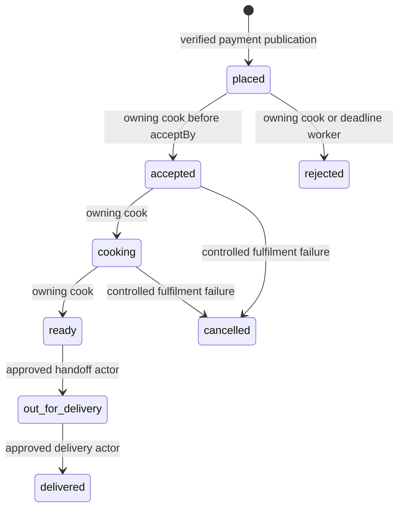

# The kitchen order state machine

A kitchen order is not one editable status string. It is a series of promises made by different actors. `placed` means payment and capacity are confirmed and the cook can see the job. `accepted` means the cook has committed to fulfil it. `cooking` and `ready` describe preparation. `out_for_delivery` and `delivered` describe handoff and completion. `rejected` and `cancelled` are terminal paths with capacity and money consequences. A route that accepts any target status from a cook's browser would let it skip the decisions between them.

Define one transition table before writing the API. For each edge, record allowed actor, source state, target state, required evidence and side effects. The diagram is the compact shape of that table. The actual implementation must enforce its edges, not merely draw them.

The direct `placed` to `rejected` path supports a cook who cannot take the job and the no-response deadline. The `accepted` or `cooking` to `cancelled` paths are exceptional and need reason, support visibility and a refund decision. They should not reuse a simple pre-cooking rejection button without considering already spent effort. No path returns from `delivered` to `cooking`, and no cook can move another kitchen's order.

An alternative design uses separate boolean columns such as `is_accepted` and `is_delivered`. It looks simpler on a small board and it avoids a lookup table. It also permits impossible combinations, for example `is_delivered` true while `is_accepted` is false, and every query then has to remember which combination is legal. One status column with a guarded transition becomes a constraint the database can hold, and it keeps the history honest: each timeline row matches exactly one edge of the table.

## Name who can move each edge

The owning cook may accept or reject an order while it is still `placed` and before `acceptBy`. The same cook may mark their accepted order `cooking` and then `ready`. The delivery handoff actor may be the cook if the product supports cook-managed delivery, or a separate service role. Choose one and record it in the project. For this Sufra build, the owning cook marks `out_for_delivery` when the meal leaves the kitchen, and an approved delivery confirmation endpoint marks `delivered` with an authenticated actor. Do not make `delivered` a generic cook PATCH merely because the UI has a button.

Whoever marks `delivered` needs an identity Sufra can defend later. The confirmation endpoint should accept a request only from the assigned courier or from a verified integration for that DeliveryWindow, and it should record which of the two answered. If the build has no courier role yet, an operator action with a reason is better than handing the cook a second button that quietly widens the meaning of the state. When a dispute reaches support, the question is always the same: who said the meal arrived, and what did they see when they said it.

The system worker may reject a still-placed order after `acceptBy`. It carries a reason `NO_RESPONSE` and uses the same conditional transition service as a cook rejection, with a different actor type. A diner may see the timeline and ask for help, but no diner route writes these kitchen states. Support actions, if added, must have their own audited actor and reason. The base lesson does not add an unauthenticated override endpoint.

An actor's permission is narrower than knowing an order ID. A cook token proves a user identity; the route must map that user to the kitchen that owns the order. The predicate includes both order ID and kitchen ID. A cook associated with another kitchen in the same parent purchase still cannot move this order. The parent attempt ID is for grouping and payment reconciliation, not a broad authorization grant to all sibling kitchens.

## Put preconditions beside status

An acceptance request needs `status: placed`, `now < acceptBy`, complete paid placement, and no active refund or cancellation process. A start-cooking request needs `status: accepted`. A ready request needs `status: cooking`. A delivery handoff needs `status: ready`. These checks belong to the server, not a disabled button alone. A stale board can show an Accept button after the deadline; the API must return a conflict and current state.

A precondition checked in application code before an update is not enough by itself. Two requests can both read `placed`, both pass the check, and both write. The transition must be a conditional update that includes the expected status and, ideally, the expected sequence in its `where` clause. The database then accepts exactly one writer and reports zero affected rows to the other. Treat zero affected rows as a conflict, reload the order and return the current state, and the late acceptance race disappears without any lock the learner has to debug on a weak connection.

Some actions need data as well as status. An out-for-delivery event can record a handoff instant and actor. A delivered event needs a completion proof appropriate to the service. For this course, use an authenticated delivery confirmation event and a server timestamp; do not store a client-supplied timestamp as the authority. If the product later needs a code or photo, it can extend that edge without changing the earlier states.

The timeline event should include `sequence`, `fromStatus`, `toStatus`, `actorType`, `actorId`, `occurredAt` and a safe reason code. A customer-facing explanation can be derived from the event. Do not embed private cook notes or sensitive delivery details in a public SSE payload. M23 will broadcast only the fields the diner may see, then allow the client to request a full authorized order view.

<TraceRequest title="A late acceptance race">
  <TraceStep actor="Cook" label="Accept a placed order" detail="Sends expected sequence before acceptBy" />
  <TraceStep actor="Deadline worker" label="Reject unanswered order" detail="Checks the same placed state at acceptBy" />
  <TraceStep actor="Database" label="Allow one conditional transition" detail="The loser reloads current status" />
  <TraceStep actor="Diner" label="See one next timeline event" detail="No duplicate refund or kitchen job" />
</TraceRequest>

The trace makes the time race concrete. If acceptance wins first, the deadline worker sees `accepted` and skips. If rejection wins first, the cook receives `rejected` and cannot begin cooking. Neither side chooses by phone time or by the order in which its HTTP request was sent. The database transition decides and the timeline sequence exposes that decision to the diner.

The deadline worker in that trace is a normal transition author, not a privileged updater. It calls the same conditional service, writes the same event fields and releases the CapacityClaim through the same paid-cancellation path as a person would. Only `actorType` differs. If the worker wrote the status directly, a rejection by a person and a rejection by a clock would leave different evidence behind, and the diner would be reading a timeline that explains one case while hiding the other.

## Keep payment states adjacent, not merged

`rejected` describes kitchen fulfilment. `refund_pending` describes money. They can coexist. Do not make one overloaded order status called `refund_pending` that hides whether a cook may still act. Store a fulfilment status and a separate refund state or linked refund request. The combined receipt can say "Beit Hanan could not take the order; refund in progress" while Umm Yousef is `cooking`. The original parent attempt remains paid until refund ledger entries reconcile the balance.

Capacity also has its own state. A confirmed claim is tied to a placed order. When a cook rejects before preparation, the cancellation service releases that claim once and returns its stored units. A delayed deadline retry must not increment units again. If an order is already cooking, a different cancellation policy may be needed; do not unconditionally return all capacity and pretend the kitchen never spent effort. This course records a controlled exceptional path with manual review unless the business policy defines more.

## Test the forbidden edges first

Write a table in `docs/order-lifecycle-decisions.md` with a valid and invalid edge from each status. From `placed`, acceptance and rejection are possible under their rules, but `ready` is not. From `accepted`, cooking is possible, but a second acceptance should not append another event. From `cooking`, ready is possible, but delivered is not. From `delivered`, no further operational edge is valid. Add an ownership column and make a second kitchen's cook fail every mutation on the first kitchen's order.

Then run the late acceptance race with an injected clock at `acceptBy`. Under the strict rule, acceptance at the exact deadline fails. The worker may reject at or after it. Make the worker run early and prove it skips; make it run late and prove the deadline recorded on the order did not move. Save the one winning timeline event and current sequence. The next lesson implements an atomic status-and-event transition so a status update cannot commit without its history.
