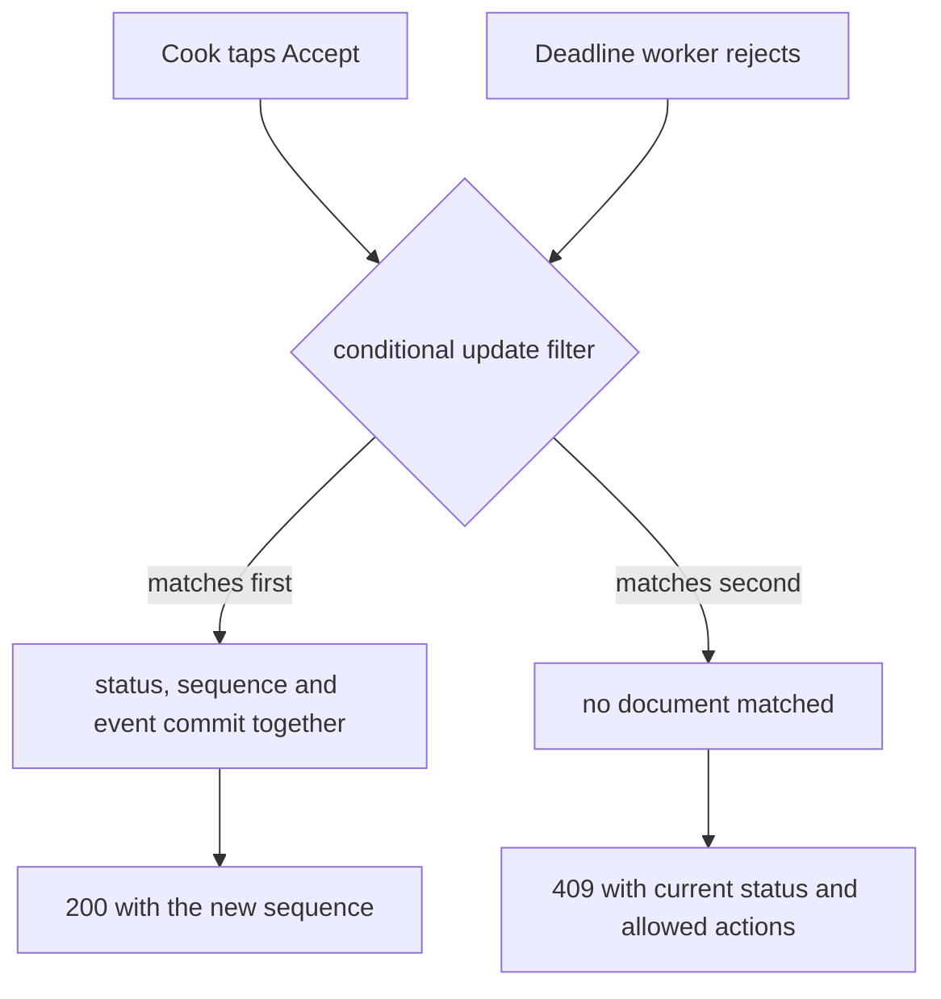

# Transitions with preconditions

The last lesson drew the allowed moves on paper. This one makes the database refuse every other move. The difference shows up at 11:00 on a Friday, when Umm Yousef has three orders on a phone with a cracked screen and one of them was already accepted from a second device. A route that trusts the button it was given will happily write `cooking` over `placed` and erase the acceptance decision that Lina is waiting to see.

Most of this chapter is about one write. A status change and the history entry that explains it must commit together, or neither commits. If they can drift apart, Sufra ends up with an order that says `ready` and a timeline whose last event says `accepted`, and nobody can tell when the meal actually started. MongoDB gives that pairing on one document, and only on one document. So the first decision is where the history lives.

## Ask for an action, not a status

A cook sends `{ "action": "accept" }`, and the server decides which edge that means: which source state, which target state, which actor. If the browser could send `{ "status": "delivered" }`, every rule in the transition table would become a client-side suggestion. The route signature below is the whole public surface for cook-driven moves.

```txt
POST /api/v1/cook/orders/:orderId/transitions
authorization: Bearer <cook access token>
body: { "action": "accept" | "reject" | "start_cooking" | "mark_ready" | "handoff",
        "expectedSeq": 1,
        "reason": "KITCHEN_FULL" }

200 { "orderId": "...", "status": "accepted", "sequence": 2, "allowedActions": ["start_cooking"],
      "serverNow": "2026-11-03T09:04:12.000Z" }
409 { "code": "STALE_STATE", "status": "rejected", "sequence": 2, "allowedActions": [],
      "message": "The acceptance window closed at 11:00." }
```

`reject` carries a reason code from a fixed list. The route ignores any other field, and it returns 400 if the body includes something like `refundAmountMinor`, because the refund is derived on the server from the order snapshot. `handoff` is the cook marking `out_for_delivery`. `delivered` is not in this list: M22.02 assigned that edge to the delivery confirmation endpoint, which has its own authenticated actor.

One shared module owns the table, and both the route and the kitchen board import it. The board needs it to decide which buttons to draw. The route needs it to decide what is legal. A second handwritten copy of the rules in the board component is how the two screens start disagreeing after a policy change.

```js
// server/src/modules/orders/transition-table.js
const COOK_EDGES = {
  accept:        { from: ['placed'], to: 'accepted' },
  reject:        { from: ['placed'], to: 'rejected' },
  start_cooking: { from: ['accepted'], to: 'cooking' },
  mark_ready:    { from: ['cooking'], to: 'ready' },
  handoff:       { from: ['ready'], to: 'out_for_delivery' },
};

export function resolveEdge({ actorType, action, fromStatus }) {
  if (actorType !== 'cook') return null;
  const edge = COOK_EDGES[action];
  if (!edge || !edge.from.includes(fromStatus)) return null;
  return edge;
}
```

The table is small on purpose. A generic `status` field with eight writable values would let one route accept anything from anywhere, and every new state would quietly become reachable from every old one. Naming the edges keeps the number of legal moves equal to the number of decisions the product actually made.

## Let the database decide the race

Two requests can arrive at the same order within the same millisecond: the cook taps Accept on a phone while the deadline worker decides the window has closed. Reading the order, checking the status in an `if`, and then writing is not enough. Both callers can pass the check before either writes. The only reliable decision point is the update filter, because the database serializes updates to one document.

So the filter carries every precondition that can be checked from stored fields: the order ID, the kitchen ID that owns it, the exact source status, and the sequence the caller last saw. For an acceptance it also carries the deadline, expressed as an instant comparison rather than a boolean argument. It carries the refund state too, so an order that has entered a refund path cannot be accepted or advanced while money is in flight.

The diagram shows two callers arriving at the same order and the single point where the race is settled. Notice that the losing branch never writes, so it cannot leave a status without an event.



Both callers are legitimate. The cook is trying to take the job and the worker is applying a deadline that has passed. The product does not need to rank them by importance or by request arrival time; it needs exactly one winner, and the filter gives that.

```js
// server/src/modules/orders/transition.js
export async function applyTransition({ Order, orderId, kitchenId, actor, action, expectedSeq, reasonCode, now }) {
  const current = await Order.findOne({ _id: orderId, kitchenId }, { status: 1, timelineSeq: 1, acceptBy: 1 }).lean();
  if (!current) return { ok: false, code: 'NOT_FOUND' };
  const resolved = resolveEdge({ actorType: actor.type, action, fromStatus: current.status });
  if (!resolved) return { ok: false, code: 'ILLEGAL_TRANSITION' };

  const filter = { _id: orderId, kitchenId, status: resolved.from, refundState: { $in: ['none', 'not_required'] } };
  if (Number.isInteger(expectedSeq)) filter.timelineSeq = expectedSeq;
  if (action === 'accept') filter.acceptBy = { $gt: now };

  const updated = await Order.findOneAndUpdate(filter, [
    { $set: {
        status: resolved.to,
        timelineSeq: { $add: ['$timelineSeq', 1] },
        timeline: { $concatArrays: ['$timeline', [{
          sequence: { $add: ['$timelineSeq', 1] },
          fromStatus: resolved.from,
          toStatus: resolved.to,
          action,
          actorType: actor.type,
          actorId: actor.id,
          reasonCode: action === 'reject' ? reasonCode : null,
          occurredAt: now,
        }]] },
    } },
  ], { returnDocument: 'after', projection: { status: 1, timelineSeq: 1, acceptBy: 1, 'timeline': { $slice: -1 } } });

  if (!updated) return { ok: false, code: 'STALE_STATE' };
  return { ok: true, order: updated };
}
```

The update is an aggregation pipeline, not a plain `$set`. That matters for the sequence number. All expressions inside one `$set` stage read the document as it was before the update, so `$timelineSeq` in both the counter and the new event refers to the same old value. The event gets `old + 1` and the counter becomes `old + 1`. A plain update with two operators cannot compute a value from another field, which is why a common bug appears here: reading the count in JavaScript, then writing `count + 1`, and writing two events with the same sequence under a retry.

The first read is a convenience, not the guard. It gives a useful error code and lets the caller see the current state, but the race is decided by the filter. If the read says `placed` and the deadline worker rejects the order a millisecond later, the conditional update matches nothing and this function returns `STALE_STATE`. That is the correct answer, not a failure.

## Give every event a sequence number

`timelineSeq` is a counter on the order, and `sequence` is copied onto each event. They should always agree with the array length, and the test helper asserts exactly that: `order.timelineSeq === order.timeline.length` for every seeded order. When they disagree, a write bypassed this function.

The sequence is not decoration. M23 will push the timeline to a diner's phone over a stream, and a phone that reconnects needs to drop events it already has and request the ones it missed. It can only do that with a number that increases by one per event and never repeats. It also gives the cook client a cheap way to say "I acted on the state I was looking at": send `expectedSeq`, and a stale second device cannot overwrite a newer decision.

A retried request after a lost response is the everyday case. Umm Yousef taps Accept, the request commits, and the response is lost in a tunnel. Her phone retries the same body. The second call reads `accepted`, resolves no edge from `accepted` to `accepted`, and returns 409 `STALE_STATE` with the current state and the current actions. The timeline still holds one accepted event. The board treats that 409 as "refresh and show reality", which is exactly the right behaviour for a cook who needs to know whether the meal is on.

## Answer with the current state

A 409 with an empty body is technically honest and practically useless. The cook needs to know what the order is now and what they can do next, and the diner's screen needs the same facts. So every conflict response includes the current status, the current sequence, the server time and the allowed actions from the shared table.

```js
// server/src/modules/orders/http.js
export async function postTransition(req, res) {
  const actor = { type: 'cook', id: req.user.id, kitchenId: req.kitchen.id };
  const result = await applyTransition({
    Order, orderId: req.params.orderId, kitchenId: req.kitchen.id, actor,
    action: req.body.action, expectedSeq: req.body.expectedSeq, now: clock.now(),
  });
  if (result.ok) return res.status(200).json(toView(result.order, clock.now()));
  if (result.code === 'NOT_FOUND') return res.status(403).json({ code: 'NOT_YOUR_KITCHEN' });
  const current = await loadOrderView(req.params.orderId, req.kitchen.id, clock.now());
  return res.status(409).json({ ...current, code: result.code });
}
```

Unknown order IDs return 403 rather than 404 on purpose. A cook who guesses an order ID that belongs to another kitchen should not learn whether it exists. The message says the same thing in both cases, and the support tool has the real record. The order was already scoped by kitchen ID in the filter, so a valid order for a different kitchen is indistinguishable from a missing one.

```quiz
type: mcq
id: sufra-lifecycle-q1
question: A stale board sends accept at 11:02 for an order whose stored acceptBy was 11:00. The order is still placed. What should the route return?
options:
  - A 200 and the accepted state
  - A 409 with the current state
  - A 500 and a support ticket
  - A 200 with a warning field only
correct: 1
explanations:
  - The stored deadline passed, so acceptance is not a valid move for this order.
  - The stored instant decides, and the cook needs the current state to choose the next action.
  - A server error hides a business rule that the client can handle.
  - A warning field does not change the fact that the order was never accepted.
```

## Test the losing side first

Write the refusal tests before the happy path. They are cheap, and they are the ones that catch a filter that quietly lost a condition.

```js
// server/test/orders/transition.test.js (failing first)
it('refuses acceptance at the exact deadline instant', async () => {
  const order = await seedPlacedOrder({ acceptBy: new Date('2026-11-03T09:00:00.000Z') });
  clock.freeze('2026-11-03T09:00:00.000Z');
  const res = await request(app).post(`/api/v1/cook/orders/${order.id}/transitions`)
    .set('authorization', cookToken.ummYousef).send({ action: 'accept', expectedSeq: 1 });
  assert.equal(res.status, 409);
  assert.equal(res.body.status, 'placed');
  assert.equal(await timelineCount(order.id), 1);
});
```

The boundary is strict. At the stored instant the cook is already too late, because the meal cannot start in time even if the request arrived with a millisecond to spare on the phone. Freeze the clock one second earlier and the same request returns 200 with sequence 2. Then run two accepts concurrently with the same `expectedSeq`, and assert one 200, one 409, and a timeline of length 2. Repeat with one accept and one system rejection, and assert the same shape, because the deadline worker uses the identical function with `actor.type: 'system'`.

Add one negative test per forbidden edge from M22.02: `mark_ready` from `placed`, `handoff` from `cooking`, any action from `delivered`, any action from `rejected`. Each should return 409 and leave the document byte-identical. Compare a hash of the order before and after to prove that a refused request wrote nothing at all, including no timestamp.

## A second kitchen's cook changes nothing

The filter includes `kitchenId`, and the actor's kitchen comes from the cook's kitchen record, never from the request body. Lina's two orders share one checkout attempt, so the tempting shortcut is to authorize by attempt ID and let any cook in that attempt act. Do not take it. Umm Yousef must fail every transition on Beit Hanan's order, and the test asserts the failure is a 403 with no timeline change on the sibling document.

The same rule applies to the delivery confirmation endpoint. It authenticates a delivery actor and checks that the order is in `out_for_delivery`, and its own test proves a cook token cannot call it. Adding a cook route for `delivered` because the board has a button would reopen the hole that M22.02 closed.

## What the atomic write buys and what it costs

The choice is one document holding the order, its frozen line snapshots and its bounded timeline. The benefit is that a single `findOneAndUpdate` gives status, history and sequence together, with no distributed transaction and no replica set requirement, which keeps local Docker simple. The cost is that the document grows with every event and MongoDB rewrites it on each change. With eight lifecycle edges plus a few support events, that is a few kilobytes, which is a fair trade for a meal that lives for a few hours.

The credible alternative is a separate `OrderEvent` collection written inside a multi-document transaction. It scales better if the timeline becomes long, for example if M23 adds a heartbeat event per minute. It also requires a replica set, which is why this course keeps it as a discussion. The switch condition is concrete: when the timeline stops being a bounded list of decisions and becomes a log, move the events out and keep a small status document. Until then, the pipeline update is the simpler correct thing.

Two smaller costs are worth naming. Every transition now needs the expected sequence, so older clients that omit it fall back to a status-only filter, which is weaker but still safe against illegal edges. And an admin fix that edits the order directly in Compass bypasses the history, which is why the gate requires the timeline and the counter to agree. A support action, if added later, must go through its own audited action name and actor type, not through a database console.

## Verify before the deadline exists

For this lesson, seed `acceptBy` by hand and prove four things: an accept before the stored instant succeeds with sequence 2, an accept at or after it returns 409, a duplicated request appends nothing, and another kitchen's cook gets 403. Save the order ID, the sequence before and after, and the two response bodies in `docs/order-lifecycle-decisions.md`.

The next lesson computes `acceptBy` from the kitchen's local rule and adds the job that fires when nothing happens. Until then the deadline field is a filter condition that no code fills, and silence still means an order sits in `placed` forever.
