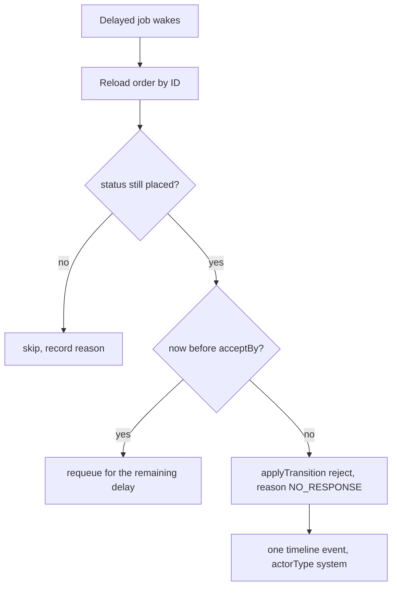

# The acceptance deadline

M20 placed two kitchen orders at 10:42 local time. Umm Yousef opened the board and accepted the maqluba. Beit Hanan's cook is away from the kitchen and never looks at the phone. Nothing in the code changes when the sweets could no longer be cooked in time, so Lina keeps a paid order that looks alive until delivery. A deadline that lives only in a policy document changes nothing. This lesson turns it into an instant on the order and a job that acts on it.

The instant has to come from the kitchen, not from a global constant. A home kitchen cooking maqluba needs to start much earlier than one assembling falafel wraps, and both are selling the same 13:00 delivery window. Thirty minutes after payment is generous for the second kitchen and useless for the first. So the deadline is computed once, when the order becomes `placed`, from three facts: when the order was placed, what preparation the dishes need, and when the kitchen's delivery window opens.

## Compute the instant from the kitchen's rule

The rule is a minimum of two bounds. The first bound is the latest moment the kitchen can still start and finish before the window opens: window start, minus the preparation lead, minus the travel buffer. The second bound is a cap on how long a cook may leave a paid order unanswered, so a slow dish in a late window does not give the cook six hours of silence. Whichever is earlier wins.

```js
// server/src/modules/orders/accept-deadline.js
export function acceptDeadline({ placedAt, windowStartAt, prepLeadMinutes, maxResponseMinutes }) {
  if (!(placedAt instanceof Date) || !(windowStartAt instanceof Date)) throw new Error('INVALID_INSTANT');
  if (!Number.isInteger(prepLeadMinutes) || prepLeadMinutes < 0) throw new Error('INVALID_PREP_LEAD');
  if (!Number.isInteger(maxResponseMinutes) || maxResponseMinutes < 1) throw new Error('INVALID_RESPONSE_CAP');

  const latestStart = windowStartAt.getTime() - prepLeadMinutes * 60_000;
  const responseCap = placedAt.getTime() + maxResponseMinutes * 60_000;
  const acceptBy = new Date(Math.min(latestStart, responseCap));
  return {
    acceptBy,
    rule: acceptBy.getTime() === latestStart ? 'PREP_LEAD' : 'RESPONSE_CAP',
  };
}
```

Both inputs are already UTC instants. `windowStartAt` was generated in M14 from the kitchen's weekly schedule and its IANA zone, so a window that reads 13:00 on the cook's phone is stored as 11:00Z on a November day in Gaza. The function never sees a local time string and never formats anything. That is the discipline that keeps this correct across a daylight saving change, when the same local label maps to a different instant.

`prepLeadMinutes` comes from the order lines that M19 froze at checkout. Use the largest `prepMinutesAtPurchase` among the lines plus the kitchen's travel buffer, because a batch for one window is started together and the longest dish sets the start. If a particular kitchen cannot batch its dishes, the fix belongs in the dish's preparation time, not in a second formula here. State that assumption in the decisions document so a reader can challenge it.

Two worked cases make the bounds concrete. A 13:00 window opens at 11:00Z. Maqluba takes 110 minutes and the buffer is 10, so the latest start is 09:00Z. Umm Yousef placed at 08:42Z and the response cap is 25 minutes, which gives 09:07Z. The earlier bound is 09:00Z, so the rule is `PREP_LEAD` and the cook has eighteen minutes. The falafel kitchen in the same window has a 20 minute dish, so its latest start is 10:30Z, and the same 08:42Z placement gives a cap of 09:07Z. There the rule is `RESPONSE_CAP` and the cook has 25 minutes. Same window, different deadlines, because the dishes differ. That is the whole point of computing rather than configuring one number.

There is an edge that the formula exposes and a naive implementation hides. If the payment webhook lands late, after the latest start has already passed, `acceptBy` falls in the past. Do not clamp it forward to give the cook a fresh window. The meal is already at risk, and a deadline that moves to make the system look reasonable is a promise Lina cannot plan around. Store the past instant, let the deadline job reject on its next run, and raise a metric so the team can see how often late payment placement happens. M26 handles the related payment and cutoff race.

## Store the rule beside the instant

An instant without its explanation is hard to defend in support. Add three fields to the kitchen order, written in the same update that moves it from `awaiting_payment` to `placed`:

```js
// server/src/modules/orders/order.schema.js (fields added in M22)
acceptBy: { type: Date, required: true },
acceptByRule: { type: String, enum: ['PREP_LEAD', 'RESPONSE_CAP'], required: true },
acceptPolicyVersion: { type: String, required: true }, // e.g. 'acc-2026-11'
```

`acceptBy` is a UTC instant. `acceptByRule` says which bound won, so a support agent can answer "why 11:00 and not 11:07" without rerunning the calculation. `acceptPolicyVersion` records which version of the response cap and buffer generated the number. Changing the cap next month must not rewrite the reason on an order placed today, and the version field is what stops that.

Add the compound index on `{ status: 1, acceptBy: 1 }`. It serves the recovery scan in the next section, and it also answers an operational question cheaply: how many paid orders are sitting in `placed` past their deadline right now. Without it, that query scans every order in the database, which is fine on a laptop and slow on a shared environment.

Do not store `acceptBy` as a formatted string, and do not store the kitchen's local wall time as the authority. A local string like `2026-11-03 11:00` is ambiguous twice a year and unorderable in a query. The formatted label belongs in the API response, built from the instant and the kitchen's zone at read time, so it is always consistent with the stored value.

## Schedule the delayed job

When M20 publishes the placed orders, enqueue one delayed job per order. The enqueue call lives next to the placement code so the order and the wake-up are created in the same domain flow, with an outbox row behind it in case Redis is unavailable.

```js
// server/src/jobs/orders/accept-deadline.js
export const ACCEPT_DEADLINE_JOB = 'orders.acceptDeadline';

export async function enqueueAcceptDeadline(queue, order, now) {
  const delay = Math.max(0, order.acceptBy.getTime() - now.getTime());
  return queue.add(ACCEPT_DEADLINE_JOB,
    { orderId: String(order.id), kitchenId: String(order.kitchenId) },
    { delay, jobId: `order-accept-deadline:${order.id}`, attempts: 8,
      backoff: { type: 'exponential', delay: 2_000 }, removeOnComplete: 1_000 });
}
```

The payload carries identities only, which is the same rule M21 set for the expiry and notification jobs. The worker reloads the order and reads its current status, deadline and policy version. A stale payload cannot resurrect a cancelled order or reject one that the cook already accepted.

The handler is small because the real decision lives in M22.03's transition function. The diagram shows the three outcomes the handler must reach, and the fact that none of them change the stored deadline.



The check order matters. Status comes first, because a job that runs for a delivered order should do nothing and say why. The clock check comes second, and when it says early the handler requeues rather than rejecting, because BullMQ delays are a scheduling hint and not a guarantee. Only after both checks does it call the shared transition with `actor.type: 'system'` and the reason code `NO_RESPONSE`.

## When the job runs early, late or after a restart

A delayed job can run a few seconds late under load, and that is acceptable. It can also run early after a clock adjustment or a manual requeue, and that is not acceptable if it rejects an order before its deadline. The handler's own clock comparison is the guard, and the conditional update in the transition is the second guard.

A worker can also be down for an hour during a power cut. Then every deadline in that hour is missed, and the diner is left looking at an order that should have been declined. Add a bounded scan that runs on worker startup and on a schedule: find orders with `status: 'placed'` and `acceptBy <= now`, page through them with a limit, and call the same handler. The scan is not a second implementation of the rule. It is the same service reached from a different wake-up.

Do not treat the queue and the scan as two authorities that might disagree. The order document is the only authority. If the job already rejected an order, the scan finds it in `rejected` and skips. If the scan rejected it first, the late job finds the same state and skips. Neither path may set a different rejection reason or append a second event, and the sequence number from M22.03 proves that neither did.

The deadline itself never moves. A job that runs two hours late still rejects with the stored `acceptBy` in the timeline and the actual `occurredAt` recorded separately. Lina should be able to see both: the moment the cook ran out of time, and the moment the system noticed. Hiding the second one to make the timeline look tidy is a small lie that costs trust when someone checks the times.

## Show the clock the server computed

The diner's tracking screen and the cook's board both display `acceptBy`, formatted in the kitchen's time zone with a short zone label. Neither screen decides whether the order is late. A phone whose clock is twelve minutes behind will show a countdown that is wrong, and a phone whose clock is ahead will show a deadline that has passed while the server still accepts. M18 already established the pattern: return `serverNow` with the payload and let the client compute an offset for the countdown, then re-fetch when the app returns to the foreground.

State the consequence plainly on the screens. Before the deadline, the cook sees "accept by 11:00" and the diner sees "waiting for the kitchen to confirm". After the deadline but before the job runs, both see the same deadline in the past and the honest label "waiting for the kitchen" without pretending it is fine. After the rejection, the diner sees the restaurant name, the reason in plain words, and the refund state that M22.05 adds. A countdown that reaches zero is not an event; only the stored status change is.

## A failing test at the boundary

Freeze the clock and test the three boundary positions before wiring the route. The suite uses M4's injectable clock, so nothing here depends on the machine's real time.

```js
// server/test/orders/accept-deadline.test.js (failing first)
it('rejects an unanswered order at the stored instant, not before', async () => {
  const order = await seedPlacedOrder({ status: 'placed',
    acceptBy: new Date('2026-11-03T09:00:00.000Z'), timelineSeq: 1 });
  clock.freeze('2026-11-03T08:59:59.000Z');
  assert.deepEqual(await handleAcceptDeadline({ orderId: order.id }, deps),
    { skipped: 'placed', requeuedInMs: 1000 });
  clock.freeze('2026-11-03T09:00:00.000Z');
  const result = await handleAcceptDeadline({ orderId: order.id }, deps);
  assert.equal(result.status, 'rejected');
  assert.equal(result.timelineSeq, 2);
  const event = await lastTimelineEvent(order.id);
  assert.equal(event.reasonCode, 'NO_RESPONSE');
  assert.equal(event.actorType, 'system');
});
```

Then accept the order one second before the instant and run the job at the instant; the job must skip with reason `accepted` and the timeline must stay at length 2. Seed an order whose `acceptBy` is already in the past and run the scanner; it must reject it with one event and leave the sibling order untouched. Run the job twice and compare the order hash before and after the second run.

The test above covers the order. Capacity and money are deliberately out of scope for this chapter, which is why the deadline job reads a feature flag that stays off in shared environments until M22.05 lands. Turning it on now would reject Lina's sweets and leave the claim confirmed and the 700 minor units unrefunded, which is a worse outcome than a late rejection. The next lesson attaches those two effects to the same rejection path and gives the flag a reason to be switched on.
