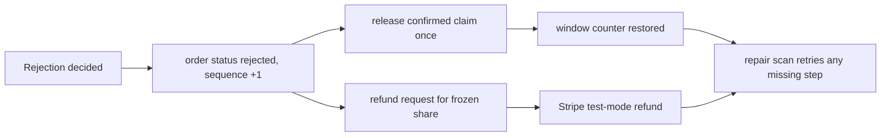

# Reject, release and refund

Beit Hanan's order reached its deadline at 09:00Z. The order now says `rejected`, which stops the cook from acting on it and tells Lina that half her lunch is not coming. Two other records still claim otherwise. The kitchen window still counts three confirmed load units as spent, and Stripe still holds 700 minor units that nobody will cook for. A rejection that changes only the status is a bookkeeping error with a real cost for one diner and one cook.

This lesson wires the three records behind a single service, so the cook's reject button and the system deadline job make the same three changes in the same order. The interesting work is not the happy path. It is deciding what the system does when it stops between two of the three steps, and how a retry can finish the job without releasing capacity twice or refunding twice.

## One service, three records

The service takes an order identity, the kitchen that owns it, an actor and a reason code. It derives everything else from stored state: the claim ID, the claimed units, the attempt, the PaymentIntent and the paid share. None of those may come from the request body, because the browser is the least trustworthy place for a number that moves money.

```js
// server/src/modules/orders/reject-order.js
export async function rejectOrder({ orderId, kitchenId, actor, reasonCode, now }, deps) {
  const order = await deps.Order.findOne({ _id: orderId, kitchenId }).lean();
  if (!order) return { ok: false, code: 'NOT_FOUND' };

  // Step 1: stop the order. The filter also blocks a second rejection.
  const transition = await deps.applyTransition({
    Order: deps.Order, orderId, kitchenId, actor,
    action: 'reject', expectedSeq: undefined, reasonCode, now,
  });
  if (!transition.ok && transition.code !== 'STALE_STATE') return transition;

  // Steps 2 and 3 read the rejected order, not the copy loaded before the write.
  const rejected = await deps.Order.findById(orderId).lean();
  if (rejected.status !== 'rejected') return { ok: false, code: 'REJECTION_NOT_APPLIED' };

  const release = await deps.releaseClaimForRejectedOrder({ Window: deps.Window, order: rejected });
  const refund = await deps.ensureRejectionRefund({ attempt: await deps.loadAttempt(order.attemptId), order: rejected });
  return { ok: true, status: 'rejected', release: release.status, refund: refund.status };
}
```

Step one is a conditional transition from `placed` to `rejected` using the M22.03 function. It writes the status, the sequence and the timeline event in one update. If it loses a race with the deadline worker, the order is already rejected and the service continues to steps two and three, because those effects may still be missing. That is why `STALE_STATE` is not returned as a failure here: the caller's intent was to reject, and the order is rejected.

## Stop the order before moving money

The order in which the three steps run is a real decision with a visible cost either way. Status first means the kitchen board stops offering actions within milliseconds, and the diner's screen shows the decline before any refund exists. The cost is a window, usually milliseconds and occasionally minutes, where a rejected order still holds capacity and no refund has been requested.

Refund first would mean money leaving the platform for an order that still looks live to the cook. A cook could then accept a meal that has already been paid back, and Lina could receive food she was refunded for. That failure is worse than a short-lived stale counter, because it cannot be repaired by a background scan: the food exists. Capacity and money can both be finished later from durable state, so they go last.

The repair scan is small. Find orders in `rejected` whose claim is still `confirmed`, and call the release step; find rejected orders whose attempt is paid and which have no rejection refund request, and create one. Both queries are indexed by status and attempt, both call the same functions as the route, and both are safe to run every minute. Write the scan in this lesson even if it never fires in your happy-path test, because the test that matters is the one where you kill the process between steps.

## Release exactly once, and only that claim

A rejected pre-cooking order returns its load units to the dated window. This is a counter update on one document, so it can be atomic and conditional. The filter names the exact claim, the order that owns it and the units that were confirmed at payment. The update changes the claim state and adds those units back in the same write.

```js
// server/src/modules/orders/release-for-rejection.js
export async function releaseClaimForRejectedOrder({ Window, order }) {
  const units = order.claimedUnitsAtPurchase;
  if (!Number.isSafeInteger(units) || units < 1) return { status: 'INVALID_ORDER_UNITS' };
  const result = await Window.updateOne(
    { _id: order.windowId,
      claims: { $elemMatch: { id: order.claimId, orderId: order.id, state: 'confirmed', units } } },
    { $set: { 'claims.$.state': 'released', 'claims.$.releasedReason': 'ORDER_REJECTED' },
      $inc: { remainingUnits: units } },
  );
  if (result.modifiedCount === 1) return { status: 'released', units };
  const current = await Window.findOne({ _id: order.windowId, 'claims.id': order.claimId }, { 'claims.$': 1 }).lean();
  return { status: current?.claims?.[0]?.state ?? 'MISSING_CLAIM', units: 0 };
}
```

Three details carry the safety. The `state: 'confirmed'` predicate stops a second release, because the first release already changed it. The `orderId` inside the same array element stops the function from releasing a different attempt's claim on the same window, which is possible when a diner retries a checkout for the same lunch window. The `units` comparison stops a release from adding an amount that no longer matches the order snapshot, which would happen if a bug wrote the wrong number at checkout.

The units come from the order, not from the request body. A cook cannot send `{ "units": 10 }` and hand themselves back a full window. The route does not read that field at all, and it returns 400 if the body carries a money or capacity field, so a client developer learns the mistake early instead of silently sending values that are ignored.

After the update, assert that `remainingUnits` does not exceed `capacityUnits` for that window. A breach means something was released twice or released more than it held, and the assertion should fail loudly instead of quietly capping the counter. M26's reconciliation checks the same equation across every window with claims, so the small test here is a preview of that work.

The released counter is now higher, and the window may look partially available again. That is fine and it is also not a licence to sell it. The date has passed its dish cutoffs, and M14's browse query checks status and cutoff before capacity. The counter is an accounting fact, not a promise. Do not add a convenience that reopens the window or clears its cutoff when units return, because that would undo the cook's schedule and offer a lunch that cannot be cooked.

## Turn the frozen share into one refund request

M20.07 already defined the refund draft from the order's immutable paid share. This chapter calls it and makes the request durable before any call to Stripe, so a stopped process leaves a record instead of an untraceable intent.

```js
// server/src/modules/orders/ensure-rejection-refund.js
export async function ensureRejectionRefund({ RefundRequest, attempt, order, enqueue }) {
  const orderId = String(order.id);
  const draft = rejectionRefundDraft({ attempt, order }); // from M20.07
  let request;
  try {
    request = await RefundRequest.create({ ...draft, kind: 'cook_rejection', state: 'requested', requestedAt: new Date() });
  } catch (err) {
    if (err.code !== 11000) throw err;
    request = await RefundRequest.findOne({ orderId, kind: 'cook_rejection' }).lean();
  }
  if (request.state !== 'succeeded') {
    await enqueue('refunds.request', { refundRequestId: String(request.id) },
      { jobId: `refund:cook-rejection:${orderId}:v1`, attempts: 8,
        backoff: { type: 'exponential', delay: 5_000 } });
  }
  return { status: request.state, amountMinor: request.amountMinor };
}
```

The unique index on `{ orderId, kind: 'cook_rejection' }` is the guarantee, and the duplicate-key catch is the recovery. A retried rejection finds the same request and enqueues the same job identity, so Stripe sees one idempotency key and one refund. The amount comes from `order.paidShareMinor`, which M19 froze at checkout. Changing the sweets price today does not change what Lina paid, and the refund keeps matching the charge.

Money and fulfilment stay on separate axes. The order is `rejected` immediately, with a timestamp and a reason. The refund request is `requested`, then `pending`, then `succeeded` or `failed`, and it can take minutes or a support conversation. Never encode the money state as an order status. A `refund_pending` order status would hide whether the cook can still act and whether capacity has been returned, and those are three different questions with three different answers.

The receipt is where the two axes meet for Lina. It should keep showing the original 2500 minor unit charge, then a refund line for Beit Hanan's 700, then the remaining 1800 paid for Umm Yousef's order, which continues its own timeline. The receipt must not say "order cancelled", because half of it is being cooked.



The diagram is worth reading twice. The two branches after the status change are independent, and the repair scan can start either one again from the rejected order. Neither branch reads the other, and neither can run twice because each is guarded by its own stored predicate.

## Reject twice, reject late, reject the wrong order

The tests for this chapter are mostly refusals and replays, and they take less time to write than the happy path.

Reject the same order twice with the same reason. The second call returns 200 with the current state, the timeline stays at length 2, `remainingUnits` increases once, and one refund request exists. Assert the Stripe stub was called once with 700 and the original PaymentIntent ID.

Reject an order that is `out_for_delivery`. The transition table has no such edge, so the route returns 409 with the current status. Do not let the cook reject a meal that is already on its way, because the resolution there is a support conversation with a different compensation policy.

Reject an order the cook does not own. The service's first query is scoped by `kitchenId`, so Beit Hanan's cook gets 403 on Umm Yousef's order and nothing changes. Then try the same with the correct kitchen but a `units` or `amountMinor` field in the body, and assert the field is rejected rather than applied.

Reject an order whose claim was already released by M21's hold expiry. That cannot happen for a paid order, because M20 confirms the claim at placement, but the test documents the expected conflict: the release step returns `released` without incrementing, and the refund still goes out. A paid order with a released claim is an integrity defect that the payment module already routes to a full refund, so assert the two paths do not both move money.

Finally, kill the process between step one and step two, then run the repair scan. The order stays `rejected`, the claim is released once, the refund request appears, and a second scan changes nothing. Save the before and after for `remainingUnits`, the claim state, the request state and the Stripe stub call count in `docs/order-lifecycle-decisions.md`.

## What this path deliberately does not cover

A cook who accepted and then discovered a broken stove is a different case. The order is already `accepted` or `cooking`, effort has been spent, and the compensation rules may involve a partial refund, a replacement or a human decision. This chapter's route only moves `placed` to `rejected`. M22.02 defined a controlled cancellation edge for the later states, and the course keeps that path behind support review with its own reason code and its own audit actor. Reusing the pre-cooking button there would refund a meal that was partly cooked and return capacity that was genuinely consumed.

Refund failures are also out of scope for automation. If Stripe rejects the refund because the charge was already fully refunded, or because the intent is disputed, the request moves to `failed` with the provider's error code, the diner still sees a truthful "refund needs attention" state, and support resolves it. The ledger in M20 keeps the attempt's refundable balance so that a second rejection cannot over-refund the charge.

With the service in place, the cook still needs a way to reach it on a phone, in the right order, for the right window. The next lesson builds the kitchen board.
