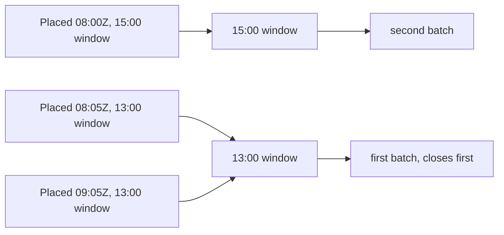

# The kitchen board

At 10:50 on a Friday, Umm Yousef has four orders in the 13:00 window and one in the 15:00 window. Two of the lunch orders are still unanswered, one is accepted and needs to start cooking now, and one diner added a note about a nut allergy that has to be read before anything else happens. A screen that lists orders by arrival time with a coloured status badge gives her none of that. She has to open each card, read the time, and work out the order of decisions in her head while a pot is on the stove.

The board is the cook's working surface, and its job is to answer three questions in the order a kitchen asks them: which window do I cook next, which orders in it need a decision, and how long do I have. Everything else on the screen is secondary. This lesson builds one small endpoint and one screen around those questions, using the transition table from M22.03 and the deadline from M22.04.

## Group by the window, not by arrival

The board's unit is the delivery window, because that is the unit the kitchen cooks in. A cook preparing for 13:00 fills trays once and portions them across several orders. Two orders placed an hour apart belong to the same batch, and two orders placed ten minutes apart can belong to different windows when one is for 13:00 and the other for 15:00. Sorting by `placedAt` mixes those together and hides the fact that the 13:00 window closes first.

The query starts from the kitchen's local day, not from the browser's. Read `kitchen.timeZone`, which is an IANA name such as `Asia/Gaza`, convert the requested date into a start and end UTC instant in that zone, and then find windows whose `startAt` falls between them. The date parameter is a convenience for navigating to tomorrow; it is not an authority for the zone. If a cook opens the board from a phone set to Istanbul time while the kitchen is in Gaza, the day boundaries and the labels still come from the kitchen.

```txt
GET /api/v1/cook/board?date=2026-11-03
authorization: Bearer <cook access token>

200 {
  "kitchenId": "...",
  "timeZone": "Asia/Gaza",
  "date": "2026-11-03",
  "serverNow": "2026-11-03T08:50:04.000Z",
  "generatedAt": "2026-11-03T08:50:04.000Z",
  "windows": [
    { "windowId": "...", "startAt": "2026-11-03T11:00:00.000Z", "endAt": "2026-11-03T12:00:00.000Z",
      "localLabel": "Today, 13:00 to 14:00", "cutoffAt": "2026-11-03T09:10:00.000Z",
      "capacityUnits": 10, "remainingUnits": 4, "loadUnits": 6,
      "orders": [
        { "orderId": "...", "status": "placed", "acceptBy": "2026-11-03T09:00:00.000Z",
          "acceptByLabel": "by 11:00", "placedAt": "2026-11-03T08:42:10.000Z",
          "lines": [{ "dishName": "Maqluba, chicken", "quantity": 2 }],
          "allowedActions": ["accept", "reject"] }
      ] }
  ]
}
```

The interface below is the contract the screen codes against. Keep it flat and small, because it crosses a mobile connection that may cost the learner real money per megabyte.

```js
// server/src/modules/orders/board.js
/**
 * @typedef {Object} BoardOrder
 * @property {string} orderId
 * @property {'placed'|'accepted'|'cooking'|'ready'|'out_for_delivery'|'delivered'|'rejected'|'cancelled'} status
 * @property {string|null} acceptBy      UTC instant, null when the order is past acceptance
 * @property {string|null} acceptByLabel short label already formatted in kitchen.timeZone
 * @property {string} placedAt
 * @property {{ dishName: string, quantity: number }[]} lines
 * @property {string[]} allowedActions   derived on the server from the shared table
 */

/**
 * @typedef {Object} BoardWindow
 * @property {string} windowId
 * @property {string} startAt
 * @property {string} endAt
 * @property {string} localLabel
 * @property {string} cutoffAt
 * @property {number} capacityUnits
 * @property {number} remainingUnits
 * @property {number} loadUnits
 * @property {BoardOrder[]} orders
 */
```

`loadUnits` is the sum of the confirmed and held units for that window, which is the number a cook actually thinks in: how much cooking is promised in this batch. `remainingUnits` is the counter from M19. Showing both is honest, and it lets a cook see that a window is busy without reading every card.

The diagram shows why arrival order is the wrong sort key. The earliest order of the day belongs to the later window, and two orders placed an hour apart belong to the same batch.



Sorted by `placedAt`, the cook would read the 15:00 order first, while the 13:00 batch is the one that has to be cooked now. Grouping by window inverts that and puts the urgent work at the top.

One request per day keeps the payload near a few kilobytes for a normal kitchen. Do not include dish photos, full addresses or the diner's phone number in the board payload. The cook needs the order, the quantity, the note and the deadline. Contact details belong to a separate authorized request that happens when the cook taps the card, and even then only after the order is accepted.

## Give the cook one clock per group

Each order carries `acceptBy`, and the window carries its own start and cutoff. The cook needs all three, because they answer different questions: how long do I have to answer, when must cooking start, and when does this window stop taking orders. The board presents them as short labels in the kitchen's zone, computed by the server so every client shows the same thing.

The countdown is computed on the client from `serverNow`, not from the phone's clock. The pattern is the same one M18 used for the cart: store the offset between `serverNow` and the device clock when the response arrives, and count down against that offset. A phone that is twelve minutes slow then still shows the correct time remaining, and a phone that is fast does not show a deadline that has already passed.

Re-fetch on focus, on a manual pull, and when the app returns from the background. A cook's phone spends most of its day in a pocket with the screen off, and a board that was loaded forty minutes ago is a liability. Freshening on focus costs one small request and removes the most common cause of a stale tap.

## Derive the buttons from the transition table

The screen does not decide which buttons to draw. The endpoint returns `allowedActions`, computed from the same table M22.03 uses for enforcement, with the current instant and the order's stored deadline applied. The board therefore shows `accept` and `reject` only while the order is `placed` and before `acceptBy`, shows `start_cooking` on an `accepted` order, and shows nothing on a `delivered` or `rejected` one.

```js
// server/src/modules/orders/board.js (excerpt)
import { COOK_EDGES } from './transition-table.js';

export function boardActions({ status, acceptBy }, { now, actorType }) {
  const actions = Object.entries(COOK_EDGES)
    .filter(([, edge]) => actorType === 'cook' && edge.from.includes(status))
    .map(([action]) => action);
  if (status === 'placed' && acceptBy !== null && acceptBy <= now) return actions.filter((a) => a !== 'accept');
  return actions;
}
```

The second check is the interesting one. The table says `accept` is legal from `placed`; the deadline says it is not legal any more. The board and the route have to agree on both conditions, which is why this logic lives in one function that both import. When the two disagree, the cook taps a button that returns 409, and the board's answer was wrong even though the server was right.

```js
// server/test/orders/board.test.js (failing first)
it('withdraws the accept action at the stored deadline', async () => {
  clock.freeze('2026-11-03T09:00:00.000Z');
  const board = await loadBoard({ kitchenId, date: '2026-11-03', now: clock.now() });
  const card = board.windows[0].orders.find((o) => o.orderId === placedOrder.id);
  assert.deepEqual(card.allowedActions, ['reject']);
});
```

Run the same test at 08:59:59Z and expect `['accept', 'reject']`. Then run it for a cooking order and expect `['mark_ready']`, and for a delivered order and expect an empty list. A board that offers an action the route will refuse is a bug in the board, even though the route is the one that protects the data.

## Handle a stale tap honestly

Two everyday situations make a stale tap likely: a weak connection that delays the response, and a second device that acted first. Both end with the server returning 409 and the current state, and the board's response to that is the difference between a confused cook and a calm one.

When the cook taps, disable that card's buttons and keep the rest of the board usable. Send the action with the `expectedSeq` the card was rendered from. On 200, replace the card with the returned status and actions. On 409, replace the card with the returned current state, show one short sentence explaining what happened, and drop the action that is no longer available. Do not show an optimistic `accepted` badge before the response, because the badge is the promise the cook is making to a diner.

The message should be specific. "The acceptance window closed at 11:00" is useful. "Conflict" is not, and neither is a generic "something went wrong". If the order was rejected by the deadline job while the cook was deciding, the card should say so plainly and offer no actions, so the cook stops treating it as work to do.

## Keep it usable on a cheap phone and a weak connection

The board is a text screen with large tap targets. Group headers are sticky, so the cook can see which window they are scrolling through. Each card shows the dish name and quantity, the deadline, and one primary action, with the rest behind a small menu. Images of dishes are absent on purpose: they cost data and add nothing at 10:50 when the cook already knows the menu.

Serve the last successful board from local storage with its `generatedAt` timestamp, and show a clear banner when it is more than a couple of minutes old. While the app is offline, keep the actions visible but refuse to send them, because a queued tap from twenty minutes ago may now be illegal. A disabled button with "reconnecting" is more honest than a button that will fail after the cook has moved on to another order.

Do not poll aggressively. A refresh on focus and a manual pull is enough for this module, and M23 adds a server push for the diner side. A board that polls every five seconds on a metered connection spends the diner's money on nothing.

## Scope the board to one kitchen

The board route authenticates a cook and resolves the kitchen from that cook's ownership record. It never accepts a `kitchenId` from the query string, because a cook who manages two kitchens still needs an explicit context switch, and a cook who manages one should not be able to read another by guessing an ID. A diner token gets 403. A cook for a different kitchen gets 403, and their board shows only their own orders even when the parent attempt contains a sibling order.

A paused kitchen still shows its placed and accepted orders. M9's pause stops new orders for future windows; it must not hide the work already promised. The board can show a banner that the kitchen is paused so the cook remembers why new orders stopped arriving, but the existing cards stay until they are finished or rejected.

## What the board is not

It is not a status editor, so there is no dropdown of eight statuses and no free-text reason field. It is not a delivery proof, so the `delivered` transition is not on the cook's card. It is not a refund console, so a rejected card shows the refund state as text and offers no button to change the amount. And it is not live yet: this board is a snapshot with a manual refresh, and the diner's tracking screen in M23 will be the first surface that receives pushed updates.

Those four exclusions are cheap to violate and expensive to unwind. Each one adds a way for a client to claim a state the server has not decided, and each one would reopen work that M22.02 and M22.03 closed. The gate will check the visible surface against the transition table.

## Verify the board before the gate

Check four things with a seeded kitchen in `Asia/Gaza` and a phone set to a different zone. First, the day boundaries follow the kitchen's zone: a board for 2026-11-03 includes the 13:00 local window and excludes a window that starts at 00:30 local on 2026-11-04. Second, the grouping puts two orders from the same window under one header even when they were placed an hour apart. Third, a placed order past `acceptBy` has no accept action, and a delivered order has none at all. Fourth, another kitchen's cook gets 403 and never sees the order ID.

Then break the client on purpose: hold the Accept request open, tap twice, and let the second request arrive after the deadline job has rejected the order. The card must end in `rejected` with a sentence that says the window closed, not `accepted`, and the timeline must hold one event. Save the board payload, the two responses and the final order state in `docs/order-lifecycle-decisions.md`. The gate asks for one accepted order and one ignored order from the same paid attempt, and this board is where both are recorded.
